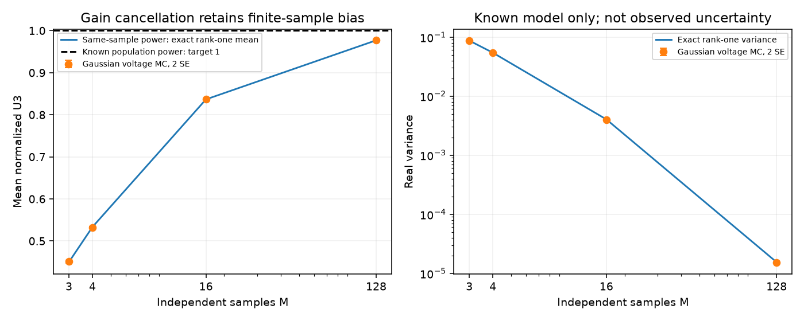

# 段階085：観測powerで正規化した三次統計の基礎

- 作成日：2026-10-17
- 状態：完了
- 比較元コミット：6cfade2

## 読者向け概要

局ごとの増幅率が分からないとき、三局の電圧の積から作るU₃を、同じ記録から測った三局のpowerで割る方法を考えます。powerは電圧の絶対値の二乗の平均です。この割り算で一定の局gainを相殺できても、割る値にもばらつきがあるので、元のU₃の平均が正しいという性質をそのまま引き継ぐとは限りません。形状の評価へ進む前に、その違いを確認します。

## 1. 目的・対象範囲

共通の有限電圧標本からpower正規化したU₃を計算するCPU参照APIと、完全共有の独立proper Gaussian電圧という限定モデルの平均・分散を実装する。一定非零局gainへの不変性、有限標本の偏り、既知母powerによる正規化との違いを確認する。

## 2. 完了条件

直接列挙・解析組合せ・入力拒否・gain変換・数値scale・既知モデル反復を照合し、ソースと導入済みの全回帰、checkout外APIを確認する。レポート・規約・索引・公開監査・匿名コミット・pushを完了する。

## 3. 実際に行った作業

電圧を各局・各windowの同じ標本のRMSで割り、その電圧に既存の異標本U₃を適用するAPIを追加した。分子と分母を別々に巨大な値へしてから割らず、実部・虚部の最大成分でscaleを整える。zero power・非有限値・masked入力は拒否する。全局で共通の標本集合は呼出側の前提であり、このAPIから時刻整列を検証したことにはならない。

完全共有Gaussian電圧のrank-one極限に限って、正規化したpowerのDirichlet積分から平均と二次モーメントを導出した。分散は有理数のまま差を取り、数値桁落ちを避ける。この式で一般天体を補正する入口は作っていない。

既存のU₃・相関器・RML・GUIの計算は変更していない。有限比のgain不変性は示したが、推定gain・物理ADC・未知LO・低SNR尤度や形状判断を実装した結果ではない。

変更：`apps/simulator/src/vsora_simulator/bispectrum_observed_power.py`、対応する二つの試験ファイル、`workflows/bispectrum_observed_power_validation.py`、`tools/verify_observed_power_installed.py`、[規約](../../interfaces/observed-power-bispectrum.md)、規約索引、[Closureガイド](../guide/07-closure-rml.md)、本レポート・段階索引・公開検証記録。

## 4. 検証条件・結果

### 対象試験

最終62件が0.58秒で合格した。小さい標本の順序付き三つ組を直接列挙し、powerで割った値を照合した。rank-one式は、もう片側の三つ組の番号を独立に列挙したDirichlet積分でも確認した。入力を変更しないこと、任意の一定複素gain、ensemble軸、選択三角形、極端なscale、無効入力を検証した。

初回は44件中43成功・1失敗だった。一括と個別の浮動小数点reductionに最大約6.94×10⁻¹⁸の差があり、完全一致を要求した試験が失敗した。その比較に相対2×10⁻¹³・絶対2×10⁻¹⁴の許容差を明記した。科学式・反復の判定基準は変更せず、元の入力を変更しない検査は完全一致を維持した。初回を合格数へ混ぜていない。

### 既知電圧の反復実験

4局、9条件それぞれ32,768反復、seed85〜93、BLAS/OpenMP各1スレッド。rank-oneはM=3/4/16/128、独立局雑音だけのnullはM=3/16/128、信号を含む二つの一般SはM=16。元の母powerを与える比較と、同じ観測標本powerで割る比較に同一電圧を使った。時間・周波数・実装置の単位へは換算していない。

| rank-one標本数M | 理論平均 | 観測powerによる反復平均・実部（最初の三角形） | 理論分散・実部 |
|---|---|---|---|
| 3 | 0.450000000 | 0.451153838 | 0.0867857143 |
| 4 | 0.533333333 | 0.532020656 | 0.0541798942 |
| 16 | 0.836601307 | 0.836989520 | 0.00402950952 |
| 128 | 0.976982707 | 0.976994153 | 1.54134402e-05 |

rank-oneの全三角形で、平均と真の平均を中心とする二次モーメントが固定6 MC SE条件内だった。MC SEは独立反復からの標準誤差であり、未知観測の誤差ではない。nullの平均0、母powerで正規化した元U₃の平均も同じ固定条件で照合した。一般Sの観測power比の平均と母平均との差は報告値として保存し、不偏という合格条件を課していない。

一定gainで変換したときの最大差は5.77526e-15。区間中に位相が変わる場合は、相殺しない例を対象試験で確認した。通常のpower正規化三基線積はrank-oneで1だが、正規化U₃の平均は1と異なる。どちらかが一般天体で正しいという結論ではない。

初回実験5.26秒・最大RSS81,864KiB、正式再実行4.97秒・82,024KiB。全科学JSONが完全一致した。API照合データ作成の初回補助処理はpackageフォルダをimport pathへ入れて失敗し、親のsrcを指定して修正した。データ作成前の失敗であり、科学実験・試験基準は変えていない。

[全科学結果](../../validation/runs/stage085/known-observed-power.json)、[API照合入力と期待値](../../validation/runs/stage085/api-golden.json)を保存した。



### 導入と全回帰

| 確認 | 実測結果 |
|---|---|
| ソース全回帰 | 1258件合格、25,596警告、560.95秒 |
| 導入済み全回帰 | 1258件合格、25,596警告、545.23秒 |
| checkout外API | 全/選択三角形・極端scaleの3入力、rank-one5標本数の全結果がsource fixtureと完全一致 |
| module実行元 | 新API・既存U₃・visibility momentが導入prefixにあることを確認 |
| 配布ファイル | 81件がsourceとバイト一致 |
| 依存関係 | pip check成功 |

全回帰除外0件。Python3.12.3、NumPy2.5.1、SciPy1.18.0、pytest8.4.2。既存依存ソフトの非推奨警告を含む。GUIの実Chromium操作はこの段階で再実行していない。wheelは5,531,572bytes、SHA-256 `25e168ca86b945503b1fb50a0449dff44bc5130bde2aaa04fc44800676f68272`。

[正式記録](../../validation/runs/stage085/verification.json)、[導入API](../../validation/runs/stage085/installed-api.json)。ログ・wheelはGit管理外 `outputs/stage085-source-final/`、`outputs/stage085-installed-final/` 等に保存した。図のmetadataはMatplotlibのSoftwareとDPIのみ。

```bash
OPENBLAS_NUM_THREADS=1 OMP_NUM_THREADS=1 \
 .verification-venv/bin/python tools/run.py workflows.bispectrum_observed_power_validation \
 --output outputs/stage085-reproduction
```

Dirichletの密度と正規化定数は[SciPy公式文書](https://docs.scipy.org/doc/scipy/reference/generated/scipy.stats.dirichlet.html)を参照した。今回のU₃の比の式は、その積分と組合せから導出・照合したものである。

## 5. 制約・未解決事項

共通標本・区間内一定gainを仮定する。実FFTの独立性、未知LO、位相の不偏性、低SNRの尤度・形状識別、RMLの重み、実機は未検証。本段階のrank-one式を一般天体へ補正係数として使わない。

## 6. 次段階

有限電圧の形状比較で、この正規化によるgain相殺と未知の分布を区別し、独立した条件設定・評価試行で検証する。
