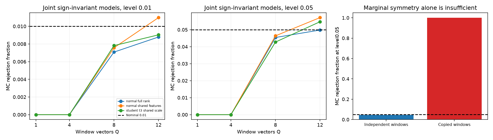

# 段階086：window全体の符号反転による条件付き対称性の検定

- 作成日：2026-10-17
- 状態：完了
- 比較元コミット：dfc87da

## 読者向け概要

複数の短い区間で得たベクトルが、正負どちらにも同じように現れるモデルと整合するかを調べます。一区間の全成分を一緒に正負反転し、全部の組合せと実際の平均を比べます。三角形同士に相関があっても同じ区間をまとめて反転すれば保てます。ただし、区間ごとの対称性だけでなく、区間別に反転した同時分布が同じという仮定が必要です。仮定を満たさない相関区間の反例も確認します。

## 1. 目的・対象範囲

Q1〜12区間・D1〜56成分の実ベクトルへ、全2^Q符号反転の上側比率を返すCPU参照APIを追加する。固定整数・有理数での列挙と既知対称ベクトルの反復で確認する。科学上の目的は、後で正規化U₃の虚部等を扱うための基礎を作ることである。本段階では電圧・FFT・VDIF・天体画像を生成しない。

## 2. 完了条件

群の全列挙と条件付き誤棄却率の上限、tie・丸め・scale・零入力・無効入力を照合する。正常12条件と意図的な区間相関1条件、各4,096反復の結果を保存する。source全回帰、wheel・checkout外API/単独CLI・導入済み全回帰を確認し、レポート・索引・公開監査・匿名commit/pushを行う。

## 3. 実際に行った作業

imaging側へ全window符号反転の参照APIを追加した。最大12window、56成分で全2^Q通りを数え、一つのwindowの全成分を一緒に反転する。全体の最大絶対成分でscaleを整え、平均ベクトルの二乗normの上側比率を返す。Gaussianのσ・真のSEFD・観測powerの理論momentは使わない。

浮動小数の近接tieを保守的に含める比較値は、全群最大統計量×float64 eps×4096に固定した。零入力・同一統計量はp=1、全体符号の重複を含む全群を列挙する。数値用scaleは観測雑音のσではない。

既知の実ベクトル実験をsimulatorの同梱moduleへ置き、checkoutのworkflowは互換入口にした。独立CLIはリポジトリのrunnerを必要としない。GUI・相関器・RMLの式は変更していない。

変更：`apps/imaging/src/vsora_imaging/window_symmetry.py`と試験、`apps/simulator/src/vsora_simulator/window_symmetry_validation.py`と試験、`workflows/window_symmetry_validation.py`、`tools/verify_window_symmetry_installed.py`、[規約](../../interfaces/window-sign-symmetry.md)、規約索引、[Closureガイド](../guide/07-closure-rml.md)、レポート・段階索引・公開記録。

## 4. 検証条件・結果

### 4.1 対象試験と入力精度の修正

最終51件が0.74秒で合格した。固定整数の三つのorbitを全位置から調べ、名目1/100・1/20・1/4・1/2の条件付き誤棄却割合が上限内であることを有理数で照合した。近接tieはIEEE値を有理数へ戻した比較で保守側となること、scale・行列の並替え・直交変換、零入力、直交行、最小p、無効入力を確認した。

初回49対象試験は成功したが、最初のソース全回帰中の境界レビューで、拡張精度の非零1e−400がfloat64の0へ消えてp=1になるケースを再現した。argvと作業ディレクトリを照合した自分の回帰プロセスだけへSIGINTを送り、終了code2を確認してからソース・試験を修正した。中断前の1031成功は全回帰の合格と数えない。

変換でoverflowする値と非零成分が0へ消える値を拒否し、2境界試験を追加した。51対象試験、科学実験、ソース全回帰を最初から再実行した。修正前後で13条件の全科学JSONは同一だった。統計量、p比較、乱数seed、反復基準は変えていない。

### 4.2 有限ベクトルと反例

4成分、Q=1/4/8/12。独立な正規分布、列間が完全相関する正規分布、windowごとに共通scaleを持つ自由度3のStudent t分布の3モデル×4条件に、同じベクトルを全windowへコピーする1反例を加えた。計13条件各4096反復、seed86〜98。生成された実ベクトルだけの試験であり、電圧・FFT・天体を通した結果ではない。

| Q=8のモデル | 同時分布の仮定 | 名目1%の棄却数・割合 | 名目5%の棄却数・割合 |
|---|---|---|---|
| normal_full_rank | 成立する生成モデル | 29/4096 (0.0071) | 186/4096 (0.0454) |
| normal_shared_features | 成立する生成モデル | 31/4096 (0.0076) | 190/4096 (0.0464) |
| student_t3_shared_scale | 成立する生成モデル | 32/4096 (0.0078) | 175/4096 (0.0427) |
| shared_windows_counterexample | 成立しない反例 | 4096/4096 (1.0000) | 4096/4096 (1.0000) |

H0を満たす12条件は、1%・5%の名目値に対して固定6 reference MC SEを加えた上限内だった。reference MC SEは名目αと独立反復数nから `sqrt(alpha*(1-alpha)/n)` と計算する反復精度の診断で、実観測の信頼区間ではない。二つの水準は同じp値集合から計算した。

コピー反例では、各windowの周辺分布は対称でも同時分布は独立行反転に不変でない。Q=8で全反復のpは0.0078125となり、名目1%・5%とも100%棄却した。この反例へH0の上限を課して合格とする処理はしていない。仮定を破った入力の危険を確認した結果である。

Q=1のpは1、Q=4の最小pは0.125のため、今回の1%・5%では棄却できない。これはこの統計量の分解能であり、他の方法や実観測に必要なwindow数の普遍的な下限ではない。

予備実験1.58秒・最大RSS45,376KiB、修正後正式実験1.98秒・80,248KiB。予備・正式・入力修正後の全JSONが一致した。

[全条件](../../validation/runs/stage086/known-window-symmetry.json)、[API照合入力](../../validation/runs/stage086/api-golden.json)。



### 4.3 配布・単独CLI・全回帰

| 確認 | 実測結果 |
|---|---|
| ソース全回帰 | 1309成功、25,596警告、546.80秒 |
| 導入済み全回帰 | 1309成功、25,596警告、547.31秒 |
| checkout外API | 7入力の全fieldがsource fixtureと完全一致、拡張精度2境界の拒否を確認 |
| checkout外CLI | 同梱moduleだけで13条件を実行し、全科学JSONがsourceと完全一致 |
| 実行元 | coreとgeneratorの両moduleが導入prefix内にあることを確認 |
| 配布ファイル | 83件がsourceとバイト一致 |
| 依存関係 | pip check成功 |

全回帰除外0件。Python3.12.3、NumPy2.5.1、SciPy1.18.0、pytest8.4.2、BLAS/OpenMP各1スレッド。既存依存ソフトの非推奨警告を含む。GUIの実Chromiumは本段階で再実行していない。wheelは5,535,727bytes、SHA-256 `cc3b2e3019eec1b5d8e97fa95074e7cdb0ad278073464458f31bf08d43a666d7`。

[正式記録](../../validation/runs/stage086/verification.json)、[導入済みAPI・CLI](../../validation/runs/stage086/installed-api.json)。ログ・wheel・途中の回帰記録はGit管理外 `outputs/stage086-source-final/`、`outputs/stage086-installed-final/` 等へ保存した。図のmetadataはSoftwareとDPIのみ。

```bash
python -m vsora_simulator.window_symmetry_validation --output outputs/window-symmetry
```

sourceでは `python tools/run.py workflows.window_symmetry_validation --output outputs/window-symmetry`。全有限群とH0の根拠は[Hemerik & Goeman (2018), §2.1](https://doi.org/10.1007/s11749-017-0571-1)を参照した。ここでのwindowへの適用・数値許容差・固定モデルの検査は本プロジェクトの実装である。

## 5. 制約・未解決事項

対象の同時分布の符号反転不変性は仮定であり、データから確認したものではない。周辺分布の対称性だけでは不十分。棄却は天体検出・広がり・画像成功を意味せず、非棄却は点源や情報不足を証明しない。未知LO、時変gain、区間相関、データを見た選択は前提を崩し得る。全群列挙に伴う最小pの分解能はこの統計量の制約で、必要観測区間数の一般則ではない。RMLの重みと画像化は変更しない。

## 6. 次段階

既知Cas A・点源等の有限電圧から正規化U₃の虚部を作り、どの条件で本検定が使えるかと、仮定が崩れる例を区別して評価する。重要な結果を日本語GUIへ接続する。
