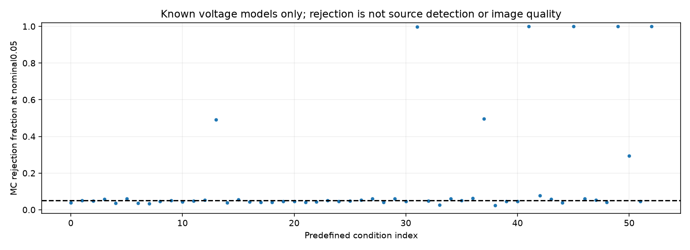

# 段階087：既知Cas A・点源の有限電圧とwindowの虚部対称性

- 作成日：2026-10-17
- 状態：完了
- 比較元コミット：1e91318

## 読者向け概要

三次統計を観測powerで正規化し、その虚部を短い区間ごとのベクトルとして調べます。点源等の既知モデルでは、局の一定gainを相殺した後に共役対称性があるため、windowの符号反転が使える条件があります。Cas Aモデルの有限電圧でも同じ処理を通し、棄却割合を比較します。小さいpはCas Aの存在確率や画像の信頼度ではありません。広がった等輝度二点源、位相変動、区間をコピーした場合等も比較し、解釈の限界を確認します。

## 1. 目的・対象範囲

既知天空の局共分散から生成した有限proper Gaussian複素モードを、観測power正規化U₃の虚部と全window符号反転へ接続する。仮想の8局spread配置、最大25/100/600m、同一の固定uvを繰り返す独立windowを使う。真の天空・SEFDは生成とモデルの確認だけに使い、検定へ渡さない。

53条件を結果評価前に定める。短標本128/512の36条件は各1024反復、19200独立モードの10条件は各256反復、7対照条件は各1024反復。長標本は理想的な64kHz×0.3秒という条件付き対応を示すが、FFTや実機の独立性を確認した値ではない。短標本から実観測の積分時間を確定しない。

## 2. 完了条件

観測power・gain・共役変換・固定入力の整合性、点源等の生成モデルでの共役対称性を照合する。H0を支持する生成条件は固定MC基準で確認し、Cas Aや反例の棄却割合そのものは成功条件にしない。全53条件を保存する。source/wheel全回帰、checkout外APIと同梱CLI、公開レポート・規約・索引・監査・匿名commit/pushを完了する。

## 3. 実際に行った作業

既知天空から8局の共分散Sを計算し、複素proper Gaussian電圧を生成した。各短区間について観測power正規化U₃を計算し、その56三角形の虚部だけを符号反転APIへ渡した。S・SEFD・天空・誤差σは生成と条件の確認に使い、検定の入力には渡していない。三角形を独立な測定として増やす処理も行わない。

点源等では、局の一定位相を外すとSを実行列にできることを確認した。このモデルの電圧は共役にしても同分布であり、正規化U₃の虚部は符号を変える。window内で一定の局gainは有限データごとに相殺される。独立windowを生成すれば、段階086の同時分布不変性を満たす。この説明はU₃比が不偏であることを要求しない。

同梱したCas A画像と設定から実行するnative CLIを追加した。3配置のUVWとvisibilityは段階081の記録から固定し、参照画像・元結果・設定のSHAを保存した。局共分散には天体の自己雑音と局receiver背景を含めた。各条件のJSONを逐次保存し、失敗時は成功集計を作らない。GUIとRMLは本段階では変更していない。

変更：`apps/simulator/src/vsora_simulator/casa_window_symmetry.py`と対象試験、`data/reference/known-casa-window-symmetry.json`、参照asset resolver、`pyproject.toml`の同梱指定、workflow互換入口、`tools/verify_casa_window_symmetry_installed.py`、[入出力・仮定](../../interfaces/casa-window-symmetry.md)、Closureガイド・索引・公開記録。

## 4. 検証条件・結果

### 4.1 ソフトと配布の確認

42対象試験が0.76秒で成功した。固定計画の条件数・反復数・seed、3配置のCas A visibility、共分散のCholesky復元、共役対称な生成モデル、gain変換、真値逆位相、window複製、無効入力、出力の上書き拒否を確認した。3条件各16反復のsmokeは動作確認として明示し、正式MCの成功に数えない。補助確認をsystem Pythonで起動した際はHTTPx/Astropy不足で停止したため成功に数えず、必要な依存がある検証venvから再実行した。GUI更新前はそのvenvで実行中ジョブ0件を確認した。

| 確認 | 実測結果 |
|---|---|
| ソース全回帰 | 1351成功、25,596警告、646.90秒 |
| 導入済み全回帰 | 1351成功、25,596警告、643.83秒 |
| checkout外API | 9モデルの全fieldがsource fixtureと完全一致 |
| checkout外native CLI | 全53条件の全科学JSON・各条件ファイルがsourceと完全一致 |
| 実行元 | 入口等5moduleと設定・天空画像が導入prefix内。別の9モデル実行で読み込まれた全15 project moduleもprefix内 |
| 配布ファイル | 84module等、4参照assetがsourceとバイト一致 |
| 依存関係 | pip check成功 |

除外0件。Python3.12.3、NumPy2.5.1、SciPy1.18.0、pytest8.4.2、BLAS/OpenMP各1スレッド。既存依存ソフトの警告を含む。全回帰は別の模擬実験と並行する実行条件であり、性能比較値ではない。wheel 5,545,875bytes、SHA-256 `cafdc688721f53ebdc0967b5d03b281049e8eeeecca63175deeefeaed1703b40`。本段階の実Chromiumは未実施。

### 4.2 正式53条件

正式実験は総46,592反復、Q=8、D=56。長標本は各256、その他は各1024反復。SEFDはreceiver背景の仮定値で、天体の自己雑音は別にSへ含める。約585966JyはTsys100K・口径1m・開口能率0.6という既存の仮定例で、実アンテナの測定値ではない。

| 条件番号 | 生成モデル | 独立モード数M | 最大基線m | receiver SEFD Jy | p≤1%の数 | p≤5%の数 |
|---|---|---|---|---|---|---|
| 0 | 点源 | 128 | 25 | 1000 | 9/1024 | 40/1024 |
| 1 | Cas A代理形状 | 128 | 25 | 1000 | 8/1024 | 52/1024 |
| 2 | 点源 | 128 | 25 | 10000 | 15/1024 | 49/1024 |
| 3 | Cas A代理形状 | 128 | 25 | 10000 | 7/1024 | 59/1024 |
| 4 | 点源 | 128 | 25 | 585966 | 8/1024 | 38/1024 |
| 5 | Cas A代理形状 | 128 | 25 | 585966 | 10/1024 | 62/1024 |
| 6 | 点源 | 128 | 100 | 1000 | 7/1024 | 37/1024 |
| 7 | Cas A代理形状 | 128 | 100 | 1000 | 7/1024 | 34/1024 |
| 8 | 点源 | 128 | 100 | 10000 | 9/1024 | 47/1024 |
| 9 | Cas A代理形状 | 128 | 100 | 10000 | 10/1024 | 51/1024 |
| 10 | 点源 | 128 | 100 | 585966 | 8/1024 | 44/1024 |
| 11 | Cas A代理形状 | 128 | 100 | 585966 | 10/1024 | 49/1024 |
| 12 | 点源 | 128 | 600 | 1000 | 15/1024 | 54/1024 |
| 13 | Cas A代理形状 | 128 | 600 | 1000 | 180/1024 | 503/1024 |
| 14 | 点源 | 128 | 600 | 10000 | 8/1024 | 39/1024 |
| 15 | Cas A代理形状 | 128 | 600 | 10000 | 10/1024 | 57/1024 |
| 16 | 点源 | 128 | 600 | 585966 | 7/1024 | 45/1024 |
| 17 | Cas A代理形状 | 128 | 600 | 585966 | 5/1024 | 42/1024 |
| 18 | 点源 | 512 | 25 | 1000 | 10/1024 | 42/1024 |
| 19 | Cas A代理形状 | 512 | 25 | 1000 | 7/1024 | 48/1024 |
| 20 | 点源 | 512 | 25 | 10000 | 7/1024 | 46/1024 |
| 21 | Cas A代理形状 | 512 | 25 | 10000 | 9/1024 | 41/1024 |
| 22 | 点源 | 512 | 25 | 585966 | 10/1024 | 44/1024 |
| 23 | Cas A代理形状 | 512 | 25 | 585966 | 13/1024 | 52/1024 |
| 24 | 点源 | 512 | 100 | 1000 | 8/1024 | 46/1024 |
| 25 | Cas A代理形状 | 512 | 100 | 1000 | 11/1024 | 50/1024 |
| 26 | 点源 | 512 | 100 | 10000 | 6/1024 | 55/1024 |
| 27 | Cas A代理形状 | 512 | 100 | 10000 | 6/1024 | 61/1024 |
| 28 | 点源 | 512 | 100 | 585966 | 6/1024 | 41/1024 |
| 29 | Cas A代理形状 | 512 | 100 | 585966 | 12/1024 | 61/1024 |
| 30 | 点源 | 512 | 600 | 1000 | 6/1024 | 48/1024 |
| 31 | Cas A代理形状 | 512 | 600 | 1000 | 935/1024 | 1021/1024 |
| 32 | 点源 | 512 | 600 | 10000 | 12/1024 | 50/1024 |
| 33 | Cas A代理形状 | 512 | 600 | 10000 | 2/1024 | 28/1024 |
| 34 | 点源 | 512 | 600 | 585966 | 13/1024 | 61/1024 |
| 35 | Cas A代理形状 | 512 | 600 | 585966 | 7/1024 | 52/1024 |
| 36 | 点源 | 19200 | 100 | 1000 | 4/256 | 16/256 |
| 37 | Cas A代理形状 | 19200 | 100 | 1000 | 51/256 | 127/256 |
| 38 | 点源 | 19200 | 100 | 585966 | 2/256 | 6/256 |
| 39 | Cas A代理形状 | 19200 | 100 | 585966 | 0/256 | 12/256 |
| 40 | 点源 | 19200 | 600 | 1000 | 1/256 | 12/256 |
| 41 | Cas A代理形状 | 19200 | 600 | 1000 | 256/256 | 256/256 |
| 42 | 点源 | 19200 | 600 | 585966 | 3/256 | 20/256 |
| 43 | Cas A代理形状 | 19200 | 600 | 585966 | 4/256 | 15/256 |
| 44 | 点源 | 19200 | 600 | 10000 | 1/256 | 10/256 |
| 45 | Cas A代理形状 | 19200 | 600 | 10000 | 220/256 | 256/256 |
| 46 | 無信号 | 512 | 600 | 1000 | 10/1024 | 61/1024 |
| 47 | 局別SEFD点源 | 512 | 600 | 局別 | 7/1024 | 54/1024 |
| 48 | 等輝度二点 | 512 | 600 | 1000 | 8/1024 | 42/1024 |
| 49 | 非等輝度二点 | 512 | 600 | 1000 | 1020/1024 | 1024/1024 |
| 50 | 点源＋二次位相 | 512 | 600 | 1000 | 95/1024 | 302/1024 |
| 51 | 点源＋真値逆位相 | 512 | 600 | 1000 | 6/1024 | 48/1024 |
| 52 | 点源window複製 | 512 | 600 | 1000 | 1024/1024 | 1024/1024 |

帰無条件を支持する27条件は、α+6 reference MC SEという固定基準内だった。reference MC SEは名目αと反復数nによる√[α(1−α)/n]で、実観測の誤差棒ではない。Cas A・非等輝度二点・二次位相・複製では棄却割合そのものを合否にしない。実験前の計画を保持し、低い値の条件も残した。条件30・50・51は同じseedの有限電圧を点源・二次位相・真値逆補正として比較するため、条件間の独立性は主張しない。MC精度は各条件内の独立反復で計算する。

同じ電圧を8windowへ複製した対照では全反復のpが2/256となった。周辺分布が対称でも行別符号反転の前提は不足する。等輝度二点は広がりを持ちながら実共分散への局位相変換が可能で、非棄却を点源の証明に使えない。二次位相の真値逆補正と元の同一有限電圧の差を確認したが、これは未知LOの推定ではない。

各条件最初の4反復で、一定gainを変えた特徴量とpの一致、windowの共役と特徴量の共役の対応を検査した。全反復へのgain検査ではない。帰無条件では実共分散への変換残差も確認した。全数値は[科学記録](../../validation/runs/stage087/known-casa-window-symmetry.json)に保存した。

正式source実験の実行時間981.82秒、最大RSS246,464KiB。source全回帰と並行実行した記録で、性能ベンチマークとして比較しない。導入済みCLIはcheckout外から同じ全53条件を再実行した。この一致は同一algorithmの配布と再実行の整合性を確認するもので、科学モデルを独立な実装で証明した意味ではない。

[正式確認](../../validation/runs/stage087/verification.json)、[導入済み照合](../../validation/runs/stage087/installed-api.json)、[API入力・期待値・固定計画](../../validation/runs/stage087/api-golden.json)。生ログ・wheel・条件別重複JSONはGit管理外`outputs/stage087-source-final/`、`outputs/stage087-source-study/`、`outputs/stage087-installed-final/`、`outputs/stage087-installed-api/`へ保存した。公開図のmetadataはSoftware/DPIのみ。

### 4.3 公開前の確認

個人情報・秘密情報監査は指摘0件。ローカルMarkdownリンク1061件、欠落0件。公開用author/committerで段階の変更だけをコミットする。

## 5. 制約・未解決事項

既知の仮想天空・感度・単一epochを使う有限Gaussianモードの比較である。ADC、FFT、FIR、量子化、VDIF、未知LO推定、RML、実機は対象外。LO補正済みの条件と、真値を与えた逆位相は未知LOの推定成功と区別する。pは符号対称モデルとの条件付き整合性で、天体の広がり・存在・画像品質を単独で示さない。時刻・周波数・windowの実独立性、未知の主ビームやRFIは未検証。

## 6. 次段階

検証済みの条件と未解決事項を日本語GUIで確認できるようにする。実際の相関・保存情報・LO診断へ接続する際は、共通標本とwindow間相関等を別段階で確認する。
