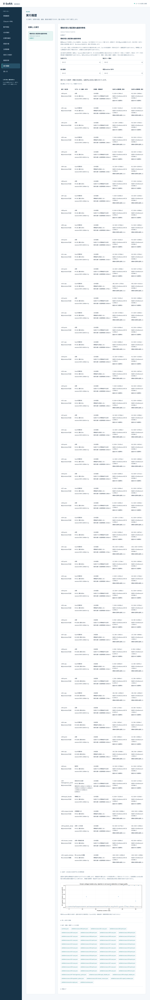
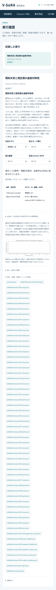

# 段階088：既知天空と短区間の虚部対称性を日本語GUIへ接続

- 作成日：2026-10-17
- 状態：完了
- 比較元コミット：4b71a06

## 読者向け概要

短い区間から得た三次統計の虚部を比較する53条件の実験を、日本語GUIから実行できるようにします。棄却割合や反復誤差、全56成分を確認し、仮定したGaussian電圧と実際の観測を区別します。pはCas Aの存在確率や画像の信頼度ではありません。

## 1. 目的・対象範囲

段階085〜087の有限電圧・観測power・条件付き符号反転を、checkoutのrunnerが無い導入済みGUIから実行する。全53条件を正式profileで再計算し、既存の配置比較も引き続き利用できるようにする。科学計算と現行RMLは変更しない。

## 2. 完了条件

丸め境界を含む対象21試験、source/installed全1370件、runner無しの両実Chromiumで53概要・2968詳細・全条件JSON・summary download・4filter・日本語font/390px、既存array_scaleの実ブラウザ回帰、module/asset導入元確認、レポート/索引/監査/匿名commit/push。

## 3. 実際の作業

動作検証へ「既知天空と短区間の虚部対称性」を追加した。導入先の同梱moduleと設定・天空画像を使い、正式53条件を再計算する。開始前に計算時間の目安と、pがCas Aの存在確率・画像信頼度でないことを示す。各条件の開始を日本語の進行状態へ通知する。

一覧はモデル・モード数・最大基線・receiver SEFDで絞り込める。全53条件の反復数、帰無条件の根拠、1%/5%の棄却数と割合、pの範囲、gain/共役/真値補正の数値差を表示する。各条件の56成分の反復平均とMC標準誤差は詳細表で確認できる。MC標準誤差は模擬反復の精度であり、一回の実観測の雑音σや画像の誤差棒ではない。

狭い画面で表を細く折り返さないよう、表の領域だけ横にスクロールする。全条件のJSONと条件別JSON、図、実行元の照合記録を保存する。実行元の内部パスは通常画面へ表示せず、公開記録はprefix内所在のboolとasset SHAを用いる。

変更：`apps/ui/src/vsora_ui/models.py`、`jobs.py`、`server.py`、`worker.py`、静的HTML/JS/CSS、新GUI対象試験と既存能力一覧試験、`tools/verify_casa_window_symmetry_ui.py`と既存native配置比較ブラウザ検証、GUIガイド・レポート・索引・公開確認記録。段階087の科学計算・同梱入力と現行RMLは変更していない。

## 4. 検証条件・結果

### 4.1 対象試験と予備確認

対象21件が2.63秒で成功した。新規7件は項目・ラベル・能力一覧、固定科学計画の不意の変更拒否、native dispatchと進行通知、失敗、中止を確認する。dispatch・失敗・中止の試験は明示的なstubを使い、全53条件の科学計算と数えない。既存native配置比較の2件と、丸め境界・非有限値の12件も確認した。

適用前には一時コピーで7件の予備試験を実行した。小規模rendererの初回確認はCSPがinline scriptを拒否し、次の配信パス指定も誤って停止した。検証用の同一origin配信assetへ草稿を載せる方法へ直し、製品のCSPは維持した。予備画像で表の細い折り返しを確認し、局所横スクロールへ改善した。これらの予備確認は下記の正式な実worker・全MC・両実ブラウザとは区別する。

初回のソース実ブラウザは全53条件の科学JSON一致を確認した後、指数表記の期待値で停止した。0.0390625という同じ値が、JavaScriptでは3.9063e−2、Pythonの既定書式では3.9062e−2になる、ちょうど中間の丸めの違いだった。科学計算やGUIの値は変更せず、検証側を正確なbinary floatからDecimalのhalf-upで5有効数字へ丸める方法へ修正した。[ECMAScriptのtoExponential規約](https://tc39.es/ecma262/multipage/numbers-and-dates.html#sec-number.prototype.toexponential)を参照した。

12境界試験を追加し対象21件を再実行した。科学JSONに含まれる全26724数値について独立期待値と実Chromiumの表示が一致し、その後に正式な53条件のソース実ブラウザを最初から再実行した。初回の停止はGUI検証の成功に数えない。[丸め差の記録](../../validation/runs/stage088/rounding-review.json)、[全数値の照合](../../validation/runs/stage088/rounding-validation.json)。

最初の全回帰は試験収集で停止した。simulatorとGUIの試験ファイルが同じbasenameだったため、pytestのmodule名が衝突した。exit code2と終了を確認してからGUI側をtest_casa_window_symmetry_gui.pyへ改名した。収集失敗を合格に数えず、対象試験と全回帰を再実行した。

### 4.2 runnerを置かない作業フォルダでの両実Chromium

| 検査 | ソース版 | 導入版 |
|---|---|---|
| 正式native worker | 全53条件を計算 | 全53条件を計算 |
| 科学JSON | 段階087の全fieldと一致 | 段階087の全fieldと一致 |
| 概要表 | 全53行の表示数値を照合 | 同左 |
| 詳細表 | 全2968行の平均・MC標準誤差を照合 | 同左 |
| 保存 | 全53条件別JSONとsummary downloadが一致 | 同左 |
| モデル/M/基線/SEFD filter | 4種類とも確認 | 同左 |
| 図・説明 | captionと適用限界を確認 | 同左 |
| 日本語・390px | font読込、root横溢れなし、表の局所横スクロール | 同左 |
| JS例外・外部通信 | 0/0 | 0/0 |
| 既存配置比較 | 18概要・108条件・6048詳細、段階081全JSONと一致 | 同左 |

いずれも新しい一時workspaceに`tools/run.py`を置かず実行した。ソース版GUIの起動・module importには元checkoutのrunnerを使い、科学計算はnative moduleを直接呼ぶ。導入版はconsole scriptから起動し、科学6module・設定・天空画像が全て導入prefix内にあることを確認した。Windows実ブラウザとWSLgの操作は未確認である。

[ソースGUI確認](../../validation/runs/stage088/source-browser.json)、[導入済みGUI確認](../../validation/runs/stage088/installed-browser.json)、[ソース実行元](../../validation/runs/stage088/source-origin.json)、[導入済み実行元](../../validation/runs/stage088/installed-origin.json)、[既存配置比較source](../../validation/runs/stage088/source-array-browser.json)、[同installed](../../validation/runs/stage088/installed-array-browser.json)。

### 4.3 全回帰・配布

| 確認 | 結果 |
|---|---|
| ソース全回帰 | 1370成功、25,596警告、598.01秒 |
| 導入済み全回帰 | 1370成功、25,596警告、632.59秒 |
| 配布ファイル | 84件がsourceとバイト一致 |
| 依存関係 | pip check成功 |

除外0件。Python3.12.3、NumPy2.5.1、SciPy1.18.0、pytest8.4.2、Chromium153.0.8010.12、BLAS/OpenMP各1スレッド。既存依存ソフトの警告を含む。wheel 5,548,650bytes、SHA-256 `98425f8f6537bc284aa20a7cf4fb127af4bd1490c0877979c7d850da4d20090b`。[正式確認](../../validation/runs/stage088/verification.json)。詳細ログ・wheel・ブラウザ画像の重複はGit管理外`outputs/stage088-*`に保存した。公開browser PNGに追加metadataはない。

## 5. 制約

生成モデルは独立Gaussianモード・既知天空・同一uvの仮想8局である。M19200=64kHz×0.3秒は理想独立数の仮定。位相補正の真値と未知LO推定、反復のMC誤差と実観測の雑音σを区別する。実機、ADC/FFT/FIR、量子化、未知LO、低SNR画像尤度、画像品質は未検証。WSLのheadless Chromiumの検証をWindows実ブラウザ/WSLgの確認としない。

## 6. 次段階

実際の相関・保存情報へ接続するため、同じ電圧標本の利用、短区間の独立性、LO推定後の統計の変化を別に検証する。
