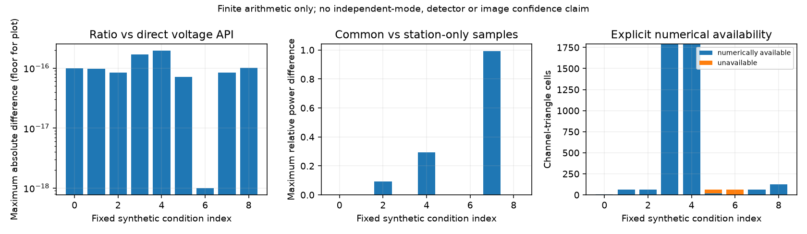

# 段階089：streaming U₃と三角形共通標本power

- 作成日：2026-10-17
- 状態：完了
- 比較元コミット：cf04801

## 読者向け概要

観測powerで三次統計を正規化する処理を、分割したFFTの和だけで計算する相関器へ接続します。欠損がある場合、三角形の全三局が使える標本と、局単独で使える標本は異なります。同じ標本のpowerを蓄積し、数値が定義できることと品質flagを分けて確認します。

## 1. 目的・対象範囲

BispectrumAccumulatorに三角形共通標本の三局power和を追加し、FXのRF順序と整合させる。直接電圧の正規化APIと、欠損・分割・gain・数値範囲の有限代数を照合する。0.3秒の浮動小数点IQと実FFTの条件を含む。既存raw NPZ version1とRMLは変更せず、同じpowerが保存されていない既存ファイルから比を捏造しない。

## 2. 完了条件

新規対象63件と関連既存55件、source/installed全1433件、正式9条件と予備JSON完全照合、checkout外5入力API全raw/normalfieldsとnative CLI全科学JSON、レポート/索引/公開監査/匿名commit/push。未適用一時コピー118件・予備9条件を正式成功に数えない。

## 3. 実際の作業

三角形ごとに三局が共通に使えるFFT標本を選び、既存の三次統計の和と同じ集合から三局power和を蓄積した。consumeが失敗した場合はpower・旧sum・countを全て更新しない。FXでRF昇順へ並べ替えるときにpowerも同じ順にした。

normalized helperはU₃と通常積を、同じ三局powerの積で割った無次元量へ変換する。分母の積を直接作ると中間でoverflow/underflowし得るため、frexpの仮数と2の指数を分けて計算する。float64変換の非零消失と、最終比の非表現可能範囲を明示的に拒否する。蓄積前に電圧をscaleする処理は追加していない。

M<3やpower0のU₃比はavailability=falseと0埋めを組にして返し、0を測定したと解釈しない。通常積はM≥1で別に判定する。既存品質maskはコピーして返し、数値availableと品質usableを区別する。maskがfalseでも元の数値は消さない。

新powerの固定storageは1cell当たり24bytes、上限4096channel・56三角形で5.25MiB増える。標本列の長さには比例しない。0.3秒の照合条件では実際に257block刻み、power配列3072bytesを確認した。実験全体は直接配列との比較のためIQ全列も保持し、この実験のRSSをstreamingの必要メモリと同一視しない。

変更：correlatorのbispectrum_accumulator.py・stream_fx.py、新bispectrum_power.py、simulatorのcommon_power_validation.pyと互換workflow、対象2試験file、導入済みverifier、[規約](../../interfaces/common-bispectrum-power.md)、Closureガイド・索引・段階レポート・公開確認記録。version1のformats moduleはbyte単位で変更していない。

## 4. 検証条件・結果

### 4.1 対象試験

新規63件と関連する既存55件、計118件が2.15秒で成功した。3/4/8局、複数channel、chunk1/7/全長、三角形ごとに異なる欠損集合を、直接電圧APIと照合した。5標本の順序付き全異標本三重和は別の直接列挙で確認した。

一定の複素gainは局ごと・channelごとに変え、同じ固定maskで比が一致することを確認した。三局powerの積が中間でoverflow/underflowし得る1e±120のgainの組でも、受理された有限raw和からの比が一致した。全体gainをどこまでも大きくできる意味ではなく、旧sumが既に範囲外なら蓄積・finishで拒否する制約は残る。

count0/1/2/3、power0、品質flagの保持、pだけがoverflowするchunkのatomic拒否、出力と内部storageの非alias、非有限・負power・形状・dtype・count・拡張精度の境界を確認した。局0単独のpower和303に対して三角形共通標本の和3となる具体例も含めた。

### 4.2 有限IQと実FFTの正式9条件

| 条件 | 内容 | 局 / FFT長 / block数 | 仮定IQ秒 | 三角形共通count範囲 | 数値available / 既存品質usable cells | 直接電圧APIとの差 |
|---|---|---|---|---|---|---|
| c00-complete | 欠損なし | 3 / 8 / 31 | 0.000121094 | 31〜31 | 8 / 7 | 1.001e-16 |
| c01-complete | 欠損なし | 4 / 16 / 257 | 0.00200781 | 257〜257 | 64 / 60 | 9.753e-17 |
| c02-missing | 局別欠損 | 4 / 16 / 257 | 0.00200781 | 199〜200 | 64 / 60 | 8.347e-17 |
| c03-complete | 欠損なし | 8 / 32 / 73 | 0.00114062 | 73〜73 | 1792 / 1736 | 1.674e-16 |
| c04-missing | 局別欠損 | 8 / 32 / 73 | 0.00114062 | 55〜58 | 1792 / 1736 | 1.943e-16 |
| c05-zero_station | 局0の電圧0 | 4 / 16 / 31 | 0.000242187 | 31〜31 | 16 / 15 | 7.152e-17 |
| c06-two_retained_blocks | 共通2blockだけ保持 | 4 / 16 / 31 | 0.000242187 | 2〜2 | 0 / 0 | 0.000e+00 |
| c07-data_dependent_mask | data依存maskを固定 | 4 / 16 / 31 | 0.000242187 | 11〜15 | 64 / 60 | 8.356e-17 |
| c08-short_window_0p3s | 0.3秒IQ | 4 / 32 / 19200 | 0.3 | 19200〜19200 | 128 / 124 | 1.008e-16 |

差は複素絶対差の全channel・三角形最大値で、U₃と通常積の大きい方を示す。cellsはchannel×三角形の組で、独立な画像情報数ではない。M<3条件で直接U₃の照合数が0なのは未定義を除外したためで、0の測定として比較した意味ではない。

各条件はGaussianの共有成分とreceiver成分を仮想電圧単位で生成し、実際に非重複の正規直交FFTを通した。data依存maskの条件も、gain比較では得られた同じmaskを固定する。再選択後の統計・mask ignorabilityや独立性を確認した結果ではない。productionの通常visibility・weight・診断配列は、opt-inなしの処理とbit単位で一致した。

元の8条件の予備結果を保持し、DSPの短積分範囲を覆う0.3秒条件を追加して9条件とした。正式9条件の全科学JSONは最新9条件の予備結果と一致した。反復検出率を見て条件を選んだ処理ではない。正式実験1.34秒・最大RSS281,032KiB。0.3秒は実行性能の保証でもOCXO安定性の測定でもなく、生成IQ数と仮定sample rateの対応である。

[全条件](../../validation/runs/stage089/known-common-power.json)、[直接API期待値](../../validation/runs/stage089/api-golden.json)。

### 4.3 配布・単独CLI・全回帰

| 確認 | 実測結果 |
|---|---|
| ソース全回帰 | 1433成功、25,596警告、539.38秒 |
| 導入済み全回帰 | 1433成功、25,596警告、539.61秒 |
| checkout外API | 5入力の全raw/normalized fieldがsource fixtureと完全一致 |
| checkout外native CLI | 正式9条件の全科学JSONがsourceと完全一致 |
| moduleの導入元 | 読み込まれた全project moduleが導入prefix内 |
| 配布ファイル | 86件がsourceとbyte一致 |
| 依存関係 | pip check成功 |
| 既存raw version1 | formats moduleのSHAが比較元と一致、新powerを保存していない |

全回帰除外0件。Python3.12.3、NumPy2.5.1、SciPy1.18.0、pytest8.4.2、BLAS/OpenMP各1スレッド。既存依存ソフトの警告を含む。本段階で実Chromiumは再実行していない。wheel 5,554,671bytes、SHA-256 8cefc77b64e890f2c744cc7ce4abfcf236482bedb31c126c8e5948eb5fb37355。[正式記録](../../validation/runs/stage089/verification.json)、[導入済み照合](../../validation/runs/stage089/installed-api.json)。ログ・wheel・元IQはGit管理外outputs/stage089-*に保存し、公開図のmetadataはSoftware/DPIのみ。

## 5. 制約

数値availableと既存品質usableを区別する。一定gainの相殺は同じ固定maskに関する代数で、mask ignorabilityや独立性を証明しない。raw和の数値範囲は電圧を事前scaleする段階085より狭い。既存version1へ新powerは保存しない。ADC・量子化・VDIF・幾何遅延・未知LO・OCXOの実安定性・低SNR画像尤度・実機を検証しない。現行visibility/weight/RMLは変更しない。

## 6. 次段階

共通powerをraw profile version2へ明示して保存し、version1の読込互換を維持する。version1の正規化はunavailableとし、元相関の識別情報・時刻/周波数・三角形のcountを保持する。その後、保存原本の日本語GUIへ接続する。
