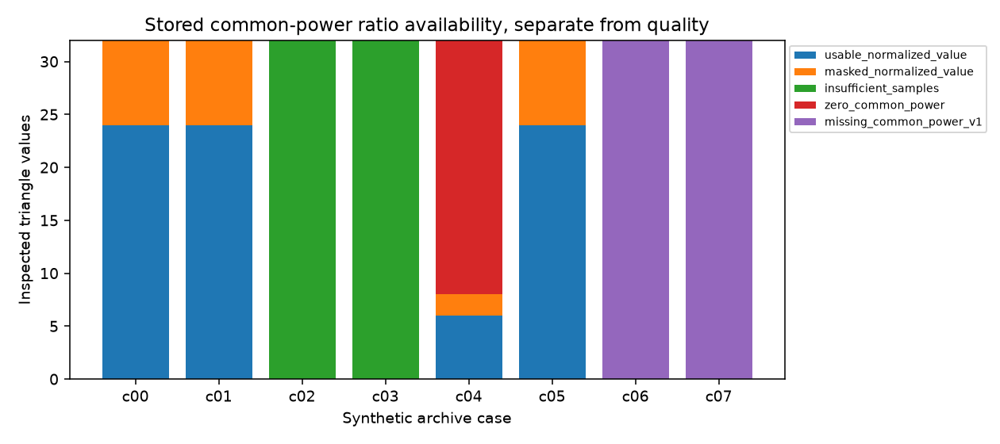

# 段階090：共通FFT電力を保存するraw profile version2

- 作成日：2026-10-17
- 状態：完了
- 比較元コミット：53c9d55

## 読者向け概要

段階089で相関器が計算できるようになった「三角形の三局に共通するFFT標本の電力」を、ファイルへ残せるようにする。後から正規化値を再計算するには、分子だけでなく同じ標本から作った分母も必要である。旧版に無い情報は不明として残す。

## 1. 目的・対象範囲

raw NPZのversion2、version1の読込互換、Python/console CLI inspectionを実装する。既存VDIF producerの保存形式変更とGUIは次段階で扱う。

## 2. 完了条件

新48/既存79の対象127試験、固定8条件の全配列roundtrip・64セル/256三角形行のinspection・原本照合・version1欠落値の維持、source全回帰と導入済み全回帰1481件、checkout外API/console CLI/全科学JSON/全16archiveの一致、導入prefix確認、文書/索引/公開監査/匿名commit/push。

## 3. 実際の作業

raw version2は三局共通標本の電力和を64bit配列で保持する。局順・標本集合・電力単位をmetadataへ固定し、比の不偏性を保証しないことも明示した。writerの既定はversion1を維持し、version2はkeywordで指定する。loaderは両版を受け付け、versionと配列集合の不一致、電力の異常値・型・shape、0標本との不整合を拒否する。旧版の原本SHA、軸・FFT・単位・count・edge和の検査は保持した。

新配列を加えても40MiBの復号後上限を越えないよう、writer側でも書込み後・公開前に確認する。一時ファイルの清掃と非上書きを維持した。新電力の最大payloadは6MiBで、既存配列とヘッダを含む全量は40MiB上限を共有する。

inspectionはraw U3と無次元の比を別fieldにし、数値availableと品質usableを分ける。M<3、0電力、品質mask、version1の電力欠落には異なるstateを返す。未定義値はJSON nullとし、0で埋めない。既存console CLIでも同じ確認済みJSONを作る。

変更ファイル：formatsのbispectrum、correlatorのbispectrum_inspect、native bispectrum_archive_validationとworkflow互換入口、新版試験、checkout外照合tool、[形式の詳細](../../interfaces/bispectrum-power-v2.md)、利用ガイド・レポート・索引・公開fixture。既存aligned producerは変更していない。

## 4. 検証条件・結果

### 4.1 対象試験と固定計画

予備互換照合ではscope説明文の変更を検出し、version1の文面を保持するよう修正した。初回の差分を互換成功に数えず、一時試験と全8条件を再実行した。

新48件と既存79件の計127件が1.00秒で成功した。旧版の保存・再構成・原本検査・非上書きの試験も実行した。変更前の導入済み089から2条件16セルのinspectionを保存し、全ての従来fieldが一致すること、対応する4archiveがバイト一致することも確認した。JSONには版・共通電力・正規化可否のfieldを追加するため、旧JSONとの比較では追加fieldを明示する。新版は全配列roundtrip、単位、全セルの正規化値、M<3/0電力/品質mask、big-endian float64、明示version、不正power/metadata、decoded size上限と失敗時清掃を確認した。固定計画の変更と既存出力への再実行も拒否した。

合成FFT係数11標本・4channel・4局・2時刻の固定8条件を使う。各条件8セル・32三角形行で、計64セル・256行を確認した。二時刻は保存軸の検査用に同じ値を繰り返しており、独立な観測を2回行ったものではない。欠測は局ごとに異なるmask、品質除外は先頭channel、0電力は1局の係数を0にする。単位宣言を変えても実較正は行わない。

| 条件 | 標本条件 | 電圧単位 | version | 正規化の状態と行数 |
|---|---|---|---|---|
| c00 | complete | ADC | 2 | masked_normalized_value: 8, usable_normalized_value: 24 |
| c01 | missing | ADC | 2 | masked_normalized_value: 8, usable_normalized_value: 24 |
| c02 | two | ADC | 2 | insufficient_samples: 32 |
| c03 | zero_count | ADC | 2 | insufficient_samples: 32 |
| c04 | zero_station | ADC | 2 | zero_common_power: 24, masked_normalized_value: 2, usable_normalized_value: 6 |
| c05 | complete | sqrt(Jy) | 2 | masked_normalized_value: 8, usable_normalized_value: 24 |
| c06 | complete | ADC | 1 | missing_common_power_v1: 32 |
| c07 | missing | sqrt(Jy) | 1 | missing_common_power_v1: 32 |

新版の数値は089のruntime APIと照合し、旧版は必要情報が欠けるため全行nullを維持した。全raw配列が保存前後で一致し、全セルの原本SHA・軸・count検査を通った。正式ソースの全JSONは予備実行とも完全一致した。実験は0.54秒、最大RSS 78,992KiBで、全夜運用性能の測定ではない。

### 4.2 配布とcheckout外の照合

| 検査 | 結果 |
|---|---|
| ソース全回帰 | 1481成功、25,596警告、538.13秒 |
| 導入済み全回帰 | 1481成功、25,596警告、538.78秒 |
| checkout外API | 78配列と全64セルのJSON一致 |
| 独立console CLI | 8条件のJSON一致 |
| native CLI | 8条件の全科学JSONと16archiveのバイト一致 |
| 実行元 | 全9読込project moduleが導入prefix内 |
| wheel | 87配布ファイルがsourceとバイト一致 |
| 依存 | pip check成功 |

除外0件。Python3.12.3、NumPy2.5.1、SciPy1.18.0、pytest8.4.2、BLAS/OpenMP各1。既存依存の警告を含む。wheel 5,559,178bytes、SHA-256 0fe41c1cdddddf87b610519e25a735d7908811938d79431e2a086696c648eed1。checkout外の新しい作業フォルダでPYTHONPATHを除去し、runnerを使わず導入module/console scriptを実行した。この段階でGUIの実ブラウザ検査は追加していない。

[旧版API基準値](../../validation/runs/stage090/legacy-v1-inspection.json)、[正式記録](../../validation/runs/stage090/verification.json)、[全科学JSON](../../validation/runs/stage090/known-archives.json)、[導入済みAPI/CLI](../../validation/runs/stage090/installed-api.json)。閉じた合成原本16archive・計56,732bytesを[fixture一覧](../../validation/runs/stage090/fixtures/README.md)と共に保存した。詳細ログ・wheel・重複実験はGit管理外 outputs/stage090-* に置く。

## 5. 制約

小規模の合成FFT係数を使う形式検証で、実IQのFFT処理や実機観測の検証ではない。ADC/Jyの二種類の宣言は単位保持の確認であり、実SEFD較正を行ったものではない。数値availableと品質usableを区別し、M<3や電力0や旧版の欠落を0で代用しない。三角形の標本独立性・マスク無視可能性・位相の不偏性・低SNR画像尤度を保証しない。既存producerは引き続きversion1、現行RMLは変更しない。全夜/GPU性能は未検証。

## 6. 次段階

VDIF→補正→FXの既存producerへversion2保存を接続し、原本照合付きのinspectionを日本語GUIへ表示する。実観測の未知LOや短区間の統計モデルは別に確認する。
