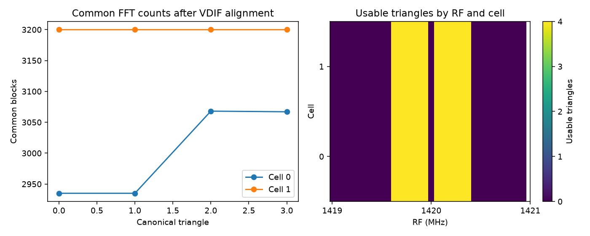

# 段階091：VDIF相関から共通FFT電力を保存

- 作成日：2026-10-17
- 状態：完了
- 比較元コミット：0c6a6e1

## 読者向け概要

後から同じ解析を再現するには、三次統計の分子だけでなく、同じ標本から作った三局の電力も必要である。段階090の保存形式を、実際のVDIF相関処理へ接続する。0.3秒の合成観測では、処理後FFTから直接計算した電力と無次元比を照合する。保存できることと、その比を画像尤度に使えることは別の判断である。

## 1. 目的・対象範囲

8bit合成VDIF→FIR・補間・時計と幾何/rate補正→FXの追加保存オプションをversion2へ接続する。原本のvisibility、品質mask、従来Closure/RML、保存offの挙動を維持する。残量を確認し、日本語の追加表示は段階092へ分けた。

## 2. 完了条件

対象18（新2/既存16）試験、0.3秒欠測あり/なしの処理後FFTから全共通電力と085の直接比を照合、実VDIF固定実験の保存off/on比較、source/installed全1483件。checkout外再相関CLIの全visibility/raw配列/正規化field一致・導入prefix・非上書き、レポート/索引/公開監査/匿名commit/push。

## 3. 実際の作業

aligned producerが三次統計と同じ三局共通FFTから蓄積した電力和を、各積分区間のraw配列へ追加した。save_bispectrumをschema_version=2で呼び、保存後に元visibilityとの照合を行う。summaryへ版、共通電力保持、電力単位、比の不偏性を保証しないflagを記録した。

既存GUIの保存チェックボックスも同じproducerへ渡るためversion2を生成する。共通電力と無次元比を追加する表示は段階092へ分け、今回のフロントエンドは変更しない。段階090完了時の5時間残量19%を確認し、保存接続とCLIを独立した区切りとして選んだ。

変更：apps/correlator/src/vsora_correlator/aligned.py、新tests/integration/test_vdif_common_power.py、tools/verify_vdif_power_installed.py、[操作と制約](../../interfaces/vdif-common-power.md)、version2規約・ガイド・レポート・索引・公開記録。現行RMLの雑音モデルは変更していない。

## 4. 検証条件・結果

### 4.1 対象試験と0.3秒の直接照合

新2件と既存16件、計18件が15.66秒で成功した。予備試験の初回は記録用subclassのself.samplesが基底クラスの標本数と衝突して停止した。記録変数をcaptured_samplesへ改名し、予備確認を再実行してから正式適用した。失敗を成功に数えていない。

新2件はseed9100、4局、2.048Msps、FFT32、19200block、180VDIF frame/局を使う。積分時間0.3秒で、欠測なしと局0/1のframe7/19を無効にした場合を確認した。時計とrateは生成真値から供給する。相関器へ入る補正後の電圧とvalidityを試験用subclassで記録し、全列の正規直交FFTを別に計算した。

各三角形の共通集合を直接選び、全channelの電力和をrtol2e−12/atol2e−8、085電圧APIからの無次元U3比をrtol2e−10/atol2e−12で照合した。これらは合格判定の許容差であり、実測最大差の値ではない。追加保存off/onで全元配列とmetadataがbit一致した。既存試験では短区間のU3、欠測、RF/elevation mask、不正optionと次元、書込み失敗、単位の保持も確認した。

### 4.2 固定VDIF実験と過去結果の保持

既存のseed64・4局・70frame/局・真値rate供給・2区間の0.05秒実験を再実行した。0.05秒は保存経路のdebug条件で、0.3秒の適合は上の別条件で確認する。追加保存off/onで13個の元数値配列とmetadataが一致し、offではraw無し、onではversion2と原本SHA照合を確認した。

段階064の公開原本とも比較し、共通する全raw配列、全visibility配列、metadataが完全一致した。新電力のshapeは[2, 32, 4, 3]、数値payloadは6,144bytes、単位はADC^2。ファイルヘッダ・既存配列・圧縮効果を除いた追加配列の容量である。

実験は3.15秒、最大RSS 286,744KiB。全夜運用性能の測定ではない。[全条件と入力VDIF SHA](../../validation/runs/stage091/vdif-results.json)、[段階064との比較](../../validation/runs/stage091/legacy-comparison.json)、[inspection例](../../validation/runs/stage091/inspection-examples.json)。

### 4.3 配布と全回帰

導入版の検証toolを確認し、科学CLIが結果保存先を作業場所にする箇所を、一時フォルダからの実行へ修正した。最初のソース全回帰の終了を確認してからtoolだけを変更し、科学moduleのSHAが変わらないことを確認して全回帰を再実行した。[実行場所の確認](../../validation/runs/stage091/cli-cwd-review.json)に記録する。表は修正後の正式な全回帰を示す。

| 確認 | 結果 |
|---|---|
| ソース全回帰 | 1483成功、27,396警告、550.44秒 |
| 導入済み全回帰 | 1483成功、27,396警告、548.48秒 |
| checkout外CLI | 同じVDIFを再相関、全元配列/metadata・raw/P/正規化field一致 |
| 導入元 | 全19読込project moduleがprefix内 |
| 既存出力 | 上書き拒否を確認 |
| wheel | 87件がsourceとbyte一致 |
| 依存 | pip check成功 |

除外0件。Python3.12.3、NumPy2.5.1、SciPy1.18.0、pytest8.4.2、BLAS/OpenMP各1。既存依存の警告を含む。新しいcheckout外作業フォルダでPYTHONPATHを除去し、導入CLIだけから実行した。入力原本はファイルとして渡し、checkoutのrunnerを使わない。GUIの追加表示と実ブラウザはこの段階では検証していない。

wheel 5,559,252bytes、SHA-256 bc353fc56b88d4c38b7604b58d83faec915a85e768584e50e516e48c9e911094。[正式確認](../../validation/runs/stage091/verification.json)、[導入済み照合](../../validation/runs/stage091/installed-api.json)。入力VDIF・元相関・raw・詳細ログ・wheelはGit管理外 outputs/stage091-* に保持し、条件と入力識別情報を公開記録へ残した。

## 5. 制約

0.3秒は生成・処理した標本数と標本周波数の対応で、実OCXO安定性の測定ではない。入力はGaussian点源とreceiver雑音、既知固定gain、供給時計/rateであり、弱い実信号での未知LO推定ではない。8bit合成VDIFを実RTL-SDRと同等と認定しない。FFT標本や品質選別の独立性、不偏位相、低SNR画像尤度、実SEFD、実Cas A画像化、全夜/GPU性能は未検証。GUIの追加表示と実ブラウザ検証は092の対象である。

## 6. 次段階

共通電力和、無次元比、数値availableと品質usableを日本語GUIで表示し、新旧版・標本不足・0電力を実ブラウザで確認する。
