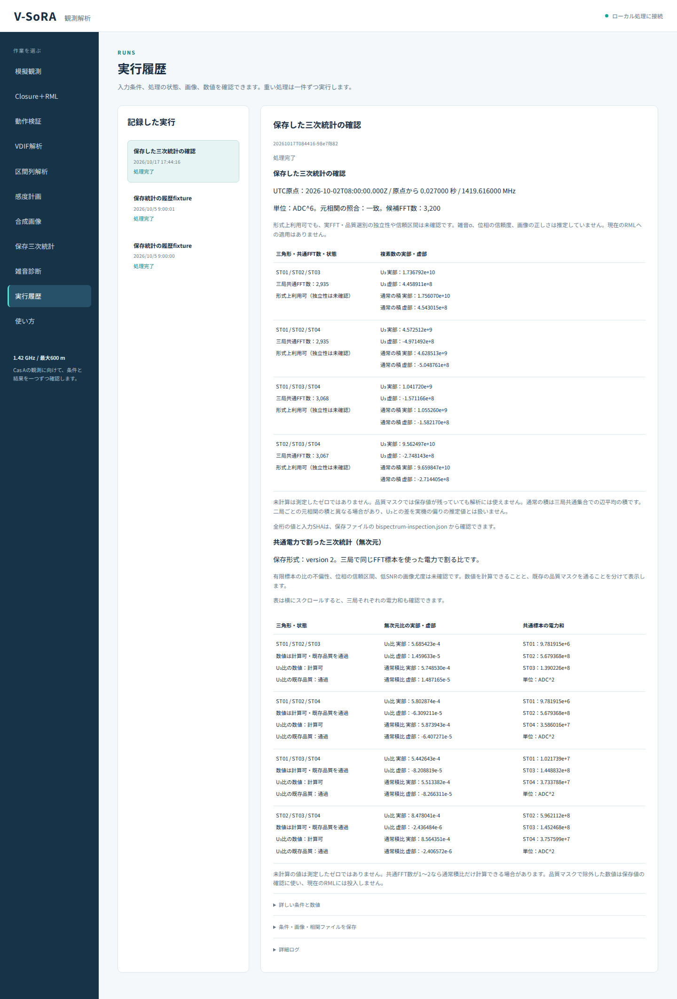
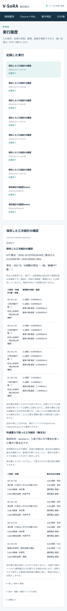

# 段階092：共通電力と無次元比を日本語GUIで確認

- 作成日：2026-10-17
- 状態：完了
- 比較元コミット：48d829f

## 読者向け概要

受信機ごとに増幅率が違うと、三局の信号から作った三次統計の大きさも変わる。同じ標本から測った各局の電力で割ると、単位と一定の増幅率の影響を取り除いた比を作れる。段階089〜091で、その電力を蓄積・保存・読み戻す経路を整えた。今回はその結果を日本語画面で確認する入口を作る。

ただし、比を計算できても、その誤差や画像の正しさが分かったわけではない。標本が少ない場合、電力が0の場合、品質条件で除外された場合を見分けられることも、観測者の判断に必要である。

## 1. 目的・対象範囲

保存三次統計画面へ、version2の無次元U₃比・通常積比・三局共通標本の電力和を追加する。既存raw表示と原本照合を維持し、v1の情報不足、M=0/1/2、0電力、品質maskを日本語で説明する。科学計算・保存形式・現在のClosure＋RMLは変更しない。

## 2. 完了条件

新14対象試験、ソース/導入済み全1497試験。両実Chromiumで実VDIF由来の保存値2条件と小規模スペクトルfixture5条件の全raw4値・比4値・共通電力3値のうち存在する値、全状態、全JSONを照合する。履歴選択、入力変更による選択解除、原本不一致の拒否、日本語font、390px、表内横scroll、JavaScriptエラー/外部通信0を確認する。公開監査・索引・匿名コミット/pushまでを完了条件とする。

## 3. 実際の作業

変更はGUIのapp.js・index.html・style.css、新しい14対象試験、実ブラウザ検証tool、ガイド・規約・本レポート・索引・公開記録である。既存の保存値確認に、無次元比と電力和の表を追加した。表は数値を計算できるかと既存品質条件を通るかを別表示する。狭い画面では表の中だけ横にスクロールできる。

version1は共通電力が無いため比を表示しない。version2ではM<3ならU₃比を未計算とし、通常積比はM=1〜2でも電力が正なら確認できる。三局のいずれかの電力が0なら除算せず、品質maskで利用不可でも保存値の確認は可能とする。表示は有効数字7桁で、保存JSONには全桁を残す。

段階091以降のVDIF解析・短区間列の保存オプションがversion2と電力和を保持することを、保存summaryの表示と説明へ反映した。科学Python・相関・保存形式・現在のRMLは変更していない。

## 4. 検証条件・結果

### 4.1 検証入力と期待値

実VDIF由来の条件は段階091で生成・相関した4局・2積分区間・32channelの保存原本を使う。第0時刻/channel10は形式上利用可、第1時刻/channel16は品質maskで利用不可である。新しいVDIF相関はこの段階で実行せず、保存された値の画面への伝達を確認した。

残る5条件はseed67の複素スペクトルから作ったM=0/1/2、旧version1（M=7）、局0の電力0（M=7）である。各条件は4局・4channel・4三角形を持つ。二つの時刻に同じ配列を入れているため、時刻間独立性の検証ではない。履歴にanalysisとsequenceの閉じたfixtureを置き、二つの原本を選択する操作も確認した。

各ケースの期待値は、読み込んだ同じ保存原本にinspection APIを適用したJSONである。独立した物理的正解を新たに与える試験ではなく、段階089〜091で直接検証した計算値を正しく表示・転送する確認である。表示丸めの期待値はPythonの通常の丸めに依存させず、浮動小数点をDecimalへ正確に移して、JavaScriptのtoExponential(6)に対応する丸めを計算する。

### 4.2 対象試験と実ブラウザ

新14件（丸め10、実worker4）が0.95秒で成功した。実workerはversion2通常・M=2・0電力とversion1を実行し、全summaryと取得JSONがAPIと一致することを確認した。丸め試験には正負0、最小subnormal、極小値、桁上がり、ちょうど半分、非有限値拒否を含む。

両実Chromium 153.0.8010.12で7条件を実行し、各4三角形、計28行/環境を照合した。各行のraw4値、正規化比4値、共通電力3値のうち保存形式・標本数・電力条件で存在する値を全件照合した。存在しない値は「未計算」とし、v1では正規化表自体を出さない。M=1〜2の通常積比、局0を含む三角形だけが0電力になることも確認した。ソース版と導入版の全7ケース記録は完全一致した。

| 操作・表示 | 両環境の観測結果 |
|---|---|
| 全summary・artifact JSON | 7条件すべてAPIと完全一致 |
| 履歴二種類からの原本選択 | 対応する二ファイルを選択 |
| 入力編集 | 時刻・周波数選択を無効化して再照合を要求 |
| 不正な対応原本・欠落原本 | エラーで停止 |
| 日本語font / 390px | 読込成功、画面全体の横はみ出し0 |
| 共通電力の幅広表 | 表内で横scroll可能、案内を表示 |
| JavaScriptエラー / 外部通信 | いずれも0 |
| 実行場所 | リポジトリ外の一時workspace、runner無し |

初回ソース実ブラウザは、検証toolが既存画面のMHz前の空白を期待文字列へ含めていなかったため停止した。製品の表示と科学計算を変えず、照合文字列を修正して全7条件を再実行した。失敗ログをGit管理外に保持し、正式成功へ数えていない。結果JSONの末尾改行も正式全回帰前に確認した。

[ソース実ブラウザ](../../validation/runs/stage092/source-browser.json)、[導入済み実ブラウザ](../../validation/runs/stage092/installed-browser.json)。

### 4.3 全回帰と配布

| 確認 | 観測結果 |
|---|---|
| ソース全回帰 | 1497成功、27,396警告、540.70秒 |
| 導入済み全回帰 | 1497成功、27,396警告、541.68秒 |
| 対象段階の科学Python | 84ファイルSHA不変 |
| 凍結したPython・frontend | 242ファイルSHA不変 |
| wheel | 87同梱ファイルがsourceとbyte一致 |
| pip check | 成功 |

除外0。Python3.12.3、NumPy2.5.1、pytest8.4.2、BLAS/OpenMP各1。警告は既存依存由来を含み、警告数を科学的な独立性の保証とは扱わない。全回帰中はソース・試験・検証toolを固定した。導入済みブラウザはPYTHONPATHを除き、UI関連moduleとinspection moduleが導入prefixから読まれることを確認した。

wheel 5,560,131bytes、SHA-256 d9cd9a0ae3894d83d3a882a22f3791dff66525b45eb518d91991c48e73690e2a。[正式記録](../../validation/runs/stage092/verification.json)。原本・全画面・serverログ・wheel・全回帰ログはGit管理外outputs/stage092-*に保持する。合成VDIF原本の識別SHAは正式記録と両ブラウザ記録に残す。

公開前の個人情報・秘密情報監査は指摘0、文書リンク1136件の欠落0、公開PNGのmetadataは空であることを確認した。author/committer双方に公開用情報を使用する。

## 5. 制約・未解決事項

実機の受信値を使用していない。実VDIFという表現は合成電圧をVDIFへ符号化し、実際の相関コードへ通した入力を指す。小規模fixtureは独立な複素スペクトルから生成し、二つの時刻へ複製しているため、独立な二つの観測区間の証明ではない。履歴は閉じたfixtureを配置して選択経路を確認し、新しい画像復元を実行したとは扱わない。

固定gainと固定maskでの無次元比の不変性は、標本の独立性、選別の影響、時間変動LO、不偏な比・位相、低SNRの画像尤度を保証しない。現在のRMLには投入していない。実Cas A画像化、実SEFD、弱い実信号での未知LO推定、全夜/GPU性能は未検証である。

## 6. 次段階

保存値を利用する前に、残留LO・量子化・標本相関が正規化統計へ与える影響を、既知入力と分けた条件で調べる。画像尤度への接続は、その適用条件と誤差評価を確認してから判断する。
