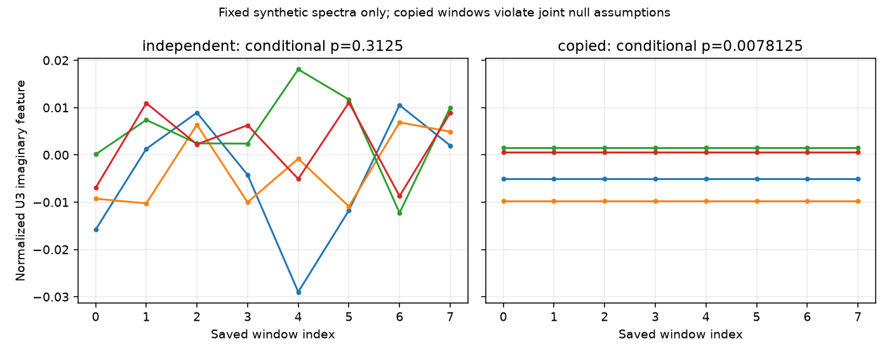

# 段階093：保存したwindow列を条件付き対称性検定へ接続

- 作成日：2026-10-17
- 状態：完了
- 比較元コミット：c987227d7b584f761043fda08a7da49e03a0820f

## 読者向け概要

短い区間ごとの三次統計は、雑音によって実部・虚部がばらつく。特定の生成条件では、虚部の正負を各区間で反転しても確率分布が変わらない。この性質を「結合分布の符号反転対称性」と呼ぶ。段階086ではこの仮定の下で使う有限の検定を、087では既知の電圧モデルによる成立例と反例を調べた。

今回は、合成電圧をその場で生成して検定する経路に加え、相関器が保存したversion2原本から同じ検定へ値を渡す。何度も再相関しなくても、保存した値と処理の来歴を確認して試せるようにする。ただし、ファイルが正しいことだけでは、検定の科学的な仮定が正しいとは分からない。

## 1. 目的・対象範囲

一つの原本照合済みrawファイルの全時刻・全三角形、事前指定channelの無次元U₃虚部を086の検定へ渡す。配列APIと独立CLIを提供し、入力SHA、全feature、仮定と未確認事項を残す。相関・正規化式・符号反転の検定量・RML・GUIは変更しない。

## 2. 完了条件

新40対象、固定8条件のsource実行と予備全JSON一致、直接電圧APIとの全feature照合。source/installed全1537試験、checkout外API/独立CLIの全成功JSONと拒否・非上書き・module prefixを確認する。レポート/索引/公開監査/匿名commit/push。

## 3. 実際の作業

新module bispectrum_window_symmetryは、既存のinspection APIから各時刻の無次元U₃虚部を全三角形分取り出し、既存のexact_window_sign_flip_testへ渡す。各windowのベクトル全体を反転する検定量・許容差は086と同じである。新しい統計的な近似や分布の当てはめは加えていない。

v1、保存時刻数が1〜12の範囲外、不正channel、M<3、0電力、既存品質mask除外を拒否する。無効値を0で補ったり、使えるwindowや三角形だけを自動抽出したりしない。これによって計算対象を明示するが、既に上流で行われた選別の科学的妥当性を認定するものではない。

ファイルAPIと新CLI vsora-window-symmetryは元相関を照合し、全feature・時刻・局・共通FFT数・入力SHAと条件付き検定結果をJSONへ保存する。配列APIは原本未照合と明示する。全channelを探索する機能やGUIはこの段階に含めない。

変更：相関器の新moduleと40試験、pyprojectのCLI入口、source検証workflow・導入版照合tool、[入力と成立条件](../../interfaces/bispectrum-window-symmetry.md)、RMLガイド・本レポート・索引・公開記録。既存の相関・保存形式・正規化・検定量・RMLのコードは変更していない。

## 4. 検証条件・結果

### 4.1 対象試験と入力条件

初回の適用手順は、検証workflowの配置先を存在しないtools/workflowsへ指定して停止した。作成済みの3ファイルが草稿とbyte一致すること、他の変更が無いことを確認し、既存のworkflowsへ配置して残りだけを適用した。正式試験の前に修正し、失敗を正式成功へ数えていない。

新40試験が0.26秒で成功した。全featureと086の全結果field、時刻数1/2/3/4/8/12、不正channelとversion、標本不足、0電力、品質mask、一部区間のみ不適合、入出力不変、原本改変の拒否、JSON・SHA・非上書きを確認した。

固定8条件のsource検証は予備の全JSONと完全一致した。実行コマンドは次の形である。

~~~bash
python tools/run.py workflows.bispectrum_window_validation \
  --output outputs/stage093-source-study \
  --real-raw outputs/stage091-source-study/with-raw/raw-bispectrum.npz \
  --real-source outputs/stage091-source-study/with-raw/shard-00000.npz
~~~

| 条件 | 入力と期待 | 観測結果 |
|---|---|---|
| 091の保存VDIF相関 | 2時刻・channel10・全4三角形 | 086への値渡しと原本SHAが一致 |
| 独立生成8区間 | seed9380、128mode、4channel、4局、全4三角形 | 全featureが直接電圧APIと一致 |
| 8区間の複製反例 | 一つの電圧区間を複製して局gainを適用 | 条件付きpは最小値、独立性未確認flag維持 |
| 一区間 | 同じ形式の1区間 | p=1、5%分解能なし |
| v1 | 共通電力なし | 拒否、結果JSONなし |
| M=2 | U₃標本不足 | 拒否、結果JSONなし |
| 一つの品質mask除外 | 全区間を要求 | 自動間引きせず拒否 |
| 局0の電力0 | 除算不能な三角形あり | 0で補わず拒否 |

合成スペクトルは、実数の局共分散ones＋2Iからproper complex Gaussianを生成し、window内で一定の複素局gainを掛ける。各channelの標本も生成上は独立に引く。FFT長4・標本周波数2048Hzに対応づけた128modeの区間幅0.25秒はfixtureの軸設定であり、原本ADC→FFTや実OCXOを検証した時間ではない。物理的な独立性を保存ファイルから判定したものではない。

直接電圧APIとの最大絶対差は6.7654215563095477e-17、一定window gainによる直接feature差は6.591949208711867e-17だった。前者は089〜091の計算経路と同じ量が検定へ届くかの照合であり、新たなp値の較正実験ではない。

### 4.2 区間数と反例の読み方

091由来の2区間では符号群4通り、最小分解能0.5、観測p=0.5。5%判定には分解能が足りない。独立生成8区間は256通り、観測p=0.3125だった。この一回の値から誤判定率や検出力は推定しない。

複製8区間の観測pは0.0078125となった。局gainを変えても同じ電圧標本の複製は独立な観測を増やさない。小さなpだけを見て天体を検出したと判断してはいけないことを示す、既知の依存反例である。出力はこの場合もwindow独立性と結合対称性を未確認とする。数値を計算する機能に、前提を自動認定する機能はない。

誤判定率の反復実験は今回追加していない。条件付き検定の全列挙と既知生成モデルの検証は[086](086-window-sign-symmetry.md)・[087](087-casa-window-symmetry.md)に保存しており、今回の試験と混同しない。[全8条件](../../validation/runs/stage093/window-results.json)。

### 4.3 導入版・全回帰

| 確認 | 観測結果 |
|---|---|
| ソース全回帰 | 1537成功、27,396警告、544.03秒 |
| 導入済み全回帰 | 1537成功、27,396警告、541.73秒 |
| checkout外API/独立CLI | 4成功の全JSON一致、4拒否、非上書き |
| project module所属 | 全9読込moduleがprefix内 |
| 凍結確認 | 303ファイルSHA不変 |
| wheel | 88同梱ファイルbyte一致、pip check成功 |

除外0件。既存依存由来の警告を含む。Python3.12.3、NumPy2.5.1、pytest8.4.2、BLAS/OpenMP各1。全回帰中は公式ソース・試験・検証toolを変更していない。導入済みCLIはPYTHONPATHを除去し、checkout runnerの無い一時workspaceから実行した。実ブラウザ検証は今回行っていない。

wheel 5,562,250bytes、SHA-256 f5c6cf2dd64782b9794a957ed02a0662d130cbba965576bcf06494695b5724a9。[正式記録](../../validation/runs/stage093/verification.json)、[導入照合](../../validation/runs/stage093/installed-api.json)。原本fixture・全ログ・wheelはGit管理外outputs/stage093-*に保持し、入力識別SHAと生成条件を全8条件へ記録する。

公開前の個人情報・秘密情報監査は指摘0、文書リンク1149件の欠落0、図のmetadataを確認した。author/committer双方に公開用情報を使用する。

## 5. 制約・未解決事項

条件付きp値の成立には、選別を含めたwindow列の結合符号反転対称性が必要である。保存原本からその前提を検証していない。全三角形を一つのベクトルとして扱い、三角形数を独立標本数と数えない。自動間引きを拒否しても、上流のデータ依存選別の妥当性は別に検証する必要がある。

一つのchannelを先に指定する機能であり、最小pを探す多重比較へ対応していない。区間の重なり・標本相関・LOの時間変動・gain一定・補正の選択誤差も保存値から認定しない。棄却・非棄却からCas Aの検出、拡がり、画像信頼度を結論しない。低SNR画像尤度、実機、未知LO推定、実SEFD、全夜/GPU性能は未検証。現在のRMLへ未投入である。

## 6. 次段階

日本語GUIに、成立条件、区間数とp値の分解能、未確認事項を併記して接続する。さらに、物理的な残留LO・量子化・選別・相関が対称性を保つ範囲と、実用的な形状識別能力を評価する。
