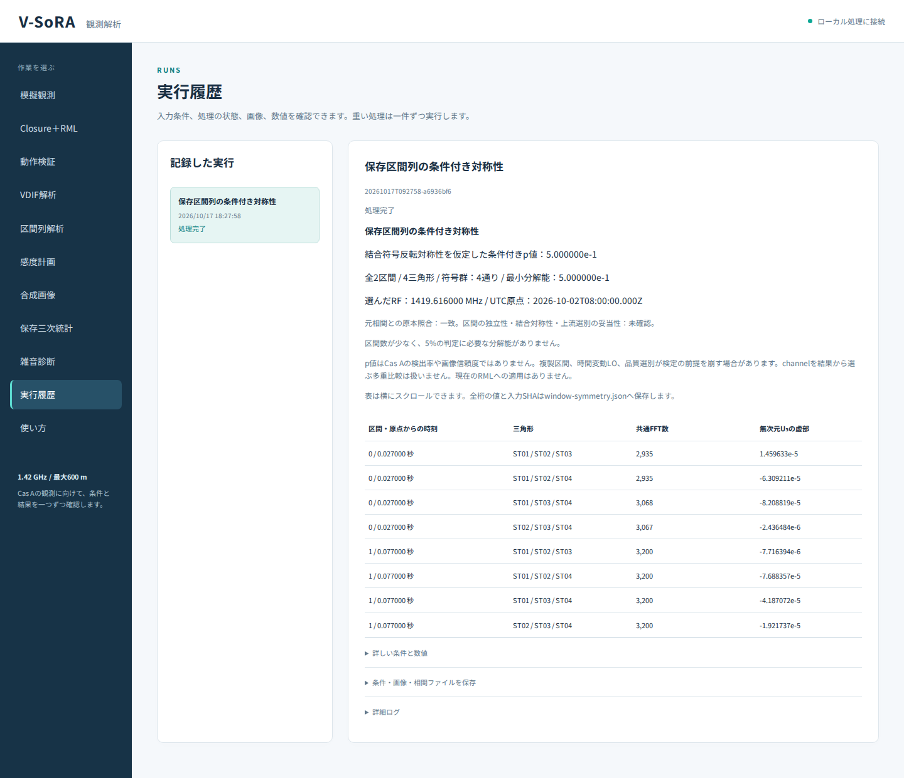
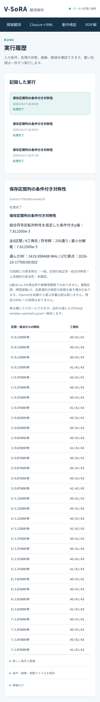

# 段階094：保存区間列の条件付き対称性を日本語GUIへ接続

- 作成日：2026-10-17
- 状態：完了
- 比較元コミット：4171ce054765333e1bfb57712a1b78145af6a0de

## 読者向け概要

短区間の統計をまとめて調べるには、区間数や元ファイルを取り違えず、検定に必要な前提も確認できる入口が必要である。段階093では、保存した無次元U₃虚部を条件付きの対称性検定へ渡すAPIとCLIを実装した。今回は観測者が同じ処理を日本語GUIから実行できるようにする。

結果にはp値とともに、区間数、符号反転の組合せ数、最小p値の分解能、全入力値を表示する。原本が一致したことと、区間の結合対称性が成立することは別々に説明する。小さいp値をCas A検出や画像の正しさへ読み替えない。

## 1. 目的・対象範囲

既存の二原本照合と入力SHAを共有し、事前指定RFについて全保存時刻・全三角形の093処理を実行する。新job、厳密なrequest、実worker、成功/失敗の日本語表示を追加する。科学Python、相関・正規化・検定量、保存形式、RMLは変更しない。

## 2. 完了条件

新20対象、両全回帰1557件。両実Chromiumで093の4成功全JSONと全76feature行/数値/状態、v1・13区間のbutton無効化、M2/0電力/品質除外の日本語停止、入力編集・選択SHA再確認・原本不一致、390px/font/局所scroll/JS外部通信0。既存092の7条件全表示/JSONも両実ブラウザで回帰。wheel同梱・科学SHA不変、レポート索引・公開監査・匿名commit/push。

## 3. 実際の作業

保存三次統計の入力フォームへ「全区間の条件付き対称性を確認」を追加した。入力照合APIは版を返し、version2・1〜12区間のときに新ボタンを有効にする。既存の一セル検査は維持する。新requestは二原本・選択SHA・channelのみを受け付け、時刻や区間の抜き出し・alpha指定を受け付けない。

workerは選択時のSHAと原本を再照合し、093の同じ配列APIへ渡す。version1、区間数範囲外、標本不足・0電力・品質除外は日本語で停止理由を示し、途中のp値や結果JSONを成功表示しない。

結果には条件付きp、全区間数・三角形数、符号群数・最小分解能、RFとUTC原点、全時刻・三角形・共通FFT数・虚部featureを表示する。5%の分解能不足と未確認の前提を併記し、表内を横にスクロールできる。全桁は保存JSONへ残す。

変更：UIのmodels/worker/jobs/raw_bispectrum、index.html/app.js、新20対象試験、実ブラウザtool、ガイド・規約・本レポート・索引・公開記録。既存の科学PythonとRMLは変更していない。

## 4. 検証条件・結果

### 4.1 対象試験

新20件が1.52秒で成功した。厳密なrequest検査10件、実worker6条件、選択SHA改変2件、許可fieldの確認1件、13区間を抜き出さず拒否する実worker1件である。実workerは正常、品質mask、M=2、0電力、v1、不正channelを使う。成功時は全summary・artifact JSONが093 APIと一致し、失敗時はsummaryが無く結果JSONを作らないことを確認した。

事前の隔離GUI20件は予備確認とし、正式適用後の試験と区別した。新たな物理的検定の較正や画像生成は行っていない。

### 4.2 両実Chromiumの操作と数値

093の保存原本を外部入力として渡し、リポジトリ外のrunnerを持たない一時workspaceからGUIを起動した。VDIF由来2区間、独立生成8区間、複製8区間、一区間の4成功を実行した。全summary・artifact JSONは093の全結果と完全一致した。

4成功の全76行/環境について、時刻・三角形の局名・共通FFT数・無次元U₃虚部を全件照合した。p値・群数・最小分解能・RF・区間数と三角形数・未確認事項・5%分解能不足の文言も確認した。新ブラウザtoolは作成したジョブIDと画面のIDが一致してから終了状態を待ち、前の結果を取り違えないようにした。

| 条件・操作 | 両環境の観測結果 |
|---|---|
| 全科学JSON | 4成功すべて093と一致 |
| v1 / 13区間 | 理由を示し新ボタン無効、既存の一セル検査は有効 |
| M2 / 0電力 / 品質除外 | 日本語で停止、部分結果やpを表示しない |
| 入力編集 | 新旧両操作を無効化して再照合を要求 |
| 選択SHA改変 | workerで再確認し、読み直しを要求 |
| 元相関不一致 | 入力照合で拒否 |
| 日本語font / 390px | 読込成功、画面全体の横はみ出し0 |
| 幅広table | 表内で横scroll可能 |
| JavaScript / 外部通信 | いずれも0 |

複製区間でも数値としてp=0.0078125を計算できるが、画面は区間独立性・結合対称性・上流選別の妥当性を未確認とする。小さいpだけで天体を検出したとは表示しない。2区間の最小p=0.5や一区間のp=1には、5%判定に必要な分解能不足を示す。

[ソース実ブラウザ](../../validation/runs/stage094/source-browser.json)、[導入済み実ブラウザ](../../validation/runs/stage094/installed-browser.json)。

### 4.3 既存画面・全回帰・配布

既存092の保存値画面も両実Chromiumで再実行し、7条件の全raw/比/電力・状態・全JSON、日本語390px、局所scrollを確認した。ソース版と導入版のケース記録は、新画面8条件と既存画面7条件の両方で完全一致した。

| 確認 | 観測結果 |
|---|---|
| ソース全回帰 | 1557成功、27,396警告、540.84秒 |
| 導入済み全回帰 | 1557成功、27,396警告、604.09秒 |
| 科学Python | 85ファイルSHA不変 |
| 凍結source | 305ファイルSHA不変 |
| wheel | 88同梱ファイルbyte一致 |
| pip check | 成功 |

除外0。既存依存由来の警告を含む。Python3.12.3、NumPy2.5.1、pytest8.4.2、BLAS/OpenMP各1。公式ソース・試験・tool・workflow・pyprojectは全回帰中に固定した。導入ブラウザはPYTHONPATHを除去し、UI・raw入力・保存/正規化・条件付き検定の関連moduleをprefixから読み込むことを確認した。

wheel 5,564,015bytes、SHA-256 ff18237801318a11b19e633b2088757d9420f18a783b5cfe598e0481c891a99c。[正式記録](../../validation/runs/stage094/verification.json)、[ソース既存画面](../../validation/runs/stage094/source-legacy-browser.json)、[導入既存画面](../../validation/runs/stage094/installed-legacy-browser.json)。詳細ログ・全画面・入力コピー・wheelはGit管理外outputs/stage094-*へ保持する。入力SHAと生成条件は[093の全8条件](../../validation/runs/stage093/window-results.json)へ残している。

導入全回帰はGit管理外の別予備計算と同じホストで並行した。秒数は実行記録であり、ソース版と導入版の速度差を評価した結果ではない。

公開前の個人情報・秘密情報監査は指摘0、文書リンク1160件の欠落0、公開PNGのmetadataは空であることを確認した。author/committer双方に公開用情報を使用する。

## 5. 制約・未解決事項

今回は既存計算を操作・表示する接続の検証であり、新しい誤判定率のMonte Carloや画像評価ではない。原本は合成VDIFと合成スペクトルで、実機を使用しない。複製8区間の小さいpは、区間の独立性・結合対称性を自動認定しない必要性を示す反例である。

上流の選別、残留LO、標本相関、実gain一定、未知LO推定、低SNR画像尤度、実SEFD、実Cas A画像化、全夜/GPU性能は未検証。channelを結果から選ぶ多重比較へ未対応。現在のRMLにこのp値やU₃比を投入していない。

## 6. 次段階

実観測に向けて、残留LO・量子化・データ選別が検定と統計量へ与える影響、有限データでの形状識別能力、画像尤度の適用条件を調べる。全体文書にも085以降の保存・診断と未完了の核心を反映する。
