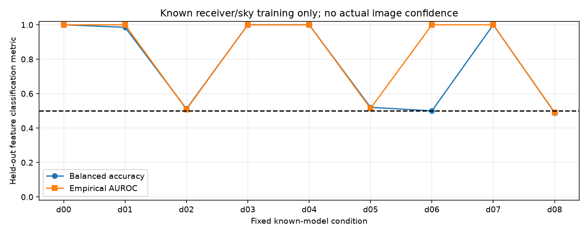

# 段階096：既知点源・Cas Aの有限電圧を独立データで識別する

- 作成日：2026-10-17
- 状態：完了
- 比較元コミット：5b2d1bcd955377129d2a745a5050548de14edb78

## 読者向け概要

平均の信号が大きいことと、雑音を含む一回の短観測で形を見分けられることは違う。条件付き対称性検定の棄却も、そのままCas Aと点源の識別率にはならない。そこで今回は、候補を既知点源と既知Cas A形状代理に限定し、別々に生成した学習データと評価データで、有限の三次統計から形状ラベルを区別できるかを調べる。

この実験は受信機雑音等を与えた条件付きの比較である。実機の未知SEFDへそのまま適用できる分類器や画像尤度を完成したとは扱わない。受信機の仮定がずれた場合も意図的に含め、正答率とscoreの順位が違う判断であることを確かめる。

## 1. 目的・対象範囲

087の既知天空・Gaussian電圧モデルと085の観測power正規化U₃を再利用し、固定9条件の独立training/holdout評価を追加する。8局・1.42GHz・600m・仮定flux1000Jy、実部56＋虚部56を一つのfeatureベクトルにする。未知LO、実ADC/FFT・量子化・RFI、画像復元、GUIは対象に含めない。

## 2. 完了条件

新66対象、9条件各training128/label・test512/labelの正式実験と予備全JSON一致。source/installed全1623試験、checkout外9APIと固定計画・独立native CLI全9条件JSON・全module/asset prefix・非上書き。保存した条件とscore・誤り率・区間を説明し、レポート/索引・公開監査・匿名commit/push。

## 3. 実際の作業

新しいtemplate_score moduleは、trainingで測った二モデルのfeature平均の差方向と中点を固定する。global scaleで有限の数値範囲を整え、test featureの射影scoreを求める。正をCas Aラベル、0以下を点源ラベルとする。training平均が同じ場合は識別不能とし、予測を作らない。入力のmask・非有限値・複素feature・不正shape・数値範囲外や非ゼロの消失を拒否する。

既存の既知天空共分散からproper complex Gaussian電圧を生成し、同じ標本power正規化U₃の実部56＋虚部56を使用する。triangles内の相関を独立な試行数へ換算しない。各条件のtraining二群とtest二群はSeedSequenceの別role0/1/2/3を使う。testを生成する前にモデルを固定し、testからの方向・閾値調整はしない。

誤判定率には固定trainingの下での二項Clopper-Pearson95%区間を付ける。これは各test群の個別区間で、学習変動・全条件同時の被覆・画像信頼度ではない。[SciPy1.18一次資料](https://docs.scipy.org/doc/scipy/reference/generated/scipy.stats._result_classes.BinomTestResult.proportion_ci.html)と、独立した小nの二項多項式・境界式で確認した。

変更：simulatorのtemplate_score.py/known_template_validation.py、新66試験、source workflow、導入API/CLI照合tool、[定義と操作](../../interfaces/known-template-holdout.md)、本レポートと索引・現在の文書への追補・公開記録。既存の科学Python、相関器、保存形式、UI、検定量、RMLのコードは変更していない。

## 4. 検証条件・結果

### 4.1 固定した生成条件と評価方法

9条件はM512/19200×SEFD1000/10000/585966Jyの6条件、trainingとpoint-testのSEFDを1000↔10000Jyへ入替えた2条件、両ラベルを同じ零天空とした負対照1条件である。全ケースで最大基線600m、同じ単一時刻の幾何、8局、1.42GHz、零天空以外の総flux1000Jyを仮定する。

SEFD1000/10000Jyは仮定値。585966Jyは直径1m・雑音温度100K・開口効率0.6から既存APIで求めた計算例で、実測値ではない。Cas Aは同梱の形状代理で、実flux・主ビーム・偏波・実OCXOを測定した入力ではない。

各ラベルtraining128・test512、計11520個の独立生成window（training2304、holdout9216）を使う。M19200は64kHz×0.3秒に対応づけた理想mode数であり、実ADC/FIR/FFTやsample相関を通していない。M512は小mode数の比較条件で、実運用の積分時間を認定しない。

balanced accuracyは二ラベルの正答率を等しく平均した値である。AUROCはCas A scoreが点源scoreを上回る割合（同点半分）で、固定閾値での正答率と別の指標である。512²個のscore対は互いに独立ではないため、それを二項試行数にして誤差を小さく見積もらない。

### 4.2 独立評価の観測値

以下の誤り数は「点源をCas Aとした件数 / Cas Aを点源とした件数」で、各分母は512である。各誤判定率・個別区間・全test score・trainingモデルは保存JSONへ残す。

| 条件 | M | 学習 / 点源test SEFD(Jy) | 生成条件 | balanced accuracy | AUROC | 誤り数 |
|---|---:|---:|---|---:|---:|---:|
| d00 | 512 | 1000 / 1000 | 一致 | 1.000000 | 1.000000 | 0 / 0 |
| d01 | 512 | 10000 / 10000 | 一致 | 0.985352 | 1.000000 | 15 / 0 |
| d02 | 512 | 585966 / 585966 | 一致 | 0.511719 | 0.508625 | 229 / 271 |
| d03 | 19200 | 1000 / 1000 | 一致 | 1.000000 | 1.000000 | 0 / 0 |
| d04 | 19200 | 10000 / 10000 | 一致 | 1.000000 | 1.000000 | 0 / 0 |
| d05 | 19200 | 585966 / 585966 | 一致 | 0.520508 | 0.513973 | 277 / 214 |
| d06 | 19200 | 1000 / 10000 | SEFD不一致 | 0.500000 | 1.000000 | 512 / 0 |
| d07 | 19200 | 10000 / 1000 | SEFD不一致 | 1.000000 | 1.000000 | 0 / 0 |
| d08 | 512 | 1000 / 1000 | 零天空・同一分布 | 0.489258 | 0.490829 | 289 / 234 |

受信機モデルが一致し、SEFD1000/10000Jy等の条件では、この単純な参照手法でも高い識別率を得た。一方、1m/100Kの計算例に相当する条件はbalanced accuracy約0.51〜0.52、AUROC約0.51だった。これは選んだfeature・学習数・一短区間・既知二モデル・単純scoreの結果で、一般の画像化不能の証明ではない。より広い帯域、複数露光、別の統計や尤度の可能性まで排除しない。

d06はAUROC=1でもbalanced accuracy=0.5となった。scoreの順位は分かれていても、受信機雑音の仮定が変わるとtrainingで固定した閾値がずれ、点源512件すべてをCas Aへ分類した。testの正解を使って閾値を修正していない。順位指標だけで実際の判定や未知SEFDの較正を保証できないことを示す。

d00の誤り0/512でも、個別95%二項区間の上限は0.00717895で0ではない。この区間は固定したtrainingと生成分布に限る。学習をやり直す揺らぎや実画像の信頼度は含めない。

零天空の負対照はbalanced accuracy=0.489258、AUROC=0.490829。固定trainingの下で両test群が同じ分布ならbalanced accuracyの期待値は0.5、分散はp(1−p)/(2n)≤1/(8n)となる。事前に決めた「最大標準誤差の6倍」の広いMC確認内だった。これを実観測の信頼水準として使わない。

[全9条件・全score・区間](../../validation/runs/stage096/holdout-results.json)。予備の最初の実験の後、零天空のfluxが0であることと生成モデル名を明示するmetadataを追加し、全条件を再実行した。全旧科学数値は完全一致した。正式sourceも最終予備の全JSONと完全一致した。[metadata確認](../../validation/runs/stage096/metadata-review.json)。

### 4.3 数値実装・配布・全回帰

新66対象試験は0.82秒で成功した。独立の射影計算、scale/label交換、識別不能、不正入力・model・数値範囲、個別二項区間の境界式と小nの二項多項式、AUCの順位とtie、固定計画の改変拒否、smoke3条件と非上書きを確認した。

testの少数の同じ実現へ別の一定局gainを掛け、feature最大差2.9837243786801082e-15、score最大差1.8189894035458565e-11、分類の一致を確認した。これらの再計算は独立なMonte Carloの追加試行とは数えない。前ADCの非線形性や時間変動LOへの保証ではない。

| 確認 | 観測値 |
|---|---|
| ソース全回帰 | 1623成功、27,396警告、540.01秒 |
| 導入済み全回帰 | 1623成功、27,396警告、571.41秒 |
| checkout外API | 9照合と固定計画が一致 |
| 単独導入CLI | 全9条件の全科学JSONがsourceと完全一致、非上書き |
| module/asset | 全17読込project moduleと設定・天空がprefix内 |
| 既存のPython/frontend/project | 305ファイルSHA不変 |
| 凍結確認 | 311ファイルSHA不変 |
| wheel | 90同梱ファイルbyte一致、pip check成功 |

除外0件。Python3.12.3、NumPy2.5.1、SciPy1.18.0、pytest8.4.2、BLAS/OpenMP各1。既存依存由来の警告を含む。source/tests/tools/workflows/pyprojectを全回帰中は固定した。導入検証はPYTHONPATHを除き、runnerの無いcheckout外workspaceからnative CLIを実行した。実ブラウザは今回実行していない。

独立CLIの初回起動は自動承認レビューのtimeoutでCreateProcess前に停止した。許可された一回の再試行で実行し、正式な全照合が成功した。最初の起動を科学試験の成功・失敗に数えていない。

source実験は215.41秒、最大RSS 197,748KiB、電圧batch最大921,600値。生成したMC実験の実行記録であり、実VDIF相関や全夜処理の性能測定ではない。

wheel 5,570,187bytes、SHA-256 266ba80272d6e3b717f7bfabf0186b871cbbed1b3b4022ac9edc506c8056bb7e。[正式記録](../../validation/runs/stage096/verification.json)、[独立導入照合](../../validation/runs/stage096/installed-api.json)、[API期待値](../../validation/runs/stage096/api-reference.json)。全ログ・wheel・case別JSON・予備実験はGit管理外outputs/stage096-*へ保持する。

導入全回帰と独立native CLIは同じホストで一部並行した。所要時間は実行記録であり、ソース版と導入版の速度比較ではない。公開前の個人情報・秘密情報監査は指摘0、文書リンク1199件の欠落0、図のmetadataを確認した。author/committer双方に公開用情報を使用する。

## 5. 制約・未解決事項

既知の二形状・flux・受信機共分散を与える参照実験であり、未知の天空や未知SEFDを推定したものではない。単純なtraining平均差scoreは最適分類器・Gaussian尤度・情報量の上限ではない。評価データで重み・閾値を調整していない。

test群の誤り率の区間は固定training・独立生成条件の下のもので、学習の揺らぎ、複数条件の同時被覆、実機や画像の信頼度を含めない。AUROCの512²対を独立標本にしない。M19200の0.3秒相当は理想mode数の仮定で、実FFTやOCXOの独立性・安定性を測った結果ではない。形状代理は既存参照画像で、現在1.42GHzの実fluxを測定したものではない。

時間変動LO、量子化、品質選別、実SEFD、弱い実信号の未知LO、実Cas A画像化、全夜/GPU性能、低SNR画像尤度は未検証。現在のRMLへこのscoreや統計を投入していない。

## 6. 次段階

既知受信機モデルの制約を緩めた識別、独立学習の揺らぎ、LO/実FFT/選別の影響を調べ、一般の画像尤度へ進む条件を評価する。日本語GUIへの接続は、成立条件と学習/testを分ける説明を保って別段階で行う。
