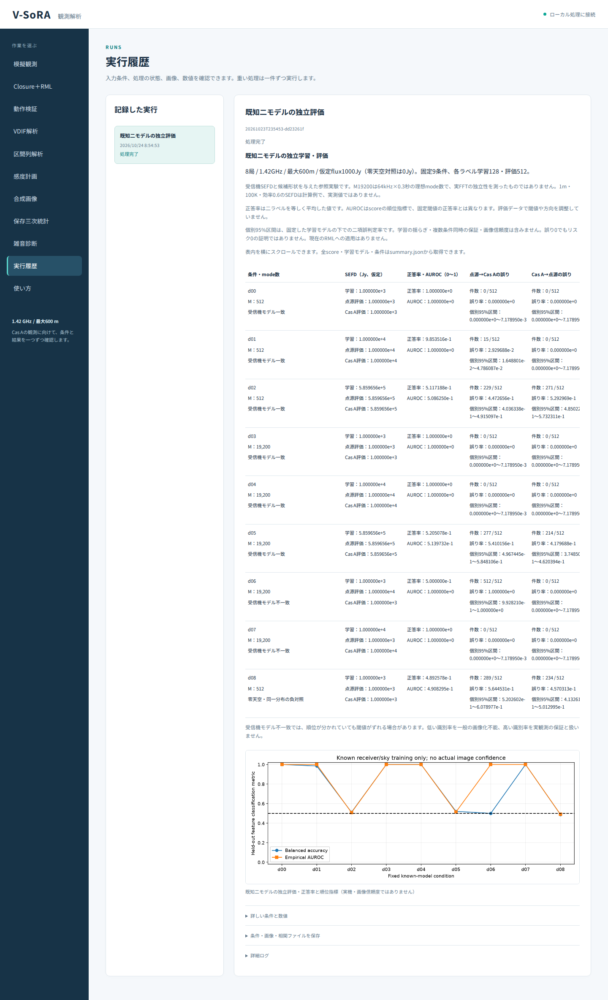
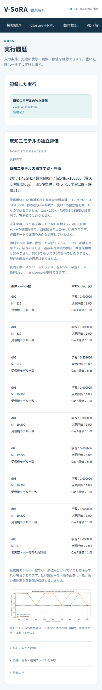

# 段階097：既知二モデルの独立評価を日本語GUIへ接続

- 作成日：2026-10-24
- 状態：完了
- 比較元コミット：0b824a63960ef80f794ed234257372217834c117

## 読者向け概要

観測網が天体の広がりを区別できるかを調べる第一歩として、段階096では「点源」と「既知のCas A形状」を候補にした参照実験を用意した。点源とは、装置の分解能では広がりを無視できる光源である。別々に生成した電圧から学習用と評価用のデータを作り、学習時に決めた判定方法を評価時には変更しない。

この段階では同じ実験を日本語GUIから実行できるようにする。正答率だけでなく、受信機の雑音条件、二種類の誤判定、評価標本数、誤判定率の区間を一緒に表示する。高い正答率は実観測の成功を保証せず、低い値も一般の画像化不能を証明しない。

## 1. 目的・対象範囲

- 段階096の固定9条件を、リポジトリの実行スクリプトを持たない作業フォルダからGUIで実行する。
- 保存された科学JSONと表示数値が一致することを、ソース版とwheel導入版の両方で確認する。
- 科学計算、RML画像復元、記録形式、Windows収録は今回の変更対象に含めない。

## 2. 完了条件

1. 新しい選択肢・固定計画・実行/失敗/中止の対象試験が成功する。
2. 両実Chromiumで9条件すべてを実行し、全科学JSONが096と一致する。全表の数値、説明、図、日本語font、幅390px、表内の横スクロールを確認する。
3. 導入版の科学module・設定・天空画像が導入先にあり、checkoutのrunnerを使わない。
4. ソース版と導入版の全回帰が成功し、検証中のソースが不変である。
5. 個人情報・秘密情報監査、文書リンク確認、匿名コミットとpushを完了する。

## 3. 実際に行った作業

「動作検証」に「既知点源/Cas Aの独立学習・評価」を追加した。workerは同梱された科学moduleを直接呼び出し、固定9条件を実行する。試行数・seed等の追加fieldは受け付けず、任意の小規模計画へ黙って置き換えない。途中の進捗と中止・失敗を既存のジョブ管理へ接続した。

各条件のmode数、仮定SEFD、受信機条件一致/不一致、零天空の負対照、正答率とAUROC、二種類の誤判定件数・率・個別95%区間を表示する。区間は「固定した学習結果の下での二項誤判定率」であると説明し、全scoreと学習modelはsummary.jsonに保持する。図のaltとcaptionでも実機・画像信頼度との違いを示す。幅広の表は表の内部で横にスクロールする。

変更ファイルはUIのmodels/worker/jobs/server、staticのapp.js/index.html、新GUI12試験・既存GUIへの追加5試験と既存2試験の利用可能選択肢、実ブラウザ照合tool、既存2ブラウザtoolの選択肢期待値、利用ガイド、文書入口・全体レポートへの補足、本レポート・索引・正式記録である。科学Pythonは変更していない。

## 4. 検証条件・結果

### 4.1 対象試験と全回帰

新17件は固定選択肢、許可しない追加field3件、native派遣と進捗、失敗、中止を確認する。さらに科学計算が返した不成功・不正応答5条件を、新GUIと既存の53条件GUIの両方で拒否することを確認した。初回全回帰後のレビューで追加した確認であり、追加後にソース・導入版・ブラウザを再検証した。初回1630件の全回帰ログはGit管理外の*-before-result-checkに保持し、正式結果の件数には加算していない。派遣試験は明示的なstubを使い、Monte Carlo実験の実行証拠とは区別した。既存のnative選択肢確認2件を合わせ、19件が0.94秒、1警告で成功した。

| 確認 | 観測結果 |
|---|---|
| ソース全回帰 | 1640成功、27,396警告、644.21秒 |
| 導入済み全回帰 | 1640成功、27,396警告、636.43秒 |
| 科学Python | 87ファイルSHA不変 |
| 両全回帰終了時の凍結source/tests/tools等 | 314ファイルSHA不変（後のtool一行更新は4.4参照） |
| wheel | 90同梱ファイルbyte一致 |
| pip check | 成功 |

除外0。Python3.12.3、NumPy2.5.1、SciPy1.18.0、pytest8.4.2、Playwright1.63.0。BLAS/OpenMP各1。既存依存由来の警告を含む。公式source/tests/tools/workflows/pyprojectは全回帰中に固定した。実ブラウザと全回帰は一部並行しており、秒数は実行記録であって実観測処理の速度比較ではない。

### 4.2 実ブラウザでの再計算と表示

ソース版・wheel導入版の両実Chromiumで、runnerを持たないリポジトリ外の一時workspaceから固定9条件を再計算した。全科学summaryとartifact JSONは、[096の全結果](../../validation/runs/stage096/holdout-results.json)と完全一致した。新しい物理条件や識別手法を追加した実験ではなく、096の実験をGUI経由で再現した確認である。

全9行についてSEFD3値、正答率・AUROC、二種類の誤判定件数・率・区間端点を、対応する列とラベルを指定して照合した。受信機条件・零天空状態、仮定と未検証事項、図のalt/caption、日本語fontも確認した。390pxで画面全体の横はみ出しは0、表の内部を実際に横へスクロールした。JavaScriptエラー・外部通信はいずれも0だった。

導入版では関連8科学moduleと設定・天空画像が導入先prefixにあり、PYTHONPATHを除去した。リポジトリの実行スクリプトはworkspaceに存在せず、workerの直接呼出しで実行した。ソース版と導入版の9行の照合記録は一致した。

[ソース実ブラウザ](../../validation/runs/stage097/source-browser.json)、[導入済み実ブラウザ](../../validation/runs/stage097/installed-browser.json)。

### 4.3 既存画面と環境復旧

既存のnative配置比較を両実Chromiumで再実行し、18概要・108条件・6,048詳細の全数値、全JSON、filter、日本語390px、図の説明を照合した。[ソース](../../validation/runs/stage097/source-array-browser.json)、[導入版](../../validation/runs/stage097/installed-array-browser.json)。既存53条件の虚部対称性GUIも、後述の最終確認で両実ブラウザから再実行した。派遣・失敗・中止等は全回帰に含めた。

初回の新GUIブラウザ起動は、更新されたPlaywrightに対応するChromium実行ファイルが見つからず、ページを開く前に停止した。対応するheadless ChromiumをGit管理外の一時領域へ導入し、別の出力先で正式検証を再実行して成功した。最初の起動を科学試験の合格には数えていない。ソースの変更は不要だった。Node実行ファイルも存在しなかったため、任意のnode構文確認は未実行であり、実Chromiumの読み込み・エラー0をJavaScript動作の確認とした。

最初の記録処理では、pip checkの終了コード0と成功行にキャッシュ警告が付いたため、出力全体を固定文字列と比較していた記録スクリプトが停止した。依存関係の異常ではない。成功行の確認へ修正し、以降のpipキャッシュ先をGit管理外の書込可能な場所へ指定して記録を再作成した。記録復旧の初回起動では、Pythonのsymlinkを解決してしまいvenv外のinterpreterとなって依存moduleが見つからず停止した。venvの起動パスを保持して再実行し成功した。科学試験を追加実行した回数には含めず、これらの停止も正式記録に残した。

公開前の初回リモート照合は、新環境にknown_hostsがなく停止した。[GitHub公式の公開ホスト鍵・指紋](https://docs.github.com/en/authentication/keeping-your-account-and-data-secure/githubs-ssh-key-fingerprints)を照合して、Git管理外のプロジェクト専用known_hostsへ保存した。厳密なホスト鍵検証と既存SSH鍵を使って接続を復旧し、リモートdevelopmentの先端が比較元と一致することを確認した。

ブラウザはWSLのheadless Chromiumであり、Windows実ブラウザ・WSLgの確認ではない。wheelは5,571,444bytes、SHA-256 `de33f73896b7cdb1db757de5dae2764cef71ac53b8ec54939c7549f13b18583b`。[正式記録](../../validation/runs/stage097/verification.json)。詳細ログ・全画面・wheelはGit管理外outputs/stage097-*に保持する。

### 4.4 既存53条件GUIと検証ツールの最終確認

静的確認で、既存ブラウザtoolの利用可能選択肢数に「2」が残っていたことを見つけた。両全回帰が終わり、314ファイルのSHAがその時点で不変であることを確認してから、検証toolの期待値一箇所を「3」へ修正した。実行中の全回帰のsource/tests/toolsは変更していない。アプリ・科学計算・試験・wheel同梱ファイルに、この後の変更はない。

変更はメニュー件数のassertだけであり、数値表示の照合関数のASTも不変だった。修正後に関連24対象試験をsource/installedで再実行し、既存の53条件・2,968詳細・53条件別JSONとsummary download・4filter・日本語390px・表内scrollを両実Chromiumで確認した。全科学JSONは087と一致し、外部通信・JavaScriptエラーは0だった。これは全回帰に追加した新24試験という意味ではなく、既に含まれる関連試験の再確認である。

最終HEADのアプリと科学計算は両全回帰時のものと一致する。全回帰後に変更した検証tool一箇所は、上記の実ブラウザ試験で検証した。他の313凍結ファイルのSHAも不変だった。比較前後SHAと順序は正式記録に残した。[ソース53条件GUI](../../validation/runs/stage097/source-symmetry-browser.json)、[導入済み53条件GUI](../../validation/runs/stage097/installed-symmetry-browser.json)。

公開前の個人情報・秘密情報監査は指摘0、文書リンク1,215件の欠落0。公開図のmetadataを確認した。author/committer双方に公開用の情報を使用する。

## 5. 制約・未解決事項

候補形状・受信機条件が既知である仮想実験である。SEFDは受信機雑音の強さをJyで表す量で、ここでは仮定値またはアンテナ径・温度等からの計算値を用いる。実測SEFDを得たものではない。

AUROCは判定scoreの順位を評価する指標で、学習時に固定した閾値の正答率とは異なる。雑音条件が学習時と変わると、順位が分かれていても閾値がずれて誤判定し得る。個別95%区間は固定した学習結果の下での二項誤判定率の範囲であり、学習の揺らぎ・全条件同時の保証・画像の信頼度を表さない。

Mは独立な電圧modeの数である。M=19,200を64kHz×0.3秒と対応させる説明は理想化した計算であり、RTL-SDRのFFT標本が独立であると測定した結果ではない。局別周波数差・時間変動位相・量子化・RFI・実測雑音を含む実機Cas A画像化、低SNR画像尤度、全夜運用、GPU性能は未検証である。

## 6. 次段階

既知形状の参照分類と、未知の画像を求めるClosure＋RMLの差を維持し、受信機条件が異なる場合の判定の限界と、実データへ渡すために必要な成立条件を順に検証する。
