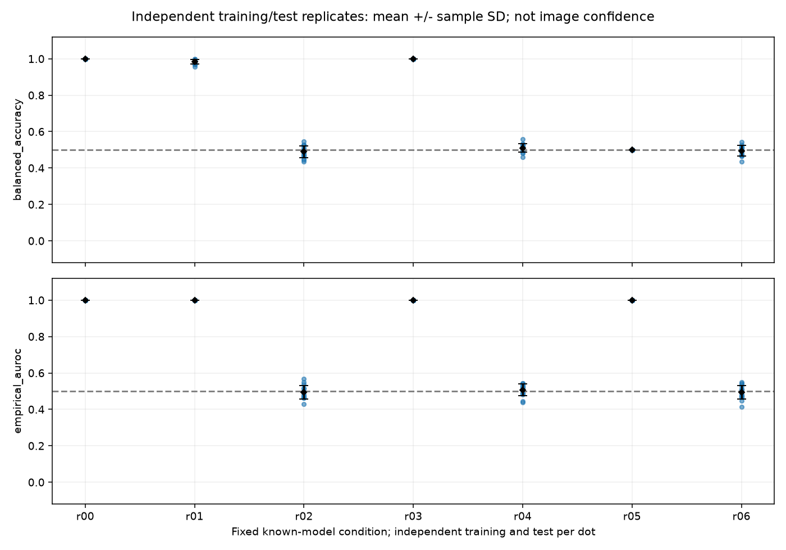

# 段階098：独立した学習・評価を繰り返したときの揺らぎ

- 作成日：2026-10-24
- 状態：完了
- 比較元コミット：ff8425cb1a5c72576569b49dec3a7f59bd7a08c5

## 読者向け概要

学習用データから決めた判定方法は、別の学習用データを渡すと変わることがある。段階096の誤判定率の区間は、一つの学習結果を固定した場合のものだった。この段階では学習用・評価用の両方を作り直し、同じ手順を何度実行したときに結果がどれだけ揺らぐかを調べる。

ただし、この揺らぎには「学習結果の違い」と「評価用データに含まれる偶然の違い」の両方が入る。学習だけの誤差を分離した実験ではない。また、候補形状・受信機雑音を与える既知モデルの実験であり、実機の画像信頼度には読み替えない。

MC（Monte Carlo、モンテカルロ）は、乱数を使ってモデルを何度も計算する方法である。正答率は点源とCas Aそれぞれの正答率を等しく平均した値、AUROCは判定scoreの順位を評価する0〜1の指標である。この実験では独立な複素電圧標本一つをmodeと呼び、Mは一つの区間に含むmode数を表す。実FFTの標本が同じだけ独立であると測定したわけではない。

## 1. 目的・対象範囲

固定した7条件について、独立な学習・評価の組を各16回生成する。点源/Cas Aの二候補と同じ平均差scoreを用い、受信機条件不一致と零天空の負対照を含める。科学計算は既存のGaussian電圧生成と正規化U₃を再利用し、RML画像尤度・実SEFD推定・未知LO推定・Windows収録は変更しない。

## 2. 完了条件

1. 反復集約の手計算、不正値・数値範囲、固定計画、独立seed/role、実電圧smoke、再現性、非上書きの対象試験に成功する。
2. 正式ソース実験の全JSONが予備実験と一致し、固定7条件・112外側反復・35,840生成windowを完走する。
3. checkout外から導入API・独立native CLIを照合し、全科学JSON、module/assetのprefix、非上書きを確認する。
4. ソース版・導入版の全回帰に成功し、ソース固定・wheel内容・依存関係を確認する。
5. 日本語レポート・索引、公開監査・文書リンク確認、匿名コミットとpushを完了する。

## 3. 実際に行った作業

独立反復を集約するAPIと、固定7条件のnative実験moduleを追加した。各反復のseedと学習/評価roleを分離し、閾値は学習で決めた0のまま評価する。モデル・score・個別二項区間を全件保存し、外側反復の平均・標本標準偏差・平均のMC標準誤差を別々に計算する。

集約APIは2〜64個の0〜1の有限実数を受け付ける。masked値、非数、複素数、不正shapeを拒否し、小さい値の標準偏差もscaleを使って計算する。表現不能な正の統計量が0へ落ちる場合は停止する。固定native計画の改変を受け付けず、既存出力へ上書きしない。

変更は新simulator module、新34試験、checkout外の導入照合tool、入出力説明、準備ガイド、本レポート・索引・正式記録である。既存の科学Python、RML、GUIの処理は変更していない。

### 統計の単位と数式

一回の外側反復は、点源/Cas Aそれぞれの学習電圧と評価電圧を生成する一組である。学習は各ラベル32区間、評価は各ラベル128区間とし、16組の全seedをあらかじめ固定する。段階096の学習128・評価512とは標本数が異なり、同じ精度の再現実験と扱わない。

ある指標を外側反復rで計算した値をa_rとし、R=16とすると、表示する量は次のとおりである。

```text
反復平均             a_bar = sum(a_r) / R
標本標準偏差         s = sqrt(sum((a_r - a_bar)^2) / (R - 1))
平均のMC標準誤差     SE_MC = s / sqrt(R)
```

標準偏差は一組の実験結果の揺らぎ、MC標準誤差は反復平均を有限回の模擬計算で求めたことによる精度を表す。いずれも未知の画像の誤差棒ではない。反復が独立であるという前提が必要で、数値配列だけから独立性を証明することはできない。APIはこの前提を明示し、生成側ではseedと学習/評価roleを分離する。

複数学習modelの誤りを一つに合算すると、同じ判定方法で得た二項標本であるかのような扱いになる。この段階では併合した二項区間を作らず、各反復の二項区間はその反復の学習結果に条件付けたものとして保持する。AUROCの全組合せ対も独立標本とは数えない。

## 4. 検証条件・結果

### 4.1 正式な模擬実験

固定7条件・各16外側反復、合計112反復を実行した。学習7,168区間、評価28,672区間、計35,840区間を生成した。gain確認に使う同じ電圧の再変換を独立な追加windowに数えていない。正式sourceの全科学JSONは、予備実験の全JSONと完全一致した。

| 条件 | M | SEFD学習/点源評価/Cas A評価（Jy、仮定） | 条件の位置付け | 正答率の反復平均 | 反復の標本SD | 平均のMC標準誤差 | AUROCの反復平均 |
|---|---:|---|---|---:|---:|---:|---:|
| r00 | 512 | 1000 / 1000 / 1000 | 受信機条件一致 | 1.000000 | 0.000000 | 0.000000 | 1.000000 |
| r01 | 512 | 10000 / 10000 / 10000 | 受信機条件一致 | 0.985107 | 0.012205 | 0.003051 | 1.000000 |
| r02 | 512 | 585966 / 585966 / 585966 | 受信機条件一致 | 0.489014 | 0.033122 | 0.008280 | 0.493431 |
| r03 | 19,200 | 10000 / 10000 / 10000 | 受信機条件一致 | 1.000000 | 0.000000 | 0.000000 | 1.000000 |
| r04 | 19,200 | 585966 / 585966 / 585966 | 受信機条件一致 | 0.510010 | 0.023909 | 0.005977 | 0.507401 |
| r05 | 19,200 | 1000 / 10000 / 1000 | 受信機条件不一致 | 0.500000 | 0.000000 | 0.000000 | 1.000000 |
| r06 | 512 | 1000 / 1000 / 1000 | 零天空の負対照 | 0.495117 | 0.027823 | 0.006956 | 0.492535 |



r05ではAUROCが高くても固定閾値の正答率が0.5となる。受信機モデルのずれを、反復を増やすだけで直せるわけではない。標本SDが0でも、正しい方法・将来のリスク0を保証しない。r06は二つのラベルへ同じ零天空分布を割り当てた負対照で、反復平均は0.5の周囲の事前に固定したMC確認範囲内だった。これは実機の天体検出試験ではない。

### 4.2 対象試験・独立導入照合

新34対象試験が1.08秒、0警告で成功した。独立した手計算、ddof=1、定数列、小さい率の非0標準偏差、表現不能値の拒否、固定計画、seed/roleの重複無し、不正profile・計画改変、実電圧smoke、再現性、非上書き、生成時の例外を確認した。smokeの9反復432生成区間はソフト確認用で、正式112反復へ加算しない。

PYTHONPATHを除去し、API照合自体もcheckout外のcwdから実行した。8件の反復集約APIと固定計画がsourceの期待値と一致した。独立native CLIの全7条件・112反復の全科学JSONも完全一致した。読込project module全18件と設定・天空画像は導入先prefix内にあり、既存native出力の全ファイルSHAが再実行によって変わらないことを確認した。[導入照合](../../validation/runs/stage098/installed-api.json)、[API期待値](../../validation/runs/stage098/api-reference.json)。

### 4.3 全回帰・配布・記録容量

| 確認 | 観測結果 |
|---|---|
| ソース全回帰 | 1674成功、27,396警告、656.71秒 |
| 導入済み全回帰 | 1674成功、27,396警告、656.71秒 |
| 既存科学Python | 87ファイルSHA不変 |
| 凍結source/tests/tools等 | 317ファイルSHA不変 |
| wheel | 91同梱ファイルbyte一致 |
| pip check | 成功 |

除外0。Python3.12.3、NumPy2.5.1、SciPy1.18.0、pytest8.4.2、BLAS/OpenMP各1。既存依存由来の警告を含む。公式source/tests/tools/workflows/pyprojectは全回帰中に固定した。同じホストで一部の計算を並行実行しており、所要秒数は実機の全夜/GPU性能やsource/wheelの速度比較を表さない。全JSON一致は同じ依存版・実行環境での確認で、異なるCPU・版でのbit一致を保証しない。

全model・全scoreを含むnative summaryは4,579,283bytesである。Git管理外の`outputs/stage098-source-study/summary.json`へ保持し、[公開結果](../../validation/runs/stage098/replicate-results.json)には全112反復の評価値・個別区間・seed・全model/scoreのcanonical JSON SHAと全summaryのSHAを残した。公開結果は392,400bytes。入力は同梱設定・天空画像、固定計画、seedとroleから再生成できる。

公開結果のtypeは`known_template_independent_training_metrics`とし、native summaryと区別した。同じ条件の全反復で共通する生成共分散等をcaseの`shared_generation_metadata`へまとめ、反復ごとの差分を保存する。共通情報と差分を併合すると元の生成metadataへ完全に戻ることを確認した。

source実験は571.40秒、最大RSS 200,884KiB、電圧batch最大921,600値だった。今回の参照MCの測定であり、実VDIF処理・全夜運用やGPUの性能測定ではない。

wheel 5,575,401bytes、SHA-256 `9acd293f2af63db5d9b5bbb268c91f408407b777b437edb79bbdf383261f1ad9`。[正式記録](../../validation/runs/stage098/verification.json)。詳細ログ・予備結果・case別データ・wheelはGit管理外outputs/stage098-*に保持する。段階098としての正式な実ブラウザ検証は実施せず、GUI接続と正式ブラウザ検証は次段階とする。次のGUI草稿の隔離12試験と7概要/112詳細の表示fixtureは予備確認であり、本段階の正式なMC・ブラウザ合格には計上しない。

公開前の個人情報・秘密情報監査は指摘0、文書リンク1,225件の欠落0。正式図は目視確認した予備図とbyte一致し、PNG metadataも確認した。導入成功後の補助処理で未定義session IDの保存警告が出たが、導入・pip checkの終了コード0を確認して正式検証を継続した。author/committer双方に公開用情報を使用する。

## 5. 制約・未解決事項

Gaussian電圧・独立mode・既知形状・与えた受信機SEFDを仮定する。1mアンテナ・100K・効率0.6から求めたSEFDは計算例で、実測値ではない。M=19,200を64kHz×0.3秒と対応させるのも理想的なmode数の解釈であり、実FFTの独立性やOCXOの安定性を確認したものではない。

学習・評価の両方を変えた反復から、学習の揺らぎだけを抽出したとは主張しない。16反復で見た標準偏差や平均のMC標準誤差は推定量であり、正規分布や画像の信頼区間を定義していない。すべての反復で同じ結果でも、将来の誤りが0である証明にはならない。

低い識別率はこのfeatureと単純手法の結果であり、一般の画像化が不可能である証明ではない。高い識別率も実機での成功保証ではない。弱い実信号の未知LO、実SEFD、実Cas A画像化、低SNR画像尤度、全夜運用・GPU性能は未検証である。

## 6. 次段階

成立条件・統計単位の説明を保って日本語GUIへ接続する。その後、受信機条件の不一致を含む識別方法と、画像化へ移すために必要なモデルを別段階で評価する。
