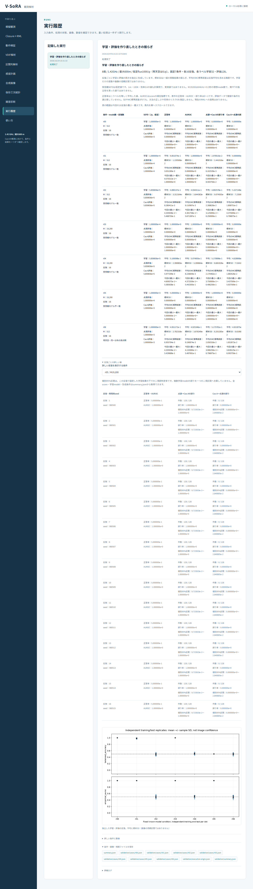
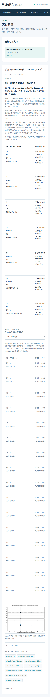

# 段階099：独立した学習・評価の反復を日本語GUIへ接続

- 作成日：2026-10-24
- 状態：完了
- 比較元コミット：a223d4b7c62caed3c25aed46f052cfb17550f7bf

## 読者向け概要

段階098では、学習用と評価用のデータを両方作り直す実験を112回実行し、同じ方法で判定をやり直したときの揺らぎを調べた。この段階では同じ計算を日本語GUIから実行し、条件ごとの平均と揺らぎ、各反復の誤判定を確認できるようにする。

標本SD（標準偏差）は一組の実験結果の揺らぎ、平均のMC標準誤差は乱数を使った有限回の模擬計算で反復平均を求める精度である。学習と評価の両方の変動を含み、学習だけの変動を分離した量ではない。画像の信頼区間や実機での成功率とも区別する。

## 1. 目的・対象範囲

同梱された098の固定7条件・各16反復をGUIから直接実行する。リポジトリのrunnerを持たない作業フォルダでも実行できるようにする。科学計算、RML、Windows収録は変更しない。

## 2. 完了条件

1. 新12試験と既存native選択肢3試験が成功する。科学計算の不成功・不正応答を成功表示しない。
2. 両実Chromiumで固定7条件を実行し、全科学JSON・7条件別JSON・summary downloadが098と一致する。
3. 全7概要・112詳細の表示値と7条件切替、説明、図、日本語font、390px、二つの表の横scrollを確認する。
4. 関連9科学module・同梱設定/天空が導入先prefixにあり、checkoutのrunnerを使わない。
5. 両全回帰、既存known-template9条件と配置比較の実ブラウザ回帰、wheel・依存関係・ソース固定を確認する。
6. レポート・索引、個人情報/秘密情報監査、匿名コミットとpushを完了する。

## 3. 実際に行った作業

「動作検証」に「学習・評価を作り直す比較」を追加した。native workerは固定full計画を直接実行し、科学計算の結果がcompleteであることを確認してから成功summaryを書く。

概要7行にはmode数・反復数・仮定SEFD・条件の位置付け、正答率/AUROC/二種類の誤り率の平均・標本SD・平均MC標準誤差・今回のmin/maxを表示する。条件選択で全112反復のseed・正答率・AUROC・誤り件数/率/個別区間を確認できる。二つの幅広tableは内部で横にscrollでき、図のalt/captionで標本SDの意味を示す。全score/modelはnative summary downloadに保持する。

既存capability試験と三つのブラウザtoolを選択肢4個へ更新した。既存toolのenabled件数はcapabilityリスト長に合わせ、固定件数の取り残しを防ぐ。全回帰前に全期待値を確認した。

変更はUIのmodels/worker/jobs/server、app.js/index.html、新12試験と既存capability3試験、新ブラウザtoolと既存3tool、ガイド・規約・本レポート/索引/公開記録。科学計算は変更していない。

## 4. 検証条件・結果

### 4.1 対象試験・正式実ブラウザ

新12件と既存capability3件、計15件が1.56秒・1警告で成功した。派遣・進捗・失敗・中止・不成功応答の試験は明示的なstubを使い、正式MC実行と区別した。

両実Chromiumでrunnerのないcheckout外workspaceから固定7条件・112反復を再計算した。全科学summary、7条件別JSON、実downloadが[098の参照実験](098-independent-training-repeats.md)と完全一致した。元の実験をGUI経由で再現した確認であり、独立な新しい物理条件を追加したMCではない。

7概要・112詳細の全表示値を対応する列/ラベルで照合し、7条件すべてへ切り替えた。平均/SD/MC標準誤差/min/max、SEFD、反復index/seed、正答率/AUROC、二種類の誤判定件数・率・個別区間を含む。説明・図のalt/caption、日本語font、390px、二つの表内で実際に横scrollする操作を確認した。画面全体の横はみ出し・JavaScriptエラー・外部通信は0だった。

導入版は関連9科学moduleと設定/天空をprefixから読み込み、PYTHONPATHとcheckoutのrunnerを使わなかった。[ソース実ブラウザ](../../validation/runs/stage099/source-browser.json)、[導入実ブラウザ](../../validation/runs/stage099/installed-browser.json)。

初回のsourceブラウザ確認では、科学計算・全JSON・表示値の照合後、折り畳まれた保存欄のリンクを開かずにクリックしてtimeoutとなった。検証toolで既存の保存欄を開く操作を追加し、sourceの全回帰と新GUIを再実行した。アプリ・科学計算・試験にはこの修正による変更がない。初回の1686成功ログと失敗したブラウザ記録はGit管理外に保存し、正式な試験件数や独立MC反復数へ加算していない。以降は修正後の319ファイルを固定した。

### 4.2 既存画面・全回帰・配布

既存のknown-template9条件も両実ブラウザで全JSON/全数値/区間/説明を確認した。配置比較も両環境の18概要・108条件・6048詳細、全JSON・全表示・filterを再確認した。53条件の虚部対称性GUIは今回実ブラウザで再実行していない。097で両環境を確認した画面であり、選択肢・派遣・失敗・中止の確認は今回の全回帰に含めた。[既存9条件source](../../validation/runs/stage099/source-known-browser.json)、[導入](../../validation/runs/stage099/installed-known-browser.json)、[配置source](../../validation/runs/stage099/source-array-browser.json)、[導入](../../validation/runs/stage099/installed-array-browser.json)。

| 確認 | 観測結果 |
|---|---|
| ソース全回帰 | 1686成功、27,396警告、663.29秒 |
| 導入済み全回帰 | 1686成功、27,396警告、700.78秒 |
| 科学Python | 88ファイルSHA不変 |
| 凍結source/tests/tools等 | 319ファイルSHA不変 |
| wheel | 91同梱ファイルbyte一致 |
| pip check | 成功 |

除外0。Python3.12.3、NumPy2.5.1、SciPy1.18.0、pytest8.4.2、Playwright1.63.0、BLAS/OpenMP各1。既存依存由来の警告を含む。公式source/tests/tools/workflows/pyprojectを全回帰中に固定した。一部並行実行の秒数は実機・全夜/GPUの性能比較ではない。

wheel 5,576,564bytes、SHA-256 `011b6ead25c320672b71c7818664ab939006d1d577c4b6dd2d5cc3844c93dc48`。[正式記録](../../validation/runs/stage099/verification.json)。詳細ログ・全画面・wheelはGit管理外outputs/stage099-*に保持する。

公開前の個人情報・秘密情報監査は指摘0、文書リンク1,238件の欠落0。PNG metadataを確認し、author/committer双方に公開用情報を使用する。

## 5. 制約・未解決事項

SEFDは仮定値であり、1m・100K・効率0.6からの値も計算例である。M19200は64kHz×0.3秒の理想mode数で、実FFTの独立性を測定した値ではない。各反復の個別95%二項区間はその学習結果に条件付き、反復を併合した区間や画像の信頼区間ではない。

SDやMC標準誤差が0でも、方法の正しさや将来のリスク0を保証しない。受信機条件がずれた例では、AUROC（scoreの順位）が高くても固定閾値の正答率が0.5となり得る。高い・低い識別率を実観測成功や画像化不能の証明へ読み替えない。

実機Cas A画像化、低SNR画像尤度、弱い実信号の未知LO、実SEFD、全夜運用・GPU性能は未検証。ブラウザはWSL headless Chromiumで、Windows実ブラウザ・WSLgの検証とは区別する。

## 6. 次段階

受信機条件の違い、局別周波数差、短積分での情報量を整理し、一般の画像尤度へ進むための参照モデルを別段階で評価する。
