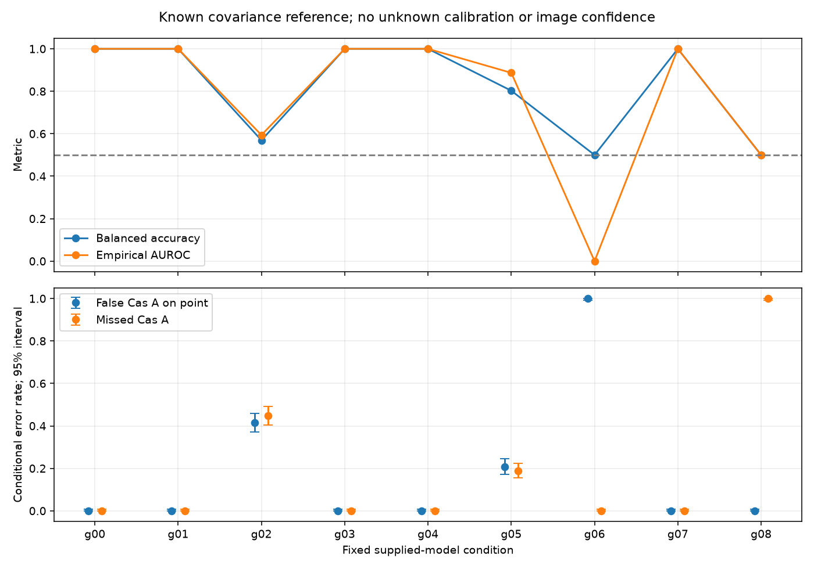

# 段階101：既知点源／Cas AのGaussian共分散による比較

- 作成日：2026-10-24
- 状態：完了
- 比較元コミット：`13115ab85ebcc6ef914ac28eedccba12bedb790b`（段階100）

## 読者向け概要

これまで、模擬電圧から局gainの影響を消す三次統計U3を作り、既知の点源とCas Aを区別する実験を進めてきた。一部の弱い条件では、単純なU3識別器の正答率は0.5付近だった。しかし、これは電圧に二モデルを区別する情報がないことや、画像化が不可能なことを意味しない。

今回は、段階100で作ったGaussian尤度の参照APIを、同じ天空テンプレートと配置へ接続する。共分散とは、各局の電力と局間の相関をまとめた行列である。この行列を二つの候補モデルについて事前に与え、得られた電圧がどちらの候補に合うかを比較する。

ここでは局位相基準、電力、雑音に相当するSEFDまで既知とする。実受信機の未知特性を解いた処理ではない。既知条件で使える情報を確認する参照実験と、精密較正が難しい実観測で画像を復元する課題を分けて進める。

## 1. 目的・対象範囲

目的は、既知の受信機と既知の二天空モデルを仮定したGaussian尤度比較を実装し、有限個の独立な電圧windowで挙動を確かめること。前段の単純なU3識別の結果を、一般の画像化の限界へ拡張しないための比較基準を得る。

8局、1.42GHz、最大600m、単一時刻の固定幾何を共用する。proper complex Gaussian電圧を全局共通の独立標本として直接生成する。Gaussian密度の定義は [Hankin (2015), 式(2)](https://journal.r-project.org/articles/RJ-2015-006/) に基づき、計算式・入力条件は [段階100](100-known-covariance-gaussian.md) で検証したものを使う。

新しいVDIF/raw profile、未知gain・SEFD・LOの推定、Closure画像尤度、RML変更、Wishart/Bartlett生成、GUI追加は対象外。Windows収録を除外する方針、短積分・局別周波数差・精密較正困難という最終的な観測条件は維持するが、この参照実験でその課題を解決したとは扱わない。

## 2. 完了条件

1. 固定9条件のAPI・native CLIを実装し、事前に決めた閾値0で独立windowを判定する。
2. Sを使わない直接電圧の二次形式と、既知gainをデータ・両候補へ与えた尤度比の照合を行う。
3. 不正入力・変更caseの拒否、等C対照、失敗の伝播、再現性、非上書き、誤り率区間の対象試験を行う。
4. ソース・導入済みの全回帰と、checkout外の独立API・native CLIの全科学JSONを照合する。
5. 同梱module/assets、wheel内容、凍結SHA、pip check、科学図、公開用監査を確認し、レポート・索引・匿名commit・developmentへのpushまで完了する。

## 3. 実際に行った作業

### 3.1 全局共通の電圧から既知モデルを比較

既存の同梱配置と天空からC0=点源、C1=Cas Aの共分散を作る。生成モデルCgenのCholesky分解を使い、各windowの全局電圧を直接生成する。その全M標本から、平均を引かない2次モーメントSを求める。

```
S = (1/M) Σ_m x_m x_m^H
score = log L(C1) − log L(C0)
```

score>0ならCas A、score<=0なら点源とする。学習は行わず、評価データで閾値やモデルを選び直さない。0での同点は点源に固定する。

全局で同じ標本を使う。三角形ごとの保存値や単に同じ件数の基線からSを作ったものではない。電圧生成batchは一配列100万complex values以下に制限し、全windowの電圧は保存しない。

### 3.2 直接計算と既知gainの照合

各labelの先頭2windowについて、電圧を直接連立方程式へ入れて二次形式を足す方法と、S経由のAPIのscoreを比較する。実装は逆行列を明示的に作らない。

同じwindowに対し、局ごとの既知の複素gainを電圧と両候補共分散へ与え、scoreと判定が変わらないことも確認する。既知の変換を両方へ与えた不変性であり、未知gainの推定に成功した試験ではない。

### 3.3 出力・統計・変更ファイル

各windowのscore、候補・生成共分散、生成seed、誤り数・個別95%区間、balanced accuracy、AUROC、入力assetのSHA256をJSONへ保存する。

balanced accuracyは二labelの正答率を等しく平均した値。AUROCは二labelのscoreの順位を表し、固定閾値での正答率とは別の指標である。512²個の比較対を独立な試行として誤差を小さく見積もらない。

誤り率のClopper-Pearson区間は既存の検証済みhelperを再利用し、「固定した学習」ではなく「固定した既知モデル」の条件付き区間として名前を変えた。学習は行っていない。[SciPyの一次資料](https://docs.scipy.org/doc/scipy/reference/generated/scipy.stats._result_classes.BinomTestResult.proportion_ci.html) にあるexact方式を使う。これは各群の個別区間で、画像や複数条件同時の信頼区間ではない。

変更ファイルは以下の通り。

- `apps/simulator/src/vsora_simulator/gaussian_template_validation.py`：固定API・native CLI・科学図。
- `apps/simulator/tests/test_gaussian_template_validation.py`：新31試験。
- `tools/verify_gaussian_template_installed.py`：checkout外API・全native CLI・prefix・非上書き・図の照合。
- [APIと条件](../../interfaces/known-covariance-template.md)、規約索引、本レポート、段階索引、正式記録。

既存のGaussian API、U3、相関器、RML、GUIのコードは変更していない。

## 4. 検証条件・結果

### 4.1 固定条件

各label512独立window、9条件で計9216windowを生成する。SEFD1000／10000Jyは仮定値。585965.634733…Jyは、直径1m・雑音温度100K・効率0.6から求めた計算例で実測値ではない。Cas A形状は同梱画像の代理で、実際の1.42GHzのflux、主ビーム、偏波を測定した入力ではない。

M19200は従来の64kHz×0.3秒に対応づけた理想mode数であり、実ADC/FIR/FFTを通した独立性の実証ではない。M512も比較用の小mode数で、実運用の積分時間を認定しない。

g06/g07は、片方のlabelの生成雑音を意図的に変更する人工対照。天体形状に応じて実受信機の状態が変わると仮定したものではない。受信機モデルを誤指定したときの失敗例として読む。

### 4.2 模擬実験の観測値

正式なソース実験9条件は成功。導入済みnative CLIとの全科学JSON・図のpixelsも一致した。両全回帰も成功した。

| 条件 | M | 仮定 / 点源生成 / Cas A生成 SEFD(Jy) | 状態 | 正答率 | AUROC | 点源→Cas A / Cas A→点源の誤り数（各512） |
|---|---:|---:|---|---:|---:|---:|
| g00 | 512 | 1000 / 1000 / 1000 | 一致 | 1.000000 | 1.000000 | 0 / 0 |
| g01 | 512 | 10000 / 10000 / 10000 | 一致 | 1.000000 | 1.000000 | 0 / 0 |
| g02 | 512 | 585966 / 585966 / 585966 | 一致 | 0.569336 | 0.593918 | 212 / 229 |
| g03 | 19200 | 1000 / 1000 / 1000 | 一致 | 1.000000 | 1.000000 | 0 / 0 |
| g04 | 19200 | 10000 / 10000 / 10000 | 一致 | 1.000000 | 1.000000 | 0 / 0 |
| g05 | 19200 | 585966 / 585966 / 585966 | 一致 | 0.802734 | 0.886921 | 106 / 96 |
| g06 | 19200 | 1000 / 10000 / 1000 | 誤指定 | 0.500000 | 0.000000 | 512 / 0 |
| g07 | 19200 | 10000 / 1000 / 10000 | 誤指定 | 1.000000 | 1.000000 | 0 / 0 |
| g08 | 512 | 1000 / 1000 / 1000 | 零天空・同一候補 | 0.500000 | 0.500000 | 0 / 512 |



上段は正答率とAUROC、下段は二群の誤り率とその個別95%区間。上段に画像の誤差やAUROCの区間を付けた図ではない。誤り0の条件にも、未知条件でのリスク0という保証はない。

### 4.3 結果の読み方

仮定SEFD約585966Jyでは、M512のg02の正答率は約0.569、M19200のg05は約0.803だった。受信機・位相基準を既知とするこの参照条件では、二モデルを区別する情報が残る例を確認できた。M19200のg05でも各群に誤りがあり、完全な識別ではない。

一方、g06は点源をすべてCas Aと誤り、正答率0.5、AUROC0になった。g07では誤り0だったが、誤指定の向きで結果が違うだけで、未知SEFDに頑健なことの証明ではない。零天空のg08では二候補のscoreがすべて厳密0となり、同点規則によって点源の誤り0、Cas Aの誤り1、balanced accuracyとAUROCはともに0.5になった。

段階096の同じ仮定M/SEFDに対するU3の単純識別器は、d02で正答率0.511719、d05で0.520508だった。今回のg02/g05とは、入力情報、受信機の既知性、学習の有無、評価の乱数実現値が違う。同じ電圧を使った対応のある比較ではないため、「U3という量の限界」「Gaussian法なら実観測で0.803の成功率」とは解釈しない。

特にGaussian側は局位相基準、電力、モデルの天空位置まで与えている。未知局位相で位置の自由度も残るClosure画像化より強い条件であり、純粋な形状だけに由来する情報量を測定したものでもない。

### 4.4 正式検証・実行記録

正式記録は [verification.json](../../validation/runs/stage101/verification.json)、[全条件の指標・共分散・score要約](../../validation/runs/stage101/metrics.json)、[独立導入API/CLI](../../validation/runs/stage101/installed-api.json)、[小API参照値と固定plan](../../validation/runs/stage101/api-reference.json) に保存した。

| 検証 | 結果 |
|---|---|
| 新対象試験 | 31成功、1.68秒 |
| ソース全回帰 | 1797成功、27396既存警告、除外0、603.88秒 |
| 導入済み全回帰 | 1797成功、27396既存警告、除外0、601.62秒 |
| 電圧を直接使う独立二次形式 | 36window照合、最大絶対差4.07e-10 |
| 既知gainの変換 | 36window照合、最大絶対差1.05e-09、全判定一致 |
| checkout外API/CLI | 小API4条件・full/smoke両plan・全9科学JSON・各9case JSONが一致 |
| prefixと保存 | 全20読込project module・3assetsが導入prefix内、runner/PYTHONPATHなし、再実行失敗と全bytes不変 |
| wheelと凍結 | package内93ファイルをsource bytesと照合、凍結286ファイルSHA不変、既存source Python85ファイル不変、pip check成功 |
| 科学図 | source/導入CLIの全pixels一致、目視で軸・凡例・区間を確認、公開PNGの付加メタデータを除去してpixels保持 |

sourceの固定実験は36.81秒、子process最大RSSは201484KiBだった。一つの生成配列の最大は921600 complex values。これは全メモリ使用量ではなく、RSSには計算・Python・描画等も含まれる。全回帰と同時実行したこのWSLでの記録で、GPU性能、実VDIFの全夜処理、他機種との速度比較ではない。

環境はPython 3.12.3、NumPy 2.5.1、SciPy 1.18.0、pytest 8.4.2、Matplotlib 3.11.1、BLAS/OpenMP各1 thread。ソース・試験・検証toolは全回帰開始前に凍結し、両全回帰中に変更していない。

各群512個の全scoreと全科学JSONは、Git管理外の `outputs/stage101-source-study/` と `outputs/stage101-installed-api/native/` に残した。公開metricsには全条件・共分散・誤り数/区間・scoreの件数/平均/標本SD/範囲と、各score配列のcanonical JSON SHA256、全source summaryのSHA256を保存した。公開seedと同梱入力からnative CLIで再生成できる。

```bash
python tools/run.py pytest -q apps/simulator/tests/test_gaussian_template_validation.py
python tools/run.py vsora_simulator.gaussian_template_validation --profile full --output outputs/gaussian-sky-new
python tools/run.py pytest -q
# wheel導入後、checkout外からも実行可能。
python -m vsora_simulator.gaussian_template_validation --profile full --output gaussian-sky-new
# 導入済み全回帰ではソース用runnerを使わない。
python -m pytest -q
```

checkout外の専用照合toolは、導入先Pythonで `tools/verify_gaussian_template_installed.py --reference <source-summary.json> --api-reference <api-reference.json> --output <new-output>` と実行した。新しい出力を指定し、既存結果の上書き拒否も別の呼び出しで確認した。

GUIは変更せず、実ブラウザ試験を再実行していない。通常GUIは利用者の稼働中ジョブが0であることを確認して所有PTYだけを止め、更新したwheelで再開した。


公開前に追加13ファイルの内容・図のメタデータを確認し、全Git対象の個人情報・秘密情報監査は指摘0件、ローカル文書リンク1255件は欠落0件だった。公開用author/committerで段階コミットを作成する。文献の公開著者名と出典URLは維持した。

## 5. 制約・未解決事項

- 未知gain、SEFD、LOを推定していない。LOが区間内で動く場合の固定Cの妥当性も検証していない。
- Gaussian、独立mode数、同じ分布、全局共通標本、既知位相・電力は生成上の仮定。量子化、I/Q不均衡、実ADC/FIR/FFT、RFI、欠測を通していない。
- 単一時刻・既知二候補の比較であり、自由な天空画像の復元ではない。各誤り率の個別区間を画像の信頼区間へ転用しない。
- 既存U3の単純識別より高い数値が出ても、最良のClosure法との比較や情報上限を求めたことにはならない。
- この段階ではGUI追加・実ブラウザ試験を行わない。既存GUIの単体・結合試験は全回帰へ含める。
- 実機Cas A画像化、低SNRのClosure画像尤度、弱い実信号の未知LO、実SEFD、全夜/GPU性能は未検証のままである。

## 6. 次段階

この固定参照比較を日本語GUIから実行し、仮定SEFDと生成SEFD、閾値0と順位指標、全score、個別区間を観測者が取り違えずに確認できるようにする。

その後、未知局位相・電力などを含む場合の尤度の扱い、全局共通FFT標本を保証する入力仕様、既存U3との共通電圧での比較を段階ごとに検討する。実受信機の較正困難という条件に戻した検証が必要である。
