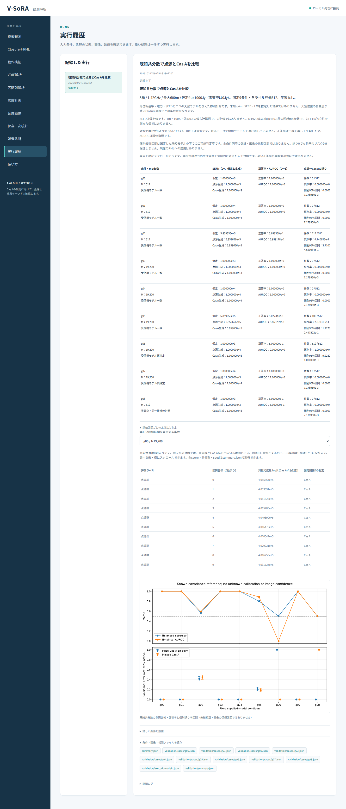
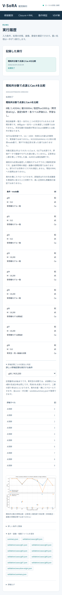

# 段階102：既知共分散による比較を日本語GUIへ接続

- 作成日：2026-10-24
- 状態：完了
- 比較元コミット：`8e00fe91bb3ddb7a81cd194be471862cb29880e1`（段階101）

## 読者向け概要

段階101では、点源とCas Aの二つの既知モデルについて、全局の電力と相関をまとめた共分散を使ってGaussian尤度を比較した。今回は、その固定した参照実験を日本語GUIから実行・確認できるようにする。

見るべきものは、単なる「よい正答率」だけではない。受信機の雑音を表すSEFDを何と仮定し、実際の模擬電圧を何から生成したか、判定の閾値をどう決めたか、どの群をどれくらい誤ったかを確認する。概要表から条件を選び、各短区間の対数尤度比と判定までたどれる形にした。

この比較では局位相基準・電力・SEFDを供給する。精密較正が難しい実観測の未知gainやLOを推定した結果でも、自由な天空画像を復元した結果でもない。その条件を画面にも表示する。

## 1. 目的・対象範囲

目的は、101の同梱データ・native APIを使い、リポジトリのrunnerがない作業フォルダからも参照比較を再実行できるGUIを作ること。

対象はfull9条件・各label512区間、計9216区間の固定実験。概要9行、条件切替で1024行ずつの詳細、二群の誤り率と個別95%区間、全JSONと科学図を確認できるようにする。

科学計算、100のGaussian API、既存U3、RML、VDIF/raw profileを変更する段階ではない。Windows収録は除外し、1.42GHz Cas A・最大600m・局別周波数差・数百ms〜数秒・精密較正困難なClosure＋RMLという最終目標を維持する。

## 2. 完了条件

1. native操作を追加し、固定full条件を呼び出す。依頼範囲外のprofile・seed等をGUI要求で上書きさせない。
2. 正常系・失敗・中止・不正結果の新12試験と、既存native操作の対象試験を行う。
3. source/導入済み両実Chromiumで、新9概要・全9216詳細・9条件切替・全表示値/判定/正誤・全JSON/実download・日本語/390px・表内scroll・module/config/FITSの所在を確認する。
4. 既存4種類のnative GUIも両実ブラウザで回帰し、両全回帰、wheel、凍結SHA、pip checkを確認する。
5. 学部生向けレポート・操作ガイド・索引・公開前監査・公開用commit・developmentへのpushを完了する。

## 3. 実際に行った作業

### 3.1 画面から数値の根拠へたどる

「動作検証」へ「既知共分散で点源/Cas Aを比較」を追加した。概要表には次を表示する。

- 条件番号、M、モデル一致／誤指定／零天空の状態。
- 仮定したSEFDと、点源群・Cas A群の生成SEFD。
- 二群を等しく平均した正答率、scoreの順位を表すAUROC。
- 二群それぞれの誤り数・誤り率・固定モデル条件付きの個別95%区間。

「評価区間ごとの尤度比と判定」を開くと、条件を選んで点源群512行・Cas A群512行を表示する。区間番号は0始まりで、各行にscore、閾値0での判定、正誤を表示する。表内で縦横にスクロールできるため、全1024行を表示してもページ全体を際限なく伸ばさない。

対数尤度比は `log[L(Cas A)/L(点源)]`。0より大きいとCas A、0以下は点源に固定する。零天空対照は両群が同じ分布で全scoreが0となるので、同点規則によって点源群の誤り率0、Cas A群の誤り率1となる。この違いも画面で説明する。

画面は丸めて表示し、丸め前の全score・共分散・seedはsummaryと9個の条件別JSONから取得する。保存欄を実際に開いてダウンロードする操作まで検証する。

### 3.2 実行経路と結果の扱い

workerは同梱の `gaussian_template_validation.run(...,profile='full')` を呼ぶ。リポジトリの外部workflowスクリプトへ戻さず、進行状況を条件ごとに日本語で表示する。

戻り値がdictかつstate=completeのときだけ成功にする。例外、取消、failed/cancelled/未定義のstate、Noneを成功扱いしない。これらの配線試験では明示したstubを使い、実Monte Carloの合格とは区別する。

専用rendererを別JSファイルに置き、既存画面のrendererを共用・書換えしない。読み込みは既存の `/assets/` 経路を使う。native操作が5種類になったため、既存のcapability試験とブラウザ検証の選択肢も更新した。

### 3.3 実装・検証時の修正

初期準備では、既存のscriptタグを `/static/` と仮定した編集assertion、複製した試験の選択肢の重複、検証toolのCLI配置で停止した。実際のHTMLと5選択肢へ合わせ、正式な全回帰前に修正した。科学計算の変更ではない。既存53条件のブラウザtoolに不要な `--reference` を渡した初回呼び出しも、worker起動前にargparseで停止し、正しい引数で一回実行した。

初回の導入版新GUIは、全科学JSON・9概要・導入所在の確認後、詳細条件selectが非表示となってタイムアウトした。summaryが生成済みでも、画面が最終の完了状態へ更新される前に詳細を開くと、最後の再描画で閉じる時間差があった。実行中の全回帰・既存ブラウザが終了するまでソースを変更せず、完了表示とrunning spinnerの消失を待つ検証へ修正した。

併せて、対数の対象を曖昧にしないよう新rendererの見出しを `log[L(Cas A)/L(点源)]` とした。新画面の見出しと検証待機を修正した後の正式結果を、初回の結果と区別して記録した。

修正後の予備GUIでは、閉じた詳細欄の見出しを`innerText`で検査して両版が停止した。単独の実Chromiumで、閉じた欄は`innerText`が空、`textContent`と開いた欄の`innerText`は正しいことを確認した。詳細欄を開いてから検査する順序へ直し、全9216行のrenderer照合と両native GUIを再実行した。最終全回帰を始める前の検証toolだけの修正で、科学計算・画面の数値・試験は変えていない。

### 3.4 変更ファイル

- UIのmodels・server・jobs・worker：操作定義、capability、native実行。
- `static/known-covariance.js`、index・app・style：専用表示、読み込み、caption、表内scroll。
- 新GUI試験、既存4capability試験、5種類のブラウザ照合tool。
- [操作ガイド](../guide/06-gui.md)、[科学条件・API](../../interfaces/known-covariance-template.md)、本レポート、索引、正式記録。

## 4. 検証条件・結果

正式記録は [verification.json](../../validation/runs/stage102/verification.json)。新画面は [sourceブラウザ](../../validation/runs/stage102/source-browser.json) と [導入済みブラウザ](../../validation/runs/stage102/installed-browser.json) に全確認項目を残した。

| 検証 | 結果 |
|---|---|
| 対象試験 | 新12＋既存48＝60成功、1既存警告、0.79秒 |
| ソース全回帰 | 1809成功、27396既存警告、除外0、607.80秒 |
| 導入済み全回帰 | 1809成功、27396既存警告、除外0、604.50秒 |
| 新GUI、両実Chromium | 各9概要・全9216詳細・9条件切替、全score/判定/正誤・表示数値を照合 |
| データ輸送 | 両環境で全科学JSON・9case JSON・summaryの実downloadが101の全結果と一致 |
| 最終画面の安定性 | 完了表示・spinner消失を待ち、実際の2回のpoll応答後も詳細の開閉状態とg06の選択を保持 |
| 390px・日本語 | 両環境で日本語font/caption/alt、ページ全体の横はみ出し0、2表内の横scrollと詳細の縦scrollを確認 |
| 実行所在 | runnerのないcheckout外workspace、sourceは列挙10科学moduleがcheckout内、導入済みは列挙10module・config・FITSがprefix内 |
| エラー・通信 | 両新GUIともJavaScriptエラー0、ブラウザの外部通信0 |
| wheel・凍結 | package内94ファイルをsource bytesと照合、凍結289ファイルSHA不変、既存科学Python78ファイル不変、pip check成功 |

既存4種類の回帰は、source/導入済みの両実ブラウザで以下を確認した。各JSONに全条件と数値の確認結果がある。

| 既存操作 | 各環境での確認量 | source / 導入済みの記録 |
|---|---|---|
| 配置比較 | 18概要・108条件・6048詳細、全科学JSON | [source](../../validation/runs/stage102/source-array-browser.json) / [導入済み](../../validation/runs/stage102/installed-array-browser.json) |
| 既知天空の虚部対称性 | 53条件・2968成分、全53 JSON・実download・4filter | [source](../../validation/runs/stage102/source-casa-browser.json) / [導入済み](../../validation/runs/stage102/installed-casa-browser.json) |
| 既知二モデルの学習・評価 | 全9条件・表示値・全科学JSON | [source](../../validation/runs/stage102/source-known-browser.json) / [導入済み](../../validation/runs/stage102/installed-known-browser.json) |
| 独立した学習・評価の反復 | 7概要・112詳細、全表示・全JSON・実download | [source](../../validation/runs/stage102/source-independent-browser.json) / [導入済み](../../validation/runs/stage102/installed-independent-browser.json) |

初回の全回帰もsource1809件/1030.02秒、導入済み1809件/1044.45秒で成功したが、最終のGUI検証待機と新見出し修正後に両全回帰を再実行した。初回と正式件数を合算しない。最終のsource・試験・toolは全回帰前に凍結し、実行中に変更していない。

待機修正は、初回の全回帰と旧8ブラウザがすべて終了してから適用した。変えたのは新browser verifierと新rendererの見出し1つだけで、残り287ファイルはSHA不変。旧科学計算・worker・既存renderer・旧verifierはその後変更していないため、旧8ブラウザの成功記録を維持し、新GUIは両版を再実行した。見出しを含む新JSを反映したwheelも作り直した。

詳細な初回失敗・修正・SHAは正式記録の `preflight_repairs` と `final_view_wait_repair` に保存した。失敗した初回の導入新GUIを成功扱いせず、初回source新GUIの結果も正式な修正後GUIの結果へ合算していない。

環境はPython 3.12.3、NumPy 2.5.1、SciPy 1.18.0、pytest 8.4.2、Playwright 1.63.0、Chromium153.0.8010.12。BLAS/OpenMP各1 thread。複数の全回帰・既存GUI検証を同時に動かした実行時間であり、PC性能・全夜処理・GPUのbenchmarkではない。

代表的な再実行例は以下。出力には新しいフォルダを指定する。

```bash
python tools/run.py pytest -q apps/ui/tests/test_gaussian_template_gui.py
python tools/run.py tools.verify_gaussian_template_ui --source-checkout --reference <stage101-summary.json> --output outputs/gaussian-gui-new --port 8840
# wheel導入後のブラウザ照合と全回帰。
python tools/verify_gaussian_template_ui.py --reference <stage101-summary.json> --output outputs/gaussian-gui-installed-new --port 8841
python -m pytest -q
```

PlaywrightのChromium実体と日本語fontを使う。GUIのworker workspaceにはリポジトリのrunnerを置かない。完全なログ・wheel・初回結果はGit管理外の `outputs/stage102-*`、公開用の小容量JSON・新画面PNGは `validation/runs/stage102/` に保存した。PNGに個人情報を含む付加メタデータがないことも確認した。






科学条件・scoreの意味・誤り率区間の解釈は [段階101](101-known-covariance-template.md) と同じ。GUIで固定seedを再計算して一致を確かめたもので、再実行回数を新しい独立観測として統計精度へ足していない。

公開前に変更38ファイルと4枚のPNG付加メタデータを確認し、全Git対象の個人情報・秘密情報監査は指摘0件、ローカル文書リンク1281件は欠落0件だった。公開用author/committerで段階コミットを作成する。

## 5. 制約・未解決事項

- 既知の位相基準・電力・SEFD・二天空モデルによる参照比較。未知較正に耐えるClosure画像尤度や、実受信機の成功確率ではない。
- 95%区間は各固定モデルの誤り率に対する個別区間。画像、AUROC、複数条件同時の区間ではない。誤り0でも未知条件のリスク0を保証しない。
- MやSEFD、総fluxは仮定・計算値。実ADC/FIR/FFT、量子化、欠測、実効独立M、実OCXO/LOの条件を確認していない。
- 実ブラウザはWSL上のheadless Chromium。Windows上の対話ブラウザやWSLg、全夜運用、GPU性能を確認したものではない。
- 実機Cas A画像化、低SNRのClosure画像尤度、弱い実信号での未知LO推定、実SEFDは未検証のまま。

## 6. 次段階

既知位相という強い仮定を一つずつ外した参照比較を検討する。まず局位相だけを未知とし、振幅・SEFDは依然既知とする小さな最適化APIを、解析解・独立計算・不正入力・非収束で確かめる候補がある。

これは現在のClosure＋RMLを置き換える決定ではない。未知局特性の影響を扱う画像尤度へ進むための段階で、未知LOや自由画像の復元は別の課題として残す。
