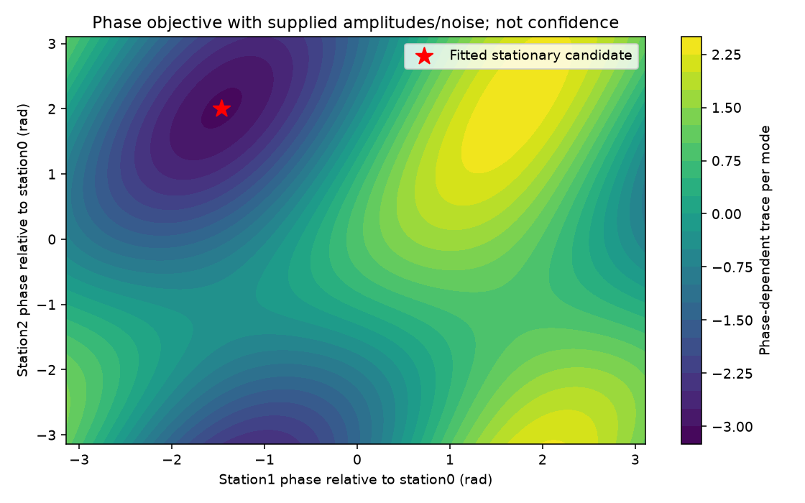

# 段階103：既知振幅・雑音で局位相だけを合わせるGaussian参照

- 作成日：2026-10-24
- 状態：完了
- 比較元コミット：03c4754f4e6be33538118b3a3b191af5e574a888

## 読者向け概要

段階101・102では、点源とCas Aのどちらが観測電圧を説明しやすいかを、受信機の応答が分かっている条件で比較した。実際の独立した受信機では、同じ天体の電波でも局ごとに位相が回る。位相は複素数の向きであり、これが未知のまま前段階の計算へ入れると、天体の違いと受信機の違いを混同する。

そこで今回は、候補天体ごとに「どの局位相なら観測を最もよく説明するか」を探す小さな参照部品を作った。天体画像を自由に復元する段階ではない。受信機の振幅と雑音量は引き続き与えており、未知としたのは一つの区間内で変化しない局位相だけである。

## 1. 目的・対象範囲

段階100の既知共分散Gaussian計算に、局位相を合わせる処理を追加する。相関器package内の新API、対象試験、固定数値実験、導入版照合と文書を対象にした。既存Gaussian API、U₃、Closure＋RML、保存形式、GUIは変更しない。

最終目標は1.42 GHz・最大基線600 mのRTL-SDR/OCXO観測網からCas Aを画像化すること。本段階は精密較正が難しい条件へ近づくための参照研究であり、Windows収録は対象外である。

## 2. 完了条件

1. 勾配の有限差分、元のGaussian計算、独立した実数Gaussian表現を照合する。
2. 2局解析解と3局の密な格子を照合し、局位相・局順序・尺度変換の対照を確認する。
3. 位相を決められない場合、入力異常、実際の反復不足を成功値と区別する。
4. 固定13条件の全JSONがソース版とcheckout外の導入版で一致する。導入元、図、非上書きも確認する。
5. 凍結したコードで両全回帰、wheel一致、文書・公開監査、匿名commit/pushを完了する。

## 3. 実際に行った作業

### 3.1 共分散と位相の関係

各標本の全局電圧を列ベクトルxとし、共分散をC、共通標本数をMとする。標本二次モーメントは `S = sum(x x^H)/M`。平均を推定して引く操作は含めない。平均0で、独立かつproperな複素Gaussianを仮定した負対数尤度は、全候補で共通な定数を除いて

`q(C; S) = M [log det C + tr(C^-1 S)]`

となる。共分散は各局の電力と局間相関を一つにした行列である。このGaussian参照の位置付けは[段階100](100-known-covariance-gaussian.md)と、[Leshem・van der Veenの式32〜34](https://arxiv.org/pdf/astro-ph/0008239)を参照する。実機の電圧が独立Gaussianかどうかは今回調べていない。

局位相を `D = diag(exp(i phi))` と書くと、候補は `C(phi) = D C D^H`。これは電力と固有値を変えず、局間相関の向きを変える。全局へ同じ位相を加えても共分散は同じなので、基準局phi₀を0に固定する。

各候補で位相を動かしてqを小さくし、その後の二つの値を比べる。この操作をprofileという。ただし3局以上で得るのは局所停留候補である。厳密な最小値を保証するprofile尤度、画像の確率、検定のp値としては扱わない。

### 3.2 小さい差を扱う計算と探索

`K=C^-1` とすると、位相依存部分は

`2 Re sum(i<j) [K_ji S_ij exp(i(phi_j-phi_i))]`

である。位相に無関係な対角項を外し、係数の大きさを規格化して探索する。Kの係数はCholesky分解後の連立方程式から求める。精度行列の係数自体は保持する実装である。上式と勾配の符号は独自整理であり、有限差分・直接traceと独立に照合した。

2局では一つの位相差だけなので解析的に最小化できる。3局以上は、観測Sと候補Cから作るHermitian係数行列のn本の固有vectorの位相、および最小固有vectorの各局をπずらしたn個の開始点を使う。計2n開始点で、真の局位相を入力に使わない。基準局をずらした開始点も、全位相を基準局からの相対値へ直してから探索する。

探索はSciPyのL-BFGS-B。最大200反復、内部gtol=1e-7、ftol=1e-14、maxls=50とした。終了後に勾配を再計算し、optimizer成功と規格化勾配最大絶対値≤1e-6を確認する。反復上限で成功しない場合があることは[公式資料](https://docs.scipy.org/doc/scipy/reference/optimize.minimize-lbfgsb.html)と整合する。最小の観測目的値と丸め許容内で一致する成功候補を採用し、確認できなければ `not_converged` を返す。これは真の位相が分かったという判定ではない。

### 3.3 APIと変更ファイル

- [gaussian_phase_profile.py](../../apps/correlator/src/vsora_correlator/gaussian_phase_profile.py)：`fit_station_phases`、`compare_phase_profiles`、未収束例外。
- [対象試験](../../apps/correlator/tests/test_gaussian_phase_profile.py)：51条件。
- [固定実験tool](../../tools/verify_gaussian_phase_profile.py)：独立照合、13条件の記録、図、導入先確認。
- [インターフェース説明](../../interfaces/gaussian-phase-profile.md)、本レポート、二つの索引、正式記録。

比較は各候補で位相を別々に合わせた後、段階100の安定な尤度差計算を使う。単に大きな負対数尤度を二つ引く実装にはしない。片方でも未収束なら比較値を返さない。局数は1〜16に限定した。

## 4. 検証条件・結果

### 4.1 対象試験と固定実験

51試験が0.78秒で成功。2・3・8局の勾配、2局解析解、3局181×181格子、等候補、モデルとデータの位相変換、局順序、1e-120〜1e120の尺度、不正値、係数underflow、入力非変更を確認した。

固定実験は2・3・8局×seed103/104/105の9条件、1・3・8局の位相非依存3条件、5局の反復不足1条件の計13条件。9条件は各37標本の電圧からSを作り、生成時に加えた真の局位相を探索へ渡さない。候補Cと、Cの対角へ異なる正値を加えた候補を比較する。天体モデルや実受信機の測定値ではない。

独立照合では複素n局を実数2n変数へ展開し、SciPy実多変量Gaussianの電圧ごとの対数密度を足した値と比較した。3局の各候補値が32,761点の格子最小値以下になることも確認した。離散格子との一致は、連続空間の大域最小値の証明ではない。

5局で最大反復を1へ制限した実計算は `not_converged`、比較APIは例外となった。成功しなかった標本を0点に補ったり、集計から除いたりしていない。位相非依存条件は最小目的値が分かる一方で、物理位相を同定できないことを明示する。



3局の相対位相2個を動かした目的関数の例。低い領域へ探索候補の赤星が来ることを確認した。色は対角定数を除いたtraceの値であり、信頼度や画像確率ではない。

### 4.2 導入版・全回帰

正式数値：ソース版・導入済み版とも全1,860試験成功、除外0件。ソース版614.78秒、導入版612.84秒、両方とも既存警告27,396件。独立実Gaussianとの最大絶対差3.87e-13、既知のデータ位相変換前後のscore最大差6.57e-14。wheel内のpackage 95ファイルがソースとbyte一致し、pip checkが成功した。実行時間は今回の環境での観測値であり、実運用速度の保証ではない。

checkout外の一時作業フォルダでPYTHONPATHを外し、リポジトリのrunnerを使わずに検証toolを起動した。13条件の全JSONと図のRGB画素が一致し、読込project module3個が導入先prefix内にあること、再実行の上書き拒否と全出力byte保持を確認した。通常GUIは導入版で再開した。

再現例：

```bash
python tools/run.py pytest -q apps/correlator/tests/test_gaussian_phase_profile.py
python tools/run.py tools.verify_gaussian_phase_profile --output outputs/phase-profile-reference
python tools/run.py pytest -q
# wheelを導入した環境では、source runnerを使わず全回帰する
python -m pytest -q
```

全回帰中はソース・試験・検証toolの292ファイルを凍結。既存のsource Python86ファイルは比較元から不変。GUI自体の変更はなく、実ブラウザの再実行は行っていない。前段階の実ブラウザ結果は[段階102](102-known-covariance-gui.md)に残す。

### 4.3 初期確認での修正

初回の拡張対象試験は、仮説順序を逆にした差がbit単位で完全な反対符号になると要求し、3件失敗した。異なるCholesky基準の丸めで約1e-15の差が出るため、絶対許容2e-11へ修正した。この修正で科学実装は変えていない。

その後、局順序に偏らないため基準局も含むπ摂動を追加し、さらに基準局の摂動後の相対位相への引き直しを修正した。引き直しを専用試験で確認した。初期wheel/API照合は正式結果へ合算せず、対象試験・固定実験・wheel・導入版照合をすべて繰り返した。これらは全回帰の開始前に完了しており、全回帰途中にコードを変更していない。

公開前監査では、行列積 `a @ a.conj()` がメール形式として2件誤検出された。個人情報でないことを確認し、演算子の前後に空白を入れた。Python構文木は完全一致し、科学moduleは変更していない。初回両全回帰が終了してから表記を修正し、対象試験・全JSON照合・両全回帰を再実行した。初回607.65秒/606.21秒の全回帰は別名保管し、正式件数へ合算しない。

詳細は[正式記録](../../validation/runs/stage103/verification.json)、[全固定条件](../../validation/runs/stage103/reference.json)、[導入確認](../../validation/runs/stage103/installed-api.json)を参照。図は公開用metadataを除去し、画素と内容を確認した。

## 5. 制約・未解決事項

- 3局以上の大域最適性、真の局位相の回復、統計的誤り率・p値は保証していない。固定された少数の数値照合である。
- 振幅・SEFD・天空候補が既知。未知利得全体を解く較正や、未知画像の尤度は未完成。
- 局位相が区間内で一定という仮定がある。局ごとの周波数差による時間変化、弱信号での未知LO推定、実FFT標本の独立性は未検証。
- Mや共分散の数値は実験の仮定値。全局共通Sの実観測producer・保存は追加していない。三角形の別標本をつなぎ合わせて全局共分散にしてはいけない。
- 実機Cas A画像化、実SEFD、全夜運用、GPU性能は未検証。既存Closure＋RMLを完成した低SNR画像尤度へ置き換えたものではない。

## 6. 次段階

同じ生成電圧を使い、真の位相を与えた段階101の参照と、真の位相を渡さない本APIの比較を対にして行う候補。未知位相を扱うことで何が変わるかを、入力電圧の違いに左右されず調べる。非収束が出た場合も件数を記録し、成功例だけの識別率を全体の性能としない。振幅・SEFDが既知という制約は残るため、実観測の成功判断とは分ける。
