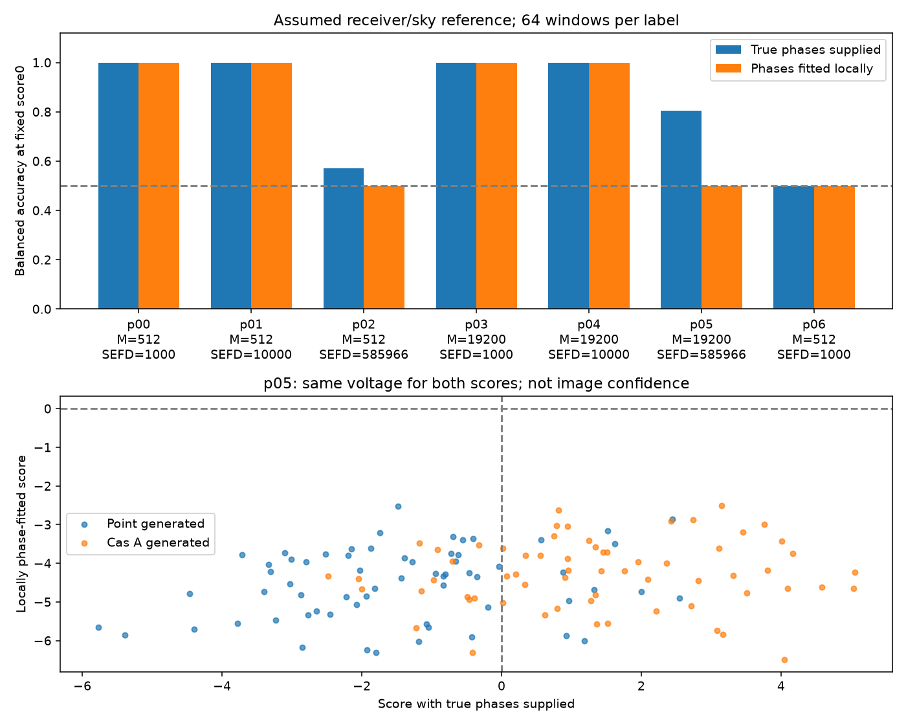

# 段階104：同じ模擬電圧で既知位相と未知位相を対に比較

- 作成日：2026-10-24
- 状態：完了
- 比較元コミット：57c42cd6e99df0a76a3a2538306f5464f6b34d7c

## 読者向け概要

受信機の局位相が分かっている場合の良い識別結果を、そのまま独立したRTL-SDR受信機へ当てはめることはできない。前段階では、局位相だけを未知として候補天体ごとに合わせる部品を作った。今回はその部品を、既知の点源とCas Aの模擬観測へ接続した。

二つの方法に同じ電圧を与える点が重要である。別々の雑音を引くと、位相の扱いによる差と、たまたま引いた雑音の差を混同する。片方には真の局位相を教え、もう片方には教えずに探索させる。ただし両方とも、受信機の振幅・雑音量と二つの天空候補を知っている参照実験である。

低感度の仮定条件では、位相探索後のscoreを単純に0で分けると、今回の標本はすべて点源判定に偏った。この結果は、その判定手順の課題を示している。実観測でCas Aが画像化できないことや、Closure＋RML全体の限界を示す証明ではない。

## 1. 目的・対象範囲

[段階101](101-known-covariance-template.md)の既知共分散比較と[段階103](103-gaussian-phase-profile.md)の位相探索を、同じ電圧で対に比較するnative API/CLIを追加する。1.42 GHz・最大600 m・8局、短積分を見据えた独立標本数の仮定を使う。Windows収録、現行U₃・Closure＋RML、GUI・保存形式の変更は対象外。

## 2. 完了条件

1. 固定7条件・計896windowの正式source実験を行う。真の局位相をprofileへ渡さない。
2. 直接電圧、独立実Gaussian、位相変換、等C、非収束・例外非隠蔽を照合する。
3. 両方法の対の結果と誤り率を保存し、未収束を0点や除外へ置換しない。
4. checkout外の導入APIとnative CLIの全科学JSON、prefix・同梱入力・非上書きを確認する。
5. ソース・試験・tool凍結のもとで両全回帰、wheel/pip check、公開監査、レポート・索引、匿名commit/pushを完了する。

## 3. 実際に行った作業

### 3.1 二つの比較へ渡す情報

固定候補の共分散をC₀（点源）、C₁（Cas A）とする。電圧xを直接生成した後、局ごとの位相だけを回す対角行列Gを掛ける。振幅は変えない。同じ全局共通標本から `S=sum(x x^H)/M` を計算する。

- **既知位相の参照（oracle）**：`G C₀ G^H` と `G C₁ G^H` を与え、段階100の安定な対数尤度比を求める。oracleは「本来は分からない真値を知っている比較用の参照」を意味する。
- **位相を探索する参照（profile）**：C₀、C₁、S、Mだけを段階103へ渡し、各候補で別々に局位相を探索する。真のGや位相の初期値を渡さない。

Gaussianの共分散と負対数尤度の式は[段階100](100-known-covariance-gaussian.md)、局位相の目的関数・勾配・局所解の意味は[段階103](103-gaussian-phase-profile.md)で説明した。本段階では同じ電圧に両方を適用する。profileは3局以上で局所停留候補であり、大域解の証明ではない。

### 3.2 生成条件と判定

M=512/19200、SEFD=1000/10000/約585966 Jyを組み合わせた6条件と、両候補が同じ零天空の1条件を固定した。各label64window、合計 `7×2×64=896` window。各window内では局位相は一定、window間は独立な一様乱数で位相を引く。実OCXOの位相ドリフトを測定・再現したものではない。

Mは独立Gaussian標本数の仮定であり、実ADC sample数や実FFTの独立性を実測した値ではない。SEFDは受信系の雑音を天体fluxの単位で表した指標で、小さいほど高感度。約585966 Jyは1 m・開口効率0.6・系雑音温度100 Kという既存の換算仮定であり、実アンテナの測定結果ではない。天体は既存の1 GHz帯の参照画像に基づく形状モデルと1000 Jyの仮定を使い、1.42 GHzで形状・fluxを実測したとしない。

両方法ともscoreが正ならCas A、0以下なら点源と事前固定する。profileへ単純な既知二仮説と同じ最適閾値を保証していない。学習データや評価データを使った閾値調整も行わない。

### 3.3 未収束と統計量

各windowの対のscore、予測、探索状態、勾配を保存する。非収束ならprofile scoreはnullとし、条件に一つでも未解決があれば全体のprofile識別率・AUCもnullにする。成功例だけを分母にした性能は出さない。受理されたwindowの対の2×2予測表には、未解決件数を併記する。予期しない数値例外は停止させる。

balanced accuracyは、点源を正しく判定する率とCas Aを正しく判定する率の平均。本実験は両label同数なので全正解率とも一致する。各labelの誤り率には個別95% Clopper–Pearson区間を付ける。これは固定生成条件と固定アルゴリズムのMonte Carlo誤差の区間であり、実画像の信頼度ではない。AUCはCas A標本のscoreが点源標本より高い頻度の点推定で、64×64対を独立な4096標本とは扱わない。二つの指標の差の信頼区間や有意差は求めていない。

### 3.4 変更ファイル

- [native実験module](../../apps/simulator/src/vsora_simulator/gaussian_phase_template.py)：固定計画、直接電圧、対のscore、非収束と指標、CLI。
- [対象試験](../../apps/simulator/tests/test_gaussian_phase_template.py)：27件。
- [導入版照合tool](../../tools/verify_gaussian_phase_template_installed.py)：checkout外のAPI2条件と全7条件のnative CLI、全JSON・導入元・同梱入力・上書き拒否。
- [インターフェース](../../interfaces/paired-phase-template.md)、本レポート、索引、正式記録。

## 4. 検証条件・結果

### 4.1 正式数値実験

対象27試験が1.97秒で成功。独立した実数2n次元Gaussianとの直接電圧式の照合、固定seed再現、等C、判定・対の表、未解決時の指標抑制、例外非隠蔽、既存出力の保持を確認した。

正式source実験は32.13秒、子processのpeak RSS 156520 KiB。全896windowが受理され、profileの未収束は0件だった。これは今回の固定条件・seedでの結果であり、他のデータでも収束する保証ではない。

| 条件 | M | SEFD（Jy、仮定） | 既知位相 識別率 / AUC | 位相探索 識別率 / AUC | 未解決 |
|---|---:|---:|---:|---:|---:|
| p00 | 512 | 1000.000 | 1.000000 / 1.000000 | 1.000000 / 1.000000 | 0 |
| p01 | 512 | 10000.000 | 1.000000 / 1.000000 | 1.000000 / 1.000000 | 0 |
| p02 | 512 | 585965.635 | 0.570312 / 0.591064 | 0.500000 / 0.558594 | 0 |
| p03 | 19200 | 1000.000 | 1.000000 / 1.000000 | 1.000000 / 1.000000 | 0 |
| p04 | 19200 | 10000.000 | 1.000000 / 1.000000 | 1.000000 / 1.000000 | 0 |
| p05 | 19200 | 585965.635 | 0.804688 / 0.859375 | 0.500000 / 0.570801 | 0 |
| p06 | 512 | 1000.000 | 0.500000 / 0.500000 | 0.500000 / 0.500000 | 0 |

p00〜p05は点源とCas A、p06は等Cの零天空対照。識別率は固定閾値0のbalanced accuracy。すべて仮定モデルからの計算結果であり、実観測値ではない。



上段は7条件の識別率。下段は低感度p05の各windowを、横軸に既知位相score、縦軸に位相探索scoreとして打った図。同じ点の二つの座標が同じ電圧から得られている。縦軸は点源・Cas Aの両方で0未満へ偏り、固定閾値ではすべて点源と判定した。そのため識別率は0.5となる。AUCは0.5と厳密には同じでなく、別の指標である。

SEFD=1000/10000 Jyの4条件では、今回の標本は両方法とも識別率1だった。一方、1条件あたり各label64標本なので、誤り0/64でも真の誤り率0が保証されるわけではない。個別95%区間の上端は約5.6%。零天空の両scoreはすべて厳密に0で、同点規則により点源となりbalanced accuracyとAUCは0.5となった。

### 4.2 独立照合・導入版・全回帰

全896windowで既知位相変換の前後を照合。各label先頭の計14windowでは、Sを使わず電圧ごとの二次形式を足す式でoracleとprofileの両scoreを確認し、さらにprofileへ追加のデータ位相変換を行ってscoreを照合した。独立実Gaussian式の対象試験3件も実施した。

両全回帰は各1,887試験成功、除外0件。ソース版598.92秒、導入版596.01秒、両方とも既存警告27,396件。直接電圧との差の最大値はoracle 3.43e-10、profile 2.84e-10。profileの追加位相変換前後の最大差は4.37e-11。実行時間は今回の環境の観測値であり、実運用速度の保証ではない。

導入版はcheckout外・PYTHONPATHなし・runnerなしの作業フォルダからAPI2条件とnative CLI全7条件を実行し、各caseとsummaryの全科学JSONをsourceと比較した。読込moduleとFITS/configが導入prefix内にあること、再実行で出力を上書きせず全byteを保持することも確認した。

全7条件・全896区間の科学JSONが完全一致。project module 22個、参照asset 2個のprefixを確認し、wheel内package 96ファイルがソースとbyte一致、pip check成功。独立導入照合の所要時間は38.55秒。

全回帰中はソース・試験・検証toolの295ファイルを凍結。既存source Python87ファイルは比較元から不変。GUIの変更・実ブラウザ再検証は本段階では行っていない。通常GUIは導入版104で再開した。16時台の草稿24試験・小規模12windowは正式合格件数に合算していない。

再現例：

```bash
python tools/run.py pytest -q apps/simulator/tests/test_gaussian_phase_template.py
python tools/run.py vsora_simulator.gaussian_phase_template --output outputs/paired-phase --profile full
python tools/run.py pytest -q
# wheel導入後、source runnerなしで全回帰
python -m pytest -q
```

正式データは[全7条件と896区間](../../validation/runs/stage104/reference.json)、[実行・凍結・回帰記録](../../validation/runs/stage104/verification.json)、[導入版照合](../../validation/runs/stage104/installed-api.json)を参照。大きな電圧配列は保存せず、乱数系列・同梱入力SHA・生成条件を記録した。詳細ログ、wheelと生の実験出力はGit管理外の `outputs/stage104-*` に置いた。

## 5. 制約・未解決事項

- 固定2候補、既知振幅・既知SEFD、区間内一定位相の参照。未知画像、未知振幅・雑音・LOの推定ではない。
- profileを閾値0で分ける方法は、未知位相の下で最適な判定と示していない。低感度の偏りには、複合候補の探索、雑音への合わせ過ぎ、局所解、閾値等の影響を今後分けて調べる必要がある。原因を本段階で一つに特定していない。
- 毎window独立位相と独立Gaussian標本は仮定。実FFT独立性、数百ms〜数秒での実OCXO位相変動や局別周波数差、弱実信号の未知LO推定は未検証。
- 全局共通Sを使う参照。三角形ごとの異なる標本から全局Sを作らない。実データproducer・保存への接続は今回追加していない。
- 識別率・AUCは有限Monte Carloの参照値であり、実機Cas Aの検出・画像化成功や、すべての手法での画像化不可能性の証明ではない。実SEFD、全夜運用、GPU性能も未検証。

## 6. 次段階

この対の比較を日本語GUIへ接続し、条件別の誤り率区間、未解決件数、全windowの二つのscoreと予測を観測者が確認できるようにする候補。科学的には、未知位相の扱いと固定閾値の影響を分ける対照、独立データによる閾値評価、位相を積分する方法等を検討する。振幅・SEFDが未知な条件へ拡張する際には別途モデルと検証が必要で、現行Closure＋RMLを完成済みの画像尤度へ置き換えない。
