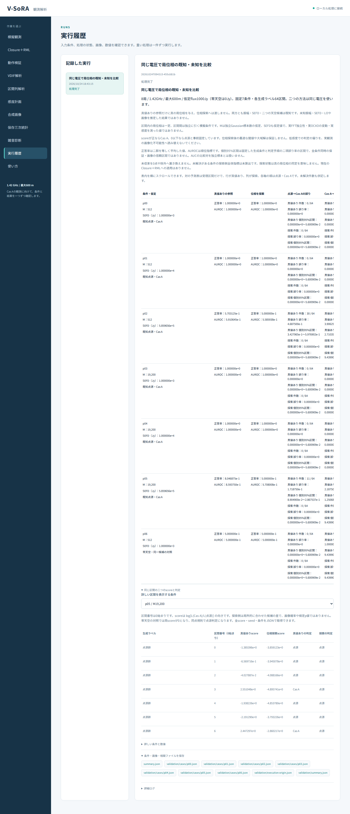

# 段階105：同じ電圧での局位相比較を日本語GUIへ接続

- 作成日：2026-10-24
- 状態：完了
- 比較元コミット：4a38482ea54a7d35f20536e8d5853a4fd0022b11

## 読者向け概要

段階104では、同じ模擬電圧へ二つの比較方法を適用した。一方は真の局位相を与えた参照、もう一方は真の位相を与えず、候補天体ごとに位相を探す参照である。今回はその結果を日本語GUIから再計算し、条件や区間を切り替えて読めるようにした。

概要の正答率だけでは、すべて点源へ判定が偏っている状態を見落とす。そこで二群それぞれの誤り数、個別区間、同じ区間の二つのscoreと予測も表示する。非収束は「未解決」とし、0点や点源判定へ置き換えない。振幅・SEFDは既知であり、精密較正が困難な実観測を解決したGUIではない。

## 1. 目的・対象範囲

[段階104](104-paired-phase-template.md)の固定7条件・896区間のnative計算を、リポジトリのrunnerがない作業フォルダでも利用できる日本語GUIへ接続する。科学module、U₃、既存Closure＋RMLは変更しない。

1.42 GHz・最大600 m・8局、短積分を見据えた独立Gaussian標本数とSEFDの仮定を保つ。Windows収録は対象外。局別周波数差、実OCXOの短時間位相変動や未知振幅・SEFD・LOは今回推定しない。

## 2. 完了条件

1. 新しい選択肢・native worker・概要と詳細・全JSON取得を接続する。
2. 両実Chromiumで7条件・896区間の全表示値と全JSON、390px日本語表示、局所スクロールを確認する。
3. 人工的な未解決表示を確認し、科学計算の成功例と区別する。
4. 既存native5操作をソース版・導入版の実ブラウザで再実行する。
5. ソース・試験・toolを凍結した両全回帰、wheel・導入元・公開監査、文書・匿名commit/pushを完了する。

## 3. 実際に行った作業

### 3.1 画面と操作

「動作検証」へ「局位相を既知/未知として同じ電圧を比較」を追加した。固定のfull計画を実行し、評価データから条件や閾値を選び直す操作は設けていない。

概要表は、M、SEFD、二つの正答率・AUROC、二群の誤り数・誤り率・個別95%区間、未解決件数、対の予測表を表示する。対の表は行が真値あり、列が探索、各軸の順は点源・Cas Aである。受理区間だけの表であることと、未解決件数を併記する。

詳細ではp00〜p06を切り替え、点源群64区間、Cas A群64区間の計128行を表示する。区間番号は0始まり。同じ電圧の二つのscore、二つの判定、探索状態、二つの正誤を横に並べる。幅の広い表は表内で横スクロールでき、詳細には縦スクロールもある。条件別JSONとsummaryを実際にダウンロードできる。

画面には、既知振幅・SEFD、区間内一定位相、独立標本数・実感度の未実測、局所解と固定閾値の制約、個別区間と画像の信頼度の違いを表示する。未収束のscore・判定は「未解決」、その条件の全体指標は「未解決のため未算出」とする。探索が停留しても真の局位相を同定したとは表示しない。

### 3.2 native workerと導入版

workerは段階104のpackage APIを直接呼び、全7条件の科学JSONを変更せず保存する。中止は進捗通知時に確認し、失敗・中止を完了扱いしない。moduleと同梱入力の導入元は実行記録へ保存する。製品画面に内部のローカルパスを表示しない。

runnerがないフォルダの動作検証は、今回の追加で6種類となった。既存5種類の選択肢と動作も確認する。その他の検証には引き続きcheckoutが必要であり、画面で利用可能性を区別する。

### 3.3 変更ファイル

- UIのmodels/jobs/server/worker：選択肢・ラベル・runnerなしの利用可能項目・native実行。
- UIのindex.html/app.js/style.cssと新しい [phase-template.js](../../apps/ui/src/vsora_ui/static/phase-template.js)：表示・切替・スクロール。
- [新worker試験](../../apps/ui/tests/test_phase_template_gui.py)、既存capability試験、既存5操作のブラウザ照合tool。
- [新ブラウザ照合tool](../../tools/verify_phase_template_ui.py)：全数値・判定・全JSON・表示・操作の検証。
- [GUIガイド](../guide/06-gui.md)、[入力と計算の規約](../../interfaces/paired-phase-template.md)、本レポート・索引・正式記録。

## 4. 検証条件・結果

### 4.1 対象試験

新12件と既存62件の計74試験が3.12秒で成功（既存警告1件）。worker呼出し、固定full計画、進捗、利用可能性、失敗・中止、数値処理の失敗結果を完了にしないことを確認した。新worker試験はstubを使う接続試験であり、896区間の科学計算の証拠とは分ける。

### 4.2 実ブラウザ

新GUIはソース版と導入版の両実Chromiumで成功した。両方ともrunnerのない一時作業フォルダから固定full計画を再計算し、段階104の全科学JSONと一致した。日本語font、390pxのroot横溢れなし、二つの表で実際の横スクロールと詳細の縦スクロール、JavaScript error 0、外部通信0を確認した。下表は各版ごとの範囲で、件数を合算して試験数と呼んでいない。

| 操作 | 各版の実ブラウザで照合した範囲 |
|---|---|
| 新しい局位相の対比較 | 7概要・896詳細・7条件切替、全表示値・全7case JSON・summary実download |
| 既存の配置比較 | 18概要・108条件・6048詳細 |
| 既存の虚部対称性 | 53条件・2968詳細、全53case JSON・4filter・summary取得 |
| 既存の独立学習/評価 | 固定9条件、全科学JSON・表示 |
| 既存の学習/評価反復 | 7概要・112詳細、全科学JSON・表示 |
| 既存の既知共分散 | 9概要・9216詳細、全科学JSON・表示 |

人工的な未解決fixtureでは、既知のsource結果の1区間だけを表示試験用にnullへ変更して描画した。「未解決」「未収束」「未算出」と表示され、0点や点源・正解に置換されないことを確認した。これは表示の確認であり、そのfixtureを正式科学実験の未収束例や実観測例に数えていない。段階104の896区間の正式実験では未収束0だった。

完成画面の条件p05と開いた詳細が、実際の2回の定期GET応答後にも保持されることを確認した。処理途中のsummaryではなく「処理完了」とspinner消失を待ってから操作する。

### 4.3 全回帰と配布

両環境で各1,899試験成功、除外0件。ソース版580.46秒、導入版580.59秒、両方とも既存警告27,396件。実行時間は今回の環境での観測値である。

科学source80ファイルは比較元から不変。ソース・試験・検証tool298ファイルを凍結し、多数の実ブラウザの終了を待ってから両全回帰を実行した。ブラウザと全回帰の間にコード変更は行っていない。

workerが記録する科学module12個と同梱FITS/configの導入元を確認した。wheel内のpackage 97ファイルがソースとbyte一致し、pip checkが成功した。公開用スクリーンショットはmetadataを除去し、RGB画素を保持した。

実行環境はWSL上のheadless Chromium。Windows側ブラウザの直接操作とWSLg desktopは確認していない。通常GUIは導入済み105でlocalhost:8765へ再開した。

### 4.4 初期確認での停止と訂正

初回の対象試験コマンドは、実在しないnative array試験ファイルを指定したため収集前に停止した（0試験）。実在するnodeidに訂正して74件を実行した。0試験の実行を成功件数へ加えていない。

草稿rendererを注入する予備確認では、inline scriptが既存CSPにより遮断された。予備contextだけを注入用に設定して描画を確認した後、正式GUIのstaticファイルとして接続した。正式ブラウザではCSPを緩めたりbypassを設定したりせず、通常の配信経路を検証した。アプリのCSP規則は変更していない。草稿の確認は正式ブラウザ件数に合算していない。

正式結果は[回帰・配布記録](../../validation/runs/stage105/verification.json)、[source新GUI](../../validation/runs/stage105/source-browser.json)、[導入版新GUI](../../validation/runs/stage105/installed-browser.json)を参照。旧5操作の両版JSONも同じフォルダへ保存する。生ログ・一時workspace・wheelはGit管理外の `outputs/stage105-*` に置く。

## 5. 制約・未解決事項

科学的な制約は段階104のまま。固定2天空・既知振幅/SEFD・区間内一定位相、3局以上の局所探索、固定閾値0の参照である。低感度での偏りを、実機Cas A画像化やすべての手法での画像化不可能性へ読み替えない。

MとSEFDは仮定値であり、実FFT独立性・実OCXO位相安定時間・弱い実信号での未知LO推定・実SEFDを測った結果ではない。全局共通Sの実データproducerは未接続。低SNR画像尤度、全夜運用、GPU性能も未検証。現行Closure＋RMLの重みや画像尤度は変更していない。

## 6. 次段階

開発全体の時系列と、最終目標から逆算した進捗説明へ、既知二モデル比較・既知Gaussian共分散・未知局位相の参照段階を反映する候補。その後、閾値・未知位相の扱い・未知振幅/SEFD・実データの共通標本保存を分けて検討する。GUIで参照実験が動くことと実観測ソフトの完成を区別して進める。
