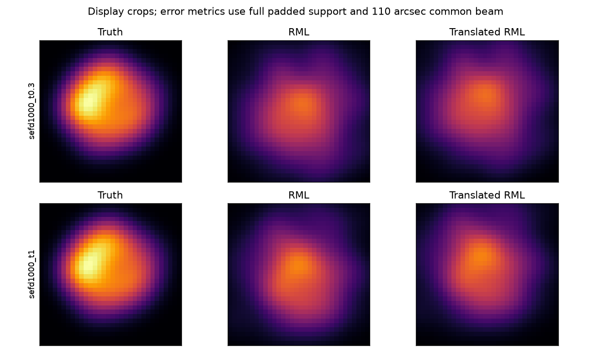

# 段階109：主画像経路の受入記録と律速の切り分け

- 作成日：2026-10-26
- 状態：完了（診断と固定ベンチの範囲。画像成功の認定ではない）
- 比較元コミット：2ea5c9dffa31ca8c778b7ed8a6999a5c980dc829（108）

## 読者向け概要

画像ファイルができたこと、数値計算が収束したこと、天体の形が正しく復元されたことは、それぞれ違う。例えば、最適化を一定回数で打ち切っても、途中の画像を保存することはできる。また、数学的には収束しても、測った情報が少なければ滑らかさなどの事前条件に強く依存する画像になり得る。

[段階108の見直し](108-goal-review-and-cadence.md)を受け、既知の二天空を分類する参照から、模擬VDIFを実際の主画像経路へ入力する確認へ戻った。今回は画像化の算法を変えず、どこで止まり、何が確認できたかを機械可読に記録する。高感度の仮定でも今回は未収束、低感度の仮定では周波数差推定で停止した。これらは改善対象を見つけた結果であり、実機での成功や画像化不可能性の証明ではない。

## 1. 目的・対象範囲

既存の模擬VDIF生成、未知の局周波数差推定、補正相関、Closure＋RML、全support画像比較を接続し、同じ入力で積分時間を比較する。処理状態、独立な位相/対数振幅Closure数、選択した最適化の収束、参照画像差を別の値にする評価API/CLIを追加する。

1.42GHz・8局・最大600m・Cas A、局ごとの一定の未知gainとLO、供給したsample clockを仮定する。実機・Windows収録・RMLの目的関数・SNR閾値・周波数推定式・GUI表示は変更しない。

## 2. 完了条件

1. 評価ルール、不正値、partial記録、真値なし、片方の制約なし、入力非変更、CLI非上書きを試験する。
2. 固定4条件を実行し、同じSEFDの二つの積分で入力SHAが一致すること、推定器へ天空真値や真のLOを供給しないことを確認する。
3. 規定の科学的な不足を未画像化として保持し、未知の実装事故は失敗として停止する。
4. 導入版API/CLIで全4評価JSONを照合し、コードを凍結したsource/導入済みの両全回帰、wheel/pip check、記録・公開監査・匿名commit/pushを終える。

## 3. 実際に行った作業

- [評価module](../../apps/imaging/src/vsora_imaging/assessment.py)、[対象試験](../../apps/imaging/tests/test_assessment.py)：評価する三つの意味を分離する。
- [固定VDIFベンチ](../../workflows/image_path_acceptance_validation.py)、[失敗の扱いの試験](../../tests/integration/test_image_path_assessment.py)：規定のValueError全文と型が一致する場合だけ次条件へ進む。
- [checkout外の導入照合](../../tools/verify_image_assessment_installed.py)、[入出力規約](../../interfaces/image-assessment.md)とその索引、本レポート、レポート索引、正式記録。

APIは既存のJSONを評価するもので、保存画像自体の存在・byteを認証するものではない。選択startの未収束を、別startの成功や良い画像差で上書きしない。参照画像がなければ画像差はnullである。閾値を宣言したときだけ大小比較するが、今回の実験ではNRMSE合格閾値を宣言していない。

### 固定条件

生成seed109、UTC `2026-10-02T10:00:00Z`、8局spread配置、1000Jyの合成Cas A、各局SEFDを1000/10000Jyとした。これは実アンテナの測定値ではない。各SEFDで1.04秒（520frame）、2.048MS/s、8bit複素VDIFを一回生成し、積分0.3秒と1秒で同じ原本を使う。生成時のsample数と乱数系列は二つのSEFD間でも共通だが、共分散が違うのでVDIFのbyteまで同じとは言わない。

供給したsample clockと電圧scaleは既知。LOは局別に一定で約−12〜26Hz、gainは区間内一定とした。生成時の真値を保存する一方、観測設定は天空modelをunknownにしfluxを削除する。LO真値を渡さず、4ms×250区間の共通pilotから推定する。最終相関は3つの有効RF channel、RMLは32×32画素・16秒角/画素、prior FWHM240秒角、1初期値・最大2000反復、既存SNR10のままである。

真値との比較は推定後だけで行う。単位fluxへ正規化し110秒角の共通beamで平滑化、平行移動だけを許して、切り落としのない全supportでNRMSEを求める。NRMSEは画像差のノルムを正解画像のノルムで割った量で、総合完成率や画像が正しい確率ではない。

## 4. 検証条件・結果

### 4.1 実際の主経路の結果

| 仮定SEFD | 積分 | 処理状態 | LO最大誤差Hz | 独立phase/logamp | 数値収束 | 位置合わせ後NRMSE |
| --- | ---: | --- | ---: | ---: | --- | ---: |
| 1000Jy | 0.3秒 | 完了 | 0.00825178 | 39 / 36 | 未収束 | 0.355040 |
| 1000Jy | 1秒 | 完了 | 0.00825178 | 55 / 52 | 未収束 | 0.310815 |
| 10000Jy | 0.3秒 | pilot後停止 | 未推定 | 未計算 | 未実行 | 未評価 |
| 10000Jy | 1秒 | pilot後停止 | 未推定 | 未計算 | 未実行 | 未評価 |

高感度の二つは全5工程を実行し画像を保存したが、選択したL-BFGS-Bはいずれも2000反復の上限に達した。抽出した全有効Closure数は位相/振幅が63/89、123/266であり、表の独立数と区別する。画像比較の移動境界には達せず、全supportのflux保持率は浮動小数点誤差内で1だった。

低感度の二つは `rate_graph_disconnected`。検出した基線の周波数差から全局を結ぶ関係が作れず、補正・Closure・RMLへ進めない。同じ1秒pilotを使ったため、最終積分だけ延ばしても推定を改善する設定にはなっていない。未計算のClosure数を0で埋めたり、未画像化を悪いNRMSEへ換算したりしなかった。



左が正解、中央がRML、右が位置合わせ後のRML。表示は切り出しだが、表の誤差は全supportで計算した。低感度の二つは画像がないため図へ載せていない。単一の短区間のuvだけでは1024画素を十分に決められず、正則化の寄与や未収束が重なる。過去の数時間合成の成功例との違いを、画像化全般の否定へ広げない。

### 4.2 ソフトと配布の検証

対象54試験が0.93秒で成功。処理完了/未完了と収束の全組合せ、選択run、真値なし、閾値の境界、不正値、片方だけの制約、全Closureと独立数、CLI非上書き、未知の例外の伝播を確認した。

両全回帰は各1985試験成功・除外0。source版601.03秒、導入版601.03秒、既存警告はそれぞれ27396件と27396件。

checkout外から導入版のpipeline APIとnative CLIを全4条件で実行し、評価JSON全項目がsource版と完全一致した。画像がある2条件はRML APIでも一致。全4条件の上書き拒否・byte保持、読込module2個の導入prefixを確認した。これは保存済みsource実験結果の再評価であり、導入版で模擬VDIFを再生成して全相関を再実行したという意味ではない。両全回帰では既存相関・RMLの試験も実行する。

ソース・試験・検証tool・workflow・設定369ファイルを凍結し、回帰後のSHAが不変。対象外tracked 1137ファイルも比較元とbyte一致。wheel内package99ファイルと同梱参照assetはsource byteと一致し、pip check成功。公開監査指摘0、文書リンク1408件で欠落0。

GUIコードは不変でブラウザを再実行していない。通常GUIを導入済み109で再起動し、APIで実行中jobが0件と確認した。新しい評価APIはまだGUIへ接続していない。環境・正式な数値・入力SHAは[生成と全4条件](../../validation/runs/stage109/reference.json)、[導入照合](../../validation/runs/stage109/installed-api.json)、[回帰・配布・監査](../../validation/runs/stage109/verification.json)を参照する。大容量VDIFと詳細ログはGit管理外の `outputs/stage109-source-study/`、`outputs/stage109-*-final/` に保存する。

再現例：

```bash
python tools/run.py pytest -q apps/imaging/tests/test_assessment.py tests/integration/test_image_path_assessment.py
python tools/run.py workflows.image_path_acceptance_validation --output outputs/image-path-new
python -m vsora_imaging.assessment --input pipeline.json --output assessment-new.json
```

## 5. 制約・未解決事項

本実験は一時刻・短区間の固定seedで、数時間のuv合成や全夜の運用ではない。周期的な帯域制限Gaussian電圧、区間中央の天空共分散、供給した正確なclock/scale、一定gain/LOという仮定を残す。今回のSEFDで止まったことは、別の配置・pilot・帯域でも同じとは言わない。2条件のpilot失敗は同じ入力・pilotから生じたもので、独立した2回の検出率測定でもない。

NRMSEは真値がある模擬実験専用である。実観測では真値がなく、収束だけを代わりの正解判定にはできない。現在の画像尤度は高SNRの局所Gaussian近似のまま。低SNR画像尤度、未知振幅/SEFD、弱い実信号のLO、実OCXO/感度、実機Cas A画像、全夜/GPU性能は未検証である。

## 6. 次段階

110はユーザー指定の10段階ごとの文書整理を行う。その後111では、同じ弱いVDIFについて、pilot長・利用基線・探索の検出条件を調べ、LO推定で止まる原因を先に切り分ける。真のLOを使う対照を設ける場合も評価用の対照と明示し、実装が未知LOを解いた結果とは分ける。高感度側は未収束と単一区間の情報不足を、より長いuv合成の問題から分離して扱う。
