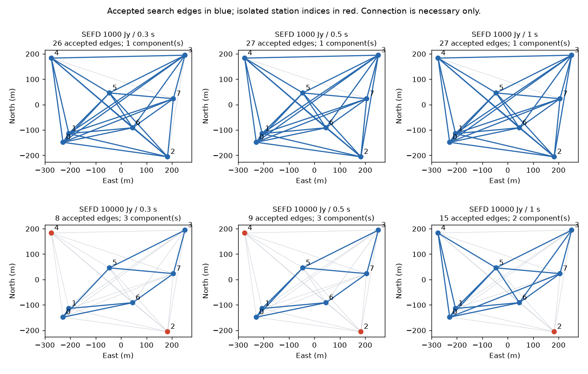

# 段階111：失敗したpilotの検出基線と局のつながりを保存

- 作成日：2026-10-26
- 状態：完了（局graphの診断。推定法の改善ではない）
- 比較元コミット：63cd1016e39bcef2239b562223f45a0f46c6e424（110）

## 読者向け概要

[109](109-image-path-acceptance.md)の弱い模擬データは、画像を作る前に局の周波数差を推定できず停止した。従来の例外は「検出された基線で全局がつながらない」と伝えていたが、どの局が孤立したか、どの基線が閾値に届かなかったかは失敗結果から読めなかった。

今回は同じ走査を使う診断を追加し、推定の成否とは別に基線ごとの情報を保存する。弱条件では、1秒で15本を検出できても1局が孤立していた。基線本数だけで採用するより、全局を結ぶ関係があるかを見る必要がある。

## 1. 目的・対象範囲

検出・棄却の基線記録と局graphを返すAPI/CLIを追加する。現行推定の基線走査部分をそのまま共通helperへ抽出し、旧推定の式・閾値・成功JSON・失敗例外を維持する。既存の109原本から保存済みpilotを取り出し、先頭0.3/0.5/1秒を比較する。

当初の111計画にあった切り分けを、まず「局解を作れない場合にも診断を残す」範囲へ限定した。長いVDIFの生成、補正後相関、画像の再計算、閾値を緩める処理は本段階で行わず、112で選ぶ対照と分ける。Windows収録とGUI表示は変更しない。

## 2. 完了条件

1. 連結・孤立局・複数group・非連続局index・重み0・探索境界・不正値・CLI非上書きを試験する。
2. 同じpilotの全6条件と固定雑音対照で、比較元moduleの全成功JSON・失敗例外が新推定と一致する。
3. 入力SHAと配列を保持し、真値を診断・推定へ供給しない。
4. 導入API/CLI全JSON、非上書き・prefix・wheel/pip check、凍結した両全回帰、正式記録・公開監査・匿名commit/pushを完了する。

## 3. 実際に行った作業

### graphとは何か

局を点、検出した基線を線として描いたものをgraphと呼ぶ。基線i–jでは周波数差 `r_i-r_j` を測る。例えば0–2の基線が弱くても、0–1と1–2が測れれば、その道順で2局目との関係を作れる。一方、ある局に入る線が一本もなければ、他の7局で何本検出しても、その局のrateは求められない。

n局、k個の独立groupなら、基線差の行列rankはn−kとなる。全局を結ぶにはn−1が必要で、8局なら7。ただし連結は必要条件に過ぎない。線に沿った周波数差が互いに矛盾する場合やaliasがある場合まで、解が正しいと認定するものではない。全局に共通する絶対周波数も測れない。

### 変更ファイル

- [既存rate](../../apps/correlator/src/vsora_correlator/rate.py)：走査式を共通helperへ抽出。旧推定の局解・共分散・例外は維持。
- [graph診断](../../apps/correlator/src/vsora_correlator/rate_graph.py)、[36対象試験](../../apps/correlator/tests/test_rate_graph.py)：全基線の検出/棄却、連結group、基準局のgroup、孤立局、rank。
- [固定prefix比較](../../workflows/rate_graph_validation.py)、[導入照合](../../tools/verify_rate_graph_installed.py)：真値は事後の基線誤差評価だけに使う。
- [規約](../../interfaces/rate-graph.md)とその索引、本レポート、レポート索引、正式記録。

新APIは局解を求めない。成功・失敗と別にgraphを返すので、graphがつながっていても既存推定の整合性判定で落ちることはあり得る。また、全pairsを保持して重みを0にする場合は孤立局を残せるが、入力pairsから消した局の存在を診断器が推測することはない。

## 4. 検証条件・結果

### 4.1 同じ原本からのprefix比較

入力は109のSEFD1000/10000Jy、1.42GHz・最大600m・8局、合成Cas Aの二つの保存pilot。生成seed109、各250区間×4msである。75/125/250区間を先頭から取り、実効span0.3/0.5/1秒で比較した。重み・RF選別・局配置・原本は同じで、原本SHAと入力配列が変わらないことを確認した。

coherent SNR閾値8、noise peak量の閾値8、最大基線rate100Hzは既存値を維持した。真の局rateや天空modelは診断・推定へ渡さず、結果の基線rate誤差の算出だけに使う。

| 仮定SEFD | pilot秒 | 採用基線/28 | group数 | 孤立局index | 旧推定結果 |
| --- | ---: | ---: | ---: | --- | --- |
| 1000Jy | 0.3 | 26 | 1 | なし | 局解あり |
| 1000Jy | 0.5 | 27 | 1 | なし | 局解あり |
| 1000Jy | 1 | 27 | 1 | なし | 局解あり |
| 10000Jy | 0.3 | 8 | 3 | 2、4 | 切断で停止 |
| 10000Jy | 0.5 | 9 | 3 | 2、4 | 切断で停止 |
| 10000Jy | 1 | 15 | 2 | 2 | 切断で停止 |

局indexは0始まりで、観測設定のST01〜ST08に対応する。弱条件では0.3/0.5秒の二つの孤立局のうち4が1秒でつながったが、2は孤立したままだった。基線の棄却理由は弱条件0.3/0.5/1秒で、coherent検出不足17/17/12本、最大peakが探索外または境界3/2/1本だった。後者から実LOが探索外にあると断定しない。雑音で別のpeakが最大になった可能性もある。



青い線が走査で採用された基線、薄い線が他の入力基線、赤い点が孤立局。線が青いことだけで物理的に正しいrateとは認定しない。採用基線の真値からの最大誤差は、高感度で約0.182/0.188/0.0545Hz、弱条件で約0.333/0.185/0.110Hzだった。これは局の最小二乗解の最大誤差とは別である。

### 4.2 有限の雑音対照と旧推定の保持

各6条件について16個、計96個の固定seedの雑音対照を作った。保存pilotの重みを使い、基線・RF channel・時刻・実部/虚部が独立なGaussianと仮定した。実部・虚部の標準偏差を `1/sqrt(weight)` とし、重み0のsampleは0とする。これは実FFTや天体自己雑音のモデルを校正したものではない。

今回の96対照では採用基線0、全局連結0だった。閾値の一般的な誤警報確率や実観測の偽検出率を認定していない。実信号を見て閾値を緩めたり、失敗を除外したりしていない。

比較元110のrate moduleを別moduleとして読み、信号6条件・雑音96条件の全102入力で旧推定と新推定を独立に実行した。成功JSON全項目、失敗ValueErrorの型と全文が完全一致した。helper抽出の前後で式・結果・採用判断を変えていないことの確認である。

### 4.3 試験・配布

新36＋既存rate8の44対象試験が0.67秒で成功。初回はCLI用試験fixtureに必須のvisibility単位を設定し忘れて1件失敗した。ADC²を設定し直して対象試験を再実行した。実装の数式を変えて失敗を隠したものではなく、修正は凍結・正式全回帰前に完了している。

両全回帰は各2021試験成功・除外0。source 602.3秒、導入版 601.86秒、既存警告はそれぞれ27396件と27396件。

導入版ではcheckout外から信号6条件、雑音96対照のgraph全JSONと既存推定の全結果・例外がsourceと一致した。native CLI全6条件の全JSON、上書き拒否とbyte保持を確認した。読込project module5個の導入prefix、wheel内package100ファイルと同梱assetのsource byte一致、pip check成功を確認した。ソース・試験・検証tool・workflow・設定373ファイルの凍結SHAは不変で、対象外tracked 1150ファイルも不変。共通helperの式を比較元の該当文のASTと照合し一致した。公開監査指摘0、文書リンク1444件で欠落0。

GUI表示は変更せず、実ブラウザを再実行していない。更新前に通常GUIの実行中job0件を確認し、所有していたGUIだけ停止、導入済み111で再開してidleを確認した。新graph診断はGUIへ未接続である。

[全6信号条件と96雑音の要約](../../validation/runs/stage111/reference.json)、[導入照合](../../validation/runs/stage111/installed-api.json)、[回帰・配布・監査](../../validation/runs/stage111/verification.json)を公開記録とする。96雑音の各全診断JSONはcanonical JSONのSHAも保存し、詳細とprefix NPZはGit管理外 `outputs/stage111-source-study/` に置く。元VDIFは `outputs/stage109-source-study/`、実行ログとwheelは `outputs/stage111-*-final/` にある。

再現例：

```bash
python tools/run.py pytest -q apps/correlator/tests/test_rate_graph.py apps/correlator/tests/test_rate.py
python -m vsora_correlator.rate_graph --input pilot.npz --output graph-new.json
# 過去moduleは比較元110のrate.pyをGitから取得したローカルコピー
python tools/run.py workflows.rate_graph_validation --reference outputs/stage109-source-study \
  --previous-rate-module outputs/rate-before.py --output outputs/rate-graph-new
```

## 5. 制約・未解決事項

二つの原本のprefixは互いに重なり、独立した観測反復ではない。pilotを長くすれば必ずつながるという一般則を実証していない。孤立局を除いて成功扱いしたり、その配置が常に不適切と判断したりしていない。

診断が保存されるようになったことと、LO推定が改善したことは違う。1秒より長い原本、新しい補正相関、画像は今回実行していない。実際の初期周波数範囲、Nyquist alias、位相変動、自己雑音、上流の選別、実機Cas A/SEFD/OCXO、低SNR画像尤度、全夜/GPU性能は未検証である。

## 6. 次段階

112では、最大3秒以内という現在の参照条件で、長いpilotを使う対照を検討する。同じ長い原本のprefix同士で比較し、短い109原本とは乱数消費に伴うgain/LOの違いも記録する。未知LO取得と、真値補正を使う評価用対照を分け、補正後に相関・Closureを保持できるかを調べる。少数局だけの解を使う場合も局集合と画像情報の減少を明示し、8局成功へ読み替えない。
