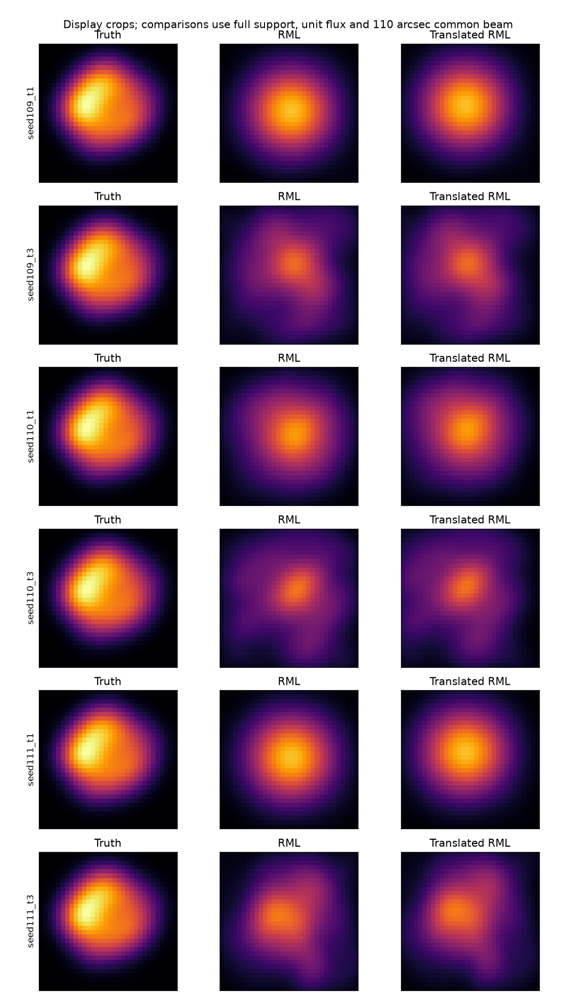

# 段階113：最終積分と画像を比較し、収束と形状改善を分ける

- 作成日：2026-10-26
- 状態：完了（固定模擬実験。形状改善は確認せず）
- 比較元コミット：3f281d81afbef754c80dabf8e9cddb7bec3cc5d4（112）

## 読者向け概要

112では局の周波数差を補正できた条件でも、最終0.3秒の相関にSNR閾値を通るClosureがなかった。今回は、同じ原本と補正rateのまま最終積分を1秒・3秒にも延ばし、画像を作れるかを確かめる。

6条件で画像が出力され、そのうち5条件は数値上収束した。しかし、今回の6画像はいずれも、データを使わない初期のGaussian priorより正解画像との差が大きかった。画像ができたことと、天体の形を良く復元したことを分けて報告する。

## 1. 目的・対象範囲

取得済みの3秒pilotの局rateを固定し、同じ原本内で最終積分時間だけを変える。Closure可用性、画像の有無、選択した最適化の収束、真値との形状差、初期priorとの差を分離する。productionの推定器・相関器・RML・SNR閾値・尤度は変更しない。

固定seed109/110/111、1.42GHz・最大600m・8局、3.04秒の模擬VDIF、一定gain/LO、正確なsample clock/scale、仮定SEFD10000Jy・flux1000Jyを112から引き継ぐ。Windows収録、実機、GUIの新表示、全夜/GPU性能は対象外。

## 2. 完了条件

1. 全9条件を正式に相関・RMLへ通し、Closure不足・未収束も保持する。0.3秒の全配列は112と一致する。
2. 原本・rate profileのSHAを保持し、生成真値は評価後にだけ使う。
3. 導入版の既存native相関/RML CLIでも全9条件を実行し、全相関・画像配列、設定・収束・全評価値、非上書き・prefixを照合する。
4. production不変の範囲で関連対象試験、wheel byte/pip check、文書・正式記録・公開監査・匿名commit/pushを終える。

## 3. 実際に行った作業

- [固定実験workflow](../../workflows/integration_image_validation.py)：同じrate profile・原本の積分時間を比較する。
- [導入CLI照合](../../tools/verify_integration_image_installed.py)：sourceと同じ入力をcheckout外から相関・画像化する。
- [規約](../../interfaces/integration-image-validation.md)、索引、本レポート、正式記録と図。

3つの原本それぞれについて、112の750区間×4msから求めた同じrate-only profileを再利用する。最終積分は共通の開始offset0.002秒で0.3/1/3秒。原本とprofileを変更せず、複製したmanifestのFFT block数だけを変えた。3秒の位相安定性は生成時の仮定で、実OCXOを測った値ではない。

RMLは32×32画素・16秒角/画素、SNR10、Gaussian prior FWHM240秒角、entropy0.01、TSV0.0001、centroid0.1、1初期値・最大2000反復・seed21を固定した。規定の高SNR独立Closure不足だけを未画像化として記録し、その他の例外は停止する。未収束画像は保存して評価する。

観測設定はunknownのままとし、事後評価専用のcopyに生成model/fluxを戻して天空を再構成した。全3seedのtruthはseed109生成時に保存した配列と完全一致。RMLはその配列を読まず、初期画像・priorもGaussianのままである。

## 4. 検証条件・結果

### 4.1 同じ原本とrateでの画像化

| seed | 積分秒 | 全有効phase/logamp | 独立phase/logamp | 数値収束 | 位置合わせ後NRMSE |
| --- | ---: | ---: | ---: | --- | ---: |
| 109 | 0.3 | 0 / 0 | 未計算 | not_run | 未評価 |
| 109 | 1 | 6 / 0 | 6 / 0 | converged | 0.220771 |
| 109 | 3 | 20 / 17 | 17 / 14 | converged | 0.444865 |
| 110 | 0.3 | 0 / 0 | 未計算 | not_run | 未評価 |
| 110 | 1 | 5 / 2 | 5 / 2 | converged | 0.314177 |
| 110 | 3 | 18 / 15 | 16 / 13 | converged | 0.470876 |
| 111 | 0.3 | 0 / 0 | 未計算 | not_run | 未評価 |
| 111 | 1 | 4 / 0 | 4 / 0 | converged | 0.219483 |
| 111 | 3 | 23 / 21 | 20 / 16 | not_converged | 0.357805 |

0.3秒の三条件はClosure不足として画像化前に停止した。1秒ではphaseだけ、または少数のlogampも使う画像が作られた。3秒では独立制約が増えたが、1024画素の任意画像を一意に決めたという意味ではない。seed111・3秒は反復上限に達し、未収束のまま保存した。

### 4.2 初期画像より形状を良く説明したか

真値のある模擬試験なので、unit fluxへ正規化し、110秒角共通beamと平行移動だけを許して、切り落としのない全supportでNRMSEを計算した。これは画像差のノルム比で、信頼確率ではない。

固定Gaussian priorだけのNRMSEは **0.2188727**。同じRML classが作るpriorを取り出し、データへfitしない参照として評価した。導入版でもprior配列と全比較値を照合する。priorの幅は今回の真値を見て選び直しておらず、既存設定240秒角を維持した。

この3seedの6画像は、いずれもpriorよりNRMSEが大きかった。1秒のphase-onlyに近い画像はpriorに近い誤差で、3秒はClosureが増えても、この試行では約0.358〜0.471となった。「長くすると常に悪い」「Closure法では画像化不可能」と一般化しない。単一時刻のuv情報、少数の制約、雑音、補正誤差、非凸最適化、正則化の影響が重なっており、次の対照で分ける必要がある。



左が真値、中央がRML、右が位置合わせ後。表示は切り出しで、誤差は全supportによる。0.3秒の三つは画像がないため図へ載せていない。数値収束しても、正しい形状や大域解を認定したことにはならない。

### 4.3 導入版・配布と既存試験

checkout外で全9相関・全9RML試行を実行し、117個の全相関配列、6枚の保存画像配列とNPY SHA、graph/設定/目的関数/Closure数/収束の科学JSON、全比較metricが一致した。no-data prior配列と全metricも一致。Closure不足の三条件は同じValueErrorで画像なし、未収束の一条件も同じ状態。全相関と出力された画像の上書き拒否・byte保持、原本/profile SHA不変、読込project module17個と参照assetのprefixを確認した。経過秒と入力archiveの来歴SHAは各実行で分け、他のRML科学項目は全て照合した。

既存RML/assessment/pipelineの57対象試験は27.38秒で成功、既存警告2280件。新しいworkflowを模倣する試験は追加していない。production module・既存試験・設定・同梱assetはbyte不変で、wheel再導入と全回帰は113で繰り返していない。[111の両2021試験](../../validation/runs/stage111/verification.json)（602.30/601.86秒、27396警告、除外0）を既存根拠とし、今回のsource9＋導入版9の実相関・RML試行を新しい検証として分けて記録する。

ソース/試験/検証tool/workflow/設定377ファイルの凍結SHA不変、対象外tracked 1168ファイル不変。既存111wheelのpackage100ファイルと同梱assetはsource・導入先の両方とbyte一致、pip check成功。公開監査指摘0、文書リンク1468件で欠落0。

新GUI表示とブラウザは実行していない。通常GUIは導入済み111のままidleを維持した。[全9条件](../../validation/runs/stage113/reference.json)、[priorだけの参照](../../validation/runs/stage113/prior-reference.json)、[導入照合](../../validation/runs/stage113/installed-api.json)、[入力来歴・不変性・監査](../../validation/runs/stage113/verification.json)を参照。大きな相関NPZ、画像FITS、ログはGit管理外 `outputs/stage113-source-study/`・`outputs/stage113-installed-api/` にある。公開記録ではローカルの絶対pathを一般化した。

再現例：

```bash
python tools/run.py workflows.integration_image_validation --reference outputs/stage112-source-study \
  --seed109-truth outputs/stage112-preliminary/truth-relative.npy --output outputs/integration-image-new
```

## 5. 制約・未解決事項

同じ原本の積分区間は重なり、独立な反復ではない。固定3seed、1時刻の短区間で、数時間のuv合成や実観測への一般的な精度は評価していない。1秒のphase-onlyで画像が出たことも、振幅形状が一意に決まった証拠ではない。

残る仮定は、既知sample clock/scale、一定gain/LO、生成時のGaussian電圧・固定天空共分散、限定VDIF、現行の高SNR局所Gaussian Closure尤度である。実機Cas A画像、弱い実信号の未知LO、実SEFD/OCXO、低SNR画像尤度、全夜/GPU性能は未検証。

## 6. 次段階

114では、推定したLOでの相関と、真のLOを与える評価用対照、同じuv・選別で理想化したforward-model対照等を使い、補正/雑音と、情報不足/正則化/最適化を分ける候補を具体化する。真値を使う対照は未知データを解く実用手法とは区別する。画像がpriorを上回らない原因を調べ、必要な主経路の修正を選ぶ。次の文書整理120、根本見直し150を維持する。
