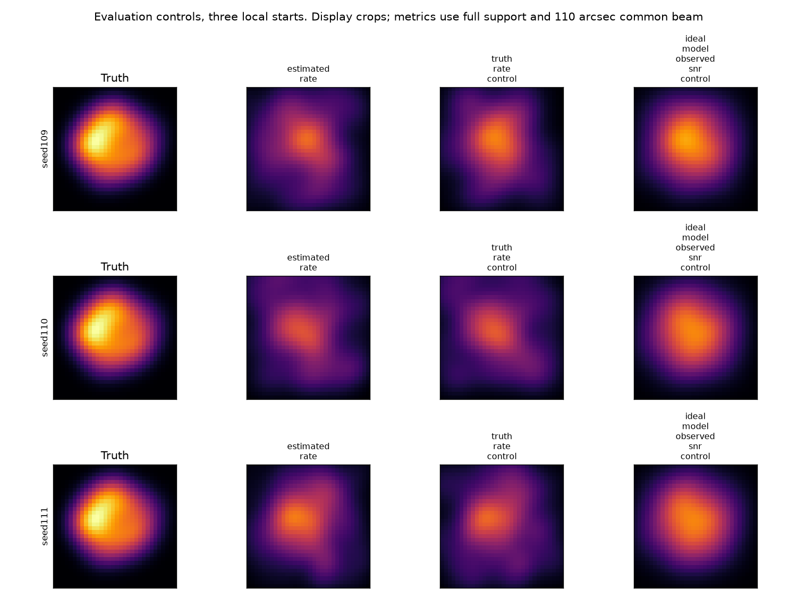

# 段階114：真のrateと理想モデルを評価専用の画像対照にする

- 作成日：2026-10-26
- 状態：完了（評価専用対照。未知観測の成功ではない）
- 比較元コミット：8677fe96640a5317d9d8eee7d7a307a40dc028eb（113）

## 読者向け概要

113では、画像が出力され数値上収束しても、生成真値との差が初期priorより大きい結果となった。ただし、それだけでは周波数補正が悪いのか、雑音の影響なのか、少ない観測点と正則化・局所探索の問題なのかが分からない。

そこで今回は、同じ相関の基準枝に加え、真の局rateで補正する対照と、理想モデルのvisibilityを使う対照を作った。後者二つは実用推定器への真値供給ではなく、問題の所在を調べる評価専用の条件である。対照でも画像差や未収束が残り、LO推定誤差だけで今回の画像誤差を説明することはできなかった。原因を一つに断定する段階ではない。

## 1. 目的・対象範囲

3seed109/110/111・最終3秒を固定し、補正/雑音/forward近似と、限られたuv・正則化・数値探索の影響を分けて検討する。productionの相関器・尤度・画像算法・SNR閾値は変更しない。

1.42GHz・最大600m・8局、模擬Cas A、仮定flux1000Jy・SEFD10000Jy、3.04秒原本、既知sample clock/scale、一定gain/LOを引き継ぐ。Windows収録、実機、GUIの変更は対象外。

## 2. 完了条件

1. 同じ基準データと二つの対照を全seedで実行し、真値を使った情報を枝ごとに明記する。
2. 理想化変換のSNR/mask/近似分散・位相・不変性・不正境界を確認する。
3. 3初期値の基準枝のrun0が113と一致し、未収束も保持する。
4. 導入版の相関/RML CLI、全配列・画像・科学JSON/metric、入力不変・非上書き・prefix・package不変を確認する。
5. レポート・規約・索引・小容量記録、公開監査・匿名commit/pushを終える。

## 3. 実際に行った作業

[対照workflow](../../workflows/image_control_validation.py)、[変換8対象試験](../../tests/integration/test_image_controls.py)、[導入照合](../../tools/verify_image_controls_installed.py)、[規約](../../interfaces/image-control-validation.md)、索引、本レポートと正式記録を追加する。

### 三つの入力を比べる

| 枝 | 何を与えるか | 分かる範囲 |
| --- | --- | --- |
| 推定rateの相関 | 113の同じ保存相関 | 初期値を増やした際の変化を基準にする |
| 真のrateの対照 | 同じrawへ真の局LOを供給し再相関 | この仮定でrate誤差を除いた場合の結果。実用推定の成功ではない |
| 理想モデルの対照 | 同じuvに対する真の天空のFourier値 | 観測時と同じSNR/選別で理想モデルをfitする場合。雑音だけを除いた因果対照ではない |

全枝でRMLはstarts3・max_iterations2000、32×32画素・16秒角、Gaussian prior240秒角、SNR10、entropy0.01・TSV0.0001・centroid0.1・seed21。初期画像やpriorは真の天空へ変えていない。基準枝のrun0は113と同じで、追加の開始点だけを増やした。

真のrate対照は必要な局ID/UTC/適用時間と真のrateだけでprofileを作り、evaluation-onlyと明記した。元の推定covarianceや基線fit等をコピーして、真値に推定誤差を付けない。元profileを上書きしない。

理想モデルはvisibilityを真の天空のFourier値へ置き換え、重みを `W_obs * (abs(V_obs)/abs(V_model))**2` とする。これで `abs(V)*sqrt(W)` が同じになり、基線の採用mask、全Closure mask、現行近似のbaseline varianceが元データと一致することを確かめた。単位Jyを持つ人工モデルに重みを移したもので、実データのradiometric較正ではない。位相と振幅の理想モデル化で雑音やforward近似等も変わるため、「雑音だけを除去した」とは表現しない。

### metadataの見直しと正式再実行

初回の9条件後、理想化したJyデータに、親のclock/rate/ADC power metadataが残っていることを見つけた。評価専用と分かる最小metadataへ変更し、正式9条件を新しい出力で再実行した。初回結果は保存したが正式件数へ加えない。変換式・RML・数値設定は不変で、修正前後の全9科学JSONが完全一致した。

## 4. 検証条件・結果

| seed | 枝 | 選択start | 数値収束 | NRMSE |
| --- | --- | ---: | --- | ---: |
| 109 | 推定rate | 0 | converged | 0.444865 |
| 109 | 真のrate対照 | 1 | not_converged | 0.366101 |
| 109 | 理想モデル対照 | 1 | converged | 0.233652 |
| 110 | 推定rate | 2 | not_converged | 0.482779 |
| 110 | 真のrate対照 | 2 | not_converged | 0.483370 |
| 110 | 理想モデル対照 | 2 | not_converged | 0.255766 |
| 111 | 推定rate | 0 | not_converged | 0.357805 |
| 111 | 真のrate対照 | 0 | not_converged | 0.429597 |
| 111 | 理想モデル対照 | 2 | not_converged | 0.255336 |

### 結果をどう読むか

全9枝で画像が保存され、選択されたrunの収束は2件、未収束は7件だった。3開始点の最小目的関数を選ぶため、別runが収束していても、選択runが未収束ならそのまま表示する。各基準枝のrun0は113のrun0と全科学値が一致した。

同じ条件でも開始点を増やすと、目的関数が小さい別runを選ぶことがある。しかし今回、画像差が小さくなるとは限らなかった。従来の最小目的関数による選択規則を維持し、選択runが未収束なら未収束と記録する。

真のrateの対照でも、画像差は一様に小さくならなかった。理想モデルの対照では元データよりNRMSEが小さくなったが、今回の3条件では約0.234〜0.256で、固定priorの0.2188727を下回らなかった。これは指定した110秒角共通beam・unit flux・平行移動・全supportのNRMSEについての結果である。

理想データでも、独立制約は少数で1024画素の自由な画像を決めるには限られる。さらに未収束も残る。これらの対照から「解像度だけ」「雑音だけ」「最適化だけ」が原因と断定せず、次は画像候補ごとの目的関数内訳等を調べる。

各行は同じseed、左から真値、推定rate、真のrate、理想モデル。画像は位置合わせ済みの表示領域で、数値誤差は全supportによる。

### 導入版と検証範囲

checkout外で真のrate相関3回・RML9試行を実行し、102個の入力数値配列・9画像配列とNPY SHA・全RML科学JSON・全参照metricがsourceと一致した。理想モデル3条件は導入APIで再構成し、SNRを先に計算する別の式から重みを検証、全maskと近似分散も照合した。評価専用ラベルと不要metadataの非継承、原本/元profile/基準相関のSHA保持、出力非上書き・byte保持、読込module17個と参照assetのprefixを確認した。経過秒と入力archive SHAは各実行の来歴として分けた。

変換の新8試験と既存RML/assessment/pipelineを合わせ、65対象試験が27.19秒で成功、既存警告2280件。float32/64入力、既知三角形の位相、mask、入力非変更、重み0、model零、不正値とoverflowを確認した。production module・既存試験・設定・同梱assetは不変。全回帰とwheel再導入は本段階で繰り返さず、[111の両2021試験](../../validation/runs/stage111/verification.json)を既存根拠として引用する。新しい8試験を加えた次回全回帰の見込みは2029件で、今回2029全件を実行したとは書かない。

ソース/試験/検証tool/workflow/設定380ファイルの凍結SHA不変、対象外tracked 1177ファイル不変。111wheelのpackage100ファイルと同梱assetはsource/導入先とbyte一致、pip check成功。公開監査指摘0、文書リンク1480件で欠落0。

新GUI・ブラウザは実施せず、通常GUIは導入済み111でidleを維持。[全対照](../../validation/runs/stage114/reference.json)、[導入照合](../../validation/runs/stage114/installed-api.json)、[来歴・不変性・監査](../../validation/runs/stage114/verification.json)を参照。大きな原本・NPZ・FITSはGit管理外 `outputs/stage114-source-final-study/`・`outputs/stage114-installed-api/`、初回は `outputs/stage114-source-study/`、ログは `outputs/stage114-*-log/` にある。公開記録では絶対pathを一般化した。

## 5. 制約・未解決事項

真のrateと理想モデルの枝は評価用で、未知観測データを解いた成功ではない。後者の人工重みは現在の選別と近似分散を保つが、一般の受信機誤差・天体自己雑音・実FFT相関の分布を検証していない。

3seed・一時刻、3局所開始点・上限2000反復の有限実験であり、大域解は保証しない。priorよりNRMSEが大きいことだけで、データへの適合も悪いとは言えない。逆に目的関数が小さいことだけで、真の形状へ近づいたとも言えない。画像誤差と目的関数の意味を分ける。

実機Cas A画像、実OCXO/SEFD、弱い実信号の未知LO、低SNR画像尤度、全夜/GPU性能は未検証である。

## 6. 次段階

115候補では、同じデータについて真値・prior・復元画像の目的関数を分解して評価するAPIを検討する。単位flux画像の目的関数と、最適化パラメータの総和を固定するためのpenaltyを分け、より良い候補が残るのか、正則化と情報不足で別の画像が選ばれるのかを調べる。priorの小さいNRMSEと、観測を説明できることも区別する。

次の文書整理120、根本見直し150。主要前提が崩れれば節目を待たず開発順を調整する。
