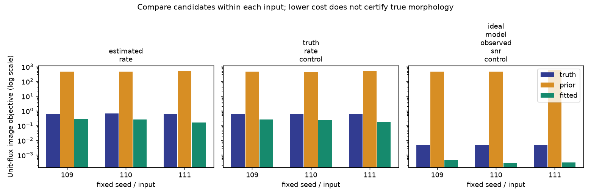

# 段階115：候補画像のデータ適合と正則化を分解して評価

- 作成日：2026-10-26
- 状態：完了（候補画像の損失評価。新しい画像最適化ではない）
- 比較元コミット：14f49dc6453255db71d790d3ef22df1df67590ff（114の索引追記）

## 読者向け概要

114では、復元画像のNRMSEが固定Gaussian priorより大きかった。NRMSEは生成した真値との形の差であり、観測値への適合そのものではない。例えば、なめらかなpriorが真値に近い見かけでも、観測されたClosureを説明できないことがある。

今回は、画像を新たに最適化せず、候補ごとの目的関数を分解するAPIを作った。27候補の結果では、priorは画像NRMSEが小さくてもデータ損失が大きく、復元画像の方が観測値には適合していた。一方、復元画像の小さい目的関数は真の形状を保証しない。この二つを同じ入力で区別するための診断である。

## 1. 目的・対象範囲

単位fluxへ正規化した候補画像について、現行高SNR Closure＋RMLのデータ損失と正則化を評価する公開API/CLIを追加する。114の固定9枝×真値/prior/復元の27候補を評価し、別計算経路・導入版と照合する。

推定器・RML solver・尤度・SNR閾値・GUIは変更しない。1.42GHz・最大600m・局別LO・短積分・精密gain較正困難という目標を維持する。Windows収録、実機、低SNR画像尤度、全夜/GPU性能は対象外。

## 2. 完了条件

1. fluxの自由度、損失分解、補助penalty除外、入力不変・不正値・CLI非上書きを正式に試験する。
2. 全27候補をAPIで評価し、直接Fourierと線形方程式の解法、既存softmax経路、fit summaryから補助penaltyを除いた値と照合する。
3. checkout外の導入API/native CLI全27JSON、SHA・prefix・上書き拒否を確認する。
4. wheel導入・pip check、コード凍結下の両全回帰、レポート・索引・公開監査・匿名commit/pushを完了する。

## 3. 実際に行った作業

- [新API/CLI](../../apps/imaging/src/vsora_imaging/objective_evaluation.py)、[26対象試験](../../apps/imaging/tests/test_objective_evaluation.py)。
- [27候補の固定評価](../../workflows/image_objective_validation.py)、[導入照合](../../tools/verify_image_objective_installed.py)。
- [規約](../../interfaces/image-objective-evaluation.md)と索引、本レポート、正式記録と図。

### 画像の損失と、最適化パラメータのpenaltyを分ける

現行RMLは非負の内部パラメータをsumで正規化して画像を作る。同じ画像を表す内部スケールが多数あるため、最適化中は内部sumを1へ近づける補助penaltyを加える。これは画像の形そのものを評価する項とは違う。

新APIは供給画像をunit fluxへ正規化し、四つの画像損失だけを評価する。

| 項 | 何を評価するか |
| --- | --- |
| データ損失 | Closure残差を近似誤差共分散で重み付けした二次形式。独立制約数で正規化 |
| entropy | Gaussian priorからの離れ方 |
| TSV | 隣接画素の明るさの差 |
| centroid | 仮定した表示中心からのずれ |

総目的関数は四項の和で、補助的なparameter_sum_penaltyは含めない。設定と独立phase/logamp数を保存し、optimizer_executedはfalseとする。有限非負・正の有限sum・正方形8〜64画素を必要とし、画素間隔を明示する。bool等の設定値を拒否し、NumPyの実数設定も通常のJSONへ変換する。

### 固定入力と独立な照合

114の同じ9visibility（3seed×推定rate/真のrate対照/理想モデル対照）について、生成真値、同じGaussian prior、保存済み復元画像を使った。新しい画像最適化は行わない。真値は比較用の候補で、実用推定へ渡していない。

独立確認では別の直接Fourier実装でmodel visibilityを作り、共分散行列を構成してnp.linalg.solveで二次形式を計算した。RML内部のCholesky解法と異なる経路である。ただし、独立Closureのdesign選択と観測時の高SNR誤差近似は共通なので、誤差モデル自体の独立検証とはしない。softmax経路とも照合し、復元画像はfit summaryの総値からparameter_sum_penaltyを除いた値と一致することを確認した。

## 4. 検証条件・結果

### 4.1 正式な対象試験と27候補

26対象試験が1.14秒で成功。point画像の既知Closure、fluxスケール17倍、入力非変更、priorのentropy、復元画像の補助penalty除外、不正画像・設定、NumPy実数のJSON化、source CLIの全JSONと上書き拒否を確認した。草稿の18成功/CLI除外は正式件数へ加えていない。

| 固定入力 | F(真値) | F(prior) | F(復元画像) |
| --- | ---: | ---: | ---: |
| seed109_estimated_rate | 0.62493615 | 454.96296 | 0.2745323 |
| seed109_truth_rate_control | 0.62540273 | 454.96285 | 0.25995985 |
| seed109_ideal_model_observed_snr_control | 0.0046497365 | 452.62539 | 0.00043846997 |
| seed110_estimated_rate | 0.65181149 | 466.96823 | 0.25496875 |
| seed110_truth_rate_control | 0.61237347 | 442.21775 | 0.23012499 |
| seed110_ideal_model_observed_snr_control | 0.0046497365 | 470.75972 | 0.00030435812 |
| seed111_estimated_rate | 0.57779256 | 487.43636 | 0.16591303 |
| seed111_truth_rate_control | 0.57777339 | 487.26083 | 0.16805883 |
| seed111_ideal_model_observed_snr_control | 0.0046497365 | 563.54394 | 0.00031522645 |

全9入力で、復元画像の総objectiveは真値・priorより小さかった。同じ行の中で候補を比べる表であり、異なる行の大小をそのまま優劣には使わない。



理想モデルの真値はデータ損失が約3〜4×10⁻²⁵で、ほぼ0だった。一方、復元画像は約1.2〜1.7×10⁻⁵のデータ損失を持つが、正則化を含む総値は真値より小さかった。これは真値以外の画像が現在の基準で低い値を持つ例であり、真値より良い形を復元したという意味ではない。

priorは総値約442〜564と大きく、観測されたClosureを十分説明していなかった。114の110秒角共通beamでpriorのNRMSEが小さいことと、このデータ適合を分けて読む。真の画像との誤差と、観測を説明する度合いは同じ尺度ではない。

直接Fourier/solve照合の最大絶対差は3.206×10⁻¹⁰（大きいprior損失付近）。全成分は相対1×10⁻⁹・絶対1×10⁻¹⁰の規定内で一致し、softmax経路も同じ基準を通過した。これを実機や低SNRの妥当性の証明へ広げない。

### 4.2 導入版と全回帰

両全回帰は各2055試験成功・除外0。source 580.94秒、導入済み 581.82秒、既存警告は各27396件。114までの2029見込みに新26試験を加えた正式結果である。

checkout外の導入APIとnative CLIは全27候補のJSON全項目がsourceと完全一致した。各出力の上書き拒否・byte保持、入力visibilityと候補画像SHA不変、読込project module9個のprefixを確認。新しいoptimizerは呼び出していない。

ソース/試験/検証tool/workflow/設定384ファイルを凍結し、回帰後のSHA不変。既存Python source 91ファイルと対象外tracked 1186ファイルも比較元から不変。wheel101ファイルと同梱assetはsource・導入先とbyte一致、pip check成功。公開監査指摘0、文書リンク1492件で欠落0。

GUIコードは不変で、ブラウザを再実行していない。更新前に実行中job0件を確認し所有GUIだけ停止、導入済み115で再開してidleを確認した。新APIのGUI接続は未実施。

[全27候補と照合差](../../validation/runs/stage115/reference.json)、[導入API/CLI](../../validation/runs/stage115/installed-api.json)、[回帰・配布・監査](../../validation/runs/stage115/verification.json)を参照。候補npy・詳細ログ・wheelはGit管理外 `outputs/stage115-*` に保存する。公開記録では絶対pathを一般化した。

再現例：

```bash
python -m vsora_imaging.objective_evaluation --input visibility.npz \
  --image relative-model.npy --pixel-arcsec 16 --output objective-new.json
python tools/run.py workflows.image_objective_validation --reference outputs/stage114-source-final-study \
  --output outputs/image-objective-new
```

## 5. 制約・未解決事項

これは候補の損失評価で、画像を改善するoptimizerを追加した段階ではない。異なるdata・格子・重み・正則化係数を横断した総objectiveの順位付け、画像の信頼確率、大域最小値を認定しない。内部誤差モデルは従来の高SNR・wrapped local Gaussian近似のまま。

低い損失が得られた理由は、観測への適合、雑音への過適合、情報不足、正則化、局所解などが重なり得る。同じデータの候補比較だけでは一つに絞れない。真値を使う114の二対照は評価専用という条件を保つ。

実機Cas A画像、実OCXO/SEFD、弱い実信号の未知LO、低SNR画像尤度、全夜/GPU性能は未検証である。

## 6. 次段階

116候補では、同じ天空・時刻・幾何だが独立に生成した別原本へ固定画像を移し、データ適合の変わり方を調べる。同じ入力での低損失が別データでも保たれるかを、再学習せず確認する。真のrateを与える評価用入力、データ依存選別と近似誤差の制約は明示し、実観測の予測保証や新たな画像復元成功へ読み替えない。

次の文書整理120、根本見直し150を維持する。
