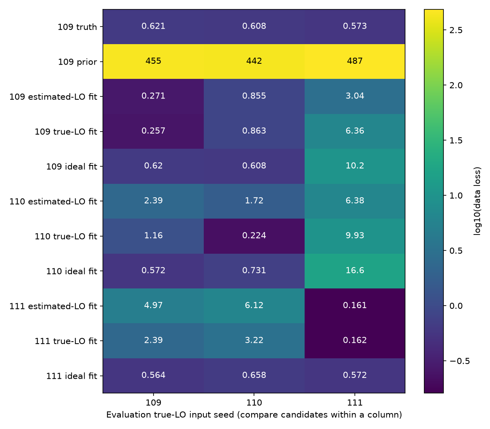

# 段階116：固定画像の別データ評価と採用基線の重なり

- 作成日：2026-10-26
- 状態：完了（既存画像の事後的な診断。再学習・新画像復元は実施しない）
- 比較元コミット：1a9a2f9b08e445b45f55a43ef9bf272de131358d（115）

## 読者向け概要

115で画像の目的関数を分解すると、保存済み復元画像は同じ入力のClosureを真の画像よりよく説明していた。しかし、そのことだけでは別の観測でも役立つ形を得たかは分からない。試験問題を覚えると、その問題には強くても別の問題には答えられない場合に似ている。

今回は画像を固定し、同じ天空・アンテナ配置・時刻で、雑音・局利得・LOを別の乱数seedで生成した入力に移して評価した。ただし、入力を採用する基線も雑音で変わる。基線はアンテナ二局の組で、各基線が画像の異なる空間情報を与える。元の入力に存在しなかった制約が新しい入力で現れると、同じ形でも大きな損失が出る例があった。

全データの評価に加えて、両入力に共通して採用された基線だけの対照を保存した。対照で損失が下がることは、情報を減らした結果でもある。画像改善や実観測での予測成功とは扱わない。

## 1. 目的・対象範囲

主画像経路の「同じ入力では低い目的関数でも形の誤差が残る」という課題に対し、データへの適合の移り方と採用情報の違いを診断する。115のtruth、Gaussian prior、114の保存済み復元9画像、計11画像を、真値LOを供給して相関した3入力へ移す。

同一seedの評価は元の雑音を共有する。異なるseedは生成器の仮定上で別の電圧・局応答を持つ。利得もseedごとに変わるため、雑音だけの介入実験ではない。新規の画像最適化、RML・閾値・誤差近似・production module・GUIの変更は行わない。周波数1.42GHz、最大600m、短積分と局別LOの前提を保ち、真値LOの供給は評価専用とする。

## 2. 完了条件

1. 全入力のpairs/時刻/周波数/uvwを完全照合し、11×3＝33評価を保存する。
2. 元の採用基線との共通集合に制限した27組について、固定画像とtruthを同じ入力・同じマスクで評価し、計54評価を保存する。情報不足は未評価として保持する。
3. 元入力・画像のSHA、非破壊、同一入力での115全JSON一致、導入API/native CLI全87JSON・非上書き・prefixを確認する。
4. helper対象試験、配布物byte照合、公開監査、日本語レポート・索引、匿名commit/pushを完了する。

## 3. 実際に行った作業

[workflow](../../workflows/image_transfer_validation.py)、[12新試験](../../tests/integration/test_image_transfer_validation.py)、[導入済み照合tool](../../tools/verify_image_transfer_installed.py)を追加した。公開画像評価APIは115のまま使う。

元入力の基線SNRを `abs(V) * sqrt(W)` で計算し、閾値10以上だった基線だけ評価重みWを保持する。それ以外は重みを0にする。評価入力自体のSNR選択も既存APIで行うので、実際に残るのは両者の共通集合である。元の複素visibility、uvw、時間、周波数は一切変えない。

保存する対照NPZのmetadataはconfig/unit/time-origin、評価専用、マスクの規則、両入力SHAを明示する。元データのclock/rate/power等を新しいマスクの来歴として引き継がない。Closureが組めない場合は「未評価」と理由を保存し、損失0や合格には変換しない。

## 4. 検証条件・結果

### 4.1 固定した入力・候補

入力は112〜114と同じ模擬VDIF由来、SEFD 10,000 Jy・flux 1,000 Jyの仮定、seed109/110/111。相関積分3秒、真値LO供給、既知時計、同一の時刻・配置・天空である。3秒の実OCXO安定性や実SEFDを測った値ではない。格子32×32、16秒角/pixel、SNR10、prior FWHM240秒角、entropy .01、TSV .0001、centroid .1は115と同じ。

表は正則化を除くデータ損失。**同じ列の中**で候補を比較する。seedごとに重み・採用集合が違うので、列をまたぐ差を尤度比や確率として読まない。

| 固定画像 | 評価seed109 | 評価seed110 | 評価seed111 |
| --- | ---: | ---: | ---: |
| seed109_estimated_rate_truth | 0.620753 | 0.6077237 | 0.5731237 |
| seed109_estimated_rate_prior | 454.9628 | 442.2177 | 487.2608 |
| seed109_estimated_rate_fitted | 0.270933 | 0.8546434 | 3.043591 |
| seed109_truth_rate_control_fitted | 0.2566266 | 0.8625156 | 6.362435 |
| seed109_ideal_model_observed_snr_control_fitted | 0.6202017 | 0.607906 | 10.18976 |
| seed110_estimated_rate_fitted | 2.393584 | 1.721889 | 6.381419 |
| seed110_truth_rate_control_fitted | 1.157989 | 0.2235972 | 9.931899 |
| seed110_ideal_model_observed_snr_control_fitted | 0.5715302 | 0.7313254 | 16.63175 |
| seed111_estimated_rate_fitted | 4.972553 | 6.123361 | 0.1608974 |
| seed111_truth_rate_control_fitted | 2.388309 | 3.215247 | 0.1619115 |
| seed111_ideal_model_observed_snr_control_fitted | 0.5637953 | 0.6579796 | 0.5721524 |



真値でもデータ損失は約.57〜.62で0ではない。有限雑音と既存の近似重みがあるためである。滑らかなpriorの損失は約442〜487と大きく、形状NRMSEの小ささだけでは観測を説明できないという115の区別が再確認された。

### 4.2 採用基線をそろえた対照

特徴的な例は、seed109の理想モデル対照から作った画像をseed111へ移した場合である。全採用基線の損失は10.18976、真値は.57312だった。共通基線へ限定すると画像.49856、同じ限定入力の真値.49773となった。評価側が採用した39 baseline-cellのうち共通は36で、独立phase/logamp制約は16/13だった。

seed110の理想モデル対照画像も、seed111全データでは16.63175に対し、共通基線35 cellだけでは.59904、真値.59973となった。こうした例は、画像を作ったときに制約されなかった空間情報が新しい入力で不一致になる可能性を示す。

この値の変化を、失った基線の「損失寄与」として引き算しない。採用集合を変えると独立Closureの基底、共分散、制約数による正規化も変わる。共通集合への限定は、全データへの予測改善でも、雑音過適合だけを単独同定した実験でもない。

### 4.3 正式な検証と、実行を繰り返さなかった範囲

新12試験と115の26試験、計38試験をsource 1.32秒・導入済み1.13秒で成功。閾値ちょうど10、保持重み、入力非破壊、4軸不一致、無効閾値、0重み、Closure不足の未評価表示、他の入力異常を隠さないことを確認した。

固定87評価は全件評価可能で、sourceとcheckout外の導入API/native CLIの全JSONが完全一致した。27共通マスクは検証側で別に再構成し、NPZの全数値配列と来歴を照合。全87出力の上書き拒否、原本・画像SHA、読込project moduleのprefixを確認した。truth/priorは9元入力で同じnpy bytesだった。同じ真値rate入力に戻した候補は115のJSONと一致した。

production/package/UIは不変なので、新wheel導入・全回帰・ブラウザは再実行していない。101同梱fileと4assetが115のwheel・source・導入先とbyte一致し、pip check成功。最新の両全回帰は[115](115-image-objective-evaluation.md)の各2055件で、新12件をその合格件数へ加算しない。次の全回帰collectは2067件見込みで、ここでは未実施。

最初の小規模実行後にClosure不足を保持する分岐と2試験を追加した。さらに生成器の来歴を再点検し、seedごとに雑音・局利得・LOが同時に変わることを明記して正式87評価・導入照合を再実行した。初回36試験および来歴追記前の二回の87評価は正式件数に合算しない。対象試験38件は両経路で成功し、来歴追記で計算処理・試験を変更していない。導入照合の初回は作業場所がcheckout内だったため開始時のguardで停止し、APIを実行する前に失敗した。作業場所をcheckout外の一時領域へ修正して、正式照合を完了した。

[全87評価](../../validation/runs/stage116/reference.json)、[導入照合](../../validation/runs/stage116/installed-api.json)、[配布・対象試験・監査](../../validation/runs/stage116/verification.json)。原本、マスクNPZ、個別JSON、ログはGit管理外 `outputs/stage116-*`。公開記録では個人名を含む絶対pathを一般化し、図のmetadataを除去した。

公開監査指摘0、文書リンク1501件で欠落0。

再現例：

```bash
python tools/run.py workflows.image_transfer_validation \
  --reference outputs/stage115-source-study --output outputs/image-transfer-new
```

## 5. 制約・未解決事項

予備結果を見て計画した**事後的診断**で、盲検の学習/評価分離やモデル選択、誤差確率の校正ではない。画像・閾値の再学習はしていないが、診断を選んだ人間が結果を見ていることは残る。

3入力は同じ天空・同じ瞬間配置のため、新しいuv幾何を増やした観測ではない。別seedの独立性は電圧生成器の仮定によるもので、実FFT・RFI・時計変動の独立性を検証していない。真値LOの補正後でも、局利得・量子化・固定生成近似の影響があり、全ての差を受信雑音だけへ帰属しない。観測SNRによる選別と固定近似分散も残る。共通集合で不一致が小さいことは、捨てた情報を説明できることを意味しない。

未知LO/振幅/SEFD、低SNR画像尤度、実機Cas A画像、全夜/GPU性能は未検証。有限候補の優劣や情報不足を、一般的な画像化不可能性へ広げない。

## 6. 次段階

異なる入力の制約を同じ画像へ同時に課す方法を検討する。同一幾何の独立雑音の蓄積と、観測時刻を変えてuv情報を増やすことを区別し、改善の有無は形状・データ適合・数値収束を分けて評価する。元の採用基線を捨てて損失だけ下げる方法は改善として採用しない。

文書整理120、根本見直し150を維持する。
