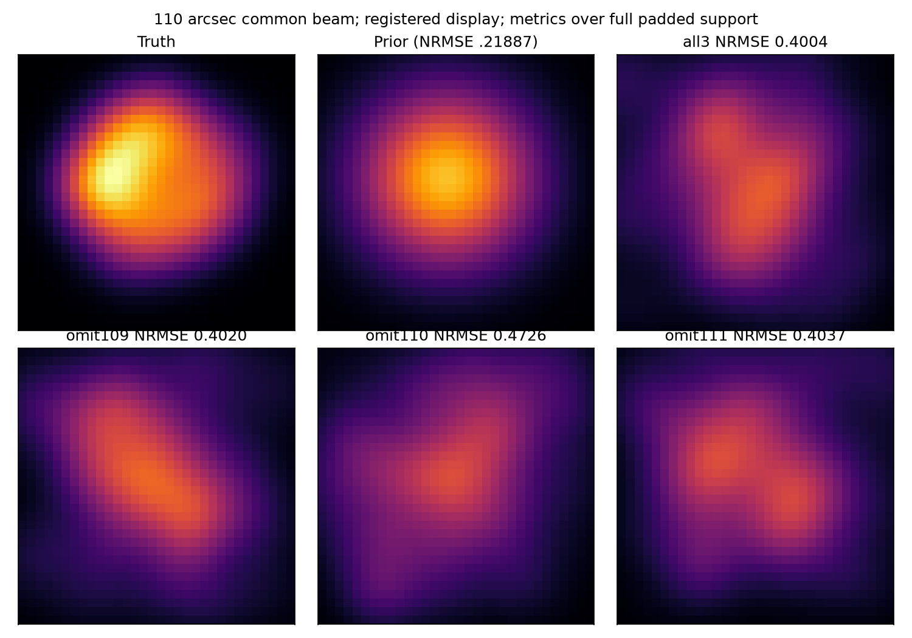

# 段階117：別生成原本のClosure制約を同じ画像へ課す

- 作成日：2026-10-26
- 状態：完了（固定4ケースの診断。良好な形状復元は確認せず）
- 比較元コミット：4a0dc45d5daafaba6cee89bb1689790517a4fbe7（116）

## 読者向け概要

116では、ある入力から作った画像が、別入力で新たに採用された基線を説明できない例があった。今回は複数入力の制約を最初から同じ画像へ課す。複素visibilityを平均すると、局ごとの位相が違う観測を打ち消し合う可能性があるため、各観測のClosureを別セルのまま扱う。

全3原本を併用した画像は数値的に収束したが、真の形とのNRMSEは約.400で、固定priorの.219より大きかった。制約を増やして数値停止条件を満たしたことと、正しい形を復元したことは別である。この3原本は同じ時刻・同じ配置で作られた別実験なので、地球の回転による新しいuv情報を追加した結果でもない。

## 1. 目的・対象範囲

主画像経路の情報不足・データ依存選別を診断するため、真値LO補正済みの3原本を既存のClosure＋RMLで併用する。全3併用1ケースと、各1原本をfitから除外した2原本併用3ケース、合計4ケースを固定した。各ケース3初期値・2000反復、閾値10・既存正則化を維持する。

画像を求める呼び出しにはtruthも除外入力も渡さない。真値LO供給は上流の評価専用条件として残る。別seedは雑音・gain・LOを同時に生成しており、雑音だけの介入ではない。production solver・低SNR尤度・GUI・Windows収録は変更しない。

## 2. 完了条件

- 同一の基線・時刻・周波数・uvw・単位を確認し、別セルとして元のvisibility/重みを保持する。
- truth/prior/fittedの各画像について、joint損失と単独入力から再構成した損失を照合する。正則化を原本数倍にしない。
- 全4ケースの画像・科学JSONを、checkout外の導入済みsolverで再生成して照合する。未収束は保持する。
- 原本SHA・非上書き・prefix・配布bytes、対象試験、レポート・索引・公開監査・匿名commit/pushを完了する。

## 3. 実際に行った作業

[併用workflow](../../workflows/image_joint_validation.py)、[9新試験](../../tests/integration/test_image_joint_validation.py)、[導入照合driver](../../tools/verify_image_joint_installed.py)を追加した。既存fit_closure_image/evaluate_closure_imageを呼び出すだけで、新しい推定器を作っていない。

### 独立セルの損失をどう足すか

各原本の独立Closure数をNᵢ、二次形式をχᵢ²とすると、jointのデータ損失は `Σχᵢ² / (2ΣNᵢ)` となる。これは各入力のデータ損失をNᵢで重み付けした平均に等しい。元のセル内の共分散を維持し、異なる原本間は生成器の独立性を仮定する。

画像に対するentropy/TSV/centroidは一回だけ加える。総objectiveを入力ごとに足すと、正則化を原本数回数えてしまうため、それは行わない。この条件を全4×3候補で単独評価から照合した。

同じ時刻に対応する別生成実験を、偽の観測時刻を持つspectralファイルへ結合しない。solverへ渡す配列の先頭軸を別セルとして積み、原本の時刻・来歴はそのまま保持する。全基線の閾値選択も既存どおりで、共通集合への限定は行わない。

## 4. 検証条件・結果

### 4.1 固定4ケース

原本は116と同じseed109/110/111、1.42GHz・最大600m・同一snapshot、仮定flux1000 Jy/SEFD10000 Jy、3秒相関。画像32×32、16秒角/pixel、prior FWHM240秒角、entropy .01/TSV .0001/centroid .1、optimizer seed21。形状評価は110秒角共通beam・平行移動・全支持領域を使う既存規約である。

| 入力 | 独立制約数 | 選択run | データ損失 | 真値データ損失 | 形状NRMSE | 除外入力の損失 |
| --- | ---: | --- | ---: | ---: | ---: | ---: |
| all3 | 98 | converged | 0.4830782 | 0.599135 | 0.4003631 | — |
| omit109 | 67 | not_converged | 0.4216155 | 0.5891326 | 0.4019657 | 0.856549 |
| omit110 | 67 | not_converged | 0.3829244 | 0.5951611 | 0.4726463 | 0.9195668 |
| omit111 | 62 | not_converged | 0.4017364 | 0.6142384 | 0.4037096 | 5.06533 |



all3は独立phase54/logamp44の98制約を持ち、3探索すべてが数値収束した。データ損失は.48308でtruthの.59913より低いが、形状NRMSE .40036はprior-only .21887より大きい。低いデータ損失・数値収束・正しい形状を一つの成功として扱わない。

2原本で求めた3ケースの**選択されたrun**はすべて未収束だった。他の初期値には収束例があっても、最小objectiveで選ばれたrunの状態を保持する。除外seed111への損失5.0653は、同じfitの訓練損失.4017と異なるが、採用制約数・重みも違うので、この差をそのまま過適合量の推定値にはしない。

### 4.2 正式検証

新9＋116の12＋115の26、計47対象試験をsource 1.20秒・導入済み1.17秒で成功。別セル・重みの保持、入力非破壊、4軸不一致、単位不一致、入力不足、制約数重み付き損失・正則化一回を確認した。

source4ケースを実行し、checkout外の導入済みsolverで同じ4ケース・各3初期値を再実行した。全画像npy bytesと科学JSON全項目が完全一致。真値/prior/fitted計12 joint候補の単独損失重み付き照合、各復元画像の全3入力での評価、収束と形状評価を含む。経過秒だけは科学JSONの比較から分けて保持した。

導入照合ではworkflowをimportせず、導入済みの既存solver/APIのみで直接配列を構成した。runner/PYTHONPATHなし、読込15 project moduleのprefix、原本SHA不変を確認。出力先を再指定するとfit実行前に拒否され、全保存file bytesが保持された。

production/package/UIは不変で、101 package fileと4assetは115のwheel・source・導入済みとbyte一致、pip check成功。全回帰・新wheel導入・実ブラウザは再実行していない。直近の全回帰は[115](115-image-objective-evaluation.md)の両2055成功で、新9件や116の12件をその合格件数へ加算しない。次回の全collectは2076見込みで、この段階では未実施。

[全条件・科学JSON](../../validation/runs/stage117/reference.json)、[導入照合](../../validation/runs/stage117/installed-api.json)、[試験と配布・監査](../../validation/runs/stage117/verification.json)に正式結果を保存した。予備のall3一回は正式件数に加えていない。原本・画像・詳細ログはGit管理外 `outputs/stage117-*`。公開pathは一般化し、図のmetadataを除去した。

公開監査指摘0、文書リンク1510件で欠落0。

```bash
python tools/run.py workflows.image_joint_validation \
  --reference outputs/stage115-source-study --output outputs/image-joint-new
```

## 5. 制約・未解決事項

これは事後的な診断で、盲検の交差検証や確率校正ではない。除外入力は個々のfitへ渡していないが、設計者は116の結果や今回の予備結果を見ている。固定4ケースの結果を一般的な性能推定値へ読み替えない。

同じ幾何で独立電圧を増やしても、新しい空間周波数は増えない。各入力のSNRマスクは異なるが、モデルの一意性や全局所解の解消を保証しない。真値を与えないsolverであっても、上流で真値LO・正確な時計を与えた対照という制約が残る。

実観測の画像、実SEFD/OCXO、未知gain/LO/SEFDの総合推定、低SNR画像尤度、全夜/GPU性能は未検証である。

## 6. 次段階

新しいuv幾何を持つ複数時刻の原本へ戻り、同じ原本で推定LO・真値LO対照・理想モデル対照を比較する。過去028の8時刻原本が保持されているため、まずSHA・生成条件を確認し、再利用できれば新しい模擬原本を無目的に増やさず、現在の主経路で再処理する。真値LOの対照を未知観測の成功へ読み替えず、同じ原本による比較と過去の条件を分けて記録する。

次の文書整理120、根本見直し150を維持する。
