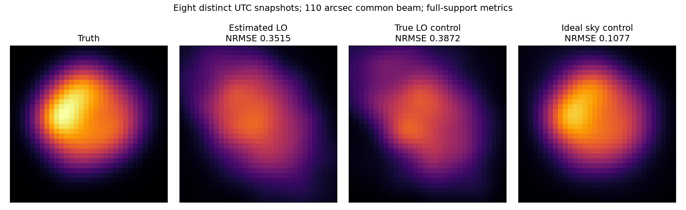

# 段階118：8時刻の模擬VDIFを同じ原本で三つの対照へ再処理

- 作成日：2026-10-26
- 状態：完了（固定8時刻・三枝の対照。3選択runは未収束）
- 比較元コミット：9c0758ad0a911b2dad392946eda69f75515ae046（117）

## 読者向け概要

117は同じ時刻・同じ配置で電圧を別生成した反復だった。地球の回転で変わるuv情報は増えていない。uvとは二局の間隔を天体方向へ投影し、波長で割った座標で、天体画像のどの細かさを測るかに対応する。複数の時刻を使うとこの座標が変わり、画像の異なる成分を制約できる。

今回は過去028で生成した8時刻の原本を現在の処理へ通し直す。各時刻の3秒を相関し、複素visibilityを平均せずClosureを同じ画像へ課す。未知のLOを推定する通常経路、真値LOを与えた評価用対照、真の天空モデルを与えた人工的対照を、同じ原本・同じ設定で比較する。

三枝の正式な数値を以下の表へ保存した。画像保存、収束、真値との差は別項目として読む。

## 1. 目的・対象範囲

主画像経路を複数時刻へ戻し、処理完了・数値収束・形状誤差を分けて、現在の律速要因を絞る。周波数1.42GHz、8局・最大600m、仮定Cas A総flux1000 Jy/SEFD10000 Jy、局別gain/LOを持つ3.04秒原本8組。精密gain較正を供給しない。

Windows収録、実機、未知SEFD、低SNR画像尤度、全夜/GPU性能は対象外。真値LOと理想天空は対照専用で、実用推定の成功として扱わない。

## 2. 完了条件

1. 現存原本152fileをSHA登録し、8時刻・config・生成条件・入力不変を確認する。
2. 同じ8原本の未知LO pipelineと真値LO対照を実行する。全8時刻を要求し、失敗を黙って除いた合成画像を作らない。
3. 真値LO合成の幾何上に理想モデルを置き、観測SNR・マスク・近似分散を人工的に保持する対照を作る。
4. 同じ画像条件で三枝を評価し、checkout外の導入CLI/APIによる全16相関・画像・科学JSON・配列・prefixを照合する。
5. 対象試験、配布byte、非上書き、文書・公開監査・匿名commit/pushを完了する。

## 3. 実際に行った作業

[再処理workflow](../../workflows/multitime_image_controls.py)、[真値profileの7新試験](../../tests/integration/test_multitime_image_controls.py)、[導入CLI/API照合](../../tools/verify_multitime_image_installed.py)を追加した。production moduleとsolverは変更しない。

### 原本の来歴と今回の固定入力

`outputs/stage028-vdif-casa-3s-sefd10000` に残っていたVDIF・sidecar・manifest・clock・observation計152fileを今回の入力として新規SHA登録した。028の公開記録には原本ごとのSHAがないので、028当時からbytesが不変だったと暗号学的に証明したわけではない。現在のファイルの来歴・生成条件を引用し、今回の処理前後で不変だったことを確認する。

天空の形は同梱Cas A FITSの正画素を中心200秒角の領域から32格子へ再配置し、仮定総flux1000 Jyへ正規化した。1.42GHzの実像を今回測定した結果ではない。

8時刻は08:15から11:45 UTCまでで、4時間の枠に分散した8露光。最初と最後の中心間は3.5時間、各露光3秒、合計24秒であり、4時間の連続記録ではない。原本は各3.04秒ある。実アンテナのSEFDやOCXO安定性を測った値ではない。

### 三つの枝を区別する

| 枝 | 供給する情報と処理 | 解釈 |
| --- | --- | --- |
| estimated_rate | 原本、正確なsample時計、750×4ms pilotから推定LO、3秒再相関 | この有限生成条件の通常経路。真の天空やLOを推定へ渡さない |
| truth_rate_control | 同じ原本に生成時の真値LO、同じsample/幾何補正 | 評価専用。弱い未知LOを推定できることの証拠ではない |
| ideal_model_true_rate_snr_control | 真値LO合成のuv/time上の真のmodel、人工的に輸送した観測SNR | 評価専用。実測Jy較正・雑音だけを除いた実験ではない |

理想枝の重みは114と同じ `W_model = W_obs * (abs(V_obs)/abs(V_model))²`。使う観測は今回は**真値LO枝**で、114の推定LO枝由来とは区別する。各基線SNR、採用マスク、近似baseline varianceを保存する。人工Jy profileにはclock/rate/ADC-power等の親metadataを引き継がず、評価専用・人工重み・供給幾何を明示する。

時刻が違う二つの観測をmerge_spectralで合成し、phase-center/時計の整列、UTC、非重複、同一局/周波数を検査する。局gainを合わせたvisibility平均はせず、短いセルを保持する。

## 4. 検証条件・結果

### 4.1 正式な8時刻・三枝

同じ原本を現在のsource経路と導入済み経路の双方で実際に再相関した。画像条件は32×32、16秒角/pixel、prior FWHM240秒角、entropy .01/TSV .0001/centroid .1、閾値SNR10、3初期値、最大2000反復、seed21で固定。表示・形状比較は110秒角共通beam・全支持領域の平行移動評価である。

| 枝 | 独立phase/logamp | 選択run | データ損失(復元) | データ損失(真値) | 形状NRMSE |
| --- | --- | --- | ---: | ---: | ---: |
| estimated_rate | 118/93 | not_converged | 0.28702138 | 0.55230144 | 0.35147727 |
| truth_rate_control | 117/93 | not_converged | 0.28686894 | 0.55437911 | 0.3872062 |
| ideal_model_true_rate_snr_control | 117/93 | not_converged | 0.00015548633 | 6.0820618e-25 | 0.10771019 |



全8時刻で通常経路と真値LO対照を完了した。最大station rate誤差は0.019760898 Hzで、有限生成条件から計算した差である。実OCXOの変動や実信号での未知LO誤差ではない。通常枝のNRMSE .35148、真値LO枝 .38721、理想モデル枝 .10771で、全3選択runは未収束だった。この固定例では真値LOを供給しても形状誤差が残り、理想モデルにはより小さい誤差が得られた。ただし理想化は観測雑音・量子化・forward近似などを同時に置換する人工的対照なので、単一原因を特定したとはしない。真値・復元のデータ損失と形状誤差を同時に保存し、どちらか一方の小さい値を画像化成功とはしない。

生成条件・core・評価規約が当時と違う可能性があるので、028の旧NRMSEや停止状態との単純な差をソフト改善量へ変換しない。今回の同じ原本内の三枝を主な比較にする。

### 4.2 正式検証と未再実行の範囲

新7＋既存55、計62対象試験がsource2.71秒、導入済み1.59秒で成功。真値rate profileに推定baseline・RMS等を混入させず、原本を変えずに来歴を分けることと、不正な真値rateの拒否を確認した。既存のSNR輸送・候補画像・独立セル・共通マスクの試験も含む。

導入済みの既存CLIを実16回呼び出し、原本から全8未知LO推定と8真値LO相関を再実行した。画像3件も導入APIで各3初期値を再実行し、全科学JSON・画像npy bytes・最終/合成配列240個およびpilot配列104個、計344個がsourceと完全一致。未知LOの8 pipelineは各pilotと補正後相関を含むため、各環境で最終相関16件にpilot8件を加え、相関実行は計24件である。読込36 project moduleが導入prefix内、workflow/runner/PYTHONPATHなし、原本152file SHA不変、出力の再指定はraw再処理前に拒否された。候補9件は別直接Fourier・np.linalg.solveの二次形式とも照合し、最大絶対差4.2041393e-10。ただしClosure design選択と近似観測分散は共有するため、低SNR誤差モデル自体の独立検証ではない。

production/package/UIは不変で、新wheel導入・全回帰・実ブラウザは再実行していない。101 package fileと4assetが115のwheel・source・導入先とbyte一致、pip check成功、凍結Python/JSON/TOML364fileはSHA不変。直近両全回帰は[115](115-image-objective-evaluation.md)の各2055成功を引用する。116〜118の追加28試験をその成功件数へ加算しない。source/導入済みの収集だけを実行して各2083件を確認したが、その全試験実行は未実施。公開監査指摘0、文書リンク1519件で欠落0。

原本と詳細ログ・画像はGit管理外 `outputs/stage118-*`。source起動時のMatplotlib cache警告は非公開ログに残し、導入照合ではGit管理外の書込可能cacheを指定した。公開記録の絶対pathは一般化し、図のmetadataを除去する。

[全条件・原本SHA・科学JSON](../../validation/runs/stage118/reference.json)、[導入再処理](../../validation/runs/stage118/installed-api.json)、[対象試験・配布・独立計算・監査](../../validation/runs/stage118/verification.json)を参照。

```bash
python tools/run.py workflows.multitime_image_controls \
  --reference outputs/stage028-vdif-casa-3s-sefd10000 --output outputs/multitime-control-new
```

## 5. 制約・未解決事項

一定gain/LO、正確な時計、連続colored Gaussianと有限sky中点近似、SNR選別、固定近似誤差、局所探索という仮定を残す。時刻が変わっても実機の4時間安定運用を行った結果ではない。

理想モデルがよく復元できても、同じ条件の実測雑音や未知時計・RFIに強いことを示さない。真値LOで改善しても未知LOの実推定が解決したことにはならず、改善しなくてもLOが不要という意味ではない。三枝の差から一つの物理原因を断定しない。

実機Cas A画像、未知gain/SEFD/LOの総合推定、低SNR画像尤度、実FFT独立性、全夜/GPU性能は未検証。

## 6. 次段階

結果を確認してから、同じ視野を粗い画素へ制限する比較を選ぶ。数値収束と画像の自由度・正則化の関係を、原本と採用基線を変えずに調べる候補である。格子を変えると正則化の離散化も変わるため、改善を自由度だけに帰属しない。別段階で目的・完了条件を定める。

120で時系列・目標別進捗・開発計画・入口・索引を整理し、次の5〜10段階の受入条件へ反映する。根本見直し150の周期も維持する。
