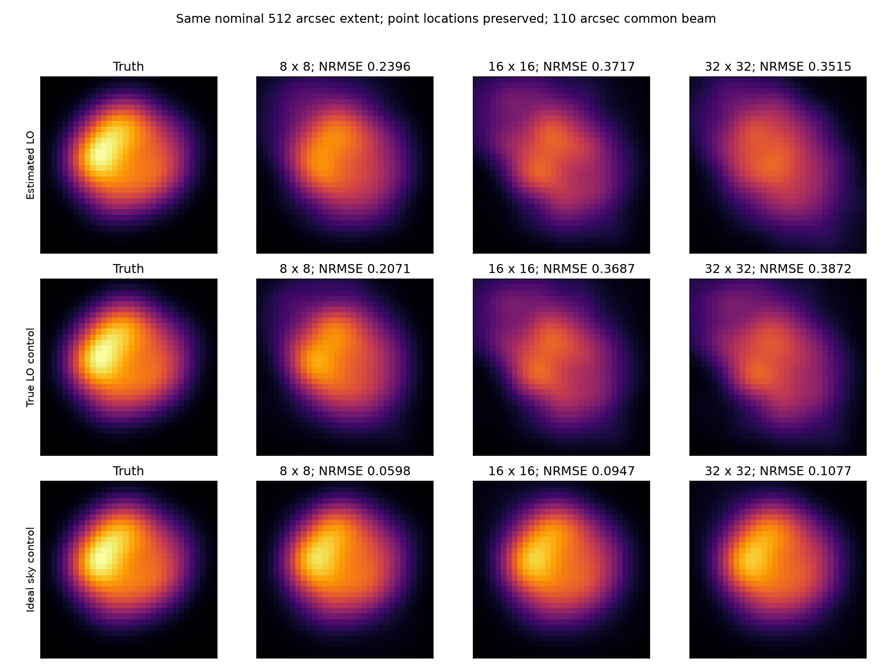

# 段階119：同じ視野・同じ観測で画像格子を比較

- 作成日：2026-10-26
- 状態：完了（固定格子比較。既定値・推奨格子は変更せず）
- 比較元コミット：5571da2b00fbe5c4166e714e3c6093e1b212705c（118）

## 読者向け概要

118では8時刻を使っても32×32画像の探索は未収束だった。今回は原本、採用基線、重みを変えず、画像を8×8、16×16、32×32の格子で表す。同じ名目視野512秒角でも、画素数が増えると未知の明るさが増える。総量を1に固定した場合、未知数はそれぞれ概ね63、255、1023となる。

結果として8×8の3枝は数値収束し、通常経路の形状NRMSEは.351から.240へ変わった。しかし同じ8格子のprior-onlyは.217で、形状誤差だけではpriorを上回る復元を確認していない。逆に、priorはデータ適合が悪い。形の差、観測の説明、数値停止条件は分けて判断する。

## 1. 目的・対象範囲

主画像経路で、画像の自由度・画素位置・正則化の離散化が数値収束と形状にどう関係するかを調べる。118の通常LO推定・真値LO対照・理想モデル対照という三枝をそのまま使い、各枝の8/16格子を新たに計算する。32格子3件は118の結果を引用し、新計算へ数えない。

周波数1.42GHz、最大600m、8時刻の3秒積分、gain較正を供給しないという条件は維持する。真値LOと理想天空の枝は評価専用のまま。新solver、閾値変更、低SNR尤度、Windows収録、GUIは対象外。

## 2. 完了条件

1. 名目視野512秒角の8/16/32格子を事前に固定し、画素位置とfluxを保った比較方法を検証する。
2. 新6 fitを3初期値/2000反復で実行し、旧3 fitを明示して引用する。truthを初期化や格子選択へ渡さない。
3. 原本の全数値配列と採用Closure数を118から保持し、埋込前後のmodel visibility・Closureデータ損失・centroidを照合する。
4. 導入CLI6回の実fit、FITS数値/WCS、全9科学JSON・粗/参照格子画像bytes、入力SHA・非上書き・prefixを照合する。
5. 対象試験、配布byte不変、レポート・索引・公開監査・匿名commit/pushを完了する。

## 3. 実際に行った作業

[格子比較workflow](../../workflows/image_grid_validation.py)、[11新試験](../../tests/integration/test_image_grid_validation.py)、[導入済みCLI照合](../../tools/verify_image_grid_installed.py)を追加した。既存RML・画像評価APIを使い、production moduleは変更しない。

### 同じ座標に明るさを置く

画素数Nと画素間隔を、8×64、16×32、32×16秒角とし、N×間隔を512秒角へそろえる。既存モデルは各画素中心へ明るさを置く点pixelモデルである。8格子の点は32格子の4画素おき、16格子の点は2画素おきと一致する。そこへ明るさを置き、残りを0にした32格子を比較用に保存する。

これは補間や追加最適化ではない。モデルvisibilityが一致することを直接Fourierで確認し、同じ110秒角beam・全支持領域・平行移動だけでNRMSEを評価する。粗い画像を見やすく補間して形状指標を良くする操作は行わない。

一方、既存の中心画素規約では端の画素中心が格子ごとに異なる。連続した画素面積を持つモデルと同一ではない。またentropy/TSV等の離散化・数値スケールも変わる。純粋に未知数だけを変えた介入ではなく、格子間の総objectiveを直接順位付けしない。

## 4. 検証条件・結果

### 4.1 固定9表示条件、新たに実行したのは6 fit

三枝のvisibility/weights/uvw/time/pairs全配列は118の識別情報と一致。SNR10、Gaussian prior FWHM240秒角、entropy .01/TSV .0001/centroid .1、seed21、3初期値、2000反復は固定した。参照天空は118と同じCas A FITS由来の32格子を使い、solverには与えていない。

| 枝 | 格子/間隔 | 計算 | 選択run | データ損失 | 形状NRMSE | 同格子prior NRMSE |
| --- | --- | --- | --- | ---: | ---: | ---: |
| estimated_rate | 8/64秒角 | 新規 | 収束 | 0.3558446 | 0.2396128 | 0.2165192 |
| estimated_rate | 16/32秒角 | 新規 | 未収束 | 0.301443 | 0.3716687 | 0.2184959 |
| estimated_rate | 32/16秒角 | 118引用 | 未収束 | 0.2870214 | 0.3514773 | 0.2188727 |
| truth_rate_control | 8/64秒角 | 新規 | 収束 | 0.3545212 | 0.2070927 | 0.2165192 |
| truth_rate_control | 16/32秒角 | 新規 | 未収束 | 0.2971198 | 0.3686787 | 0.2184959 |
| truth_rate_control | 32/16秒角 | 118引用 | 未収束 | 0.2868689 | 0.3872062 | 0.2188727 |
| ideal_model_true_rate_snr_control | 8/64秒角 | 新規 | 収束 | 0.001306351 | 0.05982575 | 0.2165192 |
| ideal_model_true_rate_snr_control | 16/32秒角 | 新規 | 未収束 | 0.0001871158 | 0.09474691 | 0.2184959 |
| ideal_model_true_rate_snr_control | 32/16秒角 | 118引用 | 未収束 | 0.0001554863 | 0.1077102 | 0.2188727 |



8格子は新3 fitとも選択runが収束した。16格子は新3 fitとも未収束、32格子は118の3未収束を引用している。収束は数値的な停止条件であり、大域最小値や真の形状の保証ではない。

通常経路の8格子はNRMSE .23961、真値LO対照は.20709、理想モデル対照は.05983だった。通常経路は同じ8格子のprior-only .21652より形状誤差が大きい。真値LO対照の僅かな差や理想枝の低誤差を、未知実観測の性能保証へ読まない。

prior-onlyの形状NRMSEは8/16/32格子でそれぞれ.21652/.21850/.21887。各格子のGaussianを同じ点位置へ埋め、同じ指標で評価した。式から独立に作ったpriorと既存objectiveのprior配列の一致も確認した。各枝・各格子のpriorも同じ画像評価APIで確認すると、データ損失は約365〜400だった。例えば通常経路8格子はprior365.77872に対して復元画像.35584である。見かけの形状が近くても、priorは観測を説明できていないという115〜118の区別を維持する。

データ損失だけを見ると、通常経路は8格子 .35584、32格子 .28702で、細かい格子の方が観測をよく説明していた。しかし形状誤差は逆の順だった。画像の自由度と雑音・正則化の関係を示す固定例で、単一原因や最良格子を確定した実験ではない。

### 4.2 正式検証

新11＋既存画像API26の計37対象試験がsource1.60秒、導入済み1.64秒で成功。flux保持・入力非破壊、8/16/32格子、直接Fourier対応、Closureデータ損失/centroid対応、不正格子を確認した。source正式6 fitと、checkout外の導入CLIによる実6 fitを照合し、引用32格子3件を含む全9科学JSON・粗/埋込npy bytesが完全一致。新6件のFITS数値・WCSを照合し、全6出力再指定をfit前に拒否した。原本SHA・読込14 project moduleのprefix・runner/PYTHONPATH/workflow importなしを確認。草稿11試験/.09秒と予備6 fitは正式件数へ加えず、正式の科学JSONは予備とも一致した。

画素埋込の直接Fourier差は全9条件で0だった。粗格子/32参照格子のデータ損失・centroidも規定内で一致した。正則化の値は一致条件にしていない。採用された独立Closureの数も格子間で保持した。情報量が増えた結果ではない。

production/package/UIは不変で、新wheel導入・全回帰・実ブラウザは再実行していない。101 package fileと4assetが115のwheel・source・導入先とbyte一致、pip check成功。凍結Python/JSON/TOML367fileはSHA不変。直近両全回帰は[115](115-image-objective-evaluation.md)の各2055成功を引用する。現在の試験を収集だけ行い両2094件と確認したが、その全実行は未実施。公開監査指摘0、文書リンク1528件で欠落0。

[全9条件・科学JSON](../../validation/runs/stage119/reference.json)、[導入CLI/FITS](../../validation/runs/stage119/installed-api.json)、[試験・prior基準・配布・監査](../../validation/runs/stage119/verification.json)。原本、粗/埋込画像、ログはGit管理外 `outputs/stage119-*`。公開pathは一般化し、図のmetadataを除去した。

```bash
python tools/run.py workflows.image_grid_validation \
  --reference outputs/stage118-source-study --output outputs/image-grid-new
```

## 5. 制約・未解決事項

結果を見た事後的診断で、盲検の格子選択や統計的性能評価ではない。格子集合は固定して全条件を保存したが、予備結果は人間が見ている。真値NRMSEで最良格子を選んだあとに、その値を未知データでの性能と呼ばない。既定値や観測者向け推奨格子は変更していない。

同じ名目視野でも画素位置・点pixel近似・正則化の数値的意味が変わる。8格子の結果を64秒角の物理的分解能の測定値とはしない。Closure数と未知数を比べるだけで、一意性や情報の有効な独立性を保証しない。

既知天空/SEFD、正確な時計、一定gain/LO、原本の有限生成近似、高SNR局所Gaussian誤差、局所探索が残る。実機Cas A画像、弱い実信号の未知LO/SEFD、低SNR画像尤度、実FFT独立性、全夜/GPU性能は未検証。

## 6. 次段階

120はユーザー指定の文書整理を必ず行う。111から119の判断のつながりを時系列へ加え、最終目標別の必要要素・進捗・残る律速、計画、現状案内、索引を同じ基準へそろえる。数値試験を文書整理で再実行するか否かを明示する。

その後は、主経路の処理完了/数値収束/形状参照を区別する日本語GUIや、既製RMLとの同じ入力比較を選ぶ。既製法はまず符号・単位・SNR・Closureの対応を検証し、単に別ソフトを導入しただけで画像化性能の成功にしない。根本見直し150の周期は維持する。
