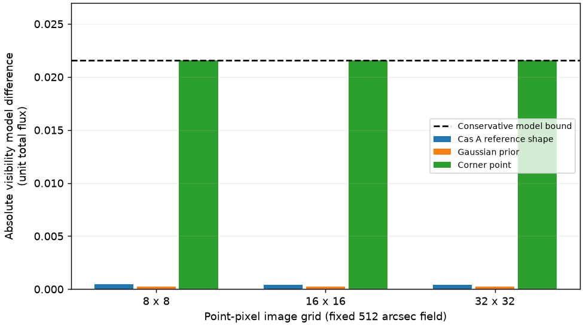

# 段階122：外部RML比較へ向けた座標・誤差・Closureの接続確認

- 作成日：2026-10-26
- 状態：完了
- 比較元コミット：bf6096513da53dd8fdc23b86001a8837356d4070（121）

## 読者向け概要

これまでの自作RMLでは、計算が終わっても正解に近い画像になるとは限らなかった。次に既製ソフトと比較するためには、同じ数値を渡したつもりで座標の向き・画素の中心・雑音の定義が違う、という事故を先に除く必要がある。この段階では外部ソフトEHTimを実際に動かし、その入口を確かめた。新しい画像の復元や、画像性能の勝敗はまだ調べていない。

Fourier変換は画像を各基線の相関値へ変換する計算である。その符号を取り違えると鏡像に相当する差が生じ、画素の中心が半画素違っても相関の位相が変わる。一方、Closureは複数の基線を組み合わせて局ごとの利得を消す量で、位相と振幅の規約も合わせなければならない。

## 1. 目的・対象範囲

独立した環境へ固定版EHTim1.3.2と既存121のV-SoRA wheelを導入し、点画素のDFT、座標・共役、sigma、周波数群の分離、Closureと局gain変換を照合する。主画像経路と同じ1.42GHz付近・600m以下を維持する。通常の検証環境、core package、solver、GUIは変更しない。

現存118/119の8時刻入力からは、外部二次元モデルが省略するw項の影響だけを計算する。真のCas A形状は評価用の候補にだけ使い、未知観測の推定に正解を渡さない。

## 2. 完了条件

固定artifact/version/SHA・依存・licenseとpip check、解析式によるDFT対照、EHTimの実Closure APIとnative公開API・誤差式の照合、原本値・mask・周波数の保持、局gain不変、w項の数値境界を確認する。source/導入済み対象試験、checkout外での実行、prefix・非上書き・原本SHA、既存package/envの不変、日本語文書・監査・匿名commit/pushまでを対象とする。

## 3. 実際に行った作業

- `workflows/ehtim_conventions_validation.py`：native参照の生成、相対値の周波数別変換、画素の向き/半画素補正、w項上限、実外部DFT/Closureの照合。
- `tests/integration/test_ehtim_conventions.py`：偏心点源、偶数/奇数格子、mask・周波数・sigma、不正入力、structured dataの保持、w上限の40試験。
- `tools/verify_ehtim_conventions_installed.py`：checkout外からのnative再生成・実外部API・全科学JSON/49配列・prefix・非上書きの照合。
- `requirements/verified-ehtim-reference-linux.txt`：外部参照環境専用の36依存pin。既存の通常環境用pinは変更しない。
- 本レポート・索引・操作記録。外部ソース自体はリポジトリへコピーしていない。

外部版は[公式README](https://github.com/achael/eht-imaging)が案内する1.3.2を、[PyPIの固定配布物](https://pypi.org/project/ehtim/1.3.2/)から取得した。SHA256は`39403ff040e7828fbfbb3344f24a9bf7ce4802f141a68c56c5918e8f5a17d3af`、license表示はGPLv3。読んだ公式tagのconst_def/obs_helpers/obsdata/imageの4ファイルも配布物と一致した。[tagのpyproject](https://github.com/achael/eht-imaging/blob/v1.3.2/pyproject.toml)、[Obsdata](https://achael.github.io/eht-imaging/obsdata.html)、[Imager](https://achael.github.io/eht-imaging/imager.html)を参照した。NFFT/pyNFFTは導入せず、direct DFTを明示した。

## 4. 検証条件・結果

新40対象はsource 0.50秒・導入済み0.23秒で各40成功・除外0。実collectは両2156だが、全2156は実行していない。production/package不変のため、最新の121両2116成功（609.28/607.50秒、各27396既存警告、除外0）を引用する。

### 座標・画素・複素相関

nativeは`exp(-2πi[ul+vm+w(n-1)])`、外部はsite1-site2のuvに対応する正符号の二次元変換を使う。基線名を保持し`u_external=-u_native`、`v_external=-v_native`とした。画像配列は両軸を反転する。偶数格子の外部座標はnativeに対して半画素ずれるので、複素visibility照合時にその既知の位相因子を補正する。奇数格子にはこの半画素差がない。

nativeと同じ点画素を比較するため、外部の既定の三角形画素ではなくdelta pulseを指定した。8/9/16/32格子と中心点・東偏心・北偏心・二点源・非対称分布の20画像条件、3周波数、2時刻・各6基線で照合した。DFTの最大絶対差は`2.220446049250313e-15`。補正前の半画素差も保存した。Closureだけでは平行移動が消える場合があるため、偏心点源の複素相関そのものも解析式で確認した。

### sigma・Closure・局gain

nativeのweightは各実部/虚部の分散の逆数として扱い、外部sigmaへ`1/sqrt(weight)`を渡した。複素雑音を`σ(X+iY)`、X/Yを独立な分散1の変数とすると、複素二乗平均は`2σ²`だが、ここでのsigmaは各成分のσである。任意の相対scaleを掛けるとvisibilityとsigmaを同じ倍率で変換する。ADC²を実測Jyへ較正したわけではない。

局gain変換あり/なし×3周波数の6条件で、それぞれ2時刻・12 visibility、8 closure phase・6 log closure amplitudeを実計算した。位相はrad、振幅はlog、debias=Falseを明示。周波数が異なる値を同じ時刻・基線の重複として平均しない。周辺値の最大差は`7.216449660063518e-16`、近似sigmaの最大差は`4.336808689942018e-19`。全6条件でnative公開APIとの照合と局gain不変を確認した。

外部APIの時刻内の行順は、局集合の列挙によって別実行で変わる場合があった。行番号だけで比較せず、時刻・局ラベル・Closureの向きを合わせて照合した。公開記録にも各値の局ラベルを残した。追加レビューでcomplex weightを実数sigmaへ黙って変換しないguardを加えた後も、局ラベルで対応させた全科学値は変更前と一致した。

これは高SNRでの周辺誤差式の比較であり、nativeの独立集合にある非対角共分散を外部の対角重みと同一と認めたわけではない。低SNR分布、実RTL雑音、局gain推定の成功も示していない。

### 実行時に見つかった外部APIの問題

無変更のEHTim1.3.2では、同じ基線数を持つ時刻群をobject配列へ変換する過程でstructured rowがtupleになり、`c_phases`がTypeErrorで停止した。正式検証でもこの停止を再現した。導入成功だけで動作済みとは扱わなかった。

自作の明示的な接続クラスで、既存の時刻群の値と順序を変えずdtypeだけを復元し、copy時もそのクラスを保持した。外部ソースの編集や、都合の悪い基線の間引きはしていない。共役あり/なしの全rowのdtype・順序・bytesを元のtableと比較し、元APIが扱える異長群の対照とも一致した。この接続部はequal-timeだけを検証し、時間/scanの平均指定は拒否する。上記のClosure成功は、この接続部を明示して利用した結果である。

### w項を省略できる範囲

w項は基線の視線方向成分と、位相中心からの広がりによる項である。正の総量1の点画素モデルでは、最大位相差φから`|V_3D-V_2D| <= 2 sin(min(φ,π)/2)`という保守的な上限を作れる。

118/119の現存3入力×8/16/32格子×Cas A参照形状/事前画像/視野端点源の27条件を計算した。原本3ファイルのSHAは119の記録と一致した。最大位相上限は約0.02156248rad、総fluxを1にした複素相関の絶対差上限は約0.02156207。視野端の対照では約0.02156207の差が実際にモデル間に現れた。

各値は3入力での最大値で、総flux1に対するモデルの絶対差である。

| 格子 | Cas A参照形状 | Gaussian事前画像 | 視野端点源 |
| --- | ---: | ---: | ---: |
| 8 | 0.00046547582 | 0.0002450373 | 0.021562065 |
| 16 | 0.00041449047 | 0.0002443541 | 0.021562065 |
| 32 | 0.0004214194 | 0.00024426485 | 0.021562065 |

図はモデル計算であり、実測相関が2.16%間違っているという意味ではない。相関自体が小さい場所では、相関値に対する比率はさらに大きくなり得る。画像誤差や成功確率への換算もしていない。したがって、次の画像比較で二次元モデルとの差を無条件に無視しない。

### 導入・再現・原本

新しい独立環境で再現する場合、専用pinを導入した後に、ローカルで作成した121のwheelを`--no-deps`で導入する。通常の検証envへEHTimを追加しない。`workflows.ehtim_conventions_validation`の`prepare`で参照を作り、`tools/verify_ehtim_conventions_installed.py`の`--reference`・`--output`・`--external-python`へ参照先・新しい出力先・独立環境のPythonを指定する。

この参照生成には、現存118/119の3入力が記録と同じ相対pathで存在する開発環境が必要である。小容量の公開JSONだけから原本を再生成したことにはならない。必要な原本SHAは正式記録に残した。

別process・checkout外作業フォルダから、nativeの全科学JSON・49配列がsourceと完全一致。外部45 moduleと既存core4 moduleの導入先を確認した。source/installed bundleのbytesも一致した。native/外部の両方で既存出力への再実行を拒否し、入力・既存出力のSHA不変を確認した。validation workflowそのものと既存入力の所在は必要であり、checkout不要の製品機能を完成したという意味ではない。

既存コード等401ファイルと凍結406ファイルは不変。既存wheel103ファイル・参照asset4件はsource/通常導入先/外部envでbyte一致、通常検証envのpip freezeも不変。外部EHTimのpackage 49ファイルも元wheelとbyte一致。別envの36依存pinとpip checkを確認した。新wheel作成・GUIブラウザ再実行・全2156再実行はしていない。公開監査指摘0、文書リンク1598件で欠落0。

[正式記録](../../validation/runs/stage122/README.md)にartifact・native参照・実外部結果・比較値を保存した。予備試験/予備実行と初回の外部停止ログはGit管理外に残し、正式成功件数へ合算しない。

## 5. 制約・未解決事項

- 画像optimizerは一度も実行していない。DFT/Closureが一致しても、画像化の成否や二つのsolverの優劣は分からない。
- 外部APIのStokes I欄へ相対的なscalar visibilityを置いた数学的参照である。単一偏波のRTL-SDR信号を、偏波較正済みの全強度へ変換したことにはならない。Q/U/V欄のゼロも実際の偏波測定ではない。
- 外部2Dモデル、画素中心、regularizer、Closure基底・共分散はnativeと自動的には同一にならない。異なる総目的関数の値だけで順位を付けない。
- equal-timeのdtype接続以外の外部API・scan平均・NFFTを動作済みにしない。元の外部配布物がこの入力で無変更のままClosureを処理できるとも主張しない。
- 実機Cas A、未知振幅/SEFD/弱い実信号のLO、低SNR画像尤度、実FFT独立性、全夜・GPU性能は未検証。

## 6. 次段階

まず同じ入力で外部RMLを動かす最小の画像比較を選ぶ。正解を初期画像・探索条件の選択へ渡さず、w項、相対flux、半画素、Closure集合・共分散の差を宣言し、既存の全支持領域/共通分解能/平行移動による指標とnativeのデータ適合の両方で評価する。実行完了・数値収束・参照との差は121と同様に分離する。文書整理130・根本見直し150を維持する。
