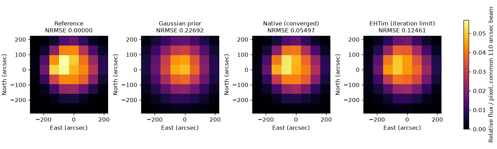

# 段階123：w=0の同一参照を自作RMLと外部RMLで画像化

- 作成日：2026-10-26
- 状態：完了
- 比較元コミット：9012c3816018297c77b383e648e5aa4fd857f2e2（122）

## 読者向け概要

[122](122-ehtim-convention-bridge.md)で外部ソフトへ渡す座標と誤差を確認したので、今回は初めて外部RMLの画像optimizerまで動かした。自作と外部に同じ入力、同じ事前画像、同じ3初期値を与え、返った画像と終了状態を比較する。

最初はw項を0にした二次元の人工参照に限定した。w項は視線方向の基線成分に関係する項で、外部の二次元モデルには含まれない。これを残したままでは、実装の違いとモデルの違いが混ざる。実観測からw項を補正したのではなく、比較のため別の理想条件を生成した。

この1条件では両法とも事前画像より参照形状に近づいた。自作は選択runが収束し、外部は3初期値すべて反復上限に達した。したがって「画像が出た」「収束した」「正解に近い」を別々に記録する。

## 1. 目的・対象範囲

現存118/119のtrue-rate対照の時刻・幾何・SNR・maskを使い、w=0のnoiseless scalar visibilityを作る。8局・最大基線約600m・8時刻・8channelのうち、元のSNR10条件で有効なのは3channel。画像は8×8格子・64秒角/画素、Gaussian事前画像はFWHM240秒角に固定する。

元の積分metadataは各3秒。時刻中心は約3.5時間に分散しているが、これを連続3.5時間の露光とは扱わない。新しい参照では3秒分の電圧・量子化・時間平均を再生成せず、時刻中心のvisibilityを直接計算した。

比較の目的は、共通の画像問題を両実装で処理できるか、終了状態と画像差がどうなるかの確認である。新しいsolver・低SNR尤度・GUIは作らない。

## 2. 完了条件

原本SHA、生成再現、同じSNR/mask、局gain不変、実際の初期配列を確認する。両法を3初期値で実行し、optimizerの実返り値を記録する。非収束を除外したり成功へ変換しない。共通の候補評価APIと参照差で後評価し、source/導入済みの画像・科学JSON、prefix・非上書き・原本・既存package/env不変、122回帰、日本語レポートと匿名公開までを確認する。

## 3. 実際に行った作業

- `workflows/ehtim_image_reference.py`：参照生成、実native/外部fit、実optimizer状態の読取り、後評価。
- `workflows/ehtim_conventions_validation.py`：122の検証済みequal-time dtype接続を明示的factoryへ抽出。外部原本は変更しない。
- `tests/integration/test_ehtim_image_reference.py`：初期値、実SciPyの収束/反復上限/例外、profiler復元、人工SNR/mask、積分metadataの18試験。
- `tools/verify_ehtim_image_reference_installed.py`：別process・checkout外での生成、両画像化、全数値・JSON・非上書きの再現。
- 本レポート・索引と小容量の正式記録。

### 入力と正解の分離

既知Cas A参照形状を総量1で生成し、seed123で局ごと・時刻ごとの複素gainを加えた。gainは各短区間・周波数内で局に分離できる一定量である。区間中の位相揺れやcoherence損失を作ったわけではない。

元のSNRを維持するため、生成した相関振幅を使ってweightを人工的に作り直した。正解画像とgain配列はfitter用bundleへ入れず別ファイルにしたが、このweight生成自体に正解モデルを使う。実観測で未知の分散・gainが測れたことや、実際の受信機雑音を生成したことにはならない。真値LOを使った元枝への依存も対照専用である。

### 固定した探索条件

両法ともseed21、先頭はGaussian prior、残り2個はlog画像に標準偏差0.5の摂動を加えて総量1にする。どの初期値を採用するかは各法自身の目的関数で決め、正解との差で選ばない。

nativeは既存のcircular warmup（最大300反復）とwrapped最終探索（最大800反復）、entropy0.01/TSV0.0001/centroid0.1。外部は固定EHTim1.3.2の公開`Imager.make_image`をdirect DFT・delta pulse・log変換・debias=False・natural weighting・maxset=Falseで実行した。data_termはcphase/logcamp各100、reg_termはsimple1/tv2 0.1/flux10000/cm0.1、maxit800/stop1e-11。これらは事前固定の参照条件で、最適値ではない。

両法の共分散、位相残差の関数、損失の正規化、正則化の尺度・原点、warmupの有無は異なる。同じパラメータ名や総目的関数の値を、同じ尤度や同じ計算量とみなさない。

## 4. 検証条件・結果

新18と段階122の40を合わせ、source58試験/1.31秒、導入済み58試験/0.76秒が成功、除外0。collectは両2174件だが、全2174は未実行。core/package不変のため121の両全2116成功（609.28/607.50秒、各27396既存警告、除外0）を明示引用する。

### 実optimizerと初期値

外部版は画像を返すが、SciPyの終了結果を公開属性へ残さない。[固定版の実装](https://github.com/achael/eht-imaging/blob/v1.3.2/ehtim/imager.py)を確認し、Pythonのprofile機能で既存`minimize`の呼出し・returnを読む方法を採った。引数・返り値・外部ソースを変更しない。独立した二次関数と反復上限付きRosenbrock関数で、成功と未収束が実際の返り値と一致し、元のprofilerも例外時を含め復元することを試験した。

各環境でnativeはwarmup/最終の計6回、外部は計3回の実minimizeを観測した。実際に渡された初期画像の最大差は約1.39e-17。原本3秒の積分情報と、空の5channelを含むmaskを保持し、外部には有効な3周波数群だけを別Obsdataとして渡した。空channelを測定値で埋めていない。

nativeは3初期値中2個が最終収束し、目的関数で選ばれたrun1も収束した。外部は3個とも800反復上限で、選ばれたrun1も未収束。全runのsuccess/status/message/nit/funを保存した。予備・途中の再実行を正式な独立ケースへ合算しない。

### 共通の後評価

NRMSEは総量と共通110秒角の分解能をそろえ、全支持領域で平行移動を許して比較した比率である。小さいほどこの参照に近いが、成功確率ではない。共通損失は115の公開APIで、同じ入力・格子・nativeのfull covarianceを使って各候補を評価した。

| 候補 | 共通NRMSE | 共通nativeデータ損失 | 共通native総画像損失 |
| --- | ---: | ---: | ---: |
| truth | 0 | 2.76447524e-29 | 0.00374441621 |
| prior | 0.226922903 | 381.41679 | 381.416891 |
| native | 0.0549743443 | 0.000410236231 | 0.00285691581 |
| ehtim | 0.124606494 | 0.570088544 | 0.572971104 |

図は共通beam・位置合わせ後の元の表示視野を示す。8格子の点画素中心は−256〜192秒角なので、表示セルの端を−288〜224秒角として座標をそろえた。表の指標は表示窓で切った誤差ではなく、余白を含む全支持領域の計算である。

この固定条件ではnativeのNRMSE約0.05497、外部約0.12461に対し、priorは約0.22692だった。一般的な手法の優劣、最適な観測条件、未知実信号での性能を表す比較ではない。外部の画面ログはχ²を小数2桁へ丸めるので、0.00表示を厳密なゼロとはせず、丸め前の各周波数/項も保存した。外部の総目的関数には定数offsetもあり、負値をnativeの正値と直接順位付けしない。

### 座標・原本・再現性

実8局幾何でpriorと3初期値の外部DFTを計算し、半画素の既知位相補正後にnativeの点画素モデルと一致した。補正前でもw=0の共通Closureからその平行移動が消えることを、元の有効制約で直接照合した。外部/自作のcentroid正則化原点が同じとは主張しない。

source/導入済みで入力・gain・truth・各法の画像16配列、全native/外部科学JSON、4候補の後評価JSONが完全一致。外部6 module/通常core4 moduleの導入先、checkout外作業フォルダ、runner不使用を確認した。prepare/native/external/assessの4種類すべてで既存出力を上書きしないこと、原本・生成物のSHA不変を確認した。検証workflowと元の118/119入力の所在は必要である。

factory抽出後も122の40試験に加え、外部DFT60比較・Closure6条件・w項27条件・49配列の回帰を実行した。追加ソフトを通常環境へ導入していない。

### レビューでの修正とログ

初期の外部tableに、テンプレート由来の積分時間0.3秒が残っていた。元のSNR源は3秒なので、全時刻/基線の`integration_s`を保持して渡すよう修正した。正式な対象試験と画像計算を再実行し、修正前後の画像bytesが不変であることも確認した。初期・途中ログは残し、正式成功件数へ合算しない。

外部は「指定flux1が最大visibility振幅の80%未満」という標準警告も出した。未知局gainを掛けた相対値であり、絶対fluxと相関振幅を一致させる参照ではないため、警告をログへ残した。物理的なJy較正を完了したとは扱わない。

凍結409ファイルと既存core/package 215ファイルのSHA不変。121のwheel103ファイル・参照asset4件をsource/通常導入先/外部envでbyte照合し、外部EHTim49ファイルも配布物と不変。通常検証envのpip freezeも変更なし。新wheel・GUIブラウザ・全2174の再実行はしていない。公開監査指摘0、文書リンク1611件で欠落0。

詳細は[正式記録](../../validation/runs/stage123/README.md)を参照する。

## 5. 制約・未解決事項

- 無雑音・同一格子・w=0・人工weightの1条件である。同じ離散生成モデルを逆問題でも使う、意図的に簡単な自己整合の参照で、現実的な観測成功予測ではない。
- 原本の時刻/SNRを借りても、実際の3秒電圧、未知LO推定、時間平均、ADC量子化、RFIや物理雑音を再現したことにはならない。
- 外部はscalar相対値をStokes I欄へ置く数学的参照。偏波や絶対flux・位置を測定した画像ではない。
- 局に分離できない基線誤差、積分中の位相/周波数揺れ、低SNRの非Gaussian尤度、実SEFD、実機Cas A、実FFT独立性、全夜・GPU性能は未検証。
- 800反復での外部未収束を、外部RMLが不可能・劣ると断定しない。正則化や共分散が違うため、nativeとの単一原因の比較でもない。

## 6. 次段階

同じ参照と設定で、外部の反復上限と勾配・終了条件を先に検証する候補を選ぶ。truthで設定を調整せず、停止状態・目的関数・画像差を分ける。その後、実際のwを持つ保存済み相関への比較では122のモデル差上限と共分散差を宣言し、実観測成功へ読み替えない。次の文書整理130・根本見直し150を維持する。
