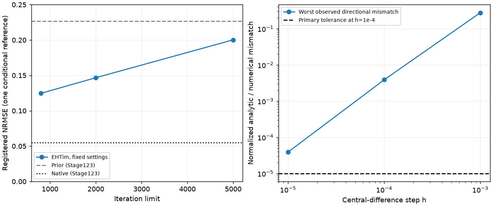

# 段階124：外部RMLの反復上限と局所勾配を同じ参照で確認

- 作成日：2026-10-26
- 状態：完了
- 比較元コミット：00ecc517ebab6e956902991f1d92a1ce4b1d897d（123）

## 読者向け概要

[123](123-paired-w0-rml-reference.md)では外部RMLが800反復で収束しなかった。今回は入力や事前画像を変えず、2,000・5,000反復まで計算した。同時に、探索が使う解析勾配と、目的関数を少しずらして測る有限差分を比べた。

反復を増やしても全初期値が未収束だった。外部自身の目的関数は小さくなったが、この人工参照の形状差は悪くなった。勾配の主判定も12点中8点が基準を満たさなかった。ただし刻み幅を小さくすると不一致が減り、補助計算も有限差分の打切り誤差が影響する可能性と整合した。勾配が壊れているとも、一般に正しいと検証できたとも断定しない。

この結果を受け、外部solverの追加調整は保留し、保存済み相関と画像モデル・誤差仮定のずれを調べる作業へ戻す。

## 1. 目的・対象範囲

123と同じw=0・無雑音・人工weight・8格子の1参照を使う。入力・prior・data/reg項・乱数seed・3初期値・終了許容値は固定し、反復上限だけを変える。800の結果は123から引用し、新しく2,000/5,000を実行する。正解画像を見て設定や初期値を選ばない。

勾配は、各上限・3初期値の初期点/終了点の計12点で、seed124の5単位方向へ測る。log-image parameterの中心差分stepは0.001/0.0001/0.00001に事前固定した。主判定はstep0.0001の規格化差が1e-5以下。これは有限の点・方向・stepだけの診断であり、全域の勾配の証明ではない。

## 2. 完了条件

実make_imageと実minimizeの返り値、初期配列・原本SHA・固定設定を保持する。方向微分と全stepの数値、両環境の画像/科学JSON/共通後評価を照合する。不適合や非収束を成功へ丸めない。旧123の800反復と122接続を回帰し、core/package/env不変、文書・監査・匿名公開を確認する。新しい画像solver、尤度、GUI、Windows収録は対象外。

## 3. 実際に行った作業

- `workflows/ehtim_image_reference.py`：同じ外部問題とImagerの組立てを再利用可能にし、反復上限を明示引数へ分けた。既定800の数値は元123と完全一致した。
- `workflows/ehtim_iteration_controls.py`：2上限×3初期値、各初期/終了点の方向微分、実optimizer記録。
- `tests/integration/test_ehtim_iteration_controls.py`：既知二次/四次関数、意図した誤勾配、不正値、資源上限の13試験。
- `tools/verify_ehtim_iteration_controls.py`：別process・checkout外での2実行、source/導入済み公開APIによる後評価・画像/JSON・非上書きの照合。
- [開発計画](../design/development-roadmap.md)の124時点の追加判断、本レポート・索引・正式記録。

外部EHTim1.3.2とSciPyの算法は変更していない。123の型接続を使い、profileは実minimizeの引数・返り値を変えず読む。通常の開発環境へ依存を追加していない。

## 4. 検証条件・結果

新13と既存58を合わせ、source71試験/1.35秒、導入済み71試験/0.77秒が成功、除外0。collectは両2187だが全2187は未実行。core不変のため最新121の両2116成功（609.28/607.50秒、各27396既存警告、除外0）を明示引用する。勾配の主判定が全て適合した意味ではない。

### 反復上限と画像

各法固有の目的関数で初期値を選んだ。今回の2,000/5,000も3初期値すべて反復上限で、選択runはどちらも1だった。truthは後評価だけに使う。共通NRMSEは全支持領域・110秒角・平行移動で計算し、共通データ損失は115のnative公開APIと同じfull covarianceで評価した。

| 上限 | 自身のF | 共通NRMSE | 共通nativeデータ損失 | 選択run収束 |
| --- | ---: | ---: | ---: | --- |
| 800（123引用） | -599.770484 | 0.124606494 | 0.570088544 | 未収束 |
| 2000 | -599.805991 | 0.146704811 | 0.869498306 | 未収束 |
| 5000 | -599.839395 | 0.200205705 | 3.88380541 | 未収束 |

800は123からの引用で、既定動作の回帰も別途実行した。反復数を増やすと外部自身のFは下がったが、共通NRMSEとnativeのデータ損失は大きくなった。native参照NRMSE約0.05497、prior約0.22692はいずれも123の固定値である。異なる目的関数・正則化の最適点が同じとは限らず、この1条件を一般的な手法の優劣にしない。

### 勾配の主判定

方向dへの中心差分は`D_h=[F(x+h d)-F(x-h d)]/(2h)`。解析値`g(x)·d`との差を`max(1,|D_h|,|g·d|)`で割った。勾配が小さいときは絶対差に近い基準である。

事前固定したh=0.0001では12点中4点が全5方向で基準内、8点が不適合。最大規格化差は約0.00388056。実装を試験した71件が成功したことを、この数値仮説も全て通ったという意味にしない。

各点の3stepは全て保存した。例として最初の初期点の一方向では、hを0.001→0.0001→0.00001へ減らすと不一致も大きく減った。したがって、単一stepの不適合を外部解析勾配の実装不良と直結させない。

### 主判定を変えない補助解析

保存した細かい2stepから`D_R=(100 D_0.00001-D_0.0001)/99`を計算した。滑らかな関数でh²の誤差項が支配的なら、その項を打ち消すRichardson補外である。最大規格化差は約5.62e-8だった。

これは主判定の不適合を見た後の補助解析であり、事前判定を差し替えていない。打切り誤差が影響した可能性と整合するが、丸め・局所曲率・近いvisibility零点などの影響を全て分離したわけではない。全域での解析勾配の正しさ、非収束の単一原因、実データへの適用性は未確定である。

### 再現・回帰・原本

source/導入済みの後評価と2外部実行の科学JSONが完全一致し、各上限の3画像と選択画像、計8配列が一致した。同じ条件の再実行であり、独立した新しい観測や雑音試行ではない。原本・出力SHA不変、非上書き、checkout外作業フォルダとrunner不使用、source/installedのcore各4 moduleを確認した。

組立てを分けた後の123既定800の全科学JSON・画像は、元の123と完全一致した。122のDFT60比較・Closure6条件・w項27条件・49配列も回帰した。外部の相対fluxに関する標準警告は123と同じくログに残した。

凍結412ファイル、既存core/package 215ファイル、通常環境pip freezeは不変。既存121 wheel103ファイルとasset4件がsource/通常導入先/外部envでbyte一致し、EHTim49ファイルも配布物から不変。新wheel・GUIブラウザ・全2187は再実行していない。公開監査指摘0、文書リンク1628件で欠落0。

[正式記録](../../validation/runs/stage124/README.md)に全局所数値と比較値を保存した。予備実行は正式条件数へ合算していない。

## 5. 制約・未解決事項

123と同じw=0・無雑音・同一格子・人工SNR weightの1条件である。真値LO枝の幾何とSNRを借りても、未知LO補正や実電圧の再生成ではない。局に分離できる一定gainとscalar相対値を使い、Jy・偏波・位置を較正したものではない。

12点・5方向・3stepは有限の診断で、gradientチェックの結果をoptimizerの大域収束保証へ変換しない。外部の対角重み/基底・cosine位相損失/regularizerはnativeと違う。各法のFの大小や反復数だけで、未知観測への有効性を決めない。

実機Cas A、弱い実信号での未知LO/振幅/SEFD、低SNR画像尤度、実FFT独立性、全夜・GPU性能は未検証。

## 6. 作業順の変更と次段階

外部RMLをすぐに主画像経路へ置き換えず、比較部品として保存する。5,000を超える反復や、truthを見ながらの正則化調整は保留する。次125は、現存118/119の通常LO・真値LO・理想参照を使い、同じ有効制約で画像モデルと保存相関の残差・weightの仮定を説明する診断を優先する。χ²型の値を未検証のp値や低SNR画像尤度としない。

130で全体文書を統一し、150の根本見直しを維持する。今回は追加結果による作業配分の修正で、節目の根本見直しを実施済みにしたものではない。
