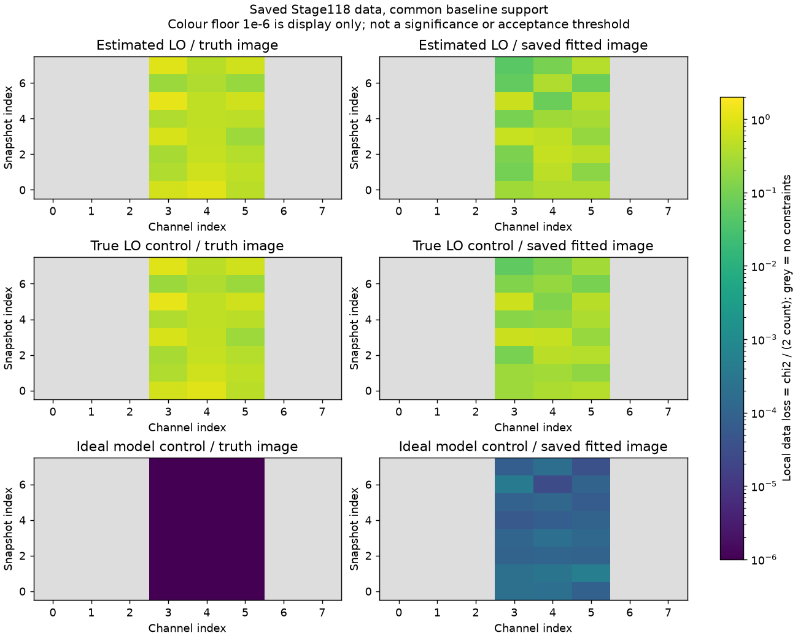

# 段階125：保存相関のClosure残差と誤差の扱いを診断

- 作成日：2026-10-26
- 状態：完了
- 比較元コミット：b18974a12a162a0757456ba5d92b0a80dd6b7455（124）

## 読者向け概要

[118](118-multitime-vdif-controls.md)では、シミュレーターの電圧を相関して画像を作る処理が動いても、得られた形が正解に十分近づかなかった。[124](124-ehtim-iteration-gradient-controls.md)で外部ソフトの反復追加を保留し、今回は主経路の保存済み相関に戻って、画像から予測するClosureと保存データの差を分解した。Closureは局ごとに掛かる利得の影響を打ち消す、複数基線の位相や振幅の組合せである。

共通の有効データだけを使うと、正解画像のデータ損失は推定LO・真値LOの双方で約0.554だった。保存された復元画像は約0.287〜0.288へさらに小さくしたが、118の形状誤差は大きかった。したがって「保存データへの一致」と「正しい形の復元」を別々に評価する必要がある。損失の値だけから、誤差モデルが正しい、過学習が原因である、あるいは実観測でも画像が得られるとは結論しない。

## 1. 目的・対象範囲

3枝（推定LO、真値LO、理想モデル）×元/共通有効基線×正解/事前画像/各枝の保存fitの18条件を事前固定した。前2枝は模擬電圧由来の保存相関、理想枝は同じ幾何に正解画像から作ったモデル値と人工的なweightを置いた対照である。実RTL-SDRの記録ではない。

入力は現存する118の3つの`visibility.npz`、3つの保存fit画像、32×32の正解画像を使う。各相関archiveのSHAを119の32格子条件、fit画像と数値配列を118、正解画像SHAを113の公開記録へ照合した。元データの再生成・再相関・再fitは行わない。別の乱数試行を同じ原本として代用しない。

## 2. 完了条件

元と共通基線の18条件について、位相/対数振幅、時刻、channelごとの残差・独立行・共分散・損失を保存する。115の公開画像評価APIと独立計算を照合し、既知例では全Closureの特異共分散を擬似逆行列で解く別経路とも比較する。空のセルや成分は不足として残し、損失0へ変換しない。

ソース版と導入版の全科学JSON・数値配列・図、checkout外の導入CLI、原本不変・非上書き・読込先を検証する。既存package/wheel/envの不変を確認し、レポート・索引・公開監査・匿名commit/pushを行う。GUI、新しいsolver、低SNR尤度、Windows収録は対象外。

## 3. 残差をどう数えたか

### 同じ基線を使って比較する

8時刻×8channel×28基線の中で、元のSNR10判定を満たす組は推定LOで284、他2枝で283ある。この三つの判定の積集合、283組を共通有効基線とした。「283本の物理的アンテナ間隔」という意味ではない。同じ時刻・channel・基線を使っても、元の誤差weightは枝ごとに保持する。

Closureには重複がある。例えば三角形を多数作ると、ある三角形の位相は他の組合せから求まる。公開のQR選択で重複のない行を選び、行番号・行列・共分散を全て保存した。共通基線では3枝とも位相117行、対数振幅93行、計210行になり、今回は選択indexも一致した。これは行列上の独立性であり、実FFT標本の統計的独立性を確認したことではない。

共通データで選択行に参加した基線セルは254組、最大幾何基線は約589.90m、最大投影uv距離は約1933.46波長だった。全てのSNR採用基線がClosureを作れるわけではない。この長さを実測の画像分解能へ置き換えない。

### 同じ基線を共有する誤差を残す

画像は総和1へ正規化し、元のw項を含む幾何からvisibilityを予測する。選択行列をA、予測と観測のClosure差をrとすると、基線ごとの近似分散は`1/SNR²`、Closure共分散は`C = A diag(1/SNR²) Aᵀ`となる。Cの対角以外の成分は、同じ基線を共有するClosureの誤差が連動することを表す。

位相の差は選択Closureを作った後で−π〜πに折り返す。CをCholesky分解して`C = L Lᵀ`とし、`z = solve(L, r)`を求めた。これは誤差の大きさと相関を考慮して残差を測る操作である。全セル・位相/振幅の`z²`を足した値をχ²型のエネルギーと呼び、現在のRMLと同じデータ損失を`D = Σz² / (2N)`で計算した。Nは採用した独立行の合計である。

時刻・channelごとの損失を平均するときも、各セルの行数を重みにする。使える行が0のセルは`null`、配列ではvalid=falseとNaNにした。8時刻の各3channel、計24セルに制約があり、他の40セルは不足である。**χ²型という名前は、χ²分布に従うこと、p値、誤差区間の被覆率を検証したという意味ではない。**

## 4. 検証条件・結果

### 画像と残差

32格子・16秒角、SNR10、事前画像FWHM240秒角などは115/118と同じ設定である。w項も保存相関の幾何を使い、123/124のw=0参照とは条件が違う。下表は共通基線のDで、値が小さいほど現在の重み付きデータ項へよく一致する。正解画像は評価専用で、今回の再最適化や設定選択には使っていない。

| 枝 | 独立行（位相 / 対数振幅） | 正解画像D | 保存fit D | 事前画像D |
| --- | ---: | ---: | ---: | ---: |
| 推定LO | 117 / 93 | 0.5542511583 | 0.2882088611 | 399.8136193 |
| 真値LO対照 | 117 / 93 | 0.5543791051 | 0.2868689449 | 399.6102568 |
| 理想モデル対照 | 117 / 93 | 3.525509784e-29 | 0.0001554863328 | 397.6802086 |

元の支持では推定LOの正解Dが0.55230144、真値LOが0.55437911だった。共通基線へ揃えると推定LOは0.55425116になった。真値LOと理想モデルは元から同じ283組なので変わらない。この集計だけから、局の周波数差の推定が不要、あるいは時計補正が画像誤差の唯一の原因とは判断しない。

灰色は制約不足である。理想枝の正解損失は約3.53×10⁻²⁹で、図の色の下限を下回る。この下限1e-6は表示の都合で、科学的な採否閾値ではない。全セルの数値を正式記録へ保存した。

推定/真値LOの保存fitは正解画像より小さい損失だが、118から引用する共通110秒角・平行移動後の形状NRMSEは約0.351/0.387、理想枝は約0.108で、選択runは3枝とも未収束だった。今回はこれらの画像差や収束を再測定・再fitしていない。正解の損失が最小でないことは、雑音への適合、利用可能情報、正則化、局所探索などを切り分ける動機であり、一つの原因の証明ではない。

32×32画像は総和を固定しても1023個の画素値を持つのに対し、今回の選択行は210〜211個である。正値制約、事前画像、平滑化、観測する空間周波数の範囲が画像を決める上で大きな役割を持つ。単純な個数比較を画像化不可能の証明や有効自由度の推定には使わない。

### 実装・再現性

新19と既存の公開画像評価26を合わせ、ソース版45試験/2.56秒、導入済み45試験/1.51秒が成功、除外0。両2206は収集のみで、全2206試験は未実行。最新の全回帰は121の両2116成功（609.28/607.50秒、各27396既存警告、除外0）を引用する。今回の変更は検証workflow/tool/試験だけで、科学packageは不変のため全回帰を繰り返していない。

独立のCholesky残差計算と115公開APIの損失差は最大約2.11e-10で、事前の相対1e-9・絶対1e-10基準内だった。既知4局例では全Closureの特異共分散を擬似逆行列で解いたエネルギーへ相対2e-13で一致し、共有誤差の非対角成分も確認した。局gainとnoise尺度を同時に移した不変性、位相wrap、3局の振幅不足、空のセル、不正値、モデル零点も試験した。

ソース/導入済みの18科学JSONと11,593数値配列、図の画素が完全一致した。checkout外・runnerなしの作業フォルダで導入済み公開CLIを18回実行し、全JSONと入力SHA/画像SHAを照合した。読込先はソースの正確な4 packageディレクトリと導入prefix内4 packageで確認した。非上書き、元7ファイルと出力SHA不変も確認した。同条件の再実行であり、独立した新しい雑音試行ではない。

初回は検証用の派生コピーを保存するとき、読込後のmetadata辞書を数値欄へ混ぜてしまい、導入CLIがobject arrayを拒否した。原本や科学coreは変更せず、呼出側でmetadataを分け、数値の保存/再読込一致を確認して両対象・全18条件・18CLIを再実行した。監査が行列積の記号をメールのように検出した2か所も、ASTが同じ空白修正後に対象と18条件を再実行した。初回・修正途中の結果は別名で残し、正式件数へ加えていない。

凍結415ファイルと既存core/package 215ファイル、通常環境pip freezeは不変。既存121 wheel103ファイルと4 assetがソース/導入先へbyte一致した。新wheel・GUIブラウザは実行していない。公開監査指摘0、文書リンク1638件で欠落0。

[正式記録](../../validation/runs/stage125/README.md)には、18条件の集計・全セルの数値・原本/派生物/行列詳細のSHA・検証結果を保存した。大きな選択行列・共分散・残差配列はGit管理外に置いた。元028rawの当時のbyte不変を今回証明したとは扱わない。

## 5. 制約・未解決事項

これは既知Cas A形状、仮定SEFD、保存された一組の模擬観測に対する事後診断である。SNR採否とweightは同じデータから得ており、基線間・時間・周波数の誤差独立性を実機で確認していない。理想枝のSNR移送も人工的な対照で、実測の放射較正ではない。

共通の有効基線に揃えても、枝ごとの共分散は同一ではない。位相を折り返す二次形式は選択基底の影響を受けうるため、whitening後の各座標を同じ物理的観測だとして行番号だけで比較しない。今回の数値は高SNR近似に基づく現在の目的関数の診断で、低SNRの画像確率や尤度を確立していない。

実機Cas A、弱い実信号の未知LO/振幅/SEFD、実SEFD・FFT独立性、全夜/GPU性能は未検証。Windows収録は引き続き対象外。

## 6. 次段階

主経路では、学習に使ったデータへの適合と、使わなかったデータの予測を分ける対照を優先する候補とする。保存済み8時刻の一部でfitし、残る時刻でClosure残差を評価すれば、同じデータだけに合わせた結果なのかを調べる材料になる。ただし時刻分割を独立した受信機/雑音試行や実観測成功の証明にはしない。選択前に分割・格子・初期値・選択規則を固定し、truthは後評価だけに使う。

外部solverの反復追加やtruthを見た設定調整の保留を継続する。文書整理130、根本見直し150の運用を維持する。
