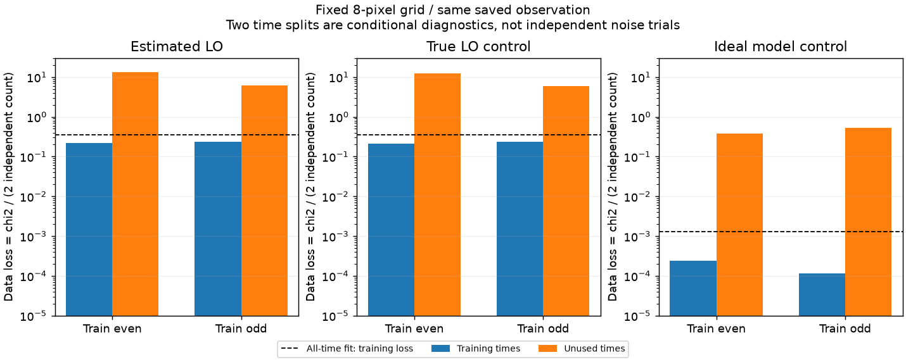

# 段階126：学習時刻と未使用時刻を分けた画像の予測評価

- 作成日：2026-10-26
- 状態：完了
- 比較元コミット：17089789b2724c370d82136304c3465d3e67e71a（125）

## 読者向け概要

画像を観測データに合わせられても、その画像が別のデータを説明できるとは限らない。[125](125-closure-residual-diagnostics.md)でこの区別が必要になったため、今回は保存した8時刻の一部だけで画像を作り、使わなかった時刻のClosureを予測した。学習時刻は画像の探索に使うデータ、未使用時刻は探索が終わった後に予測を評価するデータである。

推定LO・真値LOの双方で、学習データの損失は約0.215〜0.240だったが、未使用データでは約5.88〜13.40へ大きくなった。無雑音の理想モデルでも学習/未使用の差があった。このため、単に雑音への過剰適合だけを原因とせず、格子の表現力・時刻ごとのuv被覆・正則化・未収束なども切り分ける必要がある。検証用の処理と照合は完成したが、未知の実観測から画像を復元できたという結果ではない。

## 1. 目的・対象範囲

118の保存相関3枝を使い、以下の時刻indexを事前に固定した。

- 偶数時刻学習：0,2,4,6でfit、1,3,5,7で評価。
- 奇数時刻学習：1,3,5,7でfit、0,2,4,6で評価。
- 全時刻学習：0〜7の全てでfit。未使用集合は空で、予測点数は付けない。

3枝×3分割で9fit、各3初期値の計27探索を両環境で実行した。原本の再生成・再相関はせず、125と同じ共通有効基線283セルを使った。8時刻は疎なsnapshotであり、一晩の連続運用ではない。

画像は8×8、64秒角、名目視野512秒角に固定した。119でこの格子の3枝が収束した実績と計算規模を基に選び、今回の未使用データや正解画像を見て選んでいない。通常の32格子の既定値を変更する段階ではない。

## 2. 完了条件

時刻集合が非重複で補集合になること、未使用時刻の信号値と真値情報を学習入力から除くこと、同じ固定条件で9fitを行うことを確認する。処理完了・選択runの収束・データへの一致・参照画像との差を分けて残す。未使用集合が空なら`null`とし、予測損失0としない。

ソース版と導入済み実RML CLI9件の全科学JSON、画像、FITS数値/WCS/checksum、最小学習archiveを照合する。全入力SHA・読込先・非上書き・既存package/env不変、対象試験・実collect・文書と公開監査・匿名commit/pushを確認する。新solver、GUI、低SNR尤度、Windows収録は対象外。

## 3. 実際の変更と評価方法

### 探索へ渡したもの

`workflows/temporal_image_validation.py`を追加した。学習archiveにはvisibility、weight、局ペア、uvw、時刻、周波数、積分時間を保存する。未使用時刻のvisibilityは一定値1+0jへ置き換え、weightは0にした。したがって未使用時刻の実信号値はfitterへ入らない。幾何や時刻の軸は保持する。

metadataもホワイトリストで作り直し、表示の基準RA/Dec・周波数・画像格子と単位だけを残した。局利得、真値LO、SEFD、正解の形状・fluxは含めない。正解画像のファイルを読むのは、全9fitが終わった後にした。真値LOと理想モデルの枝自体は評価専用の対照であり、未知LOを解いた実観測の入力ではない。

既存の`image_closure`を使い、Gaussian事前画像FWHM240秒角、SNR10、entropy0.01/TSV0.0001/centroid0.1、seed21、3初期値を固定した。既存の円周位相による準備探索最大300反復と、その後のwrapped位相による最大2000反復を変更していない。選択runは各fitの既存目的関数が最小のものとし、未使用データや正解画像で選ばない。選択runが未収束なら、そのまま未収束として記録した。

### 探索後に評価したもの

9fitの各画像について、学習・未使用・全時刻の三つの支持で、fit画像・事前画像・正解画像を評価した。計81評価である。125の選択Closure行列、共有誤差を含む共分散、位相wrap、Cholesky残差を使い、データ損失を`D = Σz² / (2N)`とした。正則化を足した探索全体の目的関数とは区別する。

fit/事前画像は8格子・64秒角、正解画像は元の32格子・16秒角でvisibilityを予測する。形状差の後評価では、119と同じく8格子の点pixelを同じ位置の32格子へzero embeddingし、共通110秒角・全支持領域・平行移動のみの指標を使った。補間して正解に似せたり、正解を見て探索をやり直したりしていない。

`tests/integration/test_temporal_image_validation.py`に分割・非学習値の排除・最小metadata・実fitの不変性・不正値・ADC/Jy保存読込の18試験を追加した。`tools/verify_temporal_image_installed.py`はcheckout外で学習archiveを独立に再構成し、導入済みRML CLI9件を実行して照合する。

## 4. 検証条件・結果

### 学習と未使用時刻の残差

下表のNは採用Closureの行数である。同じ4時刻でも有効データが違うため、偶数側114、奇数側96となった。行列上の独立性を数えたもので、実FFT標本の統計的独立性や検定の自由度の実証ではない。NRMSEは値が小さいほど参照形状へ近いが、絶対fluxや位置の較正は含まない。

| 枝 | 学習index | N（学習 / 未使用） | 学習D | 未使用D | 形状NRMSE | 選択run |
| --- | --- | ---: | ---: | ---: | ---: | --- |
| 推定LO | 0,2,4,6 | 114 / 96 | 0.21595808 | 13.395434 | 0.43659737 | 未収束 |
| 推定LO | 1,3,5,7 | 96 / 114 | 0.23775756 | 6.1477643 | 0.22637951 | 収束 |
| 推定LO | 全8時刻 | 210 / 0 | 0.35441322 | —（集合なし） | 0.20790323 | 収束 |
| 真値LO対照 | 0,2,4,6 | 114 / 96 | 0.21480842 | 12.211981 | 0.43041676 | 未収束 |
| 真値LO対照 | 1,3,5,7 | 96 / 114 | 0.23970785 | 5.8825942 | 0.22417137 | 収束 |
| 真値LO対照 | 全8時刻 | 210 / 0 | 0.35452117 | —（集合なし） | 0.20709266 | 収束 |
| 理想モデル | 0,2,4,6 | 114 / 96 | 0.00024115279 | 0.3794212 | 0.13981718 | 未収束 |
| 理想モデル | 1,3,5,7 | 96 / 114 | 0.00011722493 | 0.52514461 | 0.14415298 | 収束 |
| 理想モデル | 全8時刻 | 210 / 0 | 0.0013063513 | —（集合なし） | 0.059825754 | 収束 |

図の破線は全時刻を使ったfitの**学習損失**であり、未使用データの予測ではない。独立した反復試行ではないため、誤差棒や有意差の検定は付けていない。

未使用側に対する正解画像のDは、推定LOで約0.63644/0.48504、真値LOで約0.63908/0.48305、理想モデルで約3.88e-29/3.23e-29だった。事前画像の未使用Dは約348〜386で、今回のfitは事前画像よりデータをよく説明するが、正解画像と同じ水準ではない。

同じ条件で、未使用Dだけが学習Dより大きくなる例が得られた。これは「学習が終了した」「目的関数を下げた」「未知の時刻を予測できた」を同じ判定にしてはいけないことを示す。一方、偶数学習の3枝は全て未収束なので、それらを最適解の予測性能として扱わない。奇数学習では3枝とも収束しても、推定/真値LOの未使用Dは約6のままだった。数値収束だけで形状や予測が保証されるわけでもない。

理想モデルにも学習/未使用の差がある。これは無雑音でも同じ問題が残る条件付きの例だが、真値は32格子、fitterは8格子であり、元々同じ表現力ではない。時刻ごとの空間周波数の違い、正則化、有限初期値・未収束も含め、原因を単一に確定していない。8格子は総和固定で63画素自由度だが、制約の数がそれを超えるだけで画像が一意に決まるとは限らない。

### 実装・導入済み照合

新18と既存56を合わせ、ソース版74試験/3.32秒、導入済み74試験/1.48秒が成功、除外0。両2224試験は収集のみで、全2224は未実行。今回も既存科学packageは不変で、最新全回帰121の両2116成功（609.28/607.50秒、各27396既存警告、除外0）を引用する。

各環境の9fit/27探索のうち、選択runは6件収束、3件未収束だった。全27探索の状態も保存し、未収束の探索を除外して選び直していない。学習・未使用のエネルギーの和が全時刻の値へ一致し、全時刻fitの未使用集合は不足としてnullになった。

導入済み実CLI9件と、全9科学JSON・109配列・9学習archiveのbyte・画像/embeddingが完全一致した。FITS数値とWCS/単位/基準座標を照合し、checksumも確認した。9件全ての同じ出力先への再実行をfit前に拒否し、既存出力と原本4ファイルのSHAを保持した。ソース側37 moduleは正確なソースディレクトリ、導入側37 moduleは導入prefix内にあり、CLIの作業場所はcheckout外、runner不使用、PYTHONPATHを外した。同じ条件の再現確認であって、独立した新しい観測を18件得た意味ではない。

初回は既存試験のファイル名を誤って指定し、収集前に0件で停止した。その後の初回sourceでは6fit後、Jy読込が追加する`vis_jy`の別名を誤って追加配列と扱った照合で停止した。数値は正しかったがキー集合が違ったため、学習用の数値ホワイトリストで照合し、ADC/Jyの保存読込2試験を加えて全条件をやり直した。初回の6画像と最終画像はbyte一致した。途中結果を正式件数へ加えていない。

凍結418ファイル、既存core/package 215ファイルと通常環境pip freezeは不変。既存121 wheel103ファイルと4 assetをソース/導入先へbyte照合し、新wheel・GUIブラウザ・全2224は再実行していない。両図画素は一致した。公開監査指摘0、文書リンク1648件で欠落0。

[正式記録](../../validation/runs/stage126/README.md)に全条件・全探索・セル数値・画像・入力SHA・検証結果を保存した。詳細な入力や中間データはGit管理外で保持し、個人パスを公開記録へ含めていない。

## 5. 制約・未解決事項

この分割は、保存した同じ模擬観測の中で行った条件付き診断である。共通maskは全データから計算済みで、上流のLO取得やweight推定も時刻間で情報を共有しうる。fitterへ未使用の実visibilityを渡さなかったことと、収録から独立した完全blindな検証を行ったことは別である。新しい乱数で電圧を生成していない。

真値LO・理想モデルは対照専用である。理想枝のweightも人工的なSNR移送で、物理的な感度や較正を測ったものではない。今回の8格子の結果を、既定32格子・任意配置・実機へ一般化しない。χ²型の損失からp値、coverage、低SNR画像尤度、観測成功率を算出していない。

実RTL-SDR/OCXOのCas A、弱い実信号の未知LO/振幅/SEFD、実SEFD・FFT独立性、全夜/GPU性能は未検証。Windows収録は除外を維持する。

## 6. 次段階

主経路の課題は、学習時刻だけへの適合から、別の時刻と正しい形を説明できる画像へ近づけることにある。次候補として、真値32格子とfitter8格子の違いを切り分ける、同じ8格子で生成した理想対照を検討する。全時刻/偶数/奇数の条件と正則化を固定し、表現できる天空でも同じ未使用誤差が残るかを確認する。新しい実観測の成功として扱わず、原因に応じて主経路の優先順位を更新する。

外部RMLの追加反復や、正解を見た設定調整は引き続き保留する。130で全体文書を整理し、150の根本見直しを維持する。
