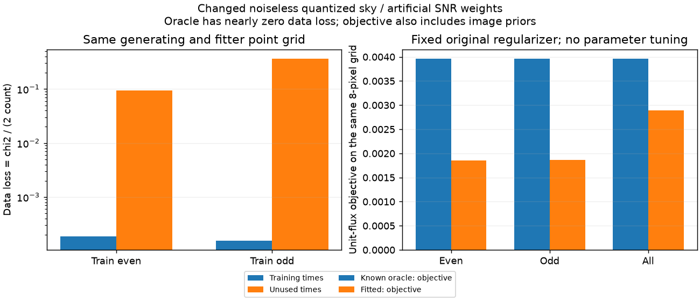

# 段階127：生成天空と復元画像の格子を揃えた対照

- 作成日：2026-10-26
- 状態：完了
- 比較元コミット：83f8e1b9aea8dc8cfc2e0a3ab7f71340e953b2b4（126）

## 読者向け概要

[126](126-temporal-image-validation.md)では、8時刻の一部だけで画像を作ると、未使用時刻の予測残差が大きくなった。無雑音の理想データでも差があったが、正解は32格子、復元ソフトは8格子だった。これは、細かい絵を粗いブロックだけで表そうとする違いを含む。

今回は、生成側も復元側も同じ8格子を使う、新しい無雑音天空を作った。選択された3件は全て収束したが、未使用時刻の残差は学習時より大きくなった。さらに、データだけならほぼ完全な正解画像でも、事前画像・平滑さ・中心位置の罰則を含む目的関数では、保存fitより値が大きかった。

これで、格子不一致や未収束だけでこの種の差を説明できるとは限らないことが分かった。ただし天空自体を量子化した新しい対照であり、元のCas A画像の改善率や実観測の成功を示したものではない。どの罰則や探索の性質が効いたかは、次の固定条件の対照で確認する必要がある。

## 1. 目的・対象範囲

126と同じ幾何・8時刻・周波数・共通有効基線283セルを使い、生成点天空とfitterの8×8・64秒角を一致させた。偶数/奇数/全時刻学習の3fit、各3初期値の9探索を両環境で実行した。元126の理想モデル3fitは引用し、再fitした条件へ加算しない。

既存RML、既定32格子、Gaussian事前画像、正則化、初期値、停止条件は変更しない。原本電圧の再生成や再相関、外部RMLの追加反復、GUI、Windows収録は対象外。

## 2. 完了条件

正のfluxを捨てずに格子へ集約し、格子外へ出る場合は切捨てやclipで隠さず停止する。生成visibilityを独立の点源和と照合し、人工SNR移送のmask・分散・rankを確認する。QRの同値な行は浮動小数でpivotが変わりうるため、index一致は観測項目とし、差があればそのまま保存する。

3fitと支持別3候補の27残差評価、同じ8格子oracleの追加9評価を行う。ソース版/checkout外導入CLI3件の全科学JSON・画像・生成archive・FITS数値/WCS/checksum・非上書き・読込先を照合し、原本/既存package不変、対象試験と実collect、文書・公開監査・匿名commit/pushを確認する。

## 3. 実際に行った作業

### 同じ格子で表現できる天空を作る

`workflows/matched_grid_image_validation.py`を追加した。元32格子の各点fluxを、最も近い64秒角の8格子中心へ加算する。等距離のときは座標の正方向へ置く規則を事前固定した。原点は元画像のindex16、新画像のindex4である。正のfluxが格子外へ出る入力は拒否する。

今回の集約後は正の45画素、総fluxは浮動小数で約1000となり、元の総和を相対1e-14以内で保存した。これは生成用に仮定したfluxで、実測のJy較正ではない。各点を移動しているので、元の天空と物理的に同一ではない。

この8格子の点天空から、w項を含むvisibilityを生成した。独立の点源ごとの複素和との最大絶対差は約4.55e-13で、固定した相対1e-12・絶対1e-10基準内だった。元の理想枝からSNRを保つようweightを人工的に移送し、元/新のSNR差は最大相対4.44e-16、基線近似分散差は6.66e-16だった。採用基線と全Closureの有効maskは一致した。

共通データは位相117行・対数振幅93行、計210行のままで、今回は選択indexも全て一致した。各時刻/channelの両index・共分散を数値archiveへ保存した。SNRを移したことを、物理的な受信機感度や誤差分布を測ったこととはしない。

### fitと後評価を分ける

126の最小学習入力を再利用し、未使用時刻の実visibilityは1+0j、weight0とした。metadataは表示の基準座標・周波数・格子などに限り、生成truth/gain/LO/SEFDを渡さない。真値は今回のデータ生成と探索後の評価に使う。生成時には真値を読んでいるので、126と同じ「全fit後に初めて真値を読んだ」とは主張しない。

3初期値seed21、Gaussian240秒角、entropy0.01/TSV0.0001/centroid0.1、既存の円周位相warmup最大300・wrapped位相の最終最大2000反復を固定した。各training目的関数でrunを選び、未使用データやtruthで選び直さない。

各fitを学習/未使用/全時刻で評価した。データ損失は125と同じ共有共分散を含む`D = Σz² / (2N)`である。画像の形状は、同じ点位置の32格子へzero embeddingし、共通110秒角・全支持領域・平行移動後のNRMSEで比較した。

正則化を含むFの比較は、**oracleもfitも同じ8格子**の公開115 APIで行った。zero embeddingした32格子のregularizerは、8格子のF比較へ流用しない。Fはunit-flux画像のdata/entropy/TSV/centroidの和で、optimizerのパラメータ総和penaltyを除いている。

`tests/integration/test_matched_grid_image_validation.py`にflux/座標/tie/不正値・点源和・SNR移送など15試験、`tools/verify_matched_grid_image_installed.py`に導入版での独立生成と実CLI3件の照合を追加した。

## 4. 検証条件・結果

### 学習と未使用時刻

| 学習index | N（学習 / 未使用） | 学習D | 未使用D | 形状NRMSE | 選択run |
| --- | ---: | ---: | ---: | ---: | --- |
| 0,2,4,6 | 114 / 96 | 0.000185984972 | 0.0950519254 | 0.0943456032 | 収束 |
| 1,3,5,7 | 96 / 114 | 0.000154953824 | 0.366918418 | 0.0871232113 | 収束 |
| 全8時刻 | 210 / 0 | 0.000497576398 | —（集合なし） | 0.040634041 | 収束 |

選択runは3件全て収束し、全9探索では7件が収束、2件が反復上限だった。未収束を除いて選び直したわけではない。全時刻fitの未使用集合は空で、nullとして保存した。

無雑音かつ同じ点格子で表現できても、今回の2分割では未使用Dが学習Dより大きかった。正解がfitterの表現範囲にあることや、数値収束したことだけでは、少ない時刻からの予測を保証しない。

126の元の理想枝では未使用Dが約0.379/0.525だったが、今回は約0.0951/0.3669である。生成天空自体を変えているため、この差を元の同一天空の改善率や、格子不一致の寄与率にはしない。少なくとも新しい整合対照の中でも差が残り、格子不一致だけでこの種の差が必ず消えるとは言えない。

### 同じ格子での正解と目的関数

| 学習index | oracle8のD | oracle8のF | fit8のF | oracle8 F − fit8 F |
| --- | ---: | ---: | ---: | ---: |
| 0,2,4,6 | 3.486e-24 | 0.003956890812 | 0.001849463717 | 0.002107427095 |
| 1,3,5,7 | 3.439e-24 | 0.003956890812 | 0.001862315775 | 0.002094575037 |
| 全8時刻 | 3.465e-24 | 0.003956890812 | 0.002896140249 | 0.001060750563 |

oracleのFは、entropy約0.00247170、TSV約0.000260618、centroid約0.00122457でほぼ決まる。データ残差がほぼゼロの正解でも、現在の画像の好みを表す罰則はゼロではない。今回はfitが少しデータから離れる代わりに罰則を下げ、trainingのFを小さくした例になった。

これを「正則化が形状誤差の唯一の原因」とは結論しない。中心位置の罰則は表示原点を選ぶための弱い条件で、絶対位置を測ったものではない。保存oracleの座標に対するFは、全ての位置の同値類で最小化した値でもない。有限の3初期値・局所探索・空間周波数の被覆も残る。どの項が未使用予測や形状に影響するかは、別の固定対照で調べる。

### 実装と再現性

新15と既存74を合わせ、ソース版89試験/2.15秒、導入済み89試験/1.56秒が成功、除外0。両2239は収集のみで、全2239は未実行。科学package不変のため、最新全回帰121の両2116成功（609.28/607.50秒、各27396既存警告、除外0）を引用する。

ソース/導入済みの全科学JSON、564配列、生成物5archiveと学習archive3件のbyte、3画像/embeddingが完全一致した。独立点源和、SNR/分散/mask/rank、27残差と追加oracle9評価、両図画素を照合した。3件のFITS数値/WCS/checksum、同じ出力への再実行拒否、原本4ファイルSHA不変も確認した。ソース/導入先の37 project moduleの読込先を確認し、導入CLIはcheckout外・runnerなし・PYTHONPATHを除いた環境で実行した。

初回は独立点源和のn方向余弦で、`sqrt(1-l*l-m*m)-1`と`sqrt(1-(l*l+m*m))-1`の演算順の差があった。nの差は最大1.11e-16だったが、w最大約2227.87波長が掛かり、24/1792点が当初のDFT基準を超えた。該当visibility差は最大約1.66e-10だった。fit前に停止し、参照側を定義した二乗和の括弧付き式へ直し、off-axis/large-w試験を追加して全条件を再実行した。許容誤差やproduction数式は変更していない。初回を正式件数に加えていない。

これは実機精度や高精度算術の一般保証ではない。方向余弦の演算順によるdouble丸めを含み、oracleの小さい非零Dも無限精度の誤差0を主張する値ではない。

凍結421ファイル、既存core/package 215ファイルと通常環境pip freezeは不変。既存121 wheel103ファイルと4 assetをソース/導入先へbyte照合し、新wheel・GUIブラウザ・全2239は再実行していない。公開監査指摘0、文書リンク1659件で欠落0。

[正式記録](../../validation/runs/stage127/README.md)には全条件・探索・セル・画像・原本/派生物SHAと検証結果を保存した。大きなSNR/基底詳細はGit管理外に置き、そのSHAを公開記録へ残した。

## 5. 制約・未解決事項

同じ保存観測のSNR・weight・共通mask・LO来歴を借りた、新しい無雑音点天空の対照である。元のCas A形状、独立した電圧生成、雑音だけの介入、未知LO推定、感度測定の試行ではない。lossのχ²型表記からp値、誤差coverage、低SNR画像尤度、画像化の成功率を計算していない。

8格子の有限例であり、主32格子や任意の天空・配置・観測時間への保証はない。真値LO/人工weightの対照を、弱い未知実信号の成功に読み替えない。

実RTL-SDR/OCXOのCas A、弱い実信号の未知LO/振幅/SEFD、実SEFD・FFT独立性、全夜/GPU性能は未検証。Windows収録は引き続き除外する。

## 6. 次段階

正解よりfitのtraining Fが小さい例が明らかになったため、次は同じ生成データを固定して、形状への罰則と中心位置への罰則を分ける対照を候補とする。係数や分割・初期値を事前固定し、truthや未使用値で良い設定を選んだ性能へ変換しない。データだけの評価と目的関数全体の評価、収束と未使用予測を引き続き分ける。既定値変更の根拠はまだない。

130で全体文書を統一し、150の根本見直しを維持する。外部RMLの追加反復やtruthを見た調整の保留も継続する。
