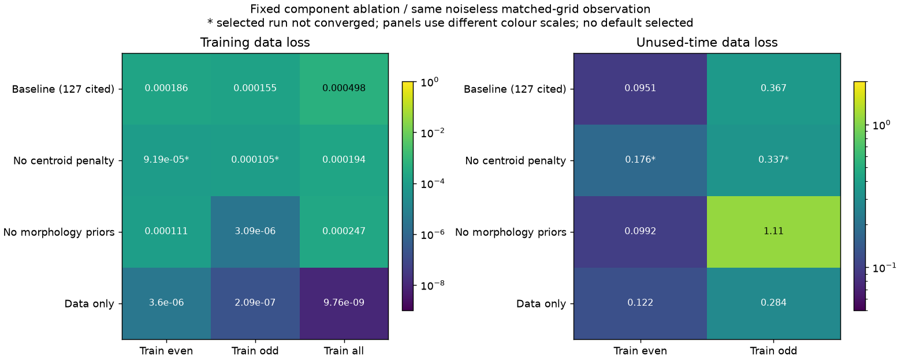

# 段階128：同じ無雑音データで画像罰則の成分を固定比較

- 作成日：2026-10-26
- 状態：完了
- 比較元コミット：d92ff7aad7d464fc42ffc5e82618473b8366973f（127）

## 読者向け概要

RMLはデータへの一致だけでなく、画像の好みも使って答えを決める。例えば、事前の形から大きく離れないこと、隣接画素が急変しないこと、表示中心から遠ざからないことに罰則を付ける。[127](127-matched-grid-image-control.md)では、同じ格子で表現できる無雑音の正解でも、この罰則を含む目的関数ではfit画像より不利だった。

今回は同じデータ・分割・初期値の式を保ち、罰則の成分だけを事前に決めた組合せで変更した。画像罰則を全て外し、全8時刻を使う条件では、正解形状をNRMSE約0.000318まで再現した。一方、半分の時刻だけを使うと未使用時刻で残差が残り、罰則の変更も一律には改善につながらなかった。無正則化を既定値へ採用したわけではない。

## 1. 目的・対象範囲

127の生成天空・8格子・人工SNR weightをそのまま使った。元入力6ファイル（control、truth8、embedded truth、3学習archive）のSHAを公開127へ照合し、再生成・再相関しない。

次の3設定を事前固定し、各設定で偶数/奇数/全時刻の3fit、各3初期値を実行した。新しい9fit・27探索であり、既定の3fitは127からの引用である。

| 設定 | entropy | TSV | centroid |
| --- | ---: | ---: | ---: |
| 既定（127引用） | 0.01 | 0.0001 | 0.1 |
| 中心罰則なし | 0.01 | 0.0001 | 0 |
| 形状罰則なし | 0 | 0 | 0.1 |
| 画像罰則なし | 0 | 0 | 0 |

Gaussian初期prior240秒角、8格子・64秒角、SNR10、seed21、3初期値、warmup最大300・最終最大2000反復と既存optimizerを固定した。生成truthや未使用値で良い係数を選ぶ探索ではない。既定32格子・ソフトの既定値、GUI、Windows収録は変更しない。

## 2. 完了条件

各設定で実RMLの画像と同じ係数の公開115目的関数が一致すること、初期priorと乱数摂動の参照配列が設定間で同じことを確認する。9fitの全探索状態と、学習/未使用/全時刻に対するfit/prior/oracle8の81評価を残す。画像が返ったことと数値収束を分け、空の未使用集合を0点へ置き換えない。

導入済み実RML CLI9件との全科学JSON・画像・初期reference・FITS数値/WCS/checksum・読込先・非上書きを確認する。原本/既存package不変、対象試験・実collect、レポート/索引/公開監査・匿名commit/pushを行う。

## 3. 実際の変更と評価方法

`workflows/regularizer_image_validation.py`、実小規模RMLを使う4試験、checkout外の導入CLI用検証toolを追加した。原本127の学習archiveをそのまま使うため、係数間で信号値・幾何・weightは同じである。未使用信号や生成truthをfitterへ渡さない126の最小学習入力も保持した。

初期referenceは、変えていないconstructorのpriorと、`log(prior)`にseed21の固定摂動を加える式から計算した。各設定のprior・初期parameter・規格化画像が同じであることを確認した。これはoptimizer呼出を捕捉したtraceではなく、既存の初期化式に基づく参照配列である。

各runは自身のtraining目的関数で選択し、未使用データや正解で選び直さない。データ損失は`D = Σz² / (2N)`で、同じ共有誤差共分散と位相wrapを使う。各設定の公開APIでentropy/TSV/centroidと総Fも分解し、実optimizerのsummaryと照合した。

「画像罰則なし」はunit-flux画像のFがデータ項だけになる条件である。optimizerのパラメータ総和を固定するpenaltyは既存実装のまま残し、公開画像Fとの比較では分けている。各設定でFの値や尺度が変わり、相対停止基準の働きも変わりうるため、数学的な大域最適解だけの比較とはしない。

## 4. 検証条件・結果

### 学習・未使用・形状を分ける

全て同じ127の生成truthに対する値である。NRMSEは共通110秒角、全支持領域、平行移動のみで評価する。小さいほど形状が近いが、実測のfluxや絶対位置を較正したものではない。

| 設定 | 学習集合 | 学習D | 未使用D | 形状NRMSE | 選択run |
| --- | --- | ---: | ---: | ---: | --- |
| 既定（127引用） | 偶数4時刻 | 0.000185984972 | 0.0950519254 | 0.0943456032 | 収束 |
| 既定（127引用） | 奇数4時刻 | 0.000154953824 | 0.366918418 | 0.0871232113 | 収束 |
| 既定（127引用） | 全8時刻 | 0.000497576398 | —（集合なし） | 0.040634041 | 収束 |
| 中心罰則なし | 偶数4時刻 | 9.18903295e-05 | 0.176315006 | 0.116357813 | 未収束 |
| 中心罰則なし | 奇数4時刻 | 0.000105273912 | 0.336929092 | 0.092537964 | 未収束 |
| 中心罰則なし | 全8時刻 | 0.000193643917 | —（集合なし） | 0.0387631675 | 収束 |
| 形状罰則なし | 偶数4時刻 | 0.000110944291 | 0.0992352074 | 0.0435349209 | 収束 |
| 形状罰則なし | 奇数4時刻 | 3.09423317e-06 | 1.11199372 | 0.126944768 | 収束 |
| 形状罰則なし | 全8時刻 | 0.000246949172 | —（集合なし） | 0.0231160599 | 収束 |
| 画像罰則なし | 偶数4時刻 | 3.60221003e-06 | 0.122405056 | 0.0700582406 | 収束 |
| 画像罰則なし | 奇数4時刻 | 2.08825086e-07 | 0.284028882 | 0.0664690056 | 収束 |
| 画像罰則なし | 全8時刻 | 9.76183504e-09 | —（集合なし） | 0.000317857687 | 収束 |

図の星印は選択run未収束。左右は色scaleが違い、色を直接比べない。既定行は127の引用で、新しくfitした条件へ加算していない。

全8時刻・画像罰則なしでは、D約9.76e-9、NRMSE約0.000318になった。同格子で表現でき、無雑音で、既知受信機仮定を使ったこの一例では、元のRMLが正解に近い形へ到達できたことを確認した。無雑音の正解に対する罰則の好みが結果に影響する材料になったが、実機データに対して罰則を外せばよいという根拠ではない。

偶数/奇数の半分だけを使うと、画像罰則なしでも未使用Dは約0.1224/0.2840だった。形状罰則なしの奇数学習では、学習Dは約3.09e-6まで小さくなった一方、未使用Dは約1.112で、既定の約0.367より大きかった。学習データへの良い適合だけで予測を保証しない。

中心罰則なしの2分割は未収束だった。その未使用Dや形状を最適解の性能と扱わない。新9件の選択runは7収束・2未収束、全27探索では20収束だった。未収束の探索を捨てて選び直していない。

### 同じ設定の目的関数を分解する

下表は全8時刻fitに対するown設定の値である。係数が違うため、総Fの大小を法の優劣の順位へ変換しない。各項を確認するための内訳である。

| 設定 | データ損失 | entropy | TSV | centroid |
| --- | ---: | ---: | ---: | ---: |
| 既定（127引用） | 0.0004975764 | 0.0017313302 | 0.00023649729 | 0.00043073635 |
| 中心罰則なし | 0.00019364392 | 0.0018251342 | 0.00023235446 | 0 |
| 形状罰則なし | 0.00024694917 | 0 | 0 | 0.00055840628 |
| 画像罰則なし | 9.7618351e-09 | 0 | 0 | 0 |

centroidは表示中心の弱い条件で、真の天体位置を測るものではない。oracleを固定座標に置いたFは、全並進同値類で最小化した値ではない。今回の結果から、位置gauge・形状罰則・局所解の寄与を単一に断定しない。

### 実装・再現性

新4と既存89を合わせ、ソース版93試験/1.62秒、導入済み93試験/1.59秒が成功、除外0。両2243は収集のみで全2243は未実行。科学package不変のため、最新全回帰121の両2116成功（609.28/607.50秒、各27396既存警告、除外0）を引用する。

新9fitが全て画像を返し、事前に規定した数値零による失敗は0件だった。ソース/導入済み実CLI9件の全科学JSON、54配列、初期reference9archiveのbyte、9画像とembeddingが完全一致した。各自の係数で公開115 APIと実summaryのデータ項・unit-flux Fを照合し、optimizerの総和penaltyを混ぜていない。

FITS数値/WCS/checksum9件、非上書き9件、入力6SHA不変、37 project moduleのsource正確ディレクトリ/導入prefix、両図画素も確認した。CLIはcheckout外・runnerなし・PYTHONPATHを外した環境で実行した。同じ条件の再現確認であり、新しい独立観測や雑音試行を18件得たわけではない。

凍結424ファイル、既存core/package 215ファイルと通常環境pip freezeは不変。既存121 wheel103ファイルと4 assetをソース/導入先へbyte照合し、新wheel・GUIブラウザ・全2243は再実行していない。公開監査指摘0、文書リンク1669件で欠落0。

[正式記録](../../validation/runs/stage128/README.md)に全探索・81評価・セル数値・画像・入力/初期reference/画像SHAを保存し、大きな中間JSONと入力はGit管理外で保持した。

## 5. 制約・未解決事項

同じ無雑音の量子化天空と、既存観測から借りた人工SNR・weightを使った一組の条件付き比較である。元のfine32 Cas A形状や、雑音のある模擬電圧由来の相関とは同じ条件ではない。完全に未知の観測に対する係数選択・モデル選択・成功率の検証でもない。

現在の高SNR近似によるχ²型損失から、p値、誤差coverage、低SNR画像尤度を計算していない。相対F停止の効果、局所解、有限初期値、位置gaugeを含み、無正則化が普遍的によいとも、正則化が不要とも結論しない。

実RTL-SDR/OCXOのCas A、弱い実信号の未知LO/振幅/SEFD、実SEFD・FFT独立性、全夜/GPU性能は未検証。Windows収録は引き続き除外する。

## 6. 次段階

同じ固定した係数条件を、118の模擬電圧から得た推定LO/真値LO/理想モデルの保存相関へ移送して確認する候補とする。今回truthを見て最もよい条件を自動採用せず、全ての事前固定条件・収束/未収束・形状とデータ残差を残す。主32格子や実受信機への推奨を出す根拠はまだない。

130の全体文書整理では、127/128の無雑音・同格子の到達と、主経路・低SNR・実機の未完を分けて反映する。150の根本見直しと、外部RML追加反復の保留を維持する。
