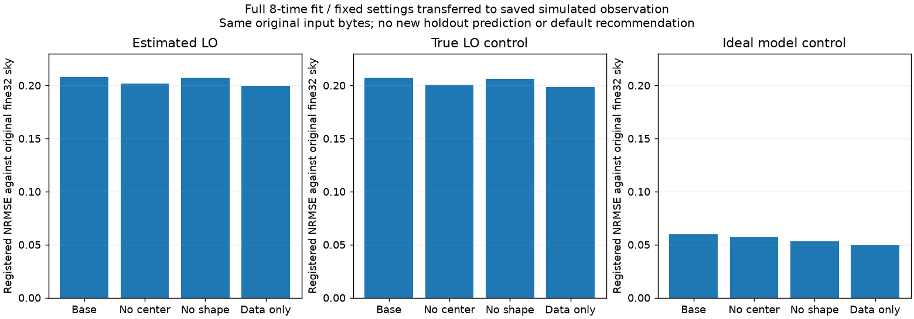

# 段階129：模擬電圧由来の相関へ固定罰則条件を移送

- 作成日：2026-10-26
- 状態：完了
- 比較元コミット：46f44b83cc9f3345bbfe838746428de69cfd2a95（128）

## 読者向け概要

[128](128-regularizer-image-controls.md)では、生成天空と復元格子が同じ無雑音例で、画像罰則を外すと正解形状へ近づいた。しかし、本来の目標は電圧を相関して得たデータから画像を作ることである。今回は係数を選び直さず、同じ三つの設定を、保存済みの模擬電圧由来の相関と評価用の真値LO/理想対照へ全て移した。

新9件は全て数値収束した。推定LO枝の形状NRMSEは既定の約0.208に対し、画像罰則なしで約0.200だった。無雑音・整合格子の約0.000318という128の到達を、そのまま主経路へ移せたわけではない。既定値は変更せず、画像への到達・数値収束・データ適合・正しい形との違いを引き続き分ける。

## 1. 目的・対象範囲

128で事前固定した三つの設定を、次の3枝へ全時刻で適用した。

- 推定LO：模擬電圧から局ごとの周波数差を推定して相関した保存データ。
- 真値LO対照：同じ模擬電圧へ生成時の周波数差を与えて相関した評価専用データ。
- 理想モデル対照：元のfine32天空からvisibilityを作り、人工的なSNR weightを持たせたデータ。

前2枝は実機で観測したものではない。真値LOや理想モデルを与える対照を、未知観測の成功と混同しない。

入力は126の各枝の`all_training/training.npz`を公開SHAへ照合してそのまま使った。共通有効基線283セル・210Closure行・全8時刻の最小学習入力で、元の電圧再生成・再相関はしていない。正解は118の32格子・16秒角、fitterは8格子・64秒角である。

## 2. 完了条件

固定三設定×三枝の9fit、各3初期値を実行し、正解や未使用値で設定・runを選び直さない。126の既定3fitは引用し、新しいfitへ加算しない。全8時刻を学習に使うため、未使用集合は空であり、新しい予測性能は測らない。

ソース版とcheckout外の導入済みRML CLI9件の全科学JSON・画像・FITS数値/WCS/checksum・初期reference・読込先・非上書き・入力SHAを照合する。元のfine32正解のデータ残差を125の値へ照合し、格子が違う正解の罰則をfit8のF比較に流用しない。既存core/env不変、対象試験・実collect、文書・監査・匿名公開までを完了条件とした。

## 3. 実際の変更と評価方法

`workflows/main_path_regularizer_validation.py`と`tools/verify_main_path_regularizer_installed.py`を追加した。既存のRML・目的関数API・画像評価を使い、数値solverは変更していない。

| 設定 | entropy | TSV | centroid |
| --- | ---: | ---: | ---: |
| 既定（126引用） | 0.01 | 0.0001 | 0.1 |
| 中心罰則なし | 0.01 | 0.0001 | 0 |
| 形状罰則なし | 0 | 0 | 0.1 |
| 画像罰則なし | 0 | 0 | 0 |

Gaussian初期prior240秒角、seed21、3初期値、SNR10、既存warmup最大300・最終最大2000反復を固定した。初期referenceのconstructor/prior/乱数式は係数間で一致した。optimizerのtraceを捕捉したという意味ではない。

truth配列は全9fitが終わってから後評価へ読んだ。128の同じ8格子oracleとは違い、今回は元の生成天空がfine32である。8格子へ集約した画像は`quantized_reference8`と呼び、生成正解や厳密oracleとは呼ばない。元fine32正解のデータ残差を別計算し、罰則や総Fは8格子fitとの順位付けに使わない。

画像差は共通110秒角・全支持領域・平行移動だけのNRMSEで測った。データ損失は共有共分散を含む`D = Σz² / (2N)`、各自の係数のunit-flux Fはoptimizerのパラメータ総和penaltyと分けて照合した。

## 4. 検証条件・結果

### 全時刻のfit結果

| 枝 | 設定 | 全時刻のD | 形状NRMSE | 選択run |
| --- | --- | ---: | ---: | --- |
| 推定LO | 既定（126引用） | 0.354413217 | 0.207903234 | 収束 |
| 推定LO | 中心罰則なし | 0.354150474 | 0.201526128 | 収束 |
| 推定LO | 形状罰則なし | 0.354305913 | 0.207106834 | 収束 |
| 推定LO | 画像罰則なし | 0.35410863 | 0.199676327 | 収束 |
| 真値LO対照 | 既定（126引用） | 0.354521169 | 0.207092664 | 収束 |
| 真値LO対照 | 中心罰則なし | 0.354249096 | 0.200645624 | 収束 |
| 真値LO対照 | 形状罰則なし | 0.354405723 | 0.206198231 | 収束 |
| 真値LO対照 | 画像罰則なし | 0.354203259 | 0.198635752 | 収束 |
| 理想モデル対照 | 既定（126引用） | 0.0013063513 | 0.0598257543 | 収束 |
| 理想モデル対照 | 中心罰則なし | 0.00105095791 | 0.057147332 | 収束 |
| 理想モデル対照 | 形状罰則なし | 0.00108656172 | 0.0533554158 | 収束 |
| 理想モデル対照 | 画像罰則なし | 0.000969480669 | 0.0498729103 | 収束 |

新しい9選択run、全27探索が全て収束した。画像を返せない数値零の失敗は0件だった。結果を見て条件を除外したり選択runを変えたりしていない。

推定LO枝のDはどの設定でも約0.354、NRMSEは約0.200〜0.207だった。既定の約0.208からの変化は、この有限データでは小さかった。真値LO枝は約0.199〜0.206で、各設定では推定LOよりわずかに小さい形状差になった。この差だけでLOが主な画像誤差の原因だとは判断せず、条件の違う弱信号のLO問題は未解決として残す。

理想モデル枝でも、画像罰則なしのNRMSEは約0.0499であり、128の整合格子・無雑音例の約0.000318とは条件が違う。元のfine32天空とfitter8の表現力、観測する空間周波数、近似誤差、局所解・有限初期値などを含む。変化を一つの原因だけに帰属させない。

### 生成正解と量子化参照を分ける

元fine32正解のDは、推定LO約0.55425116、真値LO約0.55437911、理想モデル約3.53e-29で、125の共通基線の値と完全一致した。三つの係数条件によってデータ項そのものが変わらないことも確認した。χ²型の値をp値や誤差coverageに読み替えていない。

一方、8格子へ最近傍で集約した参照のDは約1.70034/1.70104/1.18256だった。点を移した参照は元の生成天空とは違うため、正解画像なのにfitより悪いと解釈しない。fitter8は量子化画像と同じ分布になる義務はなく、visibilityを説明するよう画素fluxを配分する。fine32の罰則とfit8のFも直接順位付けしない。

全時刻を使ったため、今回の未使用集合は空でnullである。これらの小さいDやNRMSEを、新しい未使用時刻の予測・未知観測の性能・成功率として扱わない。

### 実装と導入済み照合

既存のsource93試験/2.50秒、導入済み93試験/1.66秒が成功、除外0。新unit/APIは追加せず、実CLI・既存公開目的関数との照合を主検証とした。両2243は収集のみで全2243は未実行。科学package不変のため、最新全回帰121の両2116成功（609.28/607.50秒、各27396既存警告、除外0）を引用する。

実source9fitと導入CLI9件で、全科学JSON・54配列・初期reference9archiveのbyte・画像とembeddingが完全一致した。初期referenceは同じ式から作られ、同じ入力archiveを使用した。FITS数値/WCS/checksum9件、同じ出力先の再実行拒否9件、入力4SHA不変、37 project moduleの正確なsourceディレクトリ/導入prefix、図画素も確認した。CLIはcheckout外・runnerなし・PYTHONPATHを外した環境で実行した。

記録を組み立てるスクリプトは初回、検証helperをimportする検索pathが不足して停止した。リポジトリrootをその記録スクリプトへ明示し、派生記録を作り直した。実装・試験・全fitは変更せず、再相関や再fitの成功件数へ加えていない。

凍結426ファイル、既存core/package 215ファイルと通常環境pip freezeは不変。既存121 wheel103ファイルと4 assetをソース/導入先へbyte照合し、新wheel・GUIブラウザ・全2243は再実行していない。公開監査指摘0、文書リンク1679件で欠落0。

[正式記録](../../validation/runs/stage129/README.md)に全条件・探索・残差・画像・入力/初期reference/画像SHAを保存した。詳細な中間JSONと原本はGit管理外で保持した。

## 5. 制約・未解決事項

同じ一組の模擬電圧と保存相関から得た条件付き比較である。共通maskと上流のLO/weight取得を共有しうる。独立したraw・雑音反復・実RTL-SDRの観測ではない。今回のfitは全時刻を使用し、新しいholdout評価もしていない。

候補を全て固定して比較した結果であり、truthが良かった設定を未知データ向けの推奨値へ採用していない。主32格子・別天空・別SNR・実装置へ一般化する根拠もない。高SNR近似と固定weightに基づき、低SNR画像尤度、p値、coverageを確立していない。

実機Cas A、弱い実信号の未知LO/振幅/SEFD、実SEFD・FFT独立性、全夜/GPU性能は未検証。Windows収録は引き続き除外する。

## 6. 次段階

次130は必須の全体文書整理を行う。121の日本語GUI、122〜124の外部RML接続と保留、125の残差、126の条件付き時刻分割、127/128の同格子・無雑音対照、129の主経路への移送を一つの開発の流れへまとめる。実装/模擬/実機、処理完了/収束/適合/予測/形状を分け、次の主経路の受入条件を更新する。

既定値は維持し、短積分・未知LO・弱い画像データへ戻る際も、独立な生成データと真値供給の範囲を明示する。150の根本見直し、外部RMLの追加反復とtruthを見た調整の保留を継続する。
