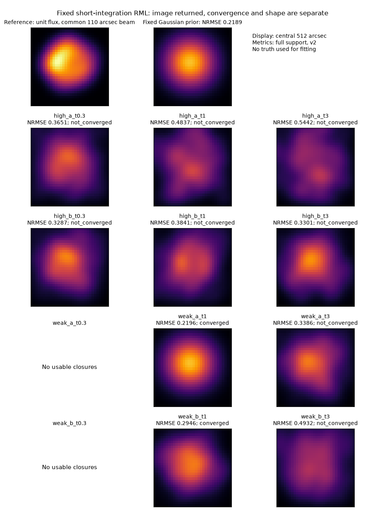

# 段階133：短積分の相関から既定格子の相対画像を復元して評価

- 作成日：2026-10-27
- 状態：完了（処理・再現・形状の評価。実観測画像化の成功ではない）
- 比較元コミット：deb20bdb6398c25d412601395b13ca9c7538f2dd（132）

## 読者向け概要

132の保存相関12条件を、既存Closure＋RMLの画像経路へ渡した。RMLはデータへの適合と画像への事前の仮定を合わせて数値最適化する手法である。今回は格子も係数も先に固定し、真値を見て調整しなかった。

10条件で画像が返り、2条件は使えるClosureが無いため停止した。選択されたrunは2件が数値収束、8件が2,000反復の上限に達した。共通の110秒角に平滑化して参照形状と比較すると、10画像すべてが固定Gaussian priorより誤差が大きかった。処理が最後まで動くこと、最適化が収束すること、形が正しいことは別である。

## 1. 目的・対象範囲

1.42GHz・最大600m・局ごとの周波数差・短積分という主経路の、相関から画像までを確認する。131の独立seedの原本4件を132で未知LO取得し、0.3・1・3秒で補正相関したデータを使う。原本の再生成や新しい相関は行わない。

今回の4原本は単一時刻付近の観測で、地球自転による8時刻のuv合成ではない。画像に使う観測点も制約も限られる。既存の高SNR近似と局所探索を変更せず、何が出力され、どの制約が不足しているかを記録する。

## 2. 完了条件

事前固定は32×32画素、1画素16秒角、Gaussian priorの半値全幅240秒角、SNR閾値10、entropy=.01、TSV=.0001、centroid=.1、seed21、3初期値、最終2,000反復である。既存の円周位相によるwarmup（最大300）からwrapped位相の最終探索へ進む二段階を使う。truthで格子・係数・runを選ばない。

全12条件を処理し、制約不足だけを既知の停止理由として残す。sourceとcheckout外の導入済みCLIの科学JSON、画像・FITS・表示画素、元入力の不変性、非上書き、module prefixを検査する。全fitの後で真値を読み、収束・形状・目的関数を分離して評価する。対象試験、レポートと索引、公開監査・匿名commit/pushまでを完了条件とした。

## 3. 実際に行った作業

`workflows/short_integration_images.py`に保存相関の識別・画像実行・事後評価を追加した。元相関の7科学配列（visibility、weight、基線pair、uvw、時刻、周波数、積分秒）をそのままコピーし、表示座標と単位だけのmetadataでfitter入力を作った。元観測のclock・LO・SEFD・生成天空の情報は画像化側へ渡さない。元配列はdtype・shape・SHAを確認し、132の公開記録とも照合した。

sourceは既存RML CLI→公開API、導入版はcheckout外からpython -mの既存RML CLIを実行した。外側の検証helperはcheckoutを使い、新しいwheel-only製品機能として導入したものではない。実際のsolver、既定格子、係数、production package、GUIは変更していない。

3初期値のrun選択は既存の学習objective最小という規則を使う。数値収束したrunだけを事後に選び直す処理は加えていない。このため、ある初期値が収束していても、より小さいobjectiveの未収束runが選ばれる場合がある。処理と収束の判定は109の公開assessment APIで分けた。

## 4. 検証条件・結果

### 全12条件

| 条件 | 画像処理 | 選択runの数値状態 | 独立位相/振幅制約 | データ損失D | 参照形状との差NRMSE |
| --- | --- | --- | ---: | ---: | ---: |
| high_a_t0.3 | 画像あり | not_converged | 43/40 | 0.19847582 | 0.365135 |
| high_a_t1 | 画像あり | not_converged | 53/50 | 0.23679755 | 0.483693 |
| high_a_t3 | 画像あり | not_converged | 61/58 | 0.2956147 | 0.544223 |
| high_b_t0.3 | 画像あり | not_converged | 42/39 | 0.098475422 | 0.328746 |
| high_b_t1 | 画像あり | not_converged | 54/51 | 0.22530893 | 0.384056 |
| high_b_t3 | 画像あり | not_converged | 61/58 | 0.21733464 | 0.330070 |
| weak_a_t0.3 | 制約不足 | not_run | — | — | — |
| weak_a_t1 | 画像あり | converged | 4/0 | 5.6612402e-09 | 0.219563 |
| weak_a_t3 | 画像あり | not_converged | 20/15 | 0.21001511 | 0.338636 |
| weak_b_t0.3 | 制約不足 | not_run | — | — | — |
| weak_b_t1 | 画像あり | converged | 3/0 | 0.083123739 | 0.294641 |
| weak_b_t3 | 画像あり | not_converged | 19/13 | 0.13333255 | 0.493203 |

NRMSEは小さいほど参照形状に近い。比較は既存v2の全支持領域、unit flux、共通110秒角、平行移動を含む指標で、画像の位置や絶対fluxを測ったことにはならない。同じGaussian priorのNRMSEは0.2188727である。今回の10画像は全てこれを上回った。真値は全fitとrun選択が終わった後だけに読んだ。

図はAPIが返す中央512秒角の表示で、評価値は全支持領域から計算している。共通の色範囲・110秒角平滑化で示した。白い制約不足欄を0画像として比較していない。

### 収束・適合・形状の違い

10画像×3初期値＝30探索のうち、9探索は数値収束した。しかし選択runとして収束したのは2画像で、残り8画像は最終2,000反復の上限である。未収束runを除外せず、全runの状態を保存した。事前に固定した反復上限を結果後に延ばしていない。

Dは近似的なClosure chi-squareを独立制約数の2倍で割ったデータ損失である。低感度1秒のweak_aは位相制約4・振幅0で、Dは約5.66e-9まで小さくなったが、形状はpriorより良くなっていない。データへの適合が良いことだけで、未知の形状が特定できたとは判断できない。

unit fluxのfitted/prior/truthの目的分解は115公開APIで別に評価し、fitのdata_lossと制約countを照合した。最適化パラメータの総和penaltyを含むFと、単位flux画像のFは区別し、全Fを無条件に同じ値と見なしていない。事前の許容値rtol1e-7/atol1e-8以内でデータ損失が一致した。ここからp値、画像確率、coverageを算出していない。

### 再現・試験・入力保持

正式対象87試験（新7＋既存80）はsource2.58秒、導入2.49秒で成功し、警告0・除外0だった。新試験は科学配列を保持したmetadataの情報分離、生成天空混入の拒否、学習objectiveによる選択、非有限/不正な選択の拒否を確認した。両2270は収集のみで、全2270は実行していない。

source/導入の12条件の全科学JSON、10画像のNPY/FITS数値・WCS/checksum、PNG画素が一致した。12のfitter archiveもbyte一致した。直接比較は数値126配列欄（schema、7科学配列、画像/FITS/PNGを含む）とmetadata_json文字列12欄で、文字列を数値配列へ加算していない。元原本76SHA、保存相関12SHA、真値4SHAを保持した。成功した10 RML出力とstudy全体について既存出力を拒否し、file SHAを保持した。無制約の2件にはRML出力dirを作らない。

最初の検証記録では数値配列数へmetadata_json文字列12個を含めていた。全処理の終了を待ち、検証toolの集計だけを修正した。科学計算・source helper・試験は変更せず再凍結し、両87対象・source全12条件・native全12条件を正式に再実行した。全科学JSONは初回と完全一致し、初回の試験/探索を正式件数へ加算していない。

凍結435file、旧core/package215file、121wheel103file＋4asset、環境pip freezeは不変。sourceの正確なmodule位置と導入側15 moduleのprefixを確認した。新wheel・ブラウザ・全回帰は再実行せず、全回帰121の両2116成功（609.28/607.50秒、各27396既存警告、除外0）を引用する。通常GUIは導入済み121のまま維持した。

実行は各所有CLI300秒・各環境1,800秒、出力64MiB/環境の上限内だった。[実行計測](../../validation/runs/stage133/measurements.json)は有限CPU処理の記録で、実受信機・全夜・GPUのbenchmarkではない。[全科学記録](../../validation/runs/stage133/reference.json)と[検証集計](../../validation/runs/stage133/verification.json)に詳細を置いた。

公開監査指摘0、文書リンク1732件で欠落0。

## 5. 制約・未解決事項

画像の誤差がpriorより大きい原因を一つに断定しない。単一時刻のuv被覆、非収束、既存高SNR/基線独立近似、source self-noise、正則化、有限標本と前方モデルの差などを切り分ける必要がある。この固定結果は、この手法一般の不可能性や実機の感度限界の証明ではない。

4原本の生成seedはnoise/gain/LOを同時に変える。pilotと最終積分も重なり、12独立観測や完全blindの成功率試験ではない。Cas A flux/SEFDは仮定、clock/decoder scaleは正確な供給値、gain/LOは区間内一定、生成天空も既存の代理モデルである。

未知の実RTL-SDR/OCXO Cas A画像化、弱実信号のLO/gain、実SEFD、実FFT独立性、低SNR画像尤度、全夜/GPU性能は未検証。Windows収録は対象外を維持する。

## 6. 次段階

134候補では主経路の前方モデル・weight/covariance・保存データの契約を先に整理する。反復回数の追加、truthを見た係数/格子の調整、外部RML追加探索は保留する。現在の保存量が何の尤度を支え、何が不足しているかを一次コードと原本識別から確認してから新実装を選ぶ。三角形別や局別の異なる標本から全局共分散を捏造しない。

今回は定期文書整理や150の根本見直しを代行していない。次の文書整理140・根本見直し150・2026-11-06 15時の期限を維持する。
