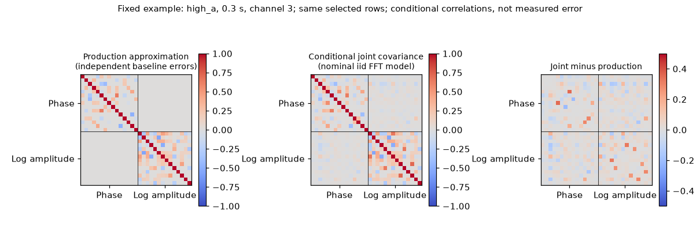

# 段階135：保存相関を条件付きの全雑音診断へ接続する

- 作成日：2026-10-27
- 状態：完了（名目IID Gaussian条件付き診断。実誤差・画像改善の検証ではない）
- 比較元コミット：13c93f86a8363d629a08e64ec6efd8a7dbe86393（134）

## 読者向け概要

134で整理した既存APIを、132の保存相関へ実際に接続した。4原本×3積分時間×8周波数、全96セルを処理し、36セルで条件付きの雑音推定、60セルは0重みのためinactiveとなった。

同じ有効行・同じ基底で比べると、高感度仮定の位相Closure分散は、現行近似に対し約0.51〜1.10の比をとった。phaseとlog amplitudeの間にも最大約0.259の相関が計算された。しかし、これは名目FFT件数をIIDと仮定した条件付きモデル同士の比較であり、実際の誤差を測った結果ではない。RMLの重み・画像・採否は変更していない。

## 1. 目的・対象範囲

現行RMLは独立円対称の基線誤差を出発点にする。一方、既存042/044/046/047には全基線のRe/Im共分散、phase/logampの同時伝播、標本からの条件付き推定がある。これらを現在の短積分データへ接続し、何が計算でき、どの仮定が残るかを確認する。

既存の12相関を使い、原本生成・再相関・fit・新しい統計API・GUIは対象に含めない。真値画像の数値を使わず、原本と真値fileは識別のためのSHAだけを照合する。

## 2. 完了条件

全96セルのinactive/unverified/conditionalを残す。ソース版の既存diagnose_noise_file APIと、checkout外の導入済みnative CLIで全JSONを照合する。比較ではSNR10と同じ有効行・productionのQR基底を使い、047既定SNR5との違いを明示する。

全科学JSON・配列実値・非上書き・prefix・原本保持・既存package不変、対象試験、レポート/索引・公開監査・匿名commit/pushまでを完了条件とした。空の制約や無効セルを分散0の測定に置換しない。

## 3. 実際に行った作業

`workflows/saved_noise_contract_validation.py`に固定入力の照合、既存API/CLIの一括実行、比較用の行と共分散の抽出を追加した。`tools/verify_saved_noise_contract_installed.py`で導入版を再実行し、全JSONと保存配列を直接比較した。外側のhelperはcheckoutを使用し、wheel-onlyの新製品機能ではない。

条件付き診断が利用できる場合は、その全visibility実共分散を既存joint_closure_noiseへ渡し、min_snr=10を指定する。production側のform_closuresも10とし、両者で有効な行から既存のQR選択で同じ独立基底を作る。productionのphase/logampのblock行列と、joint共分散の同じ行を比較した。逆行列、chi-square、p値、信頼区間は計算していない。

基線の雑音が独立でも、同じ基線を使うClosure同士の誤差は関係する。productionにもこの共有基線分の非対角項はある。今回の比較は、それ以前の基線誤差の仮定と、phase/logampの交差項まで含む行列との差を調べたもの。「productionのClosure共分散が全部対角」という意味ではない。

## 4. 検証条件・結果

### 全セルの状態と選択規則

| 対象 | 件数 | 意味 |
| --- | ---: | --- |
| 診断conditional_estimate | 36 | 各相関のchannel3,4,5。名目IID・一定proper Gaussianを仮定した推定 |
| 診断inactive | 60 | 正の基線weightがない。推定値や誤差0とはしない |
| 同じ基底で共分散を比較 | 30 | 共通の独立制約が残るセル |
| 条件付き診断は得たがSNR10の共通制約なし | 6 | 弱い2原本の0.3秒、各3セル。rank0・比較metrics=null |

全36条件付きセルで、SNR10の有効基線集合はproductionと一致した。各条件の位相/振幅rank合計も132の記録と一致した。047内部の既定SNR5の結果を、そのままSNR10の画像制約数と数えていない。

| 条件 | 共通位相/振幅rank | 位相分散比joint/production | 振幅分散比joint/production | phase/logamp相関の最大絶対値 |
| --- | ---: | ---: | ---: | ---: |
| high_a_t0.3 | 43/40 | 0.5073〜1.1006 | 0.8931〜1.0563 | 0.2067 |
| high_a_t1 | 53/50 | 0.5085〜1.1031 | 0.8893〜1.0804 | 0.2190 |
| high_a_t3 | 61/58 | 0.5083〜1.1015 | 0.8908〜1.0856 | 0.2278 |
| high_b_t0.3 | 42/39 | 0.5074〜1.1025 | 0.8924〜1.0572 | 0.1982 |
| high_b_t1 | 54/51 | 0.5087〜1.1014 | 0.8866〜1.0836 | 0.2586 |
| high_b_t3 | 61/58 | 0.5086〜1.1006 | 0.8871〜1.0833 | 0.2271 |
| weak_a_t0.3 | 0/0 | — | — | — |
| weak_a_t1 | 4/0 | 0.9076〜0.9690 | — | — |
| weak_a_t3 | 20/15 | 0.9076〜1.0152 | 0.9792〜1.0105 | 0.0312 |
| weak_b_t0.3 | 0/0 | — | — | — |
| weak_b_t1 | 3/0 | 0.9091〜0.9108 | — | — |
| weak_b_t3 | 19/13 | 0.9079〜1.0170 | 0.9915〜1.0099 | 0.0265 |

比は同じ行・同じ単位の対角分散どうしを比較し、相関係数は各共分散を自身の対角で規格化した値である。振幅制約がない場合、交差相関を0とせずnullにした。表は3周波数セルの範囲/最大を集計したもので、独立な観測試行の分布や信頼区間ではない。

図は事前に固定した最初の原本high_a・0.3秒・channel3だけの例。線はphase/logampの境界で、両側の行・列は同じ。左にも共有基線による相関があり、中央ではその構造とphase/logamp交差も変わる。画像誤差の改善や実測noiseを示した図ではない。

### 実際の診断APIと保存情報

APIの数値範囲/PSD判定まで通った36セルを記録した。Mは0.3/1/3秒で76800/256000/768000の名目FFT数である。FIR/補間、色付き入力、量子化、時変係数のため、実際に独立な標本数とは確認していない。APIのiid_fft_independence_verified、covariance_confidence_calibrated、production_rml_noise_model_changedはfalseを保持した。

同じvisibilityでも、power/count/flagを除いた133のfitter入力の固定1セルは、既存APIでunverified・missing_station_power_flags_or_fft_countsとなった。完全な132相関へ戻る必要を実際の入口でも確認した。

### 再現・試験・不変性

正式91対象（新7＋既存84）はsource3.05秒、導入2.43秒で成功し、各640既存Baseband/NumPy警告、除外0。新試験は独立円対称モデルへの一致、電圧単位の換算、不正cell/単位の拒否、inactiveと空制約の意味を確認した。予備91を正式数へ加算していない。両2277は収集のみで全2277は実行していない。

source/導入の全96診断JSONがbyte一致、全科学JSONが一致した。96比較archiveの全keyと594数値/boolean配列を実値・dtype・shape・SHAで比較した。nativeは96診断CLIと96出力拒否、sourceも96既存出力拒否、両study全体の非上書きを確認した。原本76・相関12・真値4SHAは保持した。

凍結438file、旧core/package215file、環境pip freeze、121wheel103file＋4assetは不変。sourceの正確な位置と導入10 moduleのprefixを検査し、native CLIはcheckout外・runner/PYTHONPATHなしで動かした。新wheel・ブラウザ・全回帰は実行せず、最新全回帰121の両2116成功（609.28/607.50秒、各27396既存警告、除外0）を引用する。通常GUIは導入済み121のまま。

詳細は[科学記録](../../validation/runs/stage135/reference.json)、[検証](../../validation/runs/stage135/verification.json)、[計測](../../validation/runs/stage135/measurements.json)を参照。大きな診断行列/JSONはGit外に保存し、公開記録には識別SHAと集計を残した。公開監査指摘0、文書リンク1765件で欠落0。

## 5. 制約・未解決事項

全共分散と従来モデルの差が計算できても、全共分散が現実の誤差と一致したとは限らない。046の不偏性は共通IID等を仮定して多数試行の平均を考えた性質で、一回の推定・Closure一次伝播・実confidenceの保証ではない。観測SNRで選別し、同じデータから推定していることも残る。

低感度0.3秒で比較制約が無い点は変わらない。大きいSNRでGaussian近似を採ったことも、低SNR画像尤度を解決したことにはならない。基線間/phase-logampの構造だけで133の形状誤差や未収束を一因に断定しない。

実RTL-SDR/OCXOのCas A画像化、実SEFD/beam、弱実信号LO/gain、実FFT独立性、全夜/GPUは未検証。Windows収録は後工程を維持する。

## 6. 次段階

136候補では、共分散をRMLへ自動適用する前に、既存049/051などで保存pilotの時間変化やfilterモデルの適用範囲を確認する。白色・固定kernel参照を131の色付き・時変処理へ無条件に移さず、実効Mを真値画像に合わせない。新しい同等APIやraw生成を増やす前に、既存部品と現在のデータをつなぐ最小条件を選ぶ。

文書整理140・根本見直し150、期限2026-11-06 15時、残量near10の休止・追加reset禁止を維持する。
