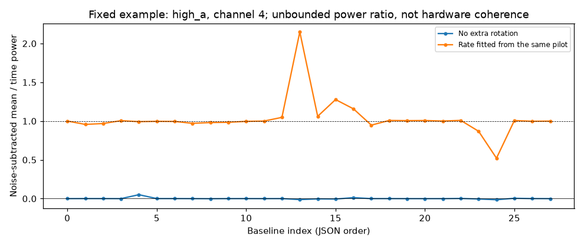

# 段階136：保存pilotの時間powerを条件付きで診断する

- 作成日：2026-10-27
- 状態：完了（既存051の保存データへの接続。実coherenceの測定ではない）
- 比較元コミット：eeead83099ae1c684fa028048db3976e605eccac（135）

## 読者向け概要

135では相関の一セル内の誤差モデルを比べた。今回は時間方向へ戻り、4ms×750個の3秒pilotで、相関の複素値がどれくらい時間平均に残るかを既存の診断APIで計算した。

4原本、3チャネル、回転なし/同pilotから推定したrateで回転あり、計24系列を処理した。全24系列は条件付きの診断を返したが、基線ごとでは672行のうち50行の比が未判定だった。有限な622個のpower比には174個の負値、148個の1超があり、範囲は約−0.748〜35.274だった。0〜1へ切り詰めず残した。これを振幅の保持率や実OCXOのcoherenceと呼ばない。

## 1. 目的・対象範囲

既存051のdiagnose_time_fileを132の保存pilotへ接続し、時間散乱とnoise差引powerの読み方を確認する。新しい数式・雑音API・filter係数モデルを作らず、既存049の色付き/時変処理への拡張が完了したとも扱わない。

131の原本再生成、再相関、画像fit、production RMLのweight/採否、GUIは変更しない。真値天空や真の局rateを使わず、観測から推定したprofileを渡す。

## 2. 完了条件と固定入力

4原本high_a/high_b/weak_a/weak_bの、132のt0.3 caseをcanonical pilotとする。最終1/3秒caseのpilotも全科学配列が同じことを確認し、同じ原本のpilotを重複した独立試行としない。

各原本のchannel3,4,5に対し、profileなし/同pilot推定profile付きの2方式を固定した。全24 JSONのsource/native照合、原本・pilot/profile SHA保持、非上書き、prefix、対象試験、レポート・索引・公開監査・匿名commit/pushまでを条件とした。比のnull・負・1超を削除しない。

## 3. 実際に行った作業

`workflows/saved_pilot_time_validation.py`に固定原本の識別とAPIの一括実行を追加し、`tools/verify_saved_pilot_time_installed.py`でcheckout外の既存native CLIを24回実行した。外側のhelperはcheckoutを必要とし、wheel-onlyの新製品機能ではない。

診断は、各時間cellの相関zと推定複素noise分散νから、時間powerと平均powerを計算する。

```text
Ptime = mean(|z_t|² − ν_t)
Pmean = |mean(z_t)|² − sum(ν_t)/T²
参考比 = Pmean / Ptime  （Ptime > 0のとき）
```

Tは750時間cell。profileを渡す場合、zをcell中央時刻の局rate差で回転する。**これは保存pilotの受動診断**であり、raw電圧をsampleごとに補正して再相関する処理とは別である。4ms cell内ですでに失われた平均振幅を回復しない。

power差引の基準式には、名目FFT/時間cellの独立性などの仮定がある。さらに今回のrateは同じpilotから推定しているため、回転をデータから独立に固定した場合の不偏性も、そのまま主張できない。powerの比が不偏である保証はなく、小さい正の分母から大きい値が生じ得る。

## 4. 検証条件・結果

### 条件別の全結果

各系列は28基線を含む。件数欄は未回転と推定回転の**二つの件数**で、成功率ではない。範囲は有限な比だけの最小〜最大であり、未判定行は全JSONに残す。

| 原本 | channel | 比あり基線数 未/推定回転 | 未回転のpower比範囲 | 推定回転のpower比範囲 |
| --- | ---: | ---: | ---: | ---: |
| high_a | 3 | 28 / 28 | -0.0085473〜0.047101 | 0.92122〜1.2983 |
| high_a | 4 | 28 / 28 | -0.014372〜0.050745 | 0.5216〜2.1496 |
| high_a | 5 | 28 / 28 | -0.010516〜0.048898 | 0.80074〜1.593 |
| high_b | 3 | 28 / 28 | -0.0056933〜0.0013544 | 0.6642〜1.3602 |
| high_b | 4 | 27 / 27 | -0.003579〜0.060599 | 0.83719〜1.5465 |
| high_b | 5 | 27 / 27 | -0.0057129〜0.0074532 | 0.80498〜1.2459 |
| weak_a | 3 | 24 / 24 | -0.18056〜0.032701 | 0.0088373〜16.179 |
| weak_a | 4 | 24 / 24 | -0.12686〜0.082509 | -0.065886〜35.274 |
| weak_a | 5 | 24 / 24 | -0.74813〜0.091506 | 0.26957〜7.7846 |
| weak_b | 3 | 25 / 25 | -0.27094〜0.44035 | 0.078827〜8.0254 |
| weak_b | 4 | 27 / 27 | -0.036763〜0.030556 | 0.08822〜2.1873 |
| weak_b | 5 | 21 / 21 | -0.087273〜0.038902 | 0.11594〜5.7585 |

全体は24系列の条件付き診断、672基線行のうち622有限・50未判定。原本も基線雑音も共有しており、672独立観測ではない。未判定は、差引後の時間signal powerが正でない/数値的に比を解決できない等の理由をAPIのstate/reasonで残す。



図は固定例high_aの中心channel4。回転後の値が1付近でも実測coherenceの保証ではなく、1を超える点も隠していない。波形の位相が揃う効果と、差引noiseや同データのprofile推定による影響を分ける必要がある。weak_a/channel4の最大約35も、信号が物理的に35倍保存されたという意味ではない。

### 接続と入力保持

12個の保存pilotを公開132の全数値識別と照合し、同じ原本の3pilotが等しいことを確認した。解析に使うcanonical4個と、推定rate profile4個の対応を検査し、profileのinput_shaも一致した。全12pilot/4profileと原本76SHAを保持した。

最終相関の固定1セルは時間軸が1個なので、実APIでunverified・time_cell_count_outside_32_to_8192となった。長い積分の一つの相関値だけを、時間散乱を測った系列として扱わない。

全24診断JSONはsource/導入でbyte一致し、全科学JSONも一致した。native24 CLIと24出力拒否、source24出力拒否、両study全体の非上書きを確認した。hardware_coherence_measured、FFT/timecell independence、profile_fit_dependence_calibrated、confidence interval、production_rml_noise_model_changed等は未校正/falseを保持した。

### 対象試験と変更範囲

既存time_scatter/noise_diagnosticsの62対象がsource4.40秒、導入3.25秒で成功。各1280既存Baseband/NumPy警告、除外0。新しい数式/APIを実装せず、新unit testやcollectは追加実行していない。予備62は正式数へ合算せず、2277収集は135の引用で全2277は未実行。

凍結440file、旧core/package215file、環境pip freeze、既存121wheel103file＋4assetは不変。sourceの正確な位置と導入15 moduleのprefixを確認し、nativeはcheckout外・runner/PYTHONPATHなし。新wheel・全回帰・ブラウザは再実行せず、全回帰121の両2116成功（609.28/607.50秒、各27396既存警告・除外0）を引用する。通常GUIは導入済み121のまま。

[全科学記録](../../validation/runs/stage136/reference.json)、[検証](../../validation/runs/stage136/verification.json)、[有限CPU計測](../../validation/runs/stage136/measurements.json)に詳細を保存した。API全24系列を実行した現在データの診断であり、新しいGaussian電圧や画像のシミュレーションではない。公開監査指摘0、文書リンク1774件で欠落0。

## 5. 制約・未解決事項

Mは名目FFT件数、時刻方向の誤差も独立とする条件付きのnoise差引である。131の色付き入力・FIR/補間・量子化・時変係数を、049の白色固定kernel参照だけで解決した状態ではない。データ依存profileの不偏性やconfidenceも未校正。比を使って実効MやRML係数を真値画像へ合わせていない。

一定のLOずれを与えた模擬原本であり、実OCXOの確率的位相変動や実受信機を観測したものではない。実Cas A、実SEFD/beam、弱実信号の未知LO/gain、実FFT独立性、低SNR画像尤度、全夜/GPU性能、Windows収録は未検証または対象外を維持する。

## 6. 次段階

137の日本語GUI接続は残量と正式検証の余裕を確認して別に選ぶ。既存の一cell/時間散乱GUIとの重複を避け、135/136の比較で必要なstate・全JSON・未判定・無制限比を正確に扱う。0〜1へのclipや「coherence測定済み」の表示を導入しない。production packageを変える段階ではsource/導入全回帰と実ブラウザを含めて検証する。

140文書整理・150根本見直し、期限2026-11-06 15時、near10休止と追加reset禁止を維持する。
