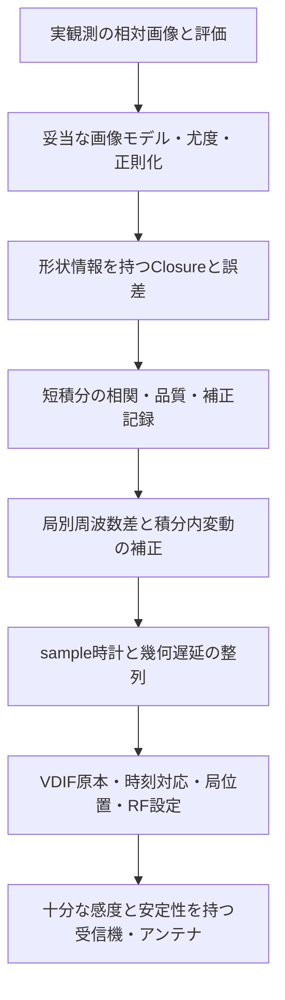

# 最終目標から逆算した必要要素と現在の進捗

- 初版整理：2026-10-06／更新：2026-10-26（130の定期整理、129までを反映）
- 対象：段階129（`483a0b9`）までの実装・検証。今回の文書整理は130
- 読者：電気・情報・機械等の工学系学部生
- この文書の役割：各要素が必要な理由、確認済みの範囲、実観測で残る完了条件を説明する

開発の実施順と判断の経緯は、別の[時系列レポート](development-history.md)にまとめた。この文書は、最終的に必要な成果から順に読み直す。

## 1. 何ができれば最終目標を達成したと言えるか

目標は、OCXOへ改造したRTL-SDRと自作アンテナで記録した実データから、Cas Aの形を説明できる画像を得て、その処理を観測者が再実行できるソフトを完成させることである。観測周波数は1.42GHz、最大基線は約600m。精密な局gain較正が困難なためClosure＋RMLを主経路とし、一積分は数百ms〜数秒、局ごとの中心周波数差を想定する。

「画像ファイルが出る」だけでは完了としない。実観測の受入条件として、少なくとも次を定義・確認する必要がある。以下は今後満たすべき条件であり、達成済みの一覧ではない。

1. 使用した原本、時刻対応、局位置、RF設定、欠損と品質が追える。
2. sample時計と幾何遅延が整い、周波数差を補正した後に短積分の信号が残る。
3. 感度と誤差を実測または検証したモデルで説明し、情報不足の区間を採用しない。
4. Cas Aを検出したことと、点源等から広がった形を区別したことを分けて評価する。
5. 事前条件・初期画像・解析設定を変えたときの結果、残差、不確かさ、失敗を記録する。
6. 観測全体を現実的な容量・時間で処理し、再実行と結果の保存を行える。

達成を判定する画質、観測時間、成功率の数値基準は、実装置の感度と評価対象を確定してから設定する。現在の反復上限や模擬NRMSEを、そのまま実観測の合格基準にしていない。

## 2. 画像から入力へ逆算する

画像を信頼するには、その画像を説明する相関データが必要である。相関データを信頼するには、同じ瞬間の電圧が必要である。同じ瞬間を選ぶには、電圧のsample番号と時刻、局の時計と位置が必要になる。



この図は依存関係である。すべてを下から一度だけ作ればよいという意味ではない。有限模擬データで上下を往復して、どの要素が失敗の原因になるかを調べる必要がある。

## 3. 進捗の読み方

実装の存在と、実装が現実の条件に通用することを別々に示す。以下の語を使う。

| 表記 | 意味 |
| --- | --- |
| 仕様・仮定を整理 | 入出力や計算条件を記載した段階。装置の測定やソフトの完成を含まない |
| 参照実装・有限模擬検証 | CPU実装を作り、指定した有限データで成功・失敗を確認した段階 |
| 既知モデルの検証 | 真値や共分散を与えて式・反復結果を確認した段階。未知観測への適用は別 |
| 操作・配布を検証 | CLI、GUI、導入環境、保存結果の整合を確認した段階 |
| 実機・実運用を検証 | 実受信機と観測全体で成立を確認した段階。本観測系のCas A画像化は未到達 |

これらは単純な完成率の段階ではない。例えば、誤差の理論APIが十分検証されていても、画像化へ未接続なら画像ソフト全体の完成度には直接換算できない。所要作業量や実装置の条件が未確定なため、根拠のない総合パーセントは付けない。

### 要素別の現在地

| 必要な要素 | 現在の進捗 | 残る主な完了条件 |
| --- | --- | --- |
| アンテナ・RTL-SDR・OCXOの特性 | 仕様前提と感度の仮定を整理 | 実SEFD、主ビーム、初期周波数差、位相安定性、欠損を測る |
| Windows収録フロントエンド | 今回の開発対象外。必要な保存情報を整理 | ハードウェアに合わせて収録と時刻対応を実装・測定する |
| IQ・VDIF・補足設定 | 限定profileの参照実装・有限模擬検証 | 実装置のI/Q、sample/UTC、設定変更と欠損の保存を確認する |
| sample時計・幾何遅延 | 与えた時計モデルによる整列を有限模擬検証 | 実時計モデルを測り、精度と適用時間を確定する |
| 局別周波数差と変動 | モデル不要pilot、一定/線形補正、111のgraph診断。112の固定長原本9条件中8件で取得し、1件は停止 | 弱い実信号での採用率・alias・残留位相変動を確認する |
| FX相関と保存 | 分割CPU処理、channel・重み・flag、FITS-IDI/CASA接続を検証 | 実入力、bandpass、偏波、全夜の容量と速度を確認する |
| RFI・品質診断 | 指定した模擬条件、保存値とGUIを検証 | 実電波環境で閾値・誤除外・見逃しを評価する |
| Closure | 一定局gainの不変性、独立集合、共有基線の共分散を検証 | 時間・周波数・主ビーム等の実際の適用範囲を確かめる |
| 雑音モデル | 標本推定と既知全共分散等の診断を追加 | 実FFT相関、自己雑音、推定誤差を画像尤度へ接続する |
| 三次統計U₃ | 理論・有限検証、共通電力v2保存、無次元比・条件付き区間検定とGUIを実装 | 弱い未知観測での分布・gain・LO・画像化を検証する |
| 固定二天空の識別 | 独立学習/test・反復、既知Gaussian比較、位相だけ未知の局所探索・対比較、独立した閾値学習を実装 | 未知振幅/SEFD/LO、学習の変動、任意画像と実観測への接続 |
| Closure＋RML画像化 | 高SNR参照実装・共分散・損失分解・時刻分割・格子/罰則の対照。129の通常8格子は形状差約.200〜.208、数値収束 | 独立な未知データでの予測、低SNR尤度、画像不確かさ、実Cas Aの形状確認 |
| 短露光合成・区間列 | 有限window列・露光保持・途中失敗保存を実装 | 全観測の自動再開、容量、速度、安定性を確認する |
| 局配置・観測条件の検討 | 最大基線入力、既知Cas Aの18配置・108条件比較 | 実感度・敷地・有限雑音の形状識別から配置を選ぶ |
| GUI・配布・再現性 | 日本語GUIと同梱参照6種類、121で画像の処理/収束/参照を分離・評価JSON保存を実ブラウザ検証 | 125〜129の比較はworkflow/CLI段階。必要な検証だけGUIへ接続し、Windows実ブラウザと実入力運用を確認 |
| GPU・長時間性能 | CPU参照実装の有限測定。GPU実装は未完成 | 全観測を測り、重い工程を選んで高速化を検証する |

## 4. 受信機とアンテナ：画像に使える電圧を得る

### なぜ必要か

Cas Aの総fluxが大きくても、広がった天体は基線によって相関fluxが小さくなる。アンテナ面積が小さい、受信機雑音が大きい、主ビームが対象を十分覆わない場合には、短積分で使える相関が得られない。Closureはgainを相殺するが、電波そのものを強くする処理ではない。

SEFDは「その受信機の雑音に相当する天体flux」をJyで表す量である。受信機雑音を中心とする単純な近似では、相関の実部・虚部それぞれの雑音尺度は次の形で小さくなる。

```text
sigma ≈ sqrt(SEFD_i × SEFD_j / (2 × channel帯域 × 積分時間))
```

これは仮定した単位・独立標本・効率等の条件の式であり、天体自己雑音や時間相関まで含む一般の誤差ではない。Jy較正のないADC²データに、仮定したJyのsigmaをそのまま付けることもしない。

### 現在の進捗と次の確認

[感度計画025](../025-sensitivity-planning.md)と[入門ガイド](../../guide/08-sensitivity.md)には、アンテナ面積・雑音温度・短積分の条件付き計算がある。実際の自作アンテナとRTL-SDRのSEFDは未測定である。OCXOの良好な仕様だけでは、sample開始時刻、局間初期差、温度変化、短時間位相安定性が確認されたことにはならない。

ハードウェアが用意できた段階で、共通の試験信号等によるI/Qと時計の確認、位相変動、感度、RFI、飽和・欠損の測定を行い、仮定値を実測へ置き換える。具体的な接続・測定手順は装置仕様を踏まえて確定する。

## 5. 収録形式と補足情報：同じ瞬間・同じ条件の電圧を選ぶ

### なぜVDIF以外も必要か

VDIFは電圧と局識別・時刻等を保存する形式だが、ヘッダーの時刻が実sampleに対応することの証拠までは作れない。USB到着時刻は、装置内部でsampleを取得した時刻と一致するとは限らない。GPSDOやPPSを使っても、sampleとの対応を測定・記録する仕組みが必要である。

| 保存する情報 | 必要になる理由 | 現在の受け渡し |
| --- | --- | --- |
| 原本ファイル、局ID、識別情報 | 別局や別収録の取り違えを防ぐ | session manifest、SHA、処理記録 |
| sample0のUTC、実sample rate、誤差と適用時間 | 局ごとに同じ時間のsampleを選ぶ | clock model。実測値の用意は別 |
| 局位置、座標系、位相中心、RF設定 | 幾何遅延・空間周波数・位相の向きを決める | 観測条件JSONとmanifest |
| I/Q順序、bit深度、scale、欠損・変更ログ | 電圧の向き、量子化、使えない区間を判断する | 限定VDIF profileと補足情報 |
| 相関、時刻、周波数、重み、flag | 画像化と外部ソフトへの交換 | 開発用spectral NPZ、限定FITS-IDI |
| 局power、共通FFT数、追加の和 | 雑音診断・三次統計を後から再計算する | 相関metadata、三次統計sidecar |

sidecarは主ファイルに付随する別ファイルである。平均visibilityだけでは、必要なすべての追加統計を復元できない。

### 現在の進捗と次の確認

8bit complex・4096sample/frame等の限定profileで、模擬IQ→VDIF→相関を検証した。対応していないbit配置、偏波、装置固有の符号を無条件に読めるものではない。Windows収録は未実装であり、ハードウェアに合わせた情報取得が必要になる。[session規約](../../../interfaces/session-manifest.md)、[時計規約](../../../interfaces/clock-model.md)、[実観測準備](../../guide/04-observation.md)を基準にする。

## 6. 時計・幾何・LO：積分する前に電圧を揃える

### 三つの補正を分ける

| 補正 | 対象 | 補正しない場合 |
| --- | --- | --- |
| sample時計 | sample番号と実時刻、sample間隔の差 | 同じ瞬間の電圧を掛けられない |
| 幾何遅延 | 天体から各局までの伝播時間の差 | 位相中心に対する相関がずれる |
| LO差・時間変動 | 受信機ごとに位相が回る速さ | 積分中に正負が打ち消され相関が減る |

例えば基線周波数差がΔfなら、積分中に `2π × Δf × 時間` だけ位相が変わる。変化した値を平均して失った相関は、積分後のClosureだけで取り戻せない。そのため、短pilotで差を測り、IQに補正を戻してから画像用の短相関を作る。

### 現在の進捗

[sample整列009](../009-adc-clock-alignment.md)・[VDIF幾何014](../014-stream-clock-geometry.md)では、与えた時計モデルを使う補間・符号を検証した。弱い未知天体から、sample開始差と実sample rateをすべて自動推定する完成品ではない。

[モデル不要rate022](../022-model-free-rate.md)で、sky振幅・位相やgainを与えずに時間方向の回転を推定する処理を追加した。[広い探索029](../029-wide-rate-pilot.md)では1185Hzの模擬基線差を扱い、[線形補正037](../037-measured-linear-rate-correction.md)では分割pilotから傾きを測って補正した。CLIとGUIの接続もある。

[111](../111-pilot-rate-graph.md)〜[113](../113-integration-and-image.md)では、pilotの接続graph、同じ長い原本のpilot長、取得後の最終積分を分けて確認した。長いpilotがLO取得を助けても、短い最終露光に画像用Closureが増えたとは限らない。これは有限の仮定条件の結果で、実OCXOの安定時間や実信号の採用率ではない。

### 残る完了条件

pilotを短くすると探索できる周波数範囲は広がるが、一測定のSNRは下がる。一定間隔の位相測定にはaliasがあり、全基線が整合しても正しい初期差とは限らない。弱いCas Aで使える基線網、推定の採用率、未採用例の原因、補正後の位相保持を同じ条件で評価する必要がある。

速い周期位相は平均rateの診断を通ることがある。[039の模擬VDIF](../039-periodic-phase-coherence.md)では線形モデルが採用されても約15%の減衰が残った。実OCXOの位相安定時間は、この模擬結果から決められない。

## 7. 相関と品質：弱い信号を誤ったデータと混ぜない

### なぜ必要か

FX相関器は周波数channelごとに二局のFFT係数を掛けて平均する。同時に、どのsampleを使ったか、欠損があったか、何個の共通FFTがあったかを記録する必要がある。長い積分で容量を減らしても、OCXOの変動を平均してしまえば信号が失われる。

RFIや飽和したデータは、天体信号より強い偽の相関を作り得る。flagと重みを出力・変換・画像化まで保つことが必要になる。弱い信号があることと、妨害がないことは別の確認である。

### 現在の進捗

[分割相関026](../026-bounded-fx.md)で有限入力の統計を保ってメモリを削減した。[周波数品質017](../017-spectral-quality-rfi.md)で模擬RFIを評価し、[CASAアダプター016](../016-casa-production-adapter.md)でFITS-IDIのchannel重みとflagをMSへ保持した。MSはCASAが使う観測データ形式である。

現在は主に単一のXX偏波を扱い、完全なStokes Iの観測を確認したものではない。実主ビーム、bandpass、局別応答、実RFIの閾値・誤除外・見逃しは残る。短いpilotでは、spectral kurtosis等の判定にFFT数が足りず「未判定」になる場合もある。

## 8. Closure：精密gain較正を省くための条件

一cellを一時刻・一channelの相関集合とする。理想相関をVij、局gainをgiとすると、一定gainモデルでは測定相関は `gi × conj(gj) × Vij` となる。三角形の積の位相では局位相、四角形の振幅比ではgain振幅を相殺できる。

ただし、三角形や四角形を多数作っても、独立な情報が同じ数だけ増えるわけではない。同じ基線を共有するClosureには誤差相関がある。4局完全網では独立Closure phaseが3、振幅が2、8局では21と20となる条件を[020](../020-closure-short-integration.md)で検証した。欠損やSNRによる不採用がある場合は、使える集合を改めて選ぶ。

Closureが相殺するのは、仮定した一cellに分離できる局応答である。積分内での変動、方向によって異なる主ビーム、基線固有の誤差まで一つの局係数で消せる保証はない。実観測では、それぞれの近似が使える範囲を確認する。

さらに、Closureから絶対fluxと位置原点は決められない。現在のRML出力は総相対fluxを1にした画像であり、既知のJyや位置を与える場合には外部制約として明記する。絶対flux・位置も最終成果に含めるなら、別の基準や測定が必要になる。

## 9. 雑音とU₃：画像を信頼するための誤差分布

### 現行RMLと診断APIの違い

現行RMLは高SNRのphase/log amplitude近似を使う。基線雑音を独立・円対称と仮定したうえで、同じ基線を共有するClosureの共分散を保持する。円対称とは、複素誤差の向きに特別な方向を仮定しないという意味である。

一方、天体電圧は局間で共有されるため、基線雑音にも共有成分がある。天体由来のばらつきを**自己雑音**と呼ぶ。フィルターや補間は時間相関を作り、観測powerから重みを推定する場合は、その推定自体にも誤差がある。

[全共分散診断044](../044-joint-closure-noise.md)、[標本推定046](../046-sample-noise-estimator.md)、[保存値診断047](../047-observation-noise-diagnostic.md)、[FFT相関049](../049-filtered-fft-noise.md)はこれらを調べる道具である。これらの全効果を、現行RMLへ自動的に反映した状態にはなっていない。[RMLガイド](../../guide/07-closure-rml.md)に現在の近似を示す。

### U₃が必要になった理由と進捗

同じ電圧標本から作った三つの標本平均相関を掛けると、平均に追加項が生じることがある。U₃は三つの異なる標本番号を使う三次統計で、独立性・一定gain等の条件下で特定の偏りを除く。相関器の保存経路では、ここでの標本は三局共通のFFT係数集合であり、原本ADCのsample数と同じ数ではない。

[053](../053-distinct-sample-bispectrum.md)以降で理論と反復実験、[061〜067の保存経路](../064-vdif-bispectrum-sidecar.md)で追加和の収集・原本照合・再計算を実装した。[068](../068-bispectrum-window-averaging.md)で平均後の分布、[070](../070-bispectrum-gain-constraints.md)で未知gainの母平均制約、[074](../074-bispectrum-independent-group-pooling.md)で周波数群のまとめ方、[076](../076-bispectrum-known-sky-scale.md)で既知Cas Aの天体雑音、[078](../078-bispectrum-joint-temporal.md)で局別時間変化を検証した。

### 観測powerで割る比：単位と一定gainが消えても、誤差は残る

[085](../085-observed-power-bispectrum.md)で、同じ有限電圧から測った各局の電力でU₃を割る比を実装した。同じwindowで一定の局gainは、分子と分母の同じ倍率として打ち消し合う。これは各データに対する代数的な性質であり、雑音が小さくなるという主張ではない。分母も同じ雑音から測った量なので、平均や分布にはその揺らぎが影響する。完全共有Gaussian電圧・M=3という特殊例の平均0.45を、一般の観測の補正値にしてはいけない。

[089](../089-common-bispectrum-power.md)〜[091](../091-vdif-common-power.md)では、三局共通の有効FFT集合から電力和も収集し、version2へ保存・再計算した。別の標本を含む局単独の電力で置き換えない。旧v1には必要量が無いため、正規化比は情報不足となる。[092のGUI](../092-bispectrum-power-gui.md)では、原本照合・全桁JSON・数値計算可否・既存品質を確認できる。

### 区間列の条件付き検定：何の前提で、何が言えるか

[086](../086-window-sign-symmetry.md)の検定は、区間ごとの虚部ベクトルを丸ごと反転する。複数三角形は局を共有するので、その列を独立な標本として数えない。妥当性には、上流選別を含む区間列の結合分布が各行の符号反転に対して不変であることが必要である。各区間だけの対称性や、SHA・時刻の違いだけでは十分でない。

検定量は区間ベクトル平均の長さの二乗で、符号反転の全組合せのうち観測値以上となる割合が条件付きp値である。これは天体の存在確率や画像の正解確率ではない。

[087](../087-casa-window-symmetry.md)は既知の有限電圧でこの条件と反例を調べ、[088](../088-casa-window-symmetry-gui.md)で日本語操作を整えた。等輝度二点源のような拡がった天空でも棄却されない場合がある。棄却率をCas Aの検出率や点源との識別率へ換算した結果ではない。

[093](../093-stored-window-symmetry.md)・[094](../094-stored-window-symmetry-gui.md)で保存version2へ接続した。一原本の全時刻1〜12・全三角形を使い、計算不能・品質除外は自動で間引かない。少数区間ではp値の最小分解能にも制約があり、同じ区間の複製では標本数を増やせない。別々のsequence原本の統合、物理的独立性や残留LOの自動認定、channel探索の多重比較には対応していない。

この結果は条件付き診断として保存する。画像へ妥当な重みや尤度を与える段階には進んでおらず、弱いデータでの形状識別と画像の不確かさは引き続き未完了である。

### 既知二候補の識別と、未知画像の復元は何が違うか

画像化の前に、点源とCas Aという二つの決まった形を見分ける参照評価を追加した。自由な画像には多数の画素がある一方、二候補なら比較の対象と誤りを明確に決められる。この単純化は、どの条件が難しいかを切り分けるために必要であり、その二形状以外も復元できた証拠ではない。

[096](../096-known-template-holdout.md)・[097](../097-known-template-gui.md)は独立した学習と評価、[098](../098-independent-training-repeats.md)・[099](../099-independent-training-gui.md)はその学習・評価を作り直す反復を実装した。学習に使ったデータで評価を兼ねないこと、学習一回の変動と反復平均の精度を区別することが、過大な性能評価を防ぐために必要である。誤り数や区間は固定した模擬条件のもので、実データや画像の信頼区間ではない。

続いて、電圧の既知Gaussian共分散を使う比較基準を[100](../100-known-covariance-gaussian.md)〜[102](../102-known-covariance-gui.md)で追加した。共分散Cは各局の電力を対角、局間の複素相関を非対角に並べた行列である。全局共通の独立標本から求めたSに対し、候補Cの `M[log det C + tr(C^-1 S)]` を比較する。この式は平均0・独立・proper Gaussian（全局共通の位相回転で分布が変わらない複素正規分布）と既知Cを仮定した参照であり、未知gainを解いたClosure画像尤度ではない。

| 参照経路 | 与える情報・調べるもの | まだ示していないこと |
|---|---|---|
| U₃・共通powerの比と条件付き検定 | 一定gainの代数的性質、有限標本、対称性の仮定、保存量 | 弱いデータの一般的な画像尤度・実機での形状識別 |
| 既知共分散Gaussian（100〜102） | 局位相・電力・SEFD・二天空を与えた電圧尤度 | 未知較正条件での同等性能、Closureとの公平な性能比較 |
| 局位相だけ未知（103〜105） | 既知振幅/SEFDのまま、各候補の一定局位相を局所探索 | 大域解、未知振幅/雑音/LO、自由な画像の復元 |

[103](../103-gaussian-phase-profile.md)では局位相だけを未知とした。候補に位相を合わせる操作が止まっても、真の局位相が分かったとは限らない。3局以上の大域最適性は保証せず、未収束を成功scoreへ置換しない。

[104](../104-paired-phase-template.md)・[105](../105-paired-phase-gui.md)は同じ電圧で既知位相と位相探索を対に比較した。低感度のp05はM19200・SEFD約585966 Jyを仮定し、固定閾値0での正答率が既知位相0.8046875、探索側0.5だった。探索側の全区間が点源へ偏ったことを詳細表示でも確認した。ただし、局所探索後の差へ閾値0が最適と示していない。別の固定閾値を同じ評価データで選び直して性能を報告することもしていない。原因や別手法の可否を一つの実験から断定せず、独立した評価を設計する必要がある。

両方法で振幅とSEFDを与え、M個の独立Gaussian標本・区間内一定位相を仮定している。これは実FFTの独立性、実OCXO、未知LOを検証したことにはならない。各label64標本では、誤り0/64でも個別95%区間の上端は約5.6%となり、将来のリスク0とは言えない。AUCの4096比較対を4096個の独立観測と数えたり、これらを実画像の正解確率と呼んだりしない。

全局共通Sを使うGaussian参照を実入力へ接続する場合には、全局で同じ有効FFT標本の集合を定義・保存または再計算するproducerが必要になる。現在のraw v2は三局ごとの共通集合なので、異なる標本集合をつなぎ合わせて全局Sにしてはいけない。これはGaussian参照を採用する場合の追加条件であり、今のClosure保存形式を全面的に変更すると決めたものではない。原本電圧と来歴を保持することが、後から別の統計を検証するためにも必要になる。

### 未完了の核心

U₃の平均が正しくても、ばらつきが大きければ形状は見分けられない。また、複素量が不偏でも、その角度・log・比が不偏とは限らない。有限標本がGaussianでない場合、平均と共分散だけから付けた「95%」に正しい包含率があるとは限らない。

U₃を含む弱いデータに妥当な画像尤度を定め、未知gain・LO・時間/周波数相関・正規化の誤差を含めて検証することが残る。現状のU₃は実験・保存・診断機能であり、低SNRの完成した画像化経路ではない。

## 10. RML画像化：データ不足を事前条件で隠さない

画像は多数の画素を持つが、測定した空間周波数は限られる。そのためRMLは、データへの適合に加えて非負・滑らかさ・一般的な事前画像等を使う。これらは不足した情報を補う仮定であり、強すぎると結果を事前画像へ寄せてしまう。

[021](../021-closure-rml-reference.md)以降で相対画像化、複数初期値、事前幅、探索上限、GUIを実装した。模擬の正解画像は復元の事前画像へそのまま入力せず、生成と最終比較に使う。

| 有限模擬検証 | 得られた結果 | 判断の限界 |
| --- | --- | --- |
| 024：SEFD1000Jy、1秒×8露光 | 旧比較で位置合わせ後の形状誤差約2.8% | 高感度の仮定、110秒角に平滑化、探索は反復上限 |
| 024：SEFD10000Jy、1秒 | 3時刻目でrate graphが途切れ、合成画像なし | 感度不足が画像化前の補正にも影響 |
| 028：SEFD10000Jy、3秒×8露光 | 工程完了、旧比較の形状誤差約34〜37% | 低い残差でも良好な形状を確認できず、探索は反復上限 |
| 030：同じ保存画像の比較方法を改定 | 高感度約2.36%、低感度約35〜39% | 全成分を保持した位置合わせ評価。画像自体の改善ではない |

条件は[024](../024-vdif-synthesis.md)・[028](../028-casa-three-second-sensitivity.md)・[030](../030-full-support-registration.md)に保存している。これらの誤差は統計的信頼区間ではない。

形状誤差NRMSEは、比較画像の画素差の二乗平均平方根を、正解画像の二乗平均平方根で割った指標である。比較では両画像を同じ幅に平滑化し、平行移動だけを合わせる。回転や拡大で正解へ寄せる操作は行わない。正解が分かる模擬試験の指標であり、実観測では直接同じ真値比較はできない。

次の完了条件は、弱い有限データで形状を識別する評価、妥当な尤度、事前条件と初期値への依存、残差と不確かさを一緒に説明できることである。実観測で正解画像は得られないため、模擬の真値比較に加え、独立なデータ分割等で結果を点検する方法も定義する必要がある。

### 109で見つけた上流の停止（当時の記録）

部品の実装状況に加え、同じ模擬原本で「どこまで進めるか」を見る必要がある。[109](../109-image-path-acceptance.md)では、1.42GHz・最大600m・8局・Cas A、未知の一定gain/LO、既知のsample clockと電圧scaleという条件で、SEFD1000/10000Jyの原本を処理した。同じ原本の最終積分を0.3秒と1秒に変えた。

| 仮定条件 | 到達点 | 次に解決すべきこと |
| --- | --- | --- |
| SEFD1000Jy、0.3/1秒 | LO最大誤差約0.00825Hz、画像を保存。ただし両方未収束、位置合わせ後NRMSE約0.355/0.311 | 単一時刻の情報不足、反復停止、複数初期値やuv合成の影響を分ける |
| SEFD10000Jy、0.3/1秒 | 1秒pilotから全局の周波数差を結べず、補正前に停止 | pilot長・検出条件・利用基線・探索の誤検出を調べる |

SEFDは受信機の雑音に相当するfluxで、小さい方が高感度である。ここではどちらも仮定値で、自作アンテナの実測ではない。また、低感度の二行は同じpilotによる同じ停止で、独立した二回の採用率試験とは数えない。

「処理完了」は計算工程が終わったという記録で、収束や正解の認証ではない。新しい評価APIはそれらを別々に保存する。真値のある模擬実験でだけ計算できる画像差を、実観測の未知画像へ直接付けることもしない。Closureがgainを消せても、LOを補正する前に積分で失った相関は自動的には戻らない。このため111以降で弱いpilotを先に切り分け、その後に画像側の対照へ進んだ。

109は一時刻の短区間で、過去の数時間のuv合成と同じ試験ではない。二つの失敗を、別の配置・帯域・pilot・複数時刻でも画像化できない証拠へ広げない。既存の高SNR尤度と低SNRで必要な誤差モデルの検証は、引き続き別の未完了課題として残る。

### 111〜119で調べた画像側の律速

画像は未知の画素を多数持つため、LOが取得できたことだけでは正しい形が決まらない。113では最終積分を変え、114では真値LOと理想モデルを与える対照を置いた。115は同じ画像のデータ損失と正則化を分け、116は別入力への適合と共通マスク、117は同じuvの独立原本併用を確認した。この順番は、似た見かけ・小さい損失・数値収束という別々の判断を切り分けるためである。

| 最近の固定比較 | 確認した範囲 | 最終目標に残ること |
| --- | --- | --- |
| 115：9入力×真値/prior/復元 | priorは形状NRMSEが小さくても観測適合が悪い。復元の小さいFは真値を認証しない | 誤差モデルと情報不足・正則化を別に評価する |
| 116〜117：別原本・同じuv | 未採用の基線が別入力で現れると不一致。同じuvの3原本併用は収束してもNRMSE .400 | 実際の多時刻と予測評価、適用する独立性を確認する |
| 118：現存8時刻VDIF | 三枝の32格子NRMSE .351/.387/.108、全3選択run未収束 | 真値LOや理想skyを使わない条件での画像評価 |
| 119：同じ視野・格子比較 | 新6 fit、8格子3収束。通常枝NRMSE .240、同格子prior .217。データ損失は復元.356に対しprior365.8 | 真値を使わない格子・正則化選択、独立評価、画像不確かさ |

表の三枝は通常LO推定、真値LO対照、理想モデル対照の順。真値LO・理想skyは実用入力ではない。118は各3秒×8露光＝24秒を4時間の枠に分散した試験で、4時間連続の受信ではない。現存152原本fileを今回SHA登録したが、028当時からbyte不変という証明はない。

119は画素数だけでなく中心位置のサンプリングと正則化の離散化も変える。格子間の総Fを直接比較せず、真値を見て最良格子を選んだ性能保証ともしない。現在の既定格子は変更していない。[115](../115-image-objective-evaluation.md)・[116](../116-image-transfer-and-masks.md)・[117](../117-independent-cell-image-fit.md)・[118](../118-multitime-vdif-controls.md)・[119](../119-fixed-field-image-grids.md)が根拠である。

### 121〜129で追加した確認と、現在の律速

121で、処理状態・選択runの収束・参照v2の形状差を日本語GUIへ接続した。参照なしの画像に正解の点数を作らず、評価JSONと原本SHAを対応させる。122〜124はEHTim1.3.2を別環境で確認したが、最初の画像比較はw=0・無雑音・人工weightの参照に限定した。外部の追加反復でも未収束だったため、主ソフトを置き換えず比較部品として保留した。

125のDは、誤差の相関を含めて規格化したClosure残差の二乗和を2Nで割る。正解画像のD約0.554より保存fitの約0.287が小さくても、正しい形の証明にはならない。126で片方の4時刻を使うと、推定/真値LOの学習D約0.215〜0.240に対し未使用D約5.88〜13.40だった。原本内の分割であり、上流LO/weight/maskを共有しうる条件付き評価である。

127/128では、生成天空を8格子へ変えてfitterと表現力を揃えた。罰則なし・全時刻ならNRMSE約0.000318に近づいたが、無雑音でも時刻分割の未使用差が残った。中心位置のgaugeや停止条件も含み、正則化の一項だけを原因にしない。元のfine32天空と別物なので、実Cas Aの改善率でもない。

129は固定した全3設定を主経路の保存相関へ移し、新9fit/27探索が収束した。通常LOのNRMSEは既定約0.208、画像罰則なし約0.200。真値LOでは約0.199〜0.206、理想モデル約0.0499〜0.0571だった。全8時刻を使ったため新しい未使用予測は測っていない。量子化した8格子参照を元の生成正解と呼ばず、fine32正解のデータ項と125が一致することを確認した。既定格子・係数は変更していない。

| 判定 | 129までの証拠 | 次に必要なこと |
| --- | --- | --- |
| 工程が終わる | 模擬電圧から画像、導入CLIで同じ値 | 実入力・全観測での再開と原本追跡 |
| 数値収束 | 129の9選択run/27探索は収束 | 大域解・正しい形や予測を別に評価 |
| データ適合 | 共有共分散のD、115公開APIと独立残差が一致 | 低SNR・自己雑音・推定weight・標本相関の妥当性 |
| 未使用予測 | 126/128は同じ原本内の条件付き時刻分割 | 独立生成や上流取得を含む情報共有の管理 |
| 形状差 | 真値がある有限試験で110秒角・全支持・平行移動NRMSE | 真値の無い実観測で残差・不確かさを説明 |

[121](../121-image-assessment-gui.md)・[125](../125-closure-residual-diagnostics.md)・[126](../126-temporal-image-validation.md)・[127](../127-matched-grid-image-control.md)・[128](../128-regularizer-image-controls.md)・[129](../129-main-path-regularizer-transfer.md)に全条件と失敗を残した。現行の高SNR画像経路での到達と、低SNR画像尤度・未知実信号の補正・実機未確認を分ける必要がある。

## 11. 局配置と観測時間：信号の強さと形状情報を両立する

基線とは二局を結ぶ距離と向きである。最大600mという条件は、すべての距離を600mに固定する指定ではない。短基線では広がったCas Aも点に近く見えるため強い相関が得やすいが、形状によるClosure差が小さくなる。長基線は細かい構造に対応するが相関が弱くなり得る。

1.42GHz・600mの `lambda / B` は約73秒角という計算上の目安である。これはfringe周期の尺度であり、実際に復元した画像のbeam幅や画質を測った結果ではない。基線の向きと投影、短基線の不足、雑音、観測時刻も効く。

[080](../080-maximum-baseline-gui.md)で最大基線をGUI入力できるようにし、[081](../081-array-scale-known-sky.md)・[082](../082-array-scale-gui.md)で既知Cas Aの18配置・108条件を比較した。U₃尺度は既知母平均の絶対値を複素rms誤差で割ったもので、検出確率や形状識別率ではない。総flux1000Jy、SEFD、独立標本数、補正済みLO等は仮定である。

次は実感度・主ビーム・敷地条件を使い、有限電圧と未知LOで形状を見分けられるかを評価して配置を選ぶ。母集団Closureの全行RMSや三角形数だけで独立画像情報量を数えない。

## 12. 長時間運用、GUI、配布：同じ処理を観測者が繰り返せる

数百ms〜数秒の積分制約があっても、短露光を別時刻の幾何とともに集めれば、地球自転によって違う空間周波数を測れる。長い観測時間と一回のコヒーレント積分時間は別である。各区間を先に不適切に複素平均しないことが必要になる。

[032〜034](../032-short-window-sequence.md)では有限window列・途中失敗保存・原本識別共有を実装した。[038](../038-linear-rate-gui-sequence.md)では線形rateと区間列、[065](../065-bispectrum-storage-gui.md)では追加統計保存をGUIへ接続した。完了・途中失敗・中止を保存できても、実観測一晩の自動resumeや安定性を確認した状態には達していない。

2.048MS/s、8bit I＋8bit Qなら、一局4時間の電圧payloadは約59GB、8局で約472GBになる計算である。ヘッダー、コピー、バックアップ、作業データは別に必要になる。相関出力も時間間隔とchannel数で増える。全夜のCPU/GPU速度と必要PCの最低仕様は、有限試験から断定しない。[容量の初期設計](../../design/2026-10-02-operational-architecture.md)には計算条件を残す。

日本語GUI・CLI・wheelの検証は進めた。[083](../083-native-array-scale.md)の配置比較以降、[105](../105-paired-phase-gui.md)までで6種類の参照比較を同梱データだけで実行できるようにした。121では主画像評価も日本語GUIへ接続した。125〜129の新比較はworkflow/CLIで行い、全てを新GUIへ接続したわけではない。一部の検証には引き続きcheckoutが必要である。WSLの実Chromiumで操作を確認した範囲と、Windows実ブラウザ・WSLgの直接確認は区別する。GPU搭載PCでも現状のCPU参照実装が自動的にGPU化するわけではない。

## 13. 今後の優先順位と完了条件

| 順番 | 次に確かめること | なぜ必要か | 完了を判断する記録 |
| --- | --- | --- | --- |
| 1 | 独立な模擬原本で短積分・未知LOの主経路を評価 | 同じ一原本・無雑音対照だけでは利用可能条件が分からない | 事前固定の原本/seed/感度/分割、.3/1/3秒、補正前停止・不足・未収束・画像を全件保存。truthを入力や選択へ渡さない |
| 2 | 弱い画像データの誤差と必要な保存量を定義 | SNR10のClosure不足を画像やp値で隠せない | 共通標本・gain/SEFD/LOの既知未知・選択weightを明示し、小画像のforward/平均/誤差を独立計算へ照合 |
| 3 | 観測者が必要な評価をGUIへ接続 | 121の三判定を保ちつつ検証の条件も見える必要がある | 受け入れた科学経路だけを日本語表示し、原本SHA・不足/null・収束・参照有無・全JSONを両実ブラウザで確認 |
| 4 | 実機測定で入力規約・感度・安定性を置き換える | 仮定SEFDや時計は実装置の測定の代わりにならない | I/Q、sample/UTC、sample rate、位相、RFI、欠損の原本と測定法。ハードウェアが用意できれば前倒し |
| 5 | 観測全体の再開とCPU/GPU速度を測る | 疎な24秒露光から一晩の速度や最低PCを保証できない | 容量・実行時間・メモリ・途中失敗、GPUなら転送も含む同一結果の測定 |

次の5〜10段階の候補と受入条件は[開発計画](../../design/development-roadmap.md)に示す。外部RMLの追加反復、truthを見た係数調整、旧仮説分類GUIの自動適用は保留する。Windows収録は装置に合わせて後で開発する。

## 14. 現在の結論と証拠の入口

限定した入力から短相関・相対画像まで進む参照経路、有限区間列、日本語GUI、統計を点検する道具と再解析用の保存情報はある。最終目標に向けた主要な未完了部分は、弱い実信号の補正・形状識別・妥当な画像誤差と、実装置および全観測での確認である。

最新の全回帰は[121の正式記録](../../../validation/runs/stage121/verification.json)のsource/導入済み各2116成功、609.28/607.50秒、各27396既存警告、除外0を引用する。[129](../../../validation/runs/stage129/verification.json)は両93対象成功（2.50/1.66秒）、新9fit/27探索と導入実CLI9の全JSON/画像/FITS一致を確認した。現在の両収集数2243は、全2243を実行した結果ではない。

122〜129でproduction/packageは不変で、121 wheel103 fileと4 assetのbyteをソース/導入先へ照合し全回帰を再実行していない。GUIの最新の両実ブラウザは121の6保存記録と実RML/CLEANで、125〜129の比較まで新GUIへ接続したわけではない。この130文書整理も数値・collect・wheel・ブラウザを再実行せず、過去の成功を新しい件数へ加算しない。

- 実施順と判断：[開発の時系列](development-history.md)
- 現状を短く読む：[実観測に向けた到達点](../../guide/09-observation-readiness.md)
- 操作：[日本語GUI](../../guide/06-gui.md)
- 根拠と失敗の詳細：[段階レポート索引](../README.md)
- 保存条件：[ソフト間の規約](../../../interfaces/README.md)

この文書を更新するときは、実装、既知モデルの計算、有限模擬試験、実機測定を引き続き分けて記載する。

文書整理は10段階ごと（次140）、根本見直しは50段階ごと（次150）。[108の基準見直し](../108-goal-review-and-cadence.md)に従い、主要前提が崩れれば節目を待たず軌道修正する。
