# 画像主経路のモデル・誤差・保存量の契約

段階134のコード監査による契約。基準は133（`cb5c3c6`）。新しい尤度・相関器・画像化器を実装した文書ではない。現行の[Closure経路](closure-pipeline.md)、[標本雑音推定](sample-visibility-noise.md)、[全共分散のClosure伝播](joint-closure-noise.md)を、現在の原本に接続するために読む。

## 1. 何を揃える必要があるか

**前方モデル**は「ある天空と受信機を仮定すると、どんな電圧や相関が得られるか」の計算である。**誤差モデル**は「同じ条件で観測を繰り返すと、その相関がどれくらい、どの方向へ揺らぐか」の計算である。平均値が合うことと、誤差の大きさ・相関が合うことは別である。

```mermaid
flowchart TD
  A[仮定天空・感度・一定gain/LO] --> B[131の帯域制限Gaussian電圧]
  B --> C[量子化VDIF・manifest・供給clock/scale]
  C --> D[幾何整列・FIR/補間・推定rate補正]
  D --> E[132の相関・局power・局/基線FFT数]
  E --> F[SNR選別・同種Closure共分散]
  F --> G[133の相対RML画像]
  E --> H[047の条件付き全雑音診断]
  H -. production未接続 .-> G
  D -. opt-in・今回は無効 .-> I[三角形共通raw-v2統計]
```



今回の課題は、各箱にソフトがあるかだけでなく、箱の間で同じ標本・単位・幾何・仮定を渡しているかを確かめることである。

## 2. 主経路の対応表

| 区間 | 現在保持・使用するもの | 条件・残る差 |
| --- | --- | --- |
| 131生成 | 中心RF・区間中央の天空visibility、仮定flux/SEFD、帯域制限Gaussian、一定局gain/LO | 実アンテナ、RFI、変動gain、未知sample clockを測ったものではない |
| VDIF→整列 | 8bit complex ADC、decoder scale、UTC origin、供給線形clock、65tap FIR/補間、幾何/RF/rate補正 | scaleがあっても物理Jy較正とは別。FIR/補間後のFFT独立性は未検証 |
| FX→spectral | 複素相関、weight、uvw、時間/周波数、局power・flag・局/基線FFT数 | weightは局power積と名目件数による弱信号近似。全基線Re/Im共分散ではない |
| spectral→Closure | 観測SNRで有効基線を選び、位相/振幅Closureを作る | 同じデータによる選別は誤差モデルの一部。低SNR非Gaussian性は未解決 |
| Closure→RML | 各セル・各種類の独立行と共有基線によるfull covariance | phase/logamp間、別セル、一般の共有源雑音まで全部を含むわけではない |
| RML出力 | 非負・unit fluxの点画素画像、prior/TSV/centroid、局所最適化 | 処理完了、数値収束、参照形状差は別。絶対flux/位置は測っていない |

元のコード位置とファイルSHAは[監査記録](../validation/runs/stage134/source-audit.json)に保存した。134では新しい平均・分散の数値実験を実行していない。

## 3. w項と、実際に残っている前方モデルの差

現在の`direct_visibility`と`ClosureObjective`は、どちらも点画素に対して

```text
V(u,v,w) = Σ_p I_p exp[-2πi {u l_p + v m_p + w(sqrt(1-l_p²-m_p²)-1)}]
```

を使う。**現行native RMLにはw項がある**。同じ格子・同じuvwなら、この式の構造は一致する。122の外部EHTim用2D adapterがuvだけを渡す話を、nativeへ移して説明してはいけない。

一方、131の電圧生成は中心周波数・区間中央の天空共分散、固定した広帯域delay、区分線形のRF delayを使う。相関は各sampleを整列して有限時間を平均し、代表時刻のuvwを保存する。filter・補間・量子化も挟む。「Fourier式が同じ」だけで、電圧生成から有限相関まで厳密に同じ前方モデルだと証明したことにはならない。133の誤差をw省略や他の一因に断定せず、この区別を残す。

## 4. 共分散という言葉の三つの意味

1. **局電圧の共分散C**：対角は各局power、非対角は平均visibility。天空と受信機を含む予測モデル。
2. **測定visibilityの誤差共分散**：有限標本の相関値がどう揺れるか。全基線の実部・虚部を並べた行列なら、基線間と実部/虚部間の関係を表せる。
3. **Closureの誤差共分散**：visibilityの誤差が位相和・振幅比へ伝わったもの。共有基線による非対角項を持つ。

現行productionは3の同じ種類・同じセル内の共分散を扱うが、その入力となる2は独立円対称基線の近似である。1や2の一般形を使ったわけではない。

[Blackburn et al. (2020), §2.4・§3.1](https://arxiv.org/pdf/1910.02062)は、低SNRでの非Gaussian性、SNR推定/選別とClosureの共分散を扱う。線形独立なClosureでも統計的に独立とは限らない。[Gwinn et al. (2012), §2.2](https://arxiv.org/pdf/1208.0039)は、共有源のself-noiseと複素平面での楕円状雑音を示す。Velaの実測結果を、このプロジェクトのCas AやOCXOの実測へ転用しない。

## 5. 既にある部品と、その接続状態

| 既存段階・部品 | 役割 | productionとの関係 |
| --- | --- | --- |
| 042 `visibility_noise_moments` | 既知局Cと共通IID標本数から、visibilityの複素/擬/全実共分散 | 模擬参照。未知受信機を推定しない |
| 044 `joint_closure_noise` | 全Re/Im共分散からphase/logampを同時に一次伝播 | 交差項を保持するが、現RMLはこのjoint行列を使わない |
| 046 `estimate_visibility_noise` | 共通の標本Sから有限標本補正したvisibility誤差を推定 | IID等の仮定下のensemble不偏性。1観測の真の誤差やcoverageの保証ではない |
| 047 `diagnose_noise_cell` | 保存power/count/flag等のゲートを通した条件付き診断 | 現RMLのweight・採否を変えない。既定min_snr=5の伝播を含む |
| 049 `filtered_visibility_moments` | 既知白色Gaussian入力・固定局kernelの時刻差を含む誤差 | 色付き入力、時変補間、実効独立数の実測まで扱ったものではない |
| 100 `gaussian_nll` | 共通S、既知C、IID proper Gaussianの電圧尤度基準 | 未知gain/SEFD/LOのClosure画像尤度へ未接続 |

新しい同等APIを作る前に、これらを現在の保存原本と接続する。詳しい条件は[局標本推定](sample-visibility-noise.md)、[一cell診断](observation-noise-diagnostic.md)、[filter参照](filtered-visibility-noise.md)、[既知Cの尤度](known-covariance-gaussian.md)を参照する。

## 6. 全局共通の標本をどう確かめるか

局iが有効だったFFT番号の集合をA_iとする。`FXAccumulator`は局powerにA_i、基線ijに共通部分A_i∩A_jを使う。

局ごとのcountが同じMというだけでは、標本番号が同じとは言えない。しかし、**全局のcountがMで、完全な全基線について共通部分のcountもM**なら、

```text
|A_i| = |A_j| = |A_i∩A_j| = M  ⇒  A_i = A_j
```

である。このproducerの定義と全基線の条件の下で、全局共通集合を確認できる。047はこの強いゲートに、単位・flag・局ID・完全基線などの検査を組み合わせる。単なる「同じcountは常に不十分」という説明でも、逆に「局countが同じなら十分」という説明でも正確でない。

### 説明用の代数的反例

異なる標本で2局ずつ測り、各powerを1、基線12と13を+1、基線23を−1とした値を一枚の行列へつなぐと、

```text
S = [[1, 1, 1], [1, 1,-1], [1,-1, 1]]
z = [-1, 1, 1]ᵀ
zᵀ S z = -3
```

になる。一方、同じ全局ベクトルから作ったSなら`zᴴ S z = mean |xᴴ z|² >= 0`であり、負にはならない。これは手計算の説明例で、新しい模擬観測やソフト試験の結果ではない。全pair共通部分まで要求する047の条件を満たした反例でもない。

半正定値性の検査だけで来歴を証明することもできない。元の標本集合・単位・正規化を揃える必要がある。

## 7. 現在のファイルでどこまで確認できるか

134では保存済み配列の目録とcount/flagを読み、元のSHAを照合した。新しい共分散計算や画像化は行っていない。

| データ | 今回確認した情報 | 扱い |
| --- | --- | --- |
| 132の12相関 | 完全28基線。全局と全pairのcountが一致。0.3/1/3秒で76800/256000/768000 FFT | 元producerの意味の下で共通集合を確認できる |
| 各相関のchannel 3,4,5 | 全局flag0、全基線weight>0、単位と局識別情報を保持 | 12×3=36セルが診断前の保存情報ゲートを満たす。API実行・PSD/数値範囲判定は次段階 |
| 他の5channel | RF/SK等を含む品質情報・0重みを保持 | 無効・未評価を0誤差の測定にしない |
| 133のfitter | 元相関の7科学配列と最小WCS設定 | 局power/count/flagは省略。診断は132の完全な相関へ戻る |
| raw-v2の能力 | 三角形共通のpower・積和を保存できる | 132ではopt-inしておらず12相関ともraw-bispectrumなし。三角形統計だけから全8局Sを組まない |

元配列とproducerの定義が揃ったことと、FFTが実際に独立であることは別である。ここでのMは名目件数。FIR、補間、131の色付き入力、量子化、時変係数の影響を自動補正していない。

## 8. 既知Gaussian尤度へ直結しない理由

全局共通のSを作れれば、既知モデルCに対する`q=M[logdet C+tr(C⁻¹S)]`という基準は100にある。基礎密度は[Hankin (2015), 式(2)](https://journal.r-project.org/articles/RJ-2015-006/)、干渉計の尤度の形は[Leshem and van der Veen (2000), 式(34)](https://arxiv.org/pdf/astro-ph/0008239)を確認した。

それでも、実際のMの独立性、一定C、平均0/proper Gaussian、未知gain/SEFD/LOをどう扱うかが残る。Cを予測する受信機モデルや未知量の推定・消去・周辺化を決めずに、qを現在の画像objectiveへ追加して低SNR尤度の完成とはしない。Sが共通標本で作れたことは、これらの仮定の検証を代行しない。

## 9. 次の受入条件

**135候補：既存APIを保存132へ接続する有限診断。** 全12×8=96セルの状態を残す。047の適用可否を確認し、使えるセルでは046→044を使う。productionと比べるときはSNR10を明示し、047既定5との違いを混同しない。同じ有効行・基底で対角近似とjoint共分散を比較し、phase/logamp交差を記録する。PSD・数値範囲で拒否されたセルも残す。RMLのweight/画像は変更せず、独立性・coverageを未検証と明示する。

**136候補：135の差に応じたfilter/標本数モデルの接続条件。** 049の白色・固定kernel参照をそのまま131の色付き・時変係数へ適用しない。既存コードと不足範囲を確認し、必要な最小拡張・独立対照を先に固定する。実効Mを真値画像に合うように調整しない。条件が揃わなければ不足を記録し、productionへの自動適用や新しい画像尤度を保留する。

実RTL-SDR/OCXOのCas A、実SEFD/beam、弱実信号の未知LO、実FFT独立性、全夜/GPU性能は未検証。Windows収録は後工程とする。[134レポート](../docs/reports/134-image-statistics-contract.md)・[開発計画](../docs/design/development-roadmap.md)へ判断をつなぐ。
